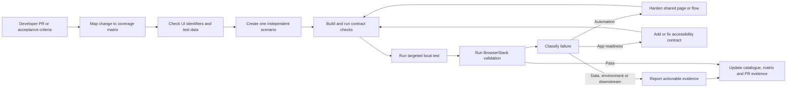

# Mobile Automation Harness and Agent Delivery

## Purpose

This document explains why native Search and Book automation is being developed in
`VAA.EAPI.Automation`, what the existing .NET mobile harness provides, and how it supports a
future agent-assisted delivery loop.

The decision is not based on C# being inherently better than TypeScript. Both Appium-based
frameworks can automate the same application. The important distinction is where the mobile
tests can reuse capabilities that the organisation already owns, and how much duplicated
infrastructure must be maintained around each test.

The recommended direction is:

> Use the EAPI harness as the primary home for new native Search and Book automation, retain
> useful WDIO coverage while it remains valuable, and migrate incrementally rather than
> rewriting working tests without a reason.

## The case in brief

The existing WDIO framework proves that the app can be automated and includes useful Azure
Storage and backend integrations. Those capabilities are strengths of that framework. They
also duplicate responsibilities already owned by EAPI Automation: authentication, storage
access, account selection, API models, environment configuration, retry behaviour, secret
handling and diagnostics.

The question is therefore not whether WDIO *can* provide those integrations. It can. The
question is whether the team should continue to maintain two implementations of the same
domain and infrastructure behaviour.

Building the native UI layer in EAPI Automation provides:

- Direct reuse of established Core and backend automation capabilities.
- One place to update Azure Storage, authentication and domain-contract behaviour.
- Typed account and journey selection rather than test-owned table queries.
- A common configuration, reporting and diagnostic model.
- Earlier automation-readiness feedback to the native application team.
- A smaller authoring path from acceptance criterion to executable test.
- A stronger foundation for an agent to create, run, diagnose and refine tests safely.

It does **not** make Appium commands, BrowserStack device allocation or backend responses
inherently faster. The speed improvement comes from reducing test construction, duplicated
setup, fallback selectors, investigation time and speculative reruns.

## Harness capabilities in place

### Execution and configuration

- xUnit is the test runner and Appium drives the native application.
- The same project supports a local macOS iOS simulator and remote BrowserStack execution.
- A single gitignored `local.settings.local.json` contains workstation or BrowserStack
  configuration; a safe committed example explains every required value.
- The setup workflow checks prerequisites, creates local configuration, restores and builds
  the project, runs offline harness checks and can run a connectivity-only session.
- BrowserStack tests are split into independently runnable classes so remote sessions can run
  in parallel. Local iOS execution is serialised where sharing the installed app would make
  concurrent sessions unsafe.

### Test structure

- Each concrete test class owns one independently runnable customer scenario.
- Tests use descriptive harness naming and traits such as `Suite` and `RegressionArea`.
- Page objects own selectors and native interaction; tests do not reach directly into the
  driver or locator implementation.
- Reusable flows own journey orchestration, while test classes retain the scenario intent and
  assertions.
- The test catalogue and E2E coverage matrix provide a living inventory of implemented,
  deferred and blocked scenarios.

### Automation readiness

- Stable accessibility identifiers are the primary application-to-automation contract.
- The harness contract tests detect missing or inconsistent identifier mappings before a
  device journey is started.
- Missing identifiers are treated as an app-readiness gap to resolve with the native team,
  not a reason to silently add fragile hierarchy, coordinate or translated-label selectors.
- Explicit Appium waits respond to application state; fixed sleeps are not the normal
  synchronisation strategy.
- Shared controls are hardened once in the page or flow layer instead of adding different
  retries to individual tests.

The recent regression work illustrates the value of this structure. Stale result-card reads,
cascading filter rerenders and flexible route-name matching were identified as shared
automation behaviours and corrected centrally. Separate failures caused by unavailable app
identifiers, invalid promo data or downstream behaviour remained visible as distinct issues
rather than being hidden by broad retries.

### Data and backend reuse

The mobile project can use the existing EAPI Core capabilities rather than implement new
storage clients inside individual UI tests. Current examples include selecting loyalty
accounts by environment, tier and points balance, then using those accounts in native login
and booking journeys.

This supports test requests expressed in domain terms, for example:

- Find an eligible Gold account with at least a specified points balance.
- Find an account whose available points are below the expected redemption cost.
- Obtain a suitable trip or booking record for a customer journey.

The storage implementation, filtering, configuration and secret handling remain below that
test-facing API. When a table schema or authentication method changes, it should be corrected
once in the shared capability.

The longer-term target is:

> API/data arrangement -> native UI execution -> API verification -> customer-visible UI
> verification

Storage-backed account selection is already in use. Full API arrangement and post-journey API
verification are an incremental next stage and should not be described as complete for every
mobile flow today.

### Diagnostics and engineering gates

- Failed sessions can capture screenshots, page source and session information.
- BrowserStack session status and failure evidence are updated so a stopped client is not the
  only diagnostic available to a QA.
- Network evidence is collected on failure where the platform exposes it, helping distinguish
  an app interaction failure from a backend or downstream response.
- Repository verification includes build, formatting, architecture and behaviour checks.
- Architecture rules protect the page-object boundary and prevent tests from accumulating
  direct driver interaction.
- Secrets remain outside source control and diagnostic output must not disclose them.

## Bounded self-healing

Self-healing is useful only when it preserves the meaning of the test. A test that guesses a
different control and passes is more dangerous than a test that fails clearly. The EAPI mobile
harness should therefore use **bounded, observable and reviewable self-healing**, not unrestricted
runtime locator replacement.

### What may heal during execution

The framework may recover automatically when the expected customer action and app contract have
not changed:

- Re-query an element after a stale reference caused by a SwiftUI rerender.
- Wait for a documented screen state, enabled action or modal dismissal.
- Scroll a known container to an app-owned accessibility identifier.
- Retry once when the application exposes a recognised transient outcome.
- Recreate a session when evidence identifies a device or Appium infrastructure failure before
  the business action has started.
- Select replacement test data before the journey starts when the original account is leased,
  expired or no longer meets an explicitly declared eligibility rule.

Every recovery must be bounded by an attempt count or timeout, emit diagnostic context, and leave
the final business assertion unchanged. A recovered execution should record that healing occurred
so recurring instability remains measurable rather than invisible.

Several of these behaviours already exist in the harness: explicit state waits, stale-element
re-resolution, dynamic loyalty account selection, known transient login handling and centralised
filter rerender handling. The filter rerender and transient login recoveries now run through the
shared `MobileHealingPolicy` and emit driver-scoped `MobileHealingEvent` telemetry to xUnit and
BrowserStack. Other existing recoveries should be migrated only after their safe retry boundary and
unchanged business assertion have been verified.

### What must not heal during execution

The framework must fail when confidence in the application contract has been lost. It must not:

- Search for a visually similar control after an accessibility identifier disappears.
- Use AI, XPath or coordinates to choose an unverified replacement and report the test as passed.
- change the expected result to match what the application returned.
- Switch accounts or journey data after the behaviour under test has begun.
- Retry permanent credential, validation, payment or business-rule failures.
- Restart a failed journey without retaining the original failure and network evidence.
- Mask a repeatable native-app defect as an automation recovery.

Temporary semantic or structural fallbacks remain possible only where the application contract
explicitly documents them. They belong in the owning page object, require a removal condition and
are not considered autonomous self-healing.

### Agent-assisted repair after failure

An agent can provide a stronger form of self-healing after the run, but the result should be a
normal reviewed code change rather than an invisible mutation of the executing test:

1. Preserve the original screenshot, page source, Appium log, network summary and session URL.
2. Reproduce the smallest affected scenario once when the failure classification permits it.
3. Compare the captured UI tree with the app-owned accessibility contract and relevant native
   source change.
4. Classify the cause as timing/state, selector contract, shared flow, data, environment,
   downstream service or product defect.
5. Propose the smallest repair in the shared page, flow, data capability or native accessibility
   contract.
6. Add or update an offline contract test that would detect the same break before another device
   session.
7. Run the contract suite and targeted scenario, followed by the relevant BrowserStack pack.
8. Raise a PR containing the original evidence, repair rationale and before/after result for human
   review.

This is self-healing at the delivery-loop level: the agent diagnoses and proposes a durable fix,
while source control, tests and review prevent an incorrect repair from silently entering the
framework.

### Confidence gates for an agent repair

An agent may automatically prepare a patch only when all applicable gates pass:

- The intended element is confirmed by an app-owned identifier or native source contract.
- The repaired interaction remains inside the owning page object or flow.
- No assertion or customer outcome is weakened.
- Offline architecture and contract tests pass.
- The targeted test reproduces the original failure before the change and passes after it, unless
  reproduction is prevented by a separately evidenced environment outage.
- The change is submitted for review and is never pushed directly into the protected branch.

If those gates cannot be satisfied, the correct outcome is an actionable failure report or an app
readiness issue, not a speculative patch.

### Suggested implementation increments

1. **Implemented:** structured `MobileHealingEvent` telemetry containing recovery type, operation,
   attempt, duration and outcome, with safe non-customer detail.
2. **In progress:** route only proven stale-element, transient-state and session recoveries through
   the shared bounded policy. Filter rerender and transient login are the initial integrations.
3. **Implemented:** attach healing events to local output and BrowserStack session diagnostics.
4. **Implemented for warnings:** report when a configurable threshold is reached. A successful
   recovery does not currently fail an otherwise valid business assertion.
5. **Next:** emit a machine-readable failure bundle for the agent loop containing classification
   inputs and artifact locations.
6. **Next:** allow an agent to prepare a repair branch and PR, retaining human approval for
   selector-contract or native-app changes.

This approach improves resilience without trading away trust in the regression result.

## Proposed agent delivery loop

The harness makes an agent useful because it gives the agent constrained, testable building
blocks. The aim is not to ask an agent to invent arbitrary Appium code; it is to let it operate
inside an explicit engineering loop.

### Loop inputs

An agent should start with:

- The developer PR or issue and its acceptance criteria.
- The relevant native source change and accessibility contract.
- Existing page objects, flows and shared data capabilities.
- The test catalogue and coverage matrix.
- Backend contracts where they determine the expected customer outcome.

### Loop behaviour

1. Identify the changed customer behaviour and the risk it introduces.
2. Check existing UI and backend coverage before proposing another E2E test.
3. Decide whether the behaviour needs a native UI scenario, a backend test, or both.
4. Confirm that required controls have stable accessibility identifiers.
5. Select or arrange data through shared Core capabilities, not test-local connectors.
6. Add one independent xUnit class using the established page and flow layers.
7. Run build, architecture and automation-contract checks before consuming a device session.
8. Run the smallest relevant local scenario, then the appropriate BrowserStack pack.
9. Apply only permitted in-run recovery and record every healing event.
10. Classify a failure as app, automation, test data, environment or downstream.
11. Prepare a reviewable shared repair rather than add scenario-specific sleeps or fallbacks.
12. Re-run the contract, targeted and relevant regression checks.
13. Update the living test catalogue and coverage matrix.
14. Produce a PR with the scenario, original evidence, healing rationale, known limitations and
    any app-readiness change.

### Guardrails

The agent loop should fail closed when a reliable test cannot be produced. In particular, it
must not:

- Invent credentials, accounts or environment data.
- Replace a missing accessibility identifier with an unreviewed fragile selector.
- Add fixed sleeps to conceal synchronisation problems.
- duplicate an E2E scenario when a lower-level test already covers the same risk adequately.
- Treat a downstream or test-data problem as an automation success.
- Modify native application behaviour merely to make an assertion pass.
- Create ordered tests that depend on state left by another test class.

## Balanced comparison with WDIO

| Consideration | Existing WDIO framework | EAPI mobile harness |
| --- | --- | --- |
| Existing functional coverage | Broader in mature app areas | Growing, strongest in native Search and Book |
| Appium capability | Proven | Proven |
| Azure/backend integration | Available through framework-owned connectors | Reuses capabilities already maintained in EAPI Core |
| Selector compatibility | Fallbacks help automate legacy screens | Accessibility-ID-first contract gives clearer failures |
| Immediate legacy coverage | Stronger | Incremental migration required |
| Duplicate infrastructure cost | Retains a second implementation beside EAPI | Consolidates mobile and backend support in one solution |
| Test construction | Existing patterns and Cucumber coverage | Direct xUnit -> flow/page -> Appium path |
| Failure isolation | Depends on scenario and fallback behaviour | Structured diagnostics plus app/automation/data/downstream classification |
| Agent suitability | Possible, but broad fallbacks increase ambiguity | Constrained contracts and shared typed capabilities reduce agent choices |

This comparison does not justify deleting working WDIO tests. It supports an incremental
policy:

- Keep stable WDIO scenarios while they provide value.
- Put new native Search and Book scenarios in the EAPI harness.
- Migrate a legacy test when it is being materially changed, is persistently flaky, or depends
  on duplicated capability that is cheaper to reuse from EAPI.
- Compare both approaches using evidence rather than language preference.

## Measures that should decide the approach

The team should track:

- Time from acceptance criteria to a reviewed executable scenario.
- Device execution duration and useful parallel throughput.
- First-run pass rate and rerun rate.
- False-failure and flaky-test rate.
- Healing events by type, scenario and release, including repeated recoveries that later succeeded.
- Mean time to identify app, automation, data or downstream ownership.
- Number of framework locations changed for an API, storage or authentication update.
- Frequency of selector fallbacks and missing accessibility identifiers.
- Maintenance effort per release, not only the cost of the first implementation.

These measures make the discussion objective. A framework with an existing connector may be
quick for the next test but still expensive if the same connector and domain rules must be
maintained independently for years.

## Recommended team agreements

1. Treat stable accessibility identifiers as part of the native feature definition of done.
2. Use EAPI Core for shared backend, storage and account-selection behaviour.
3. Keep UI E2E coverage lean and risk based; use backend tests for combinations that do not
   require customer-visible validation.
4. Keep one scenario per concrete class to preserve BrowserStack parallel execution.
5. Require actionable failure evidence and explicit ownership classification.
6. Update the catalogue and coverage matrix in the same PR as a scenario change.
7. Migrate WDIO coverage incrementally and retain it until replacement coverage is proven.
8. Review the decision using measured delivery and maintenance outcomes.

## Related documentation

- [Mobile Automation Framework Decision](MOBILE_AUTOMATION_FRAMEWORK_DECISION.md)
- [Mobile Automation Implementation Benefits](MOBILE_AUTOMATION_IMPLEMENTATION_BENEFITS.md)
- [Search and Book UI Automation Rationale](SEARCH_AND_BOOK_UI_AUTOMATION_RATIONALE.md)
- [Harness Engineering](HARNESS_ENGINEERING.md)
- [Mobile UI project README](../VAA.EAPI.Automation.MobileApp.UI/README.md)
- [Test catalogue](../VAA.EAPI.Automation.MobileApp.UI/TEST-CATALOG.md)
- [E2E coverage matrix](../VAA.EAPI.Automation.MobileApp.UI/E2E-COVERAGE-MATRIX.md)
