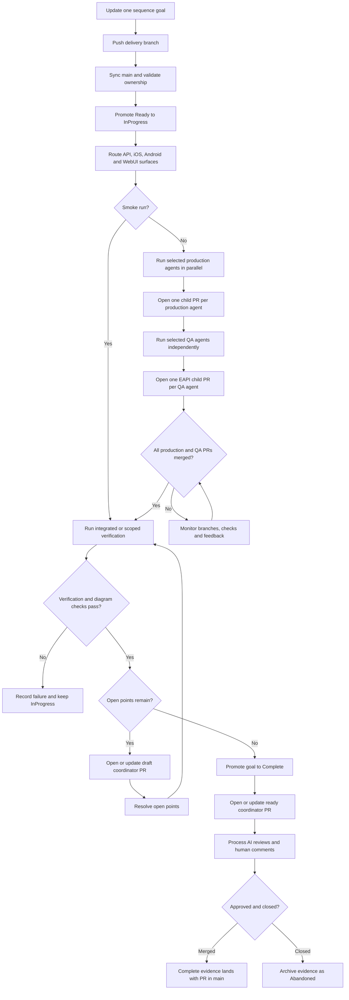

# Agent Loop Workflow

This document defines the repository workflow for delivering sequence-diagram goals through the automated agent loop.

## Purpose

- Make sequence diagrams executable goals with explicit status transitions.
- Open a draft coordinator PR first, then run independent per-surface product and functional automation delivery chains before integrated verification advances goal status.
- Route each goal to a development and QA specialist for backend, native iOS, native Android, or browser web delivery.
- Keep a draft coordinator PR to `main` as the live delivery record and mark it ready only after the goal is delivered.

## Scope

This workflow applies to diagrams under `docs/sequence-diagrams/*.md` that include an `Agent Loop Goal` section.

The current loop is branch-driven: it starts when a non-`main` branch changes a sequence diagram or related loop file. It does not yet scan `main` for `Ready` diagrams and create delivery branches automatically. Until a dispatcher workflow exists, a contributor or upstream automation must create/push the delivery branch.

## Status Lifecycle

For documentation maintenance that touches existing goals without delivering them, label the open same-repository PR to `main` with `sequence-goal:documentation-only` before pushing updates. The resolver then reports delivery as not applicable and the coordinator does not run. This intent is limited to Markdown under `docs/`, top-level PowerShell scripts under `scripts/`, and workflow YAML under `.github/workflows/`; application changes fail closed. Normal PR checks, including Mermaid rendering and harness verification, still run. Remove the label before requesting goal delivery. Explicit production/QA continuation cannot use this exception, and smoke dispatch retains its normal validation.

Allowed lifecycle:

1. `Draft -> Ready`
2. `Ready -> InProgress`
3. `InProgress -> Complete`
4. `Complete -> Draft` (only when behavior drift or redesign invalidates the current diagram)

Status transitions are enforced by `scripts/promote-sequence-goal.ps1` and validated by `scripts/check-sequence-diagram-status.ps1`.

## Automation Components

- Workflow: `.github/workflows/ai-delivery-sequence-goal-loop.yml`
- Direct goal updates: `scripts/save-sequence-goal-delivery.ps1` records each agent's branch, PR and state through retryable commits; production dispatches its matching QA after verification.
- Dedicated QA workflow: `.github/workflows/ai-delivery-sequence-goal-qa.yml` accepts only a coordinator branch and canonical surface, applies per-surface concurrency, and owns the complete bounded QA implementation.
- Direct cost recording: `scripts/save-sequence-goal-resources.ps1` records sanitized run/attempt costs in the goal document through the same retryable updater. No extra workflow is dispatched.
- Promotion script: `scripts/promote-sequence-goal.ps1`
- Agent runner script: `scripts/run-sequence-goal-agent.ps1`
- Delivery-agent resolver: `scripts/resolve-sequence-goal-delivery-agents.ps1` is used by both workflows to read the goal's `Delivery surface` and select development/QA pairs. Missing values retain the legacy `Backend` route; the QA workflow additionally requires an authenticated production checkpoint for its requested surface.
- Automation-test delivery job: each production matrix worker commits its progress to the goal document, then dispatches the dedicated QA workflow with only the coordinator branch and matching surface. That workflow resolves and runs only the requested surface's `deliver-automation-tests` job with `-DeliveryPhase AutomationTests`; it neither waits for the production PR to merge nor for another surface to finish. Each selected QA specialist receives authenticated production metadata and a bounded production diff; oversized diffs are explicitly marked as truncated instead of failing before agent execution. Each QA PR records the production repository, PR number, and immutable head SHA it verified. Reuse and completion require those values to match the current production checkpoint, and publication revalidates the checkpoint immediately before raising the QA PR. Existing coverage is represented by a reviewable attestation PR. Generated automation code is never committed to the coordinator branch. Goal-document and sequence-index evidence produced by QA is hash-validated and merged into the latest goal document by the QA publisher alongside its PR entry.
- PR review runner script: `scripts/run-sequence-goal-pr-review-agent.ps1`
- Human comment runner script: `scripts/run-sequence-goal-human-comment-agent.ps1`
- Consistency check: `scripts/check-sequence-diagram-status.ps1`
- Scope resolver: `scripts/resolve-verify-scopes.ps1`
- PR review workflow: `.github/workflows/ai-delivery-sequence-goal-pr-review-loop.yml`
- Human comment workflow: `.github/workflows/ai-delivery-sequence-goal-human-comment-loop.yml`
- Comment monitor workflow: `.github/workflows/ai-delivery-sequence-goal-comment-monitor.yml`
- PR finalizer workflow: `.github/workflows/ai-delivery-sequence-goal-pr-finalizer.yml`
- Draft PR support: open draft and ready-for-review delivery PRs both participate in AI review, human-comment, scheduled recovery, and associated-PR feedback handling. Draft state affects merge readiness only; it does not pause the agent loop.
- Harness command: dynamically resolved `scripts/verify.ps1 -SolutionPath <path> -SkipBuild`, `-ProjectPath <path> -SkipBuild`, or repository fallback `-ScopePath . -SkipBuild -SkipDeploymentCheck`
- PR review evidence: `.codex/agent-loop/pr-reviews/pr-<number>-<run-id>.json`
- Human comment evidence: `.codex/agent-loop/human-comments/pr-<number>-<run-id>.json`
- Coordinator state: the `Coordinator` entry under `Delivery progress` in the goal document. GitHub Actions concurrency serializes writers; there are no persistent goal lock files.
- Smoke test: manual `workflow_dispatch` with `smoke_test=true` creates a harmless Ready goal, skips the external agent command, verifies the loop, and cleans the temporary smoke artifacts.
- Branch sync: the workflow attempts to merge `origin/main` into the delivery branch before processing; merge conflicts fail closed for manual resolution.
- Run ordering: coordinator initialization is serialized per branch. It opens the draft coordinator PR before production starts. Production surfaces run in parallel, and each independently dispatches its matching QA continuation immediately after recording its production PR. Surface-scoped QA continuations use separate workflow runs, so they do not share the parent production barrier and can run concurrently. An empty QA matrix is an explicit successful completion path when every QA surface is already merged.
- Branch ownership: non-smoke delivery runs must own no more than one actionable `Ready`/`InProgress` sequence-goal diagram.
- Associated-PR monitor: `.github/workflows/ai-delivery-sequence-goal-associated-pr-monitor.yml` discovers `InProgress` coordinator branches of any name from their changed goal documents, checks every production and QA PR recorded in the ledger, and resumes the coordinator branch when all active PRs are merged. Workflow-run discovery has no fixed age cutoff while a branch remains available. A feedback-worker or coordinator dispatch failure is isolated to that PR or coordinator branch: the monitor records a warning and continues scanning the remaining goals. Closing the coordinator PR without merge writes durable `Abandoned` closure evidence on an available source branch; the monitor and resolver ignore that goal until an explicit reset removes that branch-local evidence. If the source branch was already deleted, the standalone archive on `main` is an audit record for a branch that can no longer be discovered or resumed, rather than reset input. Closed, unmerged child PRs remain in GitHub history but are ignored as delivery checkpoints; once no active child PR remains, the coordinator resumes and creates a replacement for any still-required surface.
- Associated-PR feedback worker: `.github/workflows/ai-delivery-sequence-goal-associated-pr-feedback.yml` handles human comments, AI/bot feedback, failing check runs or commit statuses, and merge conflicts on each open associated surface PR in its owning repository. The monitor dispatches this worker from the diagram ledger. Review-comment responses are posted in their originating threads. Only AI-only threads may be resolved after handling; a thread containing any user-authored comment always remains unresolved for human closure. Check and conflict remediation is summarized on the PR conversation; durable markers from trusted app-authored issue or review comments prevent duplicate handling. While production delivery is pending, feedback changes remain on the same branch and the next delivery run uses the goal document to resume and reverify; Mobile iOS replies are allowed while the PR intentionally remains draft, without publishing inferential readiness. Once delivery is complete, the worker publishes the validated six-pass inferential review against the final remediation SHA and marks the Mobile iOS PR ready before waiting for target-repository checks, allowing that repository's credentialed build to run. Target verification restarts a five-minute stabilization window whenever the registered check set changes and remains bound to the unchanged head SHA. Failed or timed-out verification is not given a durable handled marker, so the scheduled monitor can retry it.
- Associated-PR remediation retries: the monitor derives a stable key from every currently unhandled comment, check, conflict, and readiness item. A newly observed set containing authored feedback is eligible immediately; retries of the unchanged set become eligible after a fixed five-minute delay. Each key permits at most three unsuccessful attempts. Successful bounded batches add handled markers, change the pending-set key, and therefore continue draining backlogs without consuming the next batch's retry budget. After the third unsuccessful attempt for an unchanged set, the monitor posts one durable PR comment explaining that automation has stopped, links the latest failed run or check, and directs the user to fix the failure or provide new feedback. A changed pending set or head SHA starts a fresh bounded series.
- Delivery branch identity: new production and QA branch names include a short hash of the exact coordinator ref so distinct refs cannot collide after sanitisation or case folding. Production PRs are reused only through authenticated coordinator, phase, surface, repository, and base identity. QA reuse additionally requires the current production repository, PR number, and head SHA. A changed or replaced production checkpoint therefore creates fresh QA work instead of inheriting stale coverage. Replaced rows move to non-active history; merged rows remain active evidence but are excluded from new-delivery gating.
- Mobile iOS inferential-review evidence is normalized before strict validation. The worker requires six per-pass objects in canonical order, each containing `name`, `outcome`, and `reason`; they are retained as `passDetails` while the PR renderer receives the canonical checklist plus a derived overall outcome and reason. The PR stays draft until that canonical section is recorded, then becomes ready so documentation validation and the credentialed mobile build run on the reviewed head.
- Delivery PR metadata: production and QA child PR titles are derived from the diagram's main goal and identify their owning surface. Their descriptions state the delivered outcome, responsible specialist, phase, base branch, and concrete changed or attested files. The final coordinator PR title uses the main goal without a generic “deliver” prefix, and its description leads with the overall cross-surface deliverable before the child-PR ledger and verification evidence.

## One recovery record

See the [original and simplified flow comparison](goal-delivery-flow-comparison.md).

The goal document's `Delivery progress` section records each production and QA task's
branch, PR, status, evidence, and remaining work. Production and QA commit updates
through the shared updater, which retries concurrent pushes without force-pushing.
The `Resources` entry holds attempt costs, keyed by run and attempt so retries do not
double count. Git commits provide history.

Restart reads this document and checks the recorded branch and PR against GitHub.
`InProgress` work resumes; verified `Complete` work is reused only while its code and
requirements still match. A missing PR is created from the already-published work.
QA records the production commit it tested; changed code requires fresh verification.
PR bodies describe work and identify ownership, but readiness and pending state come
from the document. Workflow artifacts retain diagnostics, not a second recovery state.

## Delivery Specialists

Set `Delivery surface` in the goal table to one or more comma-separated values from the following table. Production agents run in parallel on isolated owning-repository branches. As each production PR is recorded, its selected QA agent starts independently and creates its own EAPI automation PR.

After the development and QA stages, `sl-seb-ai` owns coordinator verification, cost aggregation, associated-PR monitoring, and goal completion.

| Delivery surface | Development agent | QA automation agent | Primary remit |
| --- | --- | --- | --- |
| `Backend` | `dev-jim-api-ai` | `qa-rob-api-ai` | Independent EAPI production and API/functional automation PRs targeting `main`. |
| `MobileIos` | `dev-jim-ios-ai` | `qa-rob-ios-ai` | Native iOS production code and iOS/mobile UI automation in the current `VAA.EAPI.Automation` implementation. The macOS production job installs and verifies SwiftLint before agent execution. |
| `MobileAndroid` | `dev-mike-android-ai` | `qa-rob-android-ai` | Native Android production code and Android/mobile UI automation in the current `VAA.EAPI.Automation` implementation. |
| `WebUi` | `dev-mike-web-ai` | `qa-rob-web-ai` | Browser application production code and WebUI automation in the current `VAA.EAPI.Automation` implementation. |

The specialist names are included in the GitHub Actions job display name, so every selected owner is visible in run and branch-protection evidence. Older goals without the row resolve to `Backend`; all new goals should declare the applicable surfaces explicitly.

All QA specialists write automation in `VAA.EAPI.Automation/` and must follow `VAA.EAPI.Automation/AGENTS.md`, its principle documents, and the current owning project's patterns. Mobile and WebUI goals extend existing helpers, thin step definitions, page/screen objects, fixtures, data flows, and runners; they do not create separate top-level automation or test roots.

Production repository routing is:

| Surface | Repository | Default base branch |
| --- | --- | --- |
| `Backend` | This repository | `main` |
| `MobileIos` | `VAAD1ST/vaa-mobile-ios` | `develop` |
| `MobileAndroid` | `VAAD1ST/vaa-mobile-android` | `develop` |
| `WebUi` | Repository variable `SEQUENCE_GOAL_WEBUI_REPOSITORY` (`VAAD1ST/<repository>`) | Repository variable `SEQUENCE_GOAL_WEBUI_BASE_BRANCH`, default `main` |

All delivery repositories must belong to the `VAAD1ST` GitHub organisation because the workflow issues one organisation-scoped GitHub App token. On the coordinator repository, the GitHub App requires Actions read/write permission so the monitor can inspect and dispatch recovery workflows. On associated repositories it requires Actions read permission. Every selected repository also requires Checks and Commit statuses read permission plus Contents, Pull requests, and Issues read/write permission. Issues permission is required for PR conversation comments and durable handled-feedback replies. Cross-repository jobs fail closed when a mapping uses another owner or the App cannot check out, push, inspect, create, or comment on the target PR.

Each production job, including Backend, creates or reuses a deterministic branch and PR. New Backend, Android, and WebUI branches use `sequence-goal/<sanitised-coordinator-branch>-<surface>-<coordinator-hash>`; Mobile iOS uses `feat/sequence-goal-<sanitised-coordinator-branch>-<coordinator-hash>`. Each QA agent runs as its own named Actions job in a surface-scoped continuation and uses `sequence-goal/<sanitised-coordinator-branch>-qa-<surface>-<coordinator-hash>` from EAPI `main`. Only canonical branch names and current PR metadata are accepted; repository, author, branch, base, phase, and surface must match the goal document. Pending or incomplete production resumes on its authenticated existing branch. Verified production is reused without rerunning generation; the associated-PR feedback workflow owns subsequent review remediation. Both phases register their branch in the goal document before agent execution. A child PR is created after substantive work is pushed; no bootstrap file or placeholder commit is needed. Short document updates retry against the latest coordinator branch, while agent worktrees, resource evidence, logs, branches, PRs, and failure states remain surface-specific and concurrent. The ledger records every child PR and its agent resource evidence. Closed child PRs are terminal history and are ignored when a fresh delivery attempt looks for reusable work. If a branch is recorded in the goal document but its PR was not created before interruption, restart reuses that branch. An unregistered conflicting ref is left untouched and a `-retry-<run>-<attempt>` branch is allocated; later runs reuse that branch only when its PR passes the same authenticated identity checks. While a child PR is open, the scheduled monitor discovers comments, reviews, failing checks/statuses, and merge conflicts, then dispatches the existing feedback worker to verify fixes, push them to that branch, and respond at the source.

When allowlisted Mobile iOS dependency resolution or `xcodebuild` verification is blocked solely because protected dependency credentials are intentionally scoped to the target repository, the worker may record that command as `deferred-target-pr` only when an independently collected failing check reports a recognized authentication or credential error. It must still resolve every feedback decision and complete all locally available checks, then push the fix, publish or validate the inferential review, mark the PR ready, and wait for the target PR checks on the new head. Mobile iOS target verification is mandatory for every feedback remediation, even when the inferential section was already complete or no local command was deferred; both `Documentation Validation` and the credentialed `Build and Test` check must pass. Responses are posted only after those checks pass; a target-check failure or timeout fails closed. Missing tools and ordinary build, test, or lint failures cannot use this delegation. Feedback responses and the Actions run summary include token usage and the conservative standard API-equivalent cost estimate.

The coordinator branch contains the trigger goal, coordinator state, costs, questions, and child-PR ledger only. Its draft PR is opened before production delivery so those updates remain visible throughout the lifecycle. Backend production, every mobile/web production surface, and every QA specialist deliver through independent associated PRs. The branch monitor and existing review/remediation workers continue checking those PRs. After all child PRs are merged, the monitor redispatches the coordinator, integrated verification runs from refreshed `main`, the goal becomes `Complete`, and the existing coordinator PR is marked ready for review.

The coordinator records its branch, repository, current run, verification result, and failure details in the goal document. The monitor discovers the document through its authenticated open coordinator PR. Closed coordinator PRs are excluded, so merged source branches need no origin tombstone.

Recovery of a `Complete` goal uses the same production/QA commit and requirements checks as in-progress monitoring. The monitor reads the goal at the discovered coordinator commit and makes its PR ready only when all active child PRs are merged, no open points remain, and the coordinator head still matches that snapshot. Stale bindings leave the coordinator draft.

Goal-document Git updates clear inherited HTTP authorization headers for each network command before applying the coordinator token (or `GH_TOKEN` fallback). QA's pinned verification fetch also supplies command-scoped authentication because publication checkouts do not retain credentials. Regression exercises cover checkout/environment headers, token selection, and failed-push recovery without changing caller credentials.

Before each coordinator AI-review or human-comment batch is answered, the worker recomputes `Lifecycle agent resources` from the fixed delivery baseline plus every retained batch, appends the durable evidence summary to the goal, and commits both the summary and batch JSON to the open coordinator PR. Replies and thread resolution happen only after that push succeeds. The closure finalizer archives the retained evidence and removes its JSON files.

Example:

```markdown
| Delivery surface | `MobileIos` |
```

A cross-surface journey can declare:

```markdown
| Delivery surface | `Backend, MobileIos, MobileAndroid` |
```

## Required CI Configuration

- Repository secret: `OPENAI_API_KEY`
  - Stores the OpenAI Platform API key used by the configured agent command.
  - The key is passed only as an environment variable to the agent process and must never be committed into command templates, workflow files, diagrams, or evidence files.
  - The sequence-goal runner scripts map this secret to `CODEX_API_KEY` for `codex exec` invocations, because Codex CLI API-key automation reads `CODEX_API_KEY`.
- Repository variable: `SEQUENCE_GOAL_AGENT_MODEL` (optional; defaults to `gpt-6-sol`). The selected value must be enrolled in `docs/agent-resource-budgets.json`; the agent launcher fails before invoking Codex when the model lacks an approved allowlist entry or rate card.
  - Used for sequence-goal code generation, where the loop should use the latest full model for implementation work.
- Repository variable: `SEQUENCE_GOAL_REVIEW_AGENT_MODEL` (optional; defaults to `gpt-6-sol`)
  - Used for AI review handling, where the loop uses the frontier model for review and remediation.
- Repository variable: `SEQUENCE_GOAL_HUMAN_COMMENT_AGENT_MODEL` (optional; defaults to `SEQUENCE_GOAL_REVIEW_AGENT_MODEL`, then `gpt-6-sol`)
  - Used for non-AI/human comment handling when it needs to differ from AI review handling.
- Repository variables for sequence-goal runtime policy (all optional; the workflow retains the listed fallback):
  - `SEQUENCE_GOAL_MAX_CHANGED_FILES` (`200`)
  - `SEQUENCE_GOAL_AGENT_TIMEOUT_MINUTES` (`40`)
  - `SEQUENCE_GOAL_VERIFY_TIMEOUT_MINUTES` (`20`)
  - `SEQUENCE_GOAL_PRODUCTION_JOB_TIMEOUT_MINUTES` (`90`)
  - `SEQUENCE_GOAL_DELIVERY_JOB_TIMEOUT_MINUTES` (`55`)
  - `SEQUENCE_GOAL_IOS_BASE_BRANCH` (`develop`)
  - `SEQUENCE_GOAL_ANDROID_BASE_BRANCH` (`develop`)
  - `SEQUENCE_GOAL_WEBUI_REPOSITORY` (required as `VAAD1ST/repository` when `WebUi` is selected)
  - `SEQUENCE_GOAL_WEBUI_BASE_BRANCH` (`main`)
  - Change these under repository **Settings > Secrets and variables > Actions > Variables** without amending the workflow.
- Repository secret: `SEQUENCE_GOAL_AGENT_COMMAND_JSON`
- Secret value must be JSON:
  - object: `{ "executable": "<exe>", "args": ["<arg1>", "..."] }`
  - array: `["<exe>", "<arg1>", "..."]`
- The workflow installs the Codex CLI with `actions/setup-node` and `npm install -g @openai/codex` before invoking the configured agent command.
- The sequence-goal runner scripts also write an ephemeral Codex config with `approval_policy = "never"` and `sandbox_mode = "danger-full-access"`, then normalize Codex launch args to `--dangerously-bypass-approvals-and-sandbox` before `exec` in the isolated GitHub Actions runner, so non-interactive CI runs can apply patches instead of falling back to read-only defaults.
- Supported placeholders in executable and args:
  - `{diagram}`: absolute path to the coordinator repository's sequence diagram
  - `{branch}`: current branch name
  - `{repoRoot}`: absolute repository path
  - `{model}`: selected code-generation model

Example template shape:

```json
{
  "executable": "codex",
  "args": [
    "--dangerously-bypass-approvals-and-sandbox",
    "exec",
    "--model",
    "{model}",
    "Implement the sequence-goal diagram at {diagram} on branch {branch}. Repository root: {repoRoot}. First read AGENTS.md, docs/readme.md, docs/standards/coding-standards.md, docs/agent-loop-workflow.md, and the target diagram. Use the diagram's Agent delivery constraints as the primary implementation brief. Limit discovery to the diagram-defined target paths, owning solution/project files, referenced source files, and nearest tests unless a compile/test failure proves more context is required. Make the smallest valid code, test, and documentation changes. You must create or update substantive implementation/test files under the appropriate VAA.EAPI.* project path; .codex/agent-loop evidence and diagram edits alone are not a delivered goal. Implement all settled requirements and preserve genuine Open points to finalize for human input on the delivery PR. Do not invent decisions merely to close them. If the settled scope cannot be implemented safely, exit non-zero with the blocker instead of producing evidence-only output. Update evidence fields and leave the goal ready for verification."
  ]
}
```

- Repository secret: `SEQUENCE_GOAL_REVIEW_AGENT_COMMAND_JSON`
- Secret value follows the same object or array shape and is used after the sequence-goal PR exists.
- The resolved review command must end with a non-empty, non-whitespace prompt argument; missing prompts and trailing option arguments fail closed before `codex exec` starts.
- Supported placeholders in executable and args:
  - `{prNumber}`: pull request number
  - `{branch}`: current branch name
  - `{repoRoot}`: absolute repository path
  - `{reviewEvidence}`: repo-relative PR review evidence JSON path
  - `{model}`: selected AI review model

The review agent must update each unresolved AI review thread in the evidence JSON with:

- `decision`: `valid`, `invalid`, or `not-applicable`
- `resolutionComment`: a concise, human-readable reason explaining the fix or why no fix was needed
- The PR-review runner appends a mandatory consistency contract: any sequence status change must update the diagram metadata, sequence index, and behavior-harness catalog/planned entry together, then run both status and behavior checks.

Each posted AI-review response includes the maximum workflow budget and actual tokens/USD for that specific review run. Valid feedback that is actioned labels these values as fix/review resources, so the cost of applying the fix is visible in the thread.

- Repository secret: `SEQUENCE_GOAL_HUMAN_COMMENT_AGENT_COMMAND_JSON`
- Secret value follows the same object or array shape and is used for non-AI PR comments.
- Supported placeholders in executable and args:
  - `{prNumber}`: pull request number
  - `{branch}`: current branch name
  - `{repoRoot}`: absolute repository path
  - `{commentEvidence}`: repo-relative human comment evidence JSON path
  - `{model}`: selected human-comment model

The human-comment agent must update each non-AI comment in the evidence JSON with:

- `decision`: `agree`, `disagree`, or `not-applicable`
- `responseComment`: the reply to post back to the PR
- `actionSummary`: required when agreeing with the comment; describes the fix or why no file change was needed

Each posted human-comment response includes the maximum workflow budget and actual tokens/USD for that specific handling run. Agreed comments label these values as fix/comment resources.

## End-to-End Loop

GitHub Actions dedicated to this goal-delivery lifecycle use the `ai-delivery-` prefix, with each display name matching its lowercase kebab-case filename stem. This distinguishes delivery runs from `ai-harness-` controls in the GitHub Actions view while internal job/check names remain stable.

1. Agent (or contributor) updates a sequence diagram on a non-`main` branch.
2. Push triggers `ai-delivery-sequence-goal-loop.yml`.
3. Workflow attempts to sync the branch with `origin/main`.
4. Workflow detects changed `docs/sequence-diagrams/*.md` files.
5. Non-smoke branches must contain no more than one actionable `Ready`/`InProgress` goal diagram.
6. Any changed goal in `Ready` is promoted to `InProgress`.
7. Workflow creates a goal lock and run evidence file under `.codex/agent-loop/`.
8. The workflow creates or reuses the authenticated draft coordinator PR and records it in the goal before product delivery starts.
9. Production matrix jobs run each selected development agent in an isolated checkout of its owning base branch. Backend therefore follows the same branch/PR contract as iOS, Android, and WebUI.
10. Product code and owned unit tests are validated, committed to deterministic child branches, and raised as associated PRs. Each job records its production PR and immediately dispatches the matching surface-scoped QA continuation. Production agents cannot write QA automation or coordinator evidence.
11. Each QA continuation restores Automation dependencies and runs only its surface's QA specialist with the corresponding production PR available through the authenticated ledger. It starts without waiting for another production surface or for its production PR to merge, and separate surfaces can run concurrently. Its handoff and resulting PR are bound to the production repository, PR number, and head SHA; the workflow aborts if that checkpoint changes before publication.
12. Each QA delta is built, copied into an independent EAPI `main`-based worktree, committed, and raised as its own associated PR. Existing coverage produces a reviewable attestation PR instead of bypassing lifecycle tracking.
13. QA output is restricted to `VAA.EAPI.Automation` and directly owned harness documentation. After the agent exits, the workflow copies only validated regular files into a hashed handoff under `RUNNER_TEMP`, creates a fresh credential-free checkout, verifies the handoff hashes, and performs QA and coordinator publication only from that checkout. Exact generated paths are removed from the trusted checkout after child-PR publication.
14. Production and QA resource decisions are retained in the goal document, keyed by run and attempt, so retries preserve costs without double counting.
    Restore failures are recorded as `automation-restore`, separately from `automation-generation` and `automation-build`, so missing or timed-out package acquisition is not misreported as a product-contract or test-generation failure.
15. The branch monitor handles checks, comments, reviews, conflicts, and merge state for every child PR while the coordinator PR remains draft.
16. Workflow runs semantic diagram satisfaction checks against `Acceptance evidence`, `Done when`, and `Expected harness`; unresolved `Open points to finalize` are captured as non-failing questions.
17. After every child PR is merged, the monitor resumes the coordinator, refreshes `main`, runs integrated verification, and writes retained production/QA cost totals into the goal.
18. Workflow commits verification results and remaining work in the goal document, including when the goal remains `InProgress` awaiting human input.
19. Smoke runs remove their temporary diagram, index row, and smoke run JSON after completion.
20. Only when the integrated result passes and no child PR remains open does the workflow mark the existing coordinator PR ready for review; until then it remains the draft live-delivery record.
21. The trusted comment monitor on `main` dispatches both the PR review and human-comment workers with `workflow_dispatch` when a review is submitted, an inline review comment is created, a top-level PR comment is created, or the Copilot review workflow completes successfully. The trusted `workflow_run` relay ignores unsuccessful completions and prevents Copilot-authored events that GitHub marks `action_required` from suppressing agent dispatch. Independently, scheduled recovery scans every fifteen minutes inspect every trusted open sequence-goal PR and dispatch both workers, so AI and human feedback events blocked as `action_required` or raised in an associated repository are promptly collected. The schedule is recovery-only because GitHub does not guarantee cron start times.
22. Before generated Markdown is committed, the delivery, AI-review, and human-comment loops render each Mermaid fence with `scripts/check-mermaid-diagrams.ps1`. A parser or render failure identifies the file and Mermaid block and keeps the change in the verification/remediation path.
23. The PR review worker scans the sequence-goal PR for AI review comments.
24. If unresolved AI-only review threads exist, the loop records them in review evidence, runs the configured PR review agent with `SEQUENCE_GOAL_REVIEW_AGENT_MODEL`, validates each decision, verifies only the staged changes produced by that reviewer, commits fixes, and resolves handled threads with a `[from-codex]` comment. A thread containing a user-authored/non-AI comment is excluded and remains open for human closure. Delivery-owned failures elsewhere in the PR remain the delivery loop's responsibility and do not block review handling. AI and human workers share one PR-number concurrency group; an unexpected stale push is rebased and retried once, then fails closed on conflict. An opaque non-zero Codex exit is retried once in the same isolated worktree with retained evidence and combined resource telemetry, while the workflow timeout allows the bounded recovery attempt to complete.
25. The PR review loop does not report completion until there are no unresolved AI-only review threads and the PR is approved for `main`.
26. The human-comment worker scans the same PR for non-AI comments and review summaries.
27. If the agent agrees with a non-AI comment, it actions the requested change using `SEQUENCE_GOAL_HUMAN_COMMENT_AGENT_MODEL`, verifies only its staged changes, commits them, and replies with the action summary. Delivery-owned failures elsewhere in the PR remain the delivery loop's responsibility and do not block human-comment handling. Human-comment execution uses the same bounded single retry and retained telemetry as AI review execution.
28. If the agent disagrees with a non-AI comment, it replies with the reason and leaves the comment unresolved.
29. Across coordinator and associated surface PRs, an agent must never resolve a review thread containing a user-authored/non-AI comment; human closure remains a human responsibility.
30. Lifecycle verification evidence is committed before the coordinator PR is updated and marked ready. Completion evidence is committed after any questions are resolved, so only then can merging it carry the `Complete` goal state into `main`.
31. If the coordinator PR is closed without merge and its source branch remains available, the finalizer records `Abandoned` there, archives component evidence summaries, removes transient review/comment evidence files, and records closure in the goal document. If the source branch was already deleted, it instead writes only the sanitized standalone abandonment record on `main`.

## Resetting Abandoned Goals For A Clean Run

Use [`.codex/skills/sequence-goal-reset/`](../.codex/skills/sequence-goal-reset/SKILL.md) when one or more named sequence-goal deliveries must be abandoned and restarted from Draft. This is a manual recovery workflow, not an automatic status transition. Closing PRs, deleting child branches, and rewriting goal branches require explicit user authorization.

The skill first runs its read-only inventory helper to identify each goal document, report confirmed or ambiguous coordinator-base metadata, resolve every associated ledger PR in its recorded repository, reconcile PR-body correlation metadata against the ledger, find PRs that target the goal branch, and list generated delivery changes and agent-loop evidence. This correlation catches a child PR created before a cancelled workflow could commit its ledger row; any mismatch fails the inventory closed. A default-base fallback remains unconfirmed until checked. Relationships must come from goal/PR/run metadata; similarly named branches are not sufficient proof. Deleted documents and uncertain or inaccessible resources are reported and left unchanged.

A reset rebuilds each named goal branch from its latest confirmed base and restores only its Draft goal definition, index entry, authoritative supplied UX/source assets, and reusable requirements recovered from review. It removes abandoned production and automation changes, goal-specific evidence, populated PR tracking, completion metadata, closure history, and recorded resource totals. The named goal branch is preserved for the next run; only confirmed child delivery branches are deleted.

The reset is complete only when all confirmed delivery PRs are closed, confirmed child branches are gone, the goal is `Draft` and zero commits behind its base, resource rows contain template placeholders, PR/closure tracking is empty, and the remaining branch diff contains no abandoned implementation or goal-specific `.codex/agent-loop` evidence. Run `scripts/check-sequence-diagram-status.ps1` and `scripts/check-behavior-harness.ps1` from the repository root before a guarded `--force-with-lease` publication, then re-fetch and audit the remote state.

## Process Flow Chart



## Failure Behavior

- If QA agent execution or its later restore/build validation fails, the workflow fails the run and leaves the goal `InProgress`. It does not publish failure evidence from a checkout that has evaluated agent-controlled projects; the failed Actions run remains the failure record for recovery.
- Production and automation agent phases write separate JSONL usage streams. Every successful invocation must end with its own terminal `turn.completed` event; a completed production or earlier remediation turn cannot mask an interrupted invocation or missing usage stream. The only retry exception is the event-stream recovery case described under Budgets, and the incomplete invocation remains in the retained JSONL evidence alongside the retry.
- Relative resource-evidence paths are anchored to the coordinator repository even when production execution runs inside an iOS, Android, or WebUI checkout.
- Production implementation and remediation are owned by the isolated per-surface delivery jobs; the coordinator workflow does not generate or commit product code.
- Automation-test generation must produce substantive test-source changes or a validated `AUTOMATION_COVERAGE_ALREADY_EXISTS` attestation naming concrete existing test files. A no-change result without that attestation fails closed and leaves the goal `InProgress`; production-path changes, change-budget violations, and automation solution build failures do the same.
- The automation job checks out the current branch tip after the production job. After generation it creates a second, fresh trusted publication checkout and transfers only a hash-verified data handoff into it. Automation publication rebases onto the latest remote branch before a non-force push and fails closed if reconciliation conflicts; build-tainted workspaces never publish failure commits.
- After an existing cross-repository production PR remediation push fails, the workflow fetches and rebases onto the remote delivery head before one non-force retry. This recovers stale-head races and fails closed if reconciliation conflicts; unrelated push failures still surface when the retry cannot push.
- Windows jobs fetch full history only for `main` and the active delivery branch. This avoids repository-wide ref fetch failures when legacy remote branch names differ only by case.
- If status/index metadata drift is detected, `check-sequence-diagram-status.ps1` fails the run.
- If branch ownership detects more than one changed non-smoke goal diagram, the workflow fails closed before agent execution.
- If automatic conflict recovery cannot merge `origin/main`, the workflow fails closed before agent execution.
- The associated-PR monitor warns and skips a stale or inaccessible diagram reference instead of preventing other coordinator PRs from being evaluated.

## Generated-Change Policy

Coordinator and QA agent-generated changes are rejected before commit unless they match the generated-change allowlist:

- `.codex/agent-loop/`
- `docs/sequence-diagrams.md`
- `docs/sequence-diagrams/`
- `docs/behavior-harness.md`
- selected harness documentation under `docs/`
- implementation and test files under `VAA.EAPI.*` product folders

Backend production and production-remediation branches are narrower: the sequence-goal diagram, sequence index, behavior-harness registry, and `.codex/agent-loop/` evidence are read-only coordinator inputs. Those branches may change production implementation, owned unit tests, and directly owned service documentation, but the workflow rejects coordinator-owned goal or lifecycle paths before every push. When remediating a legacy child branch that already contains those paths, the coordinator restores their final tree to the delivery base before validation and commits that cleanup with the production remediation. Backend associated-PR feedback applies the same restriction.

Changes are also rejected if they touch sensitive operational paths:

- `.github/`
- `.githooks/`
- `.codex/hooks/`
- `.codex/skills/`
- `local.settings*.json`
- `appsettings*.json`
- `serviceDependencies/`
- `PublishProfiles/`

The loop may write its own evidence under `.codex/agent-loop/`.

After the implementation commit, the automation phase uses a narrower allowlist: `VAA.EAPI.Automation/`, the active sequence-goal/behavior-harness documentation, and `.codex/agent-loop/`. It requires at least one substantive test-source change under `VAA.EAPI.Automation/`, unless a validated `AUTOMATION_COVERAGE_ALREADY_EXISTS` attestation names concrete existing test files.

Allowed generated files are staged one-by-one from the current `git status`; the workflow no longer runs a blanket `git add -A` for implementation output. Any blocked path, non-allowlisted path, or generated file count above `SEQUENCE_GOAL_MAX_CHANGED_FILES` aborts the run before implementation changes are committed.

Production implementation is delivered on isolated associated-PR branches, so the coordinator workspace may legitimately contain only orchestration and evidence changes. The isolated production and QA jobs enforce substantive generated output and reject evidence-only delivery before publishing their associated PRs.

## Agent Delivery Constraints

Ready sequence-goal diagrams should include an `Agent delivery constraints` section when the goal is expected to generate code. This section is the compact implementation brief for the coding agent and should name:

- target solution/project paths;
- required new project and test project names;
- exact endpoint, event, query, or command names;
- configuration and secret-handling expectations;
- referenced source files that define the contract;
- local or CI harness commands that prove the behavior.
- the owning automation project or enough contract/flow context to select it safely, plus the functional scenarios the post-implementation automation phase must cover.
- for mobile/WebUI goals, the application root, owning project under `VAA.EAPI.Automation/`, build command, targeted UI automation command, supported OS/device/browser matrix, and stable accessibility or test-selector contract.

The implementation agent must treat these constraints as authoritative. If the section is missing or leaves major choices open, the agent should either make the smallest safe repository-conformant decision and document it in the diagram, or exit non-zero with a blocker rather than producing evidence-only output.

For mobile or WebUI delivery with supplied UX, the implementation agent must open and visually inspect every referenced artefact before planning. The artefact directly specifies the visible UI; `Sequence (detailed)` specifies its flow and behaviour. Delivery must map and implement every represented screen, state, control, and transition. Merely exposing the referenced data or adding accessibility identifiers does not satisfy a supplied UX contract. If visual inspection or representative rendering is unavailable, the agent must report a blocker rather than claiming the UI slice is implemented.

Supplied UI/UX is an acceptance target, not advisory context. Before semantic acceptance, the goal must name an executable app/UI automation test under `VAA.EAPI.Automation/`, retain repository-relative actual screenshots and comparison/diff images for the mapped states, and record a `Passed` comparison result including the tool or reviewer and tolerance used. The workflow verifies that the named test and image files exist. Missing simulator/browser execution, credentials, render tooling, or visual evidence keeps the goal `InProgress`; unit tests, identifiers, source inspection, or green compilation alone cannot substitute for rendered proof.

Cross-repository delivery must also pass every verification gate required by the target repository, including its lint and formatting rules. The iOS production job downloads the pinned official SwiftLint portable release, verifies its checksum and version, and exposes it on `PATH` before invoking the agent. A missing executable, SDK, simulator, credential, or private dependency is a blocker unless the target repository documents a safe way to provision or substitute it. The agent must not convert an unrun mandatory check into a warning or rely on later pull-request CI as a replacement for pre-PR verification; it must exit non-zero and leave the goal `InProgress` with the concrete blocker.

## Verification Policy

Each sequence diagram can select its promotion verification mode in the `Agent Loop Goal` table:

```markdown
| Promotion verification | Fast |
```

Supported values:

- `Fast`: run scoped harness checks with `-SkipBuild`; this is the default when the field is omitted.
- `Full`: run solution/project verification without `-SkipBuild` after implementation changes are committed. If only repository fallback scope can be resolved, `Full` fails closed instead of silently running a fast repository fallback.

The loop uses `scripts/resolve-verify-scopes.ps1 -Base origin/main -Head HEAD` after implementation changes are committed. Each resolved scope runs the matching harness command:

- `scripts/verify.ps1 -SolutionPath <solution>.sln -SkipBuild`
- `scripts/verify.ps1 -ProjectPath <project>.csproj -SkipBuild`
- `scripts/verify.ps1 -SolutionPath <solution>.sln` for `Full` promotion verification
- `scripts/verify.ps1 -ProjectPath <project>.csproj` for `Full` promotion verification
- `scripts/verify.ps1 -ScopePath . -SkipBuild -SkipDeploymentCheck` as repository fallback

Every command and result is written into the run evidence JSON and included in the delivery PR body.

## Semantic Diagram Satisfaction

Before promotion to `Complete`, each processed goal diagram must provide concrete delivery evidence:

- `Acceptance evidence` in the `Agent Loop Goal` table must be present and must not be placeholder text.
- `Done when` must be concrete.
- `Expected harness` must list at least one concrete harness item.
- Goals with supplied UX must provide a completed pre-implementation `Design inspection matrix`, an existing `UI/UX acceptance test` under `VAA.EAPI.Automation/`, existing repository-relative `Rendered evidence` images, and a `Passed` `Comparison result`.
- `Open points to finalize` may remain open after implementation verification. They prevent automatic promotion to `Complete`, remain visible as run evidence, and are raised as a dedicated question on the delivery PR.

The semantic satisfaction result is recorded in the run evidence as `SemanticAcceptance`.

## Pull Request Behavior

- Before a production or QA agent starts, the workflow creates its permanent delivery branch from the configured repository base and records branch ownership in the coordinator goal. Child PRs are created after substantive work is pushed. Backend and QA target EAPI `main`; mobile and Web UI preserve their configured bases. Registration-only checkpoints never dispatch QA or apply generated goal evidence.
- Branch ownership is recorded in the goal document before execution. Child PRs are opened after substantive work is pushed. Restart reads the document, resumes the recorded branch, and creates a missing PR from published work.
- Requirements identity covers the goal, delivery surface, done-when criteria, verification mode, and requirement sections. `Harness Sensor` and `Acceptance evidence` are QA-owned evidence rows and do not invalidate that identity. Put changed acceptance requirements in `Done when` or the requirement sections, not in evidence rows.
- QA completion records both the tested production commit and the verified QA commit, plus the requirements digest. Restore/build run on a checkout pinned to that QA commit. Each completion retry checks the live QA PR and latest goal requirements again. Dispatch and monitoring reject stale commit bindings, including for merged PRs; evidence-only goal edits remain reusable.
- Monitor recovery and merged-coordinator finalization compare Production and QA verification with the current requirements digest as well as the live child commits. If `main` moves before finalization can publish, rerun finalization so the new document is validated; the finalizer does not rebase a previously validated completion onto newer requirements.
- QA retains its isolated generation checkout and publishes validated automation changes onto the already registered branch. Successful publication creates or updates a draft child PR. After the pinned QA checkout passes verification and completion is committed to the goal document, the PR is marked ready. Interrupted readiness publication reuses that verified document entry without rerunning generation. A failed registration, changed production checkpoint, or missing registered branch prevents generation/publication. QA still requires production readiness but does not wait for production merge. Goal edits use the trusted pre-agent commit as their merge base and may change only the Harness Sensor and Acceptance evidence rows; task state, requirements, costs, and index lifecycle fields are protected.
- Reusing an open production or QA PR restores its draft state and records pending work in the goal document. Ownership or registration failure stops generation. Feedback and production retain shared workflow concurrency.

- Production completion is explicit: the agent returns a JSON `Complete`, `Incomplete`, or `Blocked` outcome with acceptance evidence, actual verification commands/exit codes, and remaining work. Process exit zero and `turn.completed` do not establish delivery completion. Missing or malformed outcomes fail closed.
- An `Incomplete` production result immediately resumes the exact Codex session in the same worktree. Every non-complete result must explain `stopReason`; `Blocked` is reserved for an external dependency or decision after independent work is exhausted. Fixable build/test failures remain actionable. Session persistence is enabled even when the configured command requests ephemeral execution.
- All turns share one usage record and the existing run budget. Before resuming, the runner reserves headroom for a turn of the last observed size across input tokens, output tokens, and estimated cost. It also checks the session time allowance (`SEQUENCE_GOAL_AGENT_TIMEOUT_MINUTES`, default 40) between turns. These are admission checks, not a prediction or live interruption of the next turn; the workflow job timeout and final cumulative budget validation still apply. When admission stops continuation, the runner records the reason and publishes incomplete progress for monitor recovery. The scheduled monitor remains responsible for interrupted runs and subsequent attempts; it is no longer needed for each partial milestone.
- New production PRs start draft. Incomplete or blocked production retains its partial changes and remaining work in that draft, records an InProgress or Blocked outcome, and does not dispatch QA. A restart resumes the authenticated existing branch with its previous report as context rather than treating PR existence as completion.
- Completed production records its verified commit and outcome in the goal document. QA reads that entry and checks it against the current production PR head before generation and publication. Changed code requires fresh verification.
- Readiness permits QA generation, not merging or deployment. Independent PR review, CI, QA acceptance, child merges and integrated goal verification remain required.

### Goal document state and recovery

The goal document on the goal delivery branch is the authoritative recovery record.
Its associated-PR table identifies each task's branch and PR. The readable
`Delivery progress` section records production/QA status, completed verification,
remaining work, and the commit verified. Git commits provide the history; there
are no encoded recovery trailers or attempt-reservation commits.

Production and QA use `save-sequence-goal-delivery.ps1` and the shared
`Update-SequenceGoalDocument` function to publish directly. A short temporary
worktree starts at the latest goal branch; the writer changes only its entry and
pushes normally. On a concurrent push it fetches again and reapplies that edit, up
to five times. QA goal/sensor edits use a three-way merge, so conflicting
requirements are reported rather than overwritten. Production and feedback still
share their existing GitHub Actions concurrency group.
The existing associated-PR monitor runs after delivery/QA workflows finish and on
its fifteen-minute recovery schedule. It resumes incomplete production, missing
child publication, and missing or interrupted QA before production PR merge. It
waits while delivery or QA is active, defers when GitHub state cannot be inspected,
and leaves verified open PRs awaiting review. It checks every declared surface;
missing QA cannot be mistaken for completed delivery.

The Coordinator entry records `continuationStage`, `automaticContinuations`, and a limit of three for
automatic retries in each delivery/completion stage. A `Blocked` task stops automatic recovery, and exhausted
recovery emits an actionable warning pointing to the document's remaining work.
An explicit restart resets the count. Final integrated verification after all
children merge is a separate completion transition. A green partial production
run does not mean the goal is complete; its summary identifies incomplete work.

| Restart state | Action |
| --- | --- |
| Branch pushed, PR not created | Reconcile the existing branch and finish draft registration. |
| Interrupted or InProgress | Reuse the branch and PR; inspect published work and continue remaining criteria. |
| Implementation pushed, goal update missing | Reuse published work and repeat verification before recording completion. |
| Complete goal entry, PR metadata or ready transition unfinished | Finish publication without rerunning the agent. |
| Complete current entry already published | Reconcile the PR table and dispatch missing QA. |
| Production commit or goal requirements changed | Reverify; old evidence cannot approve the change. |
| Blocked | The goal records the reason; an explicit restart retries after intervention. |

An incomplete agent outcome is saved as InProgress and returns normally without
dispatching QA. There is no automatic production continuation chain or hidden
three-attempt reservation limit. Explicit workflow restarts resume from the
document. Per-run resource limits remain enforced. QA still records the exact
production commit it tested; that is verification evidence, not a second recovery
database. Existing branches without document state are adopted on their next run
and reverified, never assumed complete from an old trailer.

Only pushed work is recoverable. Uncommitted edits on a lost runner can be lost.
Sanitized costs are retained in the goal document. Artifacts hold diagnostic snapshots; their presence does not determine delivery recovery.

- PR creation is a delivery artifact, not a trigger.
- The workflow opens a draft coordinator PR when a non-smoke goal enters `InProgress`. It remains draft until implementation and semantic verification pass, all current child PRs merge, and open points are resolved; the finalizer refuses to complete a merged goal while any open point remains.
- Manual smoke runs never open a coordinator PR.
- If an open PR already exists for the branch and base `main`, the workflow updates its title/body and adds a refresh comment instead of creating a duplicate.
- The generated PR body includes delivered goals, harness sensors, verification mode, verification commands/results, changed files, run URL, branch, goal-document path, commits, and any questions requiring input.
- Open-point questions are posted in a dedicated issue comment carrying `<!-- sequence-goal-open-points human-comment -->`. This marker overrides the GitHub App's bot identity for classification: the AI-review loop excludes it and the human-comment loop includes it.
- After the PR exists, `.github/workflows/ai-delivery-sequence-goal-comment-monitor.yml` dispatches the review/comment workers for submitted reviews, inline review comments, top-level PR comments, and successfully completed Copilot review workflows. The Copilot `workflow_run` path ignores unsuccessful conclusions and acts as the trusted relay when GitHub blocks a workflow directly triggered by a Copilot-authored event. A successful run without an associated PR falls back to scanning trusted open sequence-goal PRs. Its fifteen-minute schedule is a recovery watchdog, not an SLA, because GitHub may delay scheduled runs.
- The delivery loop, dispatcher, and mutating PR workers authenticate with a dedicated GitHub App when `SEQUENCE_GOAL_GITHUB_APP_ID` and `SEQUENCE_GOAL_GITHUB_APP_PRIVATE_KEY` are configured. `SEQUENCE_GOAL_GITHUB_APP_SLUG` is required with those credentials because it identifies the trusted App author and prevents App pushes from recursively starting the delivery loop; incomplete credentials or a missing slug fail closed before delivery. Until rollout is complete, token creation is skipped when no App credentials are configured and the workflows retain an explicit `GITHUB_TOKEN` fallback; that fallback remains functional but cannot remove GitHub's approval gate for automation-created PR activity.
- `.github/workflows/ai-delivery-sequence-goal-pr-review-loop.yml` and `.github/workflows/ai-delivery-sequence-goal-human-comment-loop.yml` are `workflow_dispatch` workers only; they do not listen directly to PR, review, or comment events that GitHub may require a write-permission approval for.
- The PR-lifecycle workers only process PRs whose body contains the sequence-goal delivery marker and whose head branch lives in this repository.
- Write-capable PR lifecycle workflows also require the configured GitHub App (with legacy `github-actions` compatibility) as author and a non-empty head branch other than `main`; no branch-name prefix is required. The PR body marker alone is not enough to opt in.
- Unresolved AI-authored review threads from Copilot, Codex, or GitHub Actions are collected into `.codex/agent-loop/pr-reviews/`.
- The configured review agent must decide whether each comment is valid, invalid, or not applicable. The workflow fails closed if any decision or resolution comment is missing.
- Valid fixes are verified through resolved `scripts/verify.ps1` scopes before commit and push. Both mutating workers use the shared `sequence-goal-pr-mutation-<PR>` concurrency group, and each allows one rebase-and-push retry if the remote head moves unexpectedly.
- Feedback on protected automation paths is answered with a human-maintainer handoff instead of allowing an agent mutation. If an agent nevertheless edits a protected path, the worker discards only that protected-path change and continues validating, verifying, committing, and replying for safe feedback in the same run.
- Handled AI-only review threads are resolved only after the workflow posts a `[from-codex]` reply that explains the decision. A thread containing a user-authored/non-AI comment is never resolved by an agent.
- The PR review loop remains incomplete until the PR has no unresolved AI-only review threads and has approval for `main`.
- Non-AI PR comments are handled by `.github/workflows/ai-delivery-sequence-goal-human-comment-loop.yml`.
- The human-comment loop processes issue comments, review summaries, and review comments from non-bot authors that do not include `[from-codex]`, plus GitHub App-authored open-point questions carrying the explicit human-comment marker.
- For each non-AI comment, the configured human-comment agent must decide `agree`, `disagree`, or `not-applicable`.
- If it agrees, it must apply the valid change or record why no file change was needed, run scoped verification for generated changes, commit any changes, and reply.
- If it disagrees, it must reply with the reason.
- The human-comment loop must not resolve human/non-AI review threads; human closure remains a human responsibility.
- When a sequence-goal PR merges, `.github/workflows/ai-delivery-sequence-goal-pr-finalizer.yml` finalizes its Coordinator ledger row as `Merged` on `main`. When it closes without merge, the finalizer records abandonment evidence on its coordinator branch. If that branch was already deleted, the finalizer writes a sanitized standalone record under `.codex/agent-loop/abandonments/` on `main` without restoring or importing the abandoned branch history.
- Merged PRs retain their `Complete` evidence and receive the post-merge ledger checkpoint. Closed-unmerged PRs are recorded as `Abandoned` on their source branch when it exists; otherwise the sanitized standalone record on `main` is the durable fallback.
- When the source branch is available, AI review and human comment evidence files are summarized into the `Agent Loop Closure Evidence` section of the goal document, then removed from `.codex/agent-loop/`. The deleted-branch fallback cannot import unavailable transient evidence.
- Finalization records closure in the goal document. GitHub repository settings control branch deletion; there is no lock cleanup or origin tombstone.

## Budgets

The workflow uses explicit runtime and change-size budgets:

- Production-generation job timeout: the `SEQUENCE_GOAL_PRODUCTION_JOB_TIMEOUT_MINUTES` repository variable, default `90` minutes.
- Automation-delivery and combined-verification job timeout: the `SEQUENCE_GOAL_DELIVERY_JOB_TIMEOUT_MINUTES` repository variable, default `55` minutes.
- Agent step timeout: the `SEQUENCE_GOAL_AGENT_TIMEOUT_MINUTES` GitHub Actions repository variable, with a `40` minute fallback when the variable is unset. Change the repository variable to tune the timeout without a source change.
- Command output: generation agents redirect verbose build, test, restore, package-manager, and formatter output to run-scoped files under `TestResults/agent-command-logs`, emitting only concise summaries or bounded failure tails. The complete Codex JSONL stream remains retained as resource and diagnostic evidence without copying large command payloads into the Actions console.
- Event-stream recovery: as the only exception to immediately failing an invocation without a terminal `turn.completed` event, when its JSONL reports event-stream lag or dropped events, the runner retries that invocation once against the existing worktree. The incomplete invocation remains in the retained JSONL evidence alongside the retry. Other agent failures are not automatically retried, and a second incomplete invocation fails normally.
- Verification step timeout: the `SEQUENCE_GOAL_VERIFY_TIMEOUT_MINUTES` repository variable, default `20` minutes.
- Generated changed files: the `SEQUENCE_GOAL_MAX_CHANGED_FILES` repository variable, default `200`.

## Smoke Test

Run a harmless end-to-end workflow test from GitHub Actions:

```pwsh
gh workflow run ai-delivery-sequence-goal-loop.yml --ref <branch> -f smoke_test=true
```

Smoke mode:

- Creates `docs/sequence-diagrams/agent-loop-smoke-test.md` in `Ready`.
- Adds the smoke goal to `docs/sequence-diagrams.md`.
- Promotes the goal through `InProgress` to `Complete`.
- Skips `SEQUENCE_GOAL_AGENT_COMMAND_JSON` and external agent execution.
- Runs the normal verification/evidence/lock path.
- Removes the temporary smoke diagram, index row, and smoke run JSON after completion so the delivery PR is not polluted by synthetic documentation.
- Does not open a coordinator PR.

## Operational Notes

- PR is a delivery artifact, not a trigger.
- Create the draft coordinator PR and register its `Coordinator` row when the goal enters `InProgress`. Keep it draft throughout child delivery and while verified open questions remain; make it ready only when every current child PR is merged and the goal is `Complete`. Closing it without merge leaves its closure evidence incomplete.
- The comment monitor dispatches PR review and human-comment loops for trusted open sequence-goal PRs on submitted reviews, inline review comments, top-level PR comments, and successful Copilot workflow completions. Fifteen-minute scheduled recovery scans trusted open sequence-goal PRs and dispatches both workers, matching the associated-PR monitor cadence and ensuring AI and human feedback whose direct event ended as `action_required` is retried without frequent polling. Successful Copilot runs without an associated PR use the same full scan; unsuccessful Copilot completions dispatch nothing.
- Batch related review and remediation changes into one verified commit and push whenever practical; each push starts repository validation and review workflows, so incremental push-per-comment loops waste Actions minutes.
- The review and human-comment workers must stay dispatch-only; only the monitor receives review events, then applies its trusted-PR filter before dispatching a worker. This avoids reintroducing GitHub's "Workflows will not run until approved by a user with write permissions" gate.
- Keep harness sensors in `docs/behavior-harness.md` aligned for `Complete` goals.
- Keep `docs/sequence-diagrams.md` index status aligned with diagram-file status.
- Retain `.codex/agent-loop/pr-reviews/*.json` and `.codex/agent-loop/human-comments/*.json` on the coordinator branch after their summaries are committed, so later batches and the closure finalizer can recompute and audit lifecycle totals; remove them only during successful closure finalization.
- The evidence finalizer accepts the repository's canonical pre-completion resource placeholders as a zero lifecycle baseline, then replaces them with measured totals. Arbitrary malformed resource values still fail closed.
- Associated feedback collection deduplicates latest check runs by provider and name, excludes cancellation/approval states that are not code findings, prioritizes authored feedback, and limits each agent pass to 20 items. Remaining unhandled items are recovered by later monitor passes, preventing large stale CI histories from starving human or AI review comments.

## Local Commands

```pwsh
scripts/check-sequence-diagram-status.ps1
scripts/promote-sequence-goal.ps1 -DiagramPath docs/sequence-diagrams/<diagram-file>.md -ToStatus InProgress
scripts/promote-sequence-goal.ps1 -DiagramPath docs/sequence-diagrams/<diagram-file>.md -ToStatus Complete
scripts/verify.ps1 -SolutionPath VAA.EAPI.Orchastration/VAA.EAPI.Orchestration.sln -SkipBuild
```
