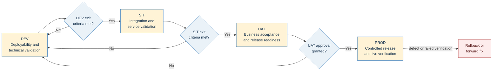
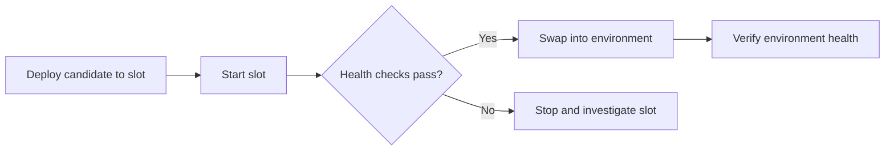
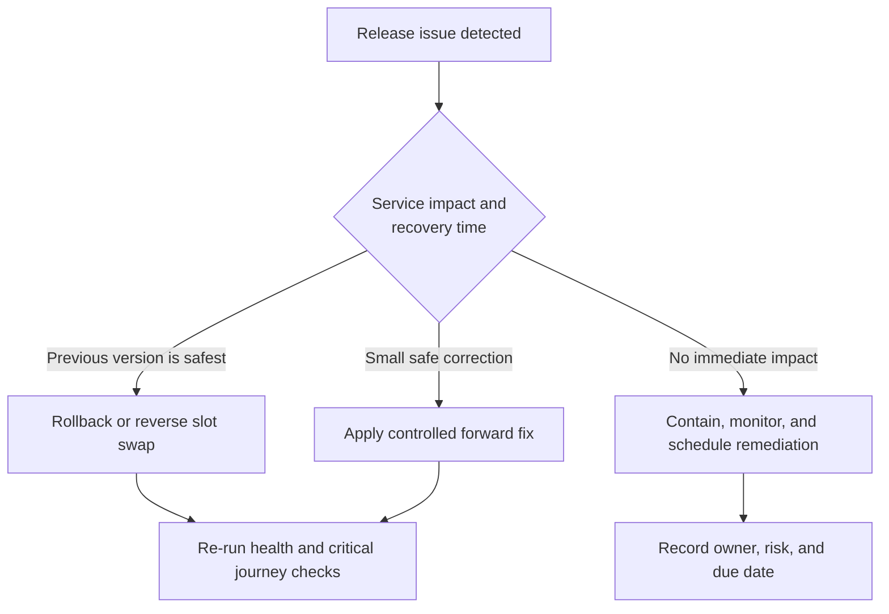

# Current SDLC: DEV to PROD

This document describes the current environment journey for delivering EAPI services from development through production.

The lifecycle follows four persistent environments:

> **DEV → SIT → UAT → PROD**

Each environment increases confidence in the release. A release should move forward only when the purpose and exit criteria of the current environment have been satisfied.

## SDLC at a Glance

## Environment Journey

| Environment | Purpose | Typical validation | Expected outcome |
| --- | --- | --- | --- |
| **DEV** | Prove that the application and infrastructure can be deployed and started with development configuration. | Deployment checks, application startup, technical smoke tests, basic endpoint checks, and developer investigation. | A deployable build that is technically stable enough for integration testing. |
| **SIT** | Prove that the service works with its APIs, data stores, messaging, downstream systems, and other EAPI components. | Integration tests, service-level functional tests, API checks, APIM validation, negative-path testing, and defect retesting. | A release candidate whose integrations and core service behaviour are working as expected. |
| **UAT** | Confirm that the end-to-end behaviour meets business and acceptance expectations in a production-like setting. | Business scenarios, acceptance tests, regression tests, operational readiness checks, and stakeholder review. | An approved release candidate ready for production deployment. |
| **PROD** | Release the approved candidate safely and verify it in live operation. | Deployment verification, production smoke tests, telemetry review, health monitoring, and incident readiness. | A stable live release with confirmed service health and an understood recovery position. |

## DEV

### Purpose

DEV is the first deployed environment in the lifecycle. Its role is to expose packaging, configuration, infrastructure, startup, and obvious runtime problems early.

DEV is primarily a technical environment. Frequent deployments and investigation are expected, but the environment should still be kept stable enough to provide meaningful feedback.

### Entry Criteria

- The change has passed code review or the team's agreed development review process.
- The application compiles and its unit tests pass.
- Application and infrastructure assets have been packaged together for deployment.
- Required DEV configuration, secrets, connections, and dependent services are available.

### Activities

- deploy or update the service infrastructure;
- deploy the application;
- confirm that the Function App starts successfully;
- confirm that expected endpoints or triggers are available;
- update the DEV API surface where APIM is used;
- run basic smoke or technical checks;
- inspect logs, traces, dependencies, and configuration failures;
- resolve deployment or runtime defects before promotion.

### Exit Criteria

- Deployment completes successfully.
- The service starts and remains healthy.
- Critical endpoints, triggers, and dependencies respond as expected.
- No unresolved defect prevents integration testing.
- The release version and deployment evidence are identifiable.

## SIT

### Purpose

SIT validates the service as part of the wider EAPI ecosystem. The emphasis moves from isolated technical correctness to integration behaviour.

This environment should represent the non-production connections required to test real service interactions, including APIM, HTTP dependencies, messaging, storage, identity, and relevant external-system test endpoints.

### Entry Criteria

- DEV exit criteria are satisfied.
- The candidate version is identified and suitable for promotion.
- Required SIT dependencies and test data are available.
- Known limitations are documented and accepted for SIT.

### Activities

- deploy the same release candidate into SIT;
- update the SIT API surface where APIM is used;
- run integration, sanity, and service-level functional tests;
- verify authentication, authorisation, networking, and dependency access;
- exercise success, validation, timeout, and downstream-failure paths;
- confirm messages, events, and state changes where applicable;
- retest defects against the promoted candidate.

### Exit Criteria

- Required SIT tests pass.
- Core integrations operate correctly.
- No open critical or high-severity defect blocks acceptance testing.
- Test evidence and any accepted defects are recorded.
- The candidate is approved to enter UAT.

## UAT

### Purpose

UAT confirms that the release meets business expectations and is operationally ready for production. It should focus on complete user or system journeys rather than individual technical components.

UAT should be sufficiently production-like to make its evidence meaningful while continuing to use non-production data, credentials, and integrations.

### Entry Criteria

- SIT exit criteria are satisfied.
- The intended production candidate is fixed and identifiable.
- Business scenarios, acceptance criteria, testers, and test data are ready.
- Any accepted SIT defects have owners and an agreed disposition.

### Activities

- deploy the release candidate into UAT;
- update the UAT API surface where APIM is used;
- execute agreed business and end-to-end scenarios;
- run appropriate regression and non-functional checks;
- validate support, monitoring, alerting, and operational procedures;
- confirm configuration and dependency differences expected in production;
- obtain stakeholder acceptance or record actionable rejection feedback.

### Exit Criteria

- Acceptance criteria are met.
- Required UAT and regression tests pass.
- Production configuration and dependencies are ready.
- Operational monitoring and support arrangements are confirmed.
- Rollback or forward-fix options are understood.
- The authorised stakeholder grants production approval.

## PROD

### Purpose

PROD is the controlled release of the approved candidate into live service. The objective is not only to complete deployment, but to prove that the release is healthy under production configuration and traffic.

### Entry Criteria

- UAT exit criteria and production approval are complete.
- The exact release artifact and version are identified.
- The deployment plan, change window, communications, and ownership are agreed.
- Production configuration, secrets, connections, and infrastructure are ready.
- Recovery steps and decision authority are clear.

### Activities

- deploy the approved release candidate;
- update the production API surface where APIM is used;
- use a deployment slot and controlled swap where supported;
- run production smoke and health checks;
- monitor logs, metrics, traces, dependencies, error rates, and latency;
- confirm that critical business journeys remain available;
- communicate release status and any required support actions.

### Exit Criteria

- Deployment and post-deployment checks pass.
- Service health and critical journeys are confirmed.
- No release-related incident requires rollback.
- Monitoring remains within agreed thresholds for the observation period.
- Deployment evidence, version, outcome, and known issues are recorded.

## Promotion Gates

The following model describes the controls expected between environments.

| Promotion | Required decision | Evidence expected |
| --- | --- | --- |
| DEV → SIT | Is the candidate technically deployable and stable enough for integrated testing? | Successful deployment, startup and smoke checks, identifiable version, and no blocking technical defect. |
| SIT → UAT | Do the service and its integrations behave correctly? | Required integration and functional test results, defect disposition, and confirmation of dependency health. |
| UAT → PROD | Does the candidate meet acceptance and operational-readiness expectations? | UAT approval, regression evidence, production-readiness confirmation, and an agreed recovery plan. |
| PROD → Complete | Is the live release healthy and supportable? | Production checks, monitoring evidence, release record, and confirmation that rollback is not required. |

Approvals should identify the decision maker, candidate version, evidence reviewed, decision time, and any conditions attached to the approval.

## Deployment Strategies

### Direct Deployment

The service is stopped or prepared for update, the application package is deployed, and the service is started again. This approach requires clear verification and recovery steps because the live environment is changed directly.

### Slot Deployment

Where supported, the package is deployed to a named slot, the slot is started and checked, and then it is swapped into the target environment.

A slot strategy is most effective when health checks are completed before the swap and the previous version remains available for recovery.

## Release Failure and Recovery

Failure handling should be agreed before production deployment.

The release owner should be able to answer:

- who can stop the deployment;
- who authorises rollback or a forward fix;
- which version is the last known-good release;
- how configuration or infrastructure changes are reversed;
- which checks confirm recovery;
- how stakeholders and support teams are informed.

## Environment Configuration and Data

Each environment has separate runtime resources and configuration. DEV, SIT, and UAT use non-production connections; PROD uses production connections and permissions.

Environment-specific values typically include:

- Function App and resource-group names;
- subscriptions and service connections;
- APIM instances, APIs, products, and policies;
- storage, messaging, DNS, VNet, and workspace settings;
- downstream service endpoints;
- monitoring and alerting destinations;
- test accounts and permitted data sources.

Secrets must remain in approved secret stores or managed service configuration. Production data must not be copied into non-production environments unless an approved, protected process permits it.

## Roles and Responsibilities

| Role | Responsibility across the lifecycle |
| --- | --- |
| Developer or service team | Build the change, maintain automated tests, support DEV/SIT investigation, and provide release notes and recovery information. |
| Test or quality owner | Define and execute the required SIT/UAT evidence and report blocking defects clearly. |
| Product or business owner | Confirm acceptance criteria and authorise or reject production promotion. |
| Release owner | Coordinate environment promotion, confirm evidence, manage the production change, and record the outcome. |
| Platform or operations owner | Maintain environment access, deployment capability, monitoring, production support, and recovery readiness. |

One person may hold multiple roles, but the decision and ownership should remain explicit.

## Current-State Caveat

The repository's delivery definitions support DEV, SIT, UAT, and PROD deployments, environment-specific configuration, APIM updates, post-deployment tests for selected services, and slot deployments for selected services.

The expected SDLC is sequential, but the current automation does not consistently encode each environment as dependent on successful completion of the preceding environment and its tests. Some promotion approvals or checks may be configured outside the repository. Delivery owners should confirm those controls before relying on them as mandatory gates.

## Maintaining This Document

Update this document when any of the following changes materially:

- the purpose or ownership of an environment;
- required entry or exit criteria;
- mandatory test or approval gates;
- environment promotion order;
- production deployment or rollback strategy;
- environment configuration, security, or data-handling policy.

The implementation evidence for the current environment flow is held in `VAA.EAPI.Pipelines/` and `VAA.EAPI.Pipelines.DigitalServices/`, together with Azure DevOps Environment configuration managed outside this repository.
