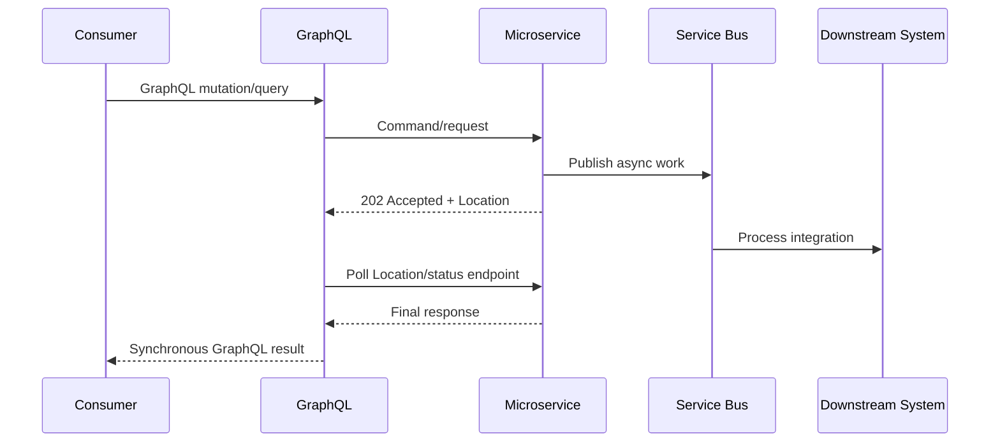

# Async To Sync Conversion

**Pattern group:** GraphQL Composition

**Status:** Recommended

**Last reviewed:** 2026-06-01

**Owner:** EAPI Technical Leads

## Intent

Use GraphQL to present a synchronous consumer API while preserving asynchronous, event-driven microservice communication behind the boundary.

This pattern lets a consumer call one GraphQL operation and receive the final business response, while GraphQL handles accepted responses, `Location` headers, `Retry-After` guidance, status polling, and final response retrieval from the responsible microservice.

## Use When

- A consumer journey needs a synchronous API contract, but the owning microservice processes the request asynchronously.
- The microservice returns `202 Accepted` with a `Location` header, operation status endpoint, or correlation identifier that can be polled safely.
- GraphQL is the consumer-facing orchestration boundary and can absorb the polling complexity.
- The workflow can complete within the configured GraphQL timeout, retry, and polling budget.

## Do Not Use When

- The operation is genuinely long-running and should remain asynchronous to the consumer.
- Polling could exceed GraphQL timeout, cost, rate-limit, or user-experience budgets.
- The final response requires GraphQL to own microservice state or bypass a bounded context.
- The status endpoint is not idempotent, not authorised for the caller, or cannot be correlated safely.

## Pattern Shape

1. Consumer calls a GraphQL query or mutation.
2. GraphQL delegates to the owning domain service or connector.
3. The microservice accepts the command and continues work asynchronously.
4. GraphQL reads the `Location` header, status URI, or configured response endpoint.
5. GraphQL polls within configured limits until the final response is ready or a terminal failure is reached.
6. GraphQL maps the final microservice response into the consumer-facing GraphQL response.

## Implementation Guidance

- Keep the synchronous facade in GraphQL; do not make the microservice pretend to be synchronous if its processing model is event-driven.
- Prefer `IHttpConnector` and the existing HTTP delegating handler pipeline for downstream calls.
- Use `Location`, `Retry-After`, and correlation identifiers consistently so GraphQL does not need endpoint-specific polling logic in resolvers.
- Apply a strict retry count, delay, timeout, and cancellation policy; never poll indefinitely.
- Return a controlled GraphQL error when the async workflow times out, fails, or remains incomplete after the polling budget.
- Preserve caller identity, authorisation, correlation ID, and analytics context across the initial command and follow-up polling calls.
- Use `noWait` only when the GraphQL operation intentionally returns the accepted response rather than converting it to a final synchronous result.

## Code References

- [LocationDelegatingHandler.cs](../../VAA.EAPI.GraphQL/VAA.EAPI.GraphQL.Common/Http/LocationDelegatingHandler.cs:15): follows accepted responses through `Location` and `Retry-After` handling.
- [HttpConnector.cs](../../VAA.EAPI.GraphQL/VAA.EAPI.GraphQL.Infrastructure/Services/HttpConnector.cs:53): exposes `noWait` so callers can choose whether the handler should wait for the final response.
- [TransactionResponseQueryHandler.cs](../../VAA.EAPI.Microservices/VAA.EAPI.Microservices.Loyalty.Vred/Applications/Query/Transaction/TransactionResponseQueryHandler.cs:34): example microservice response polling loop.
- [EnrolmentResponseQuery.cs](../../VAA.EAPI.Microservices/VAA.EAPI.Microservices.Loyalty.Enrolment/Application/Query/EnrolmentResponseQuery.cs:50): example response polling against asynchronous enrolment processing.

## Related Principles And Standards

- [Architecture Principles](../principles/architecture-principles.md)
- [Integration Principles](../principles/integration-principles.md)
- [Security Principles](../principles/security-principles.md)
- [Coding Standards](../standards/coding-standards.md)

## AI Agent Checklist

- GraphQL owns the synchronous consumer experience, not the durable workflow state.
- The microservice remains event-driven and owns its bounded context.
- Polling uses approved connector/handler infrastructure with bounded retry and timeout settings.
- `Location`, `Retry-After`, correlation ID, and authorisation are propagated correctly.
- Timeout, incomplete, and failure outcomes are mapped into explicit GraphQL errors.
- Tests cover immediate completion, accepted-then-completed, timeout, and failed status outcomes.

## Change History

| Date | Change | Author |
| --- | --- | --- |
| 2026-06-01 | Initial draft. | Seb Harvey |
| 2026-06-01 | Approved. | EAPI Technical Leads |
