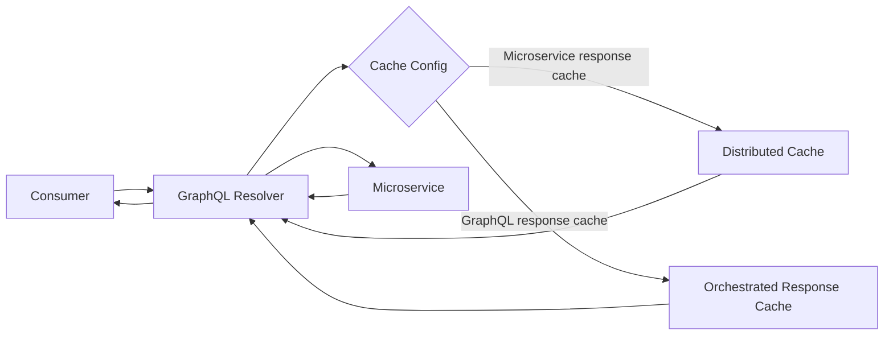

# GraphQL Response Caching

**Pattern group:** GraphQL Composition

**Status:** Recommended

**Last reviewed:** 2026-06-01

**Owner:** EAPI Technical Leads

## Intent

Apply consumer-facing caching at the GraphQL orchestration boundary rather than inside microservices.

GraphQL can be configured to cache individual microservice responses at a granular level, cache fully orchestrated GraphQL responses, or combine both where the data classification, freshness requirement, and consumer journey justify it.

## Use When

- A GraphQL operation repeatedly reads data that is safe to reuse for a defined time.
- The cache key can be derived from explicit request variables, headers, operation name, or a stable GraphQL context value.
- A journey benefits from caching multiple microservice lookups independently before GraphQL composes the final response.
- A fully orchestrated response can be cached without breaking authorisation, privacy, freshness, or bounded context rules.

## Do Not Use When

- The microservice should remain the source of truth and the requested response is highly volatile.
- The response contains sensitive, user-specific, payment, authentication, or entitlement data without a safe per-user cache key and expiry.
- Cache invalidation would require GraphQL to understand microservice domain events or own downstream state.
- A microservice is being changed only to improve GraphQL performance; keep caching at the GraphQL layer unless the owning service has a separate domain reason.

## Pattern Shape

1. GraphQL identifies the cacheable operation or downstream call from configuration.
2. Cache keys are built from configured variables, request values, or context values.
3. GraphQL checks the cache before calling the microservice or before executing the full operation.
4. On cache miss, GraphQL calls the owning microservice and composes the response.
5. GraphQL caches the microservice response or final GraphQL response using configured expiry.
6. GraphQL returns cached responses with the same security and mapping rules as live responses.

## Implementation Guidance

- Configure cache behaviour in GraphQL deployment or application configuration; do not hard-code cache eligibility in resolvers.
- Use operation-level keys such as `Cache:orderResponse` for orchestrated GraphQL responses and HTTP method/URI keys for downstream response caching.
- Keep microservices free from GraphQL-specific caching concerns.
- Use short, explicit expiries and include all security-relevant variables in the cache key.
- Prefer distributed cache for cross-instance GraphQL consistency; use memory cache only for local reference-style data where that is intentional.
- Treat cache failures as non-critical performance degradation: log the failure and continue with live execution.
- Do not cache responses that contain secrets, tokens, raw payment data, or sensitive personal data unless a security review approves the keying, encryption, and retention behaviour.

## Code References

- [CachingMiddleware.cs](../../VAA.EAPI.GraphQL/VAA.EAPI.GraphQL/Middleware/CachingMiddleware.cs:14): caches full GraphQL/function responses based on configuration.
- [CachingDelegatingHandler.cs](../../VAA.EAPI.GraphQL/VAA.EAPI.GraphQL.Common/Http/CachingDelegatingHandler.cs:16): caches downstream HTTP responses through the GraphQL HTTP pipeline.
- [ConfigReader.cs](../../VAA.EAPI.GraphQL/VAA.EAPI.GraphQL.Common/Helper/ConfigReader.cs:130): parses cache configuration, builds keys, and determines cache eligibility.
- [OrderResponseQuery.cs](../../VAA.EAPI.GraphQL/VAA.EAPI.GraphQL.Domain.Book/Queries/OrderResponseQuery.cs:27): example GraphQL query returning a cached orchestration response.
- [azuredeploy_digital.json](../../VAA.EAPI.GraphQL/VAA.EAPI.GraphQL.Deployment/Template/azuredeploy_digital.json:1060): example operation cache configuration for `orderResponse` and `paymentDetailsResponse`.

## Related Principles And Standards

- [Architecture Principles](../principles/architecture-principles.md)
- [Data Principles](../principles/data-principles.md)
- [Security Principles](../principles/security-principles.md)
- [Coding Standards](../standards/coding-standards.md)

## AI Agent Checklist

- Caching is implemented at GraphQL or shared GraphQL infrastructure, not inside a microservice for GraphQL performance.
- Cache keys include all variables needed to prevent cross-user or cross-context data leakage.
- Expiry, sliding/absolute behaviour, and cache scope are configured explicitly.
- Sensitive, personal, payment, token, and entitlement data has been reviewed before caching.
- Cache failure falls back to live execution and logs enough context to diagnose the issue.
- Tests cover cache hit, cache miss, expiry/key variation, and cache unavailable paths.

## Change History

| Date | Change | Author |
| --- | --- | --- |
| 2026-06-01 | Initial draft. | Seb Harvey |
| 2026-06-01 | Approved. | EAPI Technical Leads |
