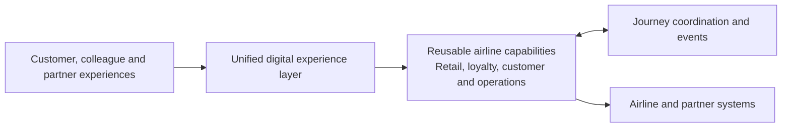

# EAPI Platform: Executive Architecture and Delivery Capability Briefing

## Purpose

This briefing explains the strategic value of the Virgin Atlantic EAPI platform for the Chief Digital and Information Officer (CDIO) and wider C-suite. It focuses on business capability, investment return and future opportunity rather than implementation detail.

## Executive summary

EAPI is Virgin Atlantic's digital integration and business capability platform. It connects customer, colleague and partner experiences to the airline and commercial systems that fulfil their journeys.

Rather than every channel connecting separately to every underlying system, EAPI turns complex airline functions into secure, reusable capabilities. These include shopping and booking, servicing, loyalty, payments, customer communications and operational processes.

In executive terms:

> EAPI converts the complexity of airline and partner systems into reusable digital capabilities that can be assembled quickly into new customer and operational journeys.

The platform's value comes from four things:

- A broad set of business capabilities built over five years.
- Reuse across web, mobile, colleague and partner channels.
- The ability to modernise and change incrementally.
- A strong foundation for adopting AI safely and productively.

## Five years of investment and return

The investment made in EAPI over the last five years has created more than a collection of individual interfaces. It has established a reusable platform asset containing business capability, integration knowledge, security controls, operating patterns and engineering experience.

This investment improves the economics of future delivery. New initiatives can build on established retail, loyalty, customer and operational capabilities instead of repeatedly recreating connections to core airline and partner systems.

The return is realised through:

- Faster development of new customer and colleague capabilities.
- Reuse of business logic across multiple channels and journeys.
- Reuse of retail capability across direct channels and NDC partner distribution.
- Less duplication than point-to-point delivery.
- Lower disruption when underlying systems change.
- Incremental modernisation that protects existing investment.
- A stronger foundation for new partners, channels and technologies.

The platform should therefore be viewed as accumulated digital capital. Its value compounds each time an existing capability is reused, extended or combined with another.

The financial and operational return can be made increasingly visible through measures such as time to launch a capability, avoided duplicate integrations, cross-channel reuse, service availability, cost per journey and speed of change.

## How the platform fits together

The platform is organised into three complementary areas:

- **Business capabilities:** independently managed services covering retail, loyalty, customer engagement and operations.
- **Experience composition:** GraphQL, Stitch and the REST router combine those capabilities into coherent experiences for channels.
- **Journey coordination:** events and orchestration support processes that cross systems, happen at scale or need to run at a particular time.

This structure limits the impact of change. An individual capability can evolve without requiring the entire platform or every consuming channel to change at the same time.

## Breadth of business capability

The platform supports a significant portion of the airline value chain.

| Business area | Representative capabilities |
| --- | --- |
| Retail and servicing | Search, offers, basket, order, payment, ticket, seat, passenger, trip, insurance, holidays and NDC retailing |
| Loyalty | Customer, enrolment, identity, wallet, transactions, campaigns, rules and partner data |
| Customer engagement | Content, customer profile, email, notifications and refunds |
| Airline operations | Flight information, crew, catering, check-in, baggage and lounge management |
| Shared enablement | Security, configuration, reference data, analytics, insights and partner connectivity |

This breadth means that new journeys can increasingly be assembled from proven capabilities rather than created as isolated technology projects.

## Extensible GraphQL capability

GraphQL provides a unified experience layer across areas such as Search, Book, Servicing, Trips, Account, Loyalty, Basket, Holidays and Operations.

In practical terms, it allows a digital experience to ask for the information it needs without needing to understand how many underlying services or systems are involved.

### Stitch

Stitch combines independently managed business areas into a unified view for consumers. Teams can continue to own and evolve their domains separately while channels receive a consistent experience.

This supports faster change, clearer ownership and less disruption when backend capabilities evolve.

### REST router

The REST router makes registered GraphQL capabilities available through familiar REST interfaces. Existing investments and consumers can therefore continue to provide value without waiting for complete replacement.

Together, GraphQL, Stitch and the REST router provide a pragmatic modernisation path: new and existing capabilities can coexist while the organisation changes them at the appropriate pace.

## NDC and modern airline retailing

NDC extends EAPI into modern airline retailing and partner distribution. It provides a standards-based way for sellers and partners to access airline offers, orders and servicing capability while shielding internal systems from external complexity.

The platform supports key areas including:

- Offer, seat, order and payment journeys.
- Order creation, search, management and documentation.
- Partner and supplier integration, including Sabre.
- Validation, monitoring and controlled handling of unsuccessful requests.

The strategic value is that the same underlying retail capabilities can be reused across direct channels such as web and mobile and indirect channels such as travel sellers and partners.

NDC and GraphQL play complementary roles. NDC supports industry-standard airline distribution, while GraphQL supports flexible digital experiences. Both draw on common EAPI business capabilities, increasing reuse and consistency.

## Journey coordination, resilience and scale

Some airline journeys require several systems to work together or an action to occur at a particular time. EAPI provides coordination for scenarios such as:

- Check-in opening and seat-selection reminders.
- Aircraft-swap and disruption notifications.
- Connected-aircraft notifications.
- Flight schedule and crew information processing.

The platform can process immediate requests as well as background events. This helps absorb peaks in demand, isolate temporary system issues and recover work safely rather than making every customer interaction wait for every downstream activity.

This contributes to resilience, operational continuity and the ability to scale individual capabilities according to demand.

## Rapid change and performance tuning

Rapid change and performance tuning are supporting benefits of the platform rather than its primary purpose.

Because capabilities are separated into manageable business areas, teams can make focused changes with a smaller impact. The unified experience layer also reduces the need for channel changes when underlying systems are reorganised.

Performance can be improved where it matters most by independently scaling busy capabilities, avoiding repeated work, processing suitable activities in the background and tuning individual customer journeys using operational evidence.

The architecture is designed for scale, but achieved performance should be demonstrated through business-relevant measures such as customer response time, transaction volumes, availability, failure rates and cost per journey.

## AI and harness-enabled delivery

The platform is being enhanced with an engineering harness that combines clear standards, reusable knowledge, automated checks and governed AI assistance.

The purpose is not simply to generate more code. It is to help teams deliver changes more quickly and consistently while maintaining security, quality and accountability.

The emerging approach supports:

- Faster discovery of the correct business area and established delivery pattern.
- Assisted implementation, testing, documentation and review.
- Automated checks before a change progresses.
- Clear evidence of what was changed and how it was verified.
- Human accountability for important business, security and operational decisions.
- Better continuity when work moves between people or working sessions.

AI provides acceleration; the harness supplies the organisational knowledge and controls needed to use that acceleration safely.

## Navigating a changing AI landscape

The five-year EAPI investment places Virgin Atlantic in a stronger position to respond to rapid changes in AI.

AI-enabled experiences need secure, well-defined access to real business capabilities. EAPI provides that controlled layer, reducing the need for AI solutions to connect directly to fragmented airline systems.

This creates two forms of readiness:

- **AI-enabled delivery:** using AI to help engineers understand, implement, test and review changes.
- **AI-enabled business capability:** allowing future customer, colleague and operational AI experiences to use approved airline capabilities safely.

The strategic advantage is adaptability rather than dependence on one AI model or supplier. Stable business interfaces and strong governance allow the organisation to adopt better technology as it emerges while retaining control of data, business rules and operational risk.

## Expected effect on resources

The most credible resource benefit is a shift in how specialist capacity is used, rather than an assumed reduction in headcount.

AI and the harness can reduce time spent on repetitive setup, rediscovering existing knowledge, routine consistency checks and avoidable review cycles. This should allow more capacity to move toward:

- Customer and colleague outcomes.
- Product and journey design.
- Business and domain decisions.
- Security and operational assurance.
- Performance and reliability improvement.
- Development of reusable platform capability.
- Complex integration and exception management.

The approach also requires continued investment. The platform knowledge, automated controls and AI workflows need ownership, maintenance, cost management and appropriate training.

Success should be measured through outcomes such as lead time for change, deployment frequency, review time, escaped defects, recovery time and the proportion of engineering effort spent on high-value work.

## Opportunities for continued growth

The strength and breadth of EAPI create an opportunity to compound the investment already made. The next phase can focus on:

- Increasing reuse across customer, colleague and partner journeys.
- Making ownership and business criticality clear across the portfolio.
- Simplifying legacy duplication and improving consistency.
- Using operational insight to optimise customer experience, scale and cost.
- Strengthening common resilience patterns across important journeys.
- Expanding governed AI-assisted delivery.
- Applying consistent delivery controls across all active areas.
- Making platform value visible through an executive scorecard.

That scorecard could cover capability reuse, speed to market, availability, customer response time, cost per journey, delivery frequency, change success, recovery performance and AI-assisted delivery outcomes.

## Recommended executive narrative

> EAPI is our digital capability and integration platform. It shields customer, colleague and partner experiences from the complexity of airline and external systems.
>
> Over the last five years, we have created reusable capabilities spanning retailing, loyalty, customer engagement and operations. This is accumulated digital capital: the return grows each time we launch a journey using existing capability, avoid duplicating an integration or change an underlying system without disrupting consumers.
>
> GraphQL provides a unified digital experience, Stitch combines independently managed business areas, and the REST router allows established interfaces to remain valuable while we modernise. NDC extends the platform into industry-standard airline retailing and partner distribution.
>
> The architecture supports focused change, resilience and scale. We are now adding an AI-enabled engineering harness so teams can discover, implement, test and review changes faster while retaining security, evidence and human accountability.
>
> This investment also gives us a strong foundation for future AI-enabled customer and colleague experiences. It allows us to adopt changing AI technologies without giving up control of our business rules, data or operational risk.
>
> The expected resource benefit is a shift away from repetitive engineering activity toward customer outcomes, product development, architecture, security, reliability and performance. We will demonstrate that value through measurable delivery, operational and financial outcomes.

## Conclusion

EAPI is not simply a collection of technology interfaces. It is a reusable enterprise capability layer connecting Virgin Atlantic's digital experiences with its commercial and operational ecosystem.

The investment of the last five years has created a platform whose return can compound through reuse, incremental modernisation and faster capability development. GraphQL, Stitch, the REST router and NDC broaden how those capabilities can be consumed, while journey coordination supports resilient operation at scale.

The next phase is to make that value increasingly measurable and to use the platform as a governed foundation for both AI-enabled delivery and future AI-enabled business experiences.
