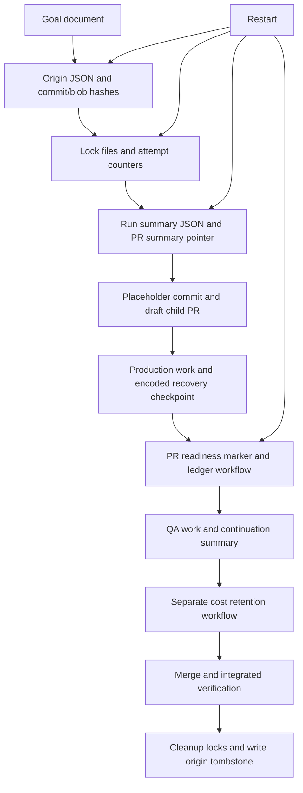
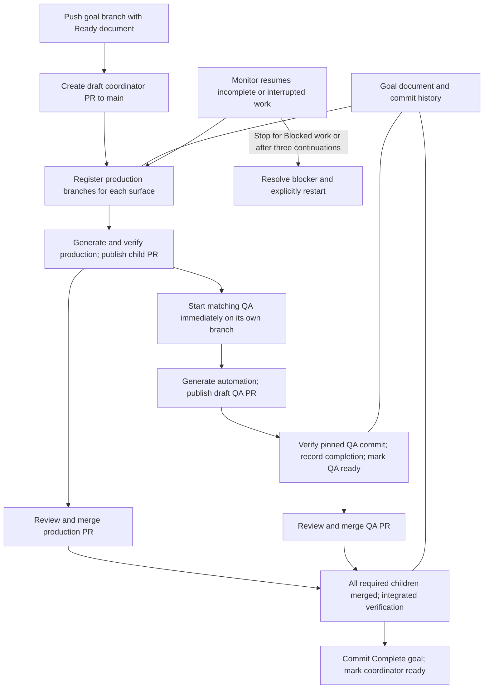

# Goal delivery flow comparison

The original process reconciled multiple recovery records. The current process uses
the goal document on the delivery branch, with ordinary commits providing history.

## Original flow

## Simplified flow

QA starts after verified production publication, without waiting for production
merge. Each surface has its own production and QA branches. The monitor waits for
active runs and verified PR review, and resumes missing work from the document.

| Concern | Original | Simplified |
| --- | --- | --- |
| Recovery | Reconcile origin, locks, summaries, PR markers, checkpoints | Read the goal document and validate its branches/PRs |
| Registration | Placeholder commit to create a draft child PR | Record the branch; open the PR when substantive work exists |
| Concurrency | Persistent locks plus workflow coordination | GitHub job concurrency and retryable document commits |
| Verification | PR readiness markers | Verified production revision recorded in the document |
| Costs | Separate dispatched workflow and JSON ledger | Idempotent run/attempt entries in the document |
| Completion | Origin tombstones and lock cleanup | Goal closure evidence; closed PRs excluded from monitoring |

Repository/PR ownership checks and QA's binding to the production revision remain.
Diagnostic artifacts and review evidence are not alternate delivery recovery records.
Incomplete or interrupted runs resume within the document continuation limit. Blocked or exhausted recovery requires intervention. Hosted end-to-end delivery still needs validation after merge.
