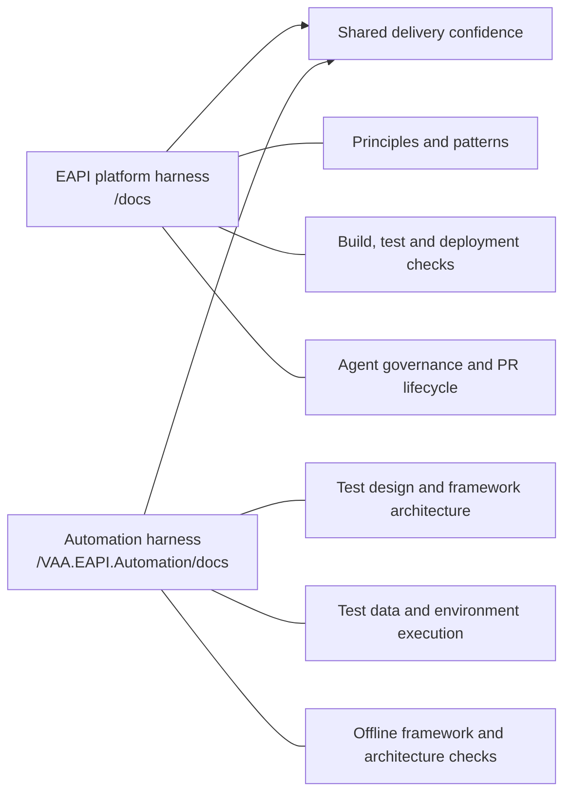
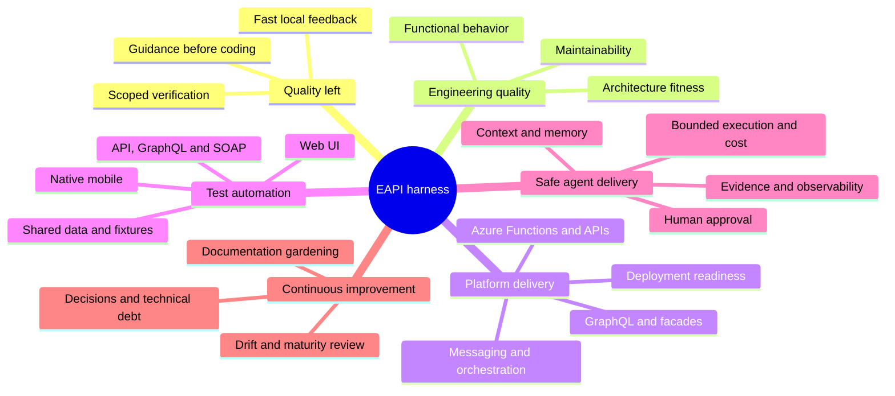
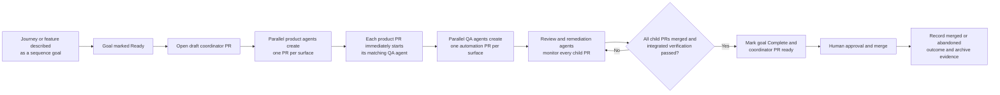
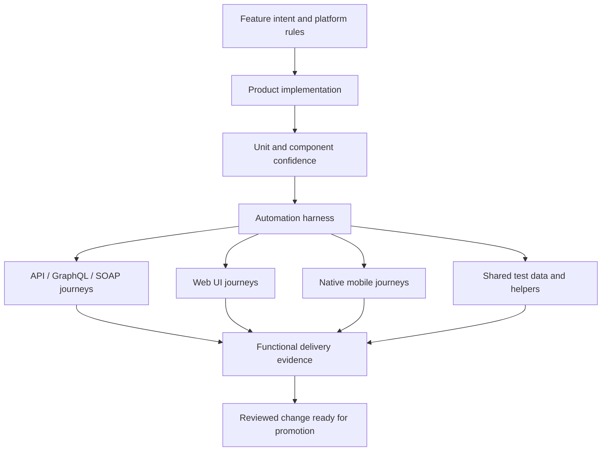

# Harness Overview

This is a high-level briefing for explaining what the EAPI engineering harness provides today, how the platform and Automation harnesses fit together, and how agent-assisted delivery moves from an idea to a reviewed change.

## The Short Version

The harness is the operating system around engineers and coding agents. It combines:

- **guides** that explain what good looks like before work starts;
- **sensors** that check the result during and after the work;
- **delivery controls** that retain evidence, manage review, and stop unsafe or incomplete changes.

There are two complementary documentation areas:

- **`/docs` — the platform harness.** Shared EAPI principles, patterns, verification, governance, agent controls, and delivery workflows for the whole repository.
- **`/VAA.EAPI.Automation/docs` — the test-automation harness.** Specialist guidance and checks for API, GraphQL, SOAP, web UI, and native mobile automation.

The platform harness establishes the common rules. The Automation harness extends them for test delivery; it does not replace them.

## What We Have Today

| Area | Platform harness (`/docs`) | Automation harness (`/VAA.EAPI.Automation/docs`) |
| --- | --- | --- |
| Orientation | Repository map, reading order, ownership and change expectations | Automation-specific workflow, architecture and conventions |
| Design guidance | Architecture, integration, infrastructure, security and data principles | Test design, test data, integration, execution and security principles |
| Reusable approaches | API, Function, GraphQL, connector, messaging, caching and testing patterns | Request wrappers, shared helpers, page objects, fixtures and suite layering |
| Quality checks | Scoped build/tests, formatting, deployment coverage, documentation health, architecture fitness, preferred-extension usage and unit-test standards | Warning ratchet, formatting, project-layer fitness tests and offline Core helper tests |
| Functional coverage | Sequence diagrams linked to behavior sensors | API, GraphQL, SOAP, Selenium/web UI and Appium/native mobile coverage |
| Test data | Platform security and data-handling rules | Storage-table-driven data, dynamic generation, isolation, cleanup and safe secrets handling |
| Delivery | Local verification, pre-commit checks, CI parity and release guidance | A single Automation verification command plus a dedicated PR gate |
| Agent operation | Memory, context routing, observability, recovery, budgets, maturity and documentation gardening | Automation-specific instructions loaded during the functional-test delivery phase |
| Evidence | Test results, coverage, run records, maturity ledgers and remediation history | Build/offline-test evidence plus environment-based functional results where authorised |

## Features and Themes Supported

The recurring themes are:

1. **Keep quality left.** Put guidance and fast checks as close as possible to the point where a change is made.
2. **Use the smallest owning scope.** Build, test and verify the affected solution or project instead of treating the monorepo as one unit.
3. **Turn important prose into executable checks.** Architecture rules, formatting, warnings, behavior and documentation health should be machine-checkable where practical.
4. **Test at more than one level.** Offline tests protect the automation framework itself; environment-based suites validate real customer and integration journeys.
5. **Prefer evidence over assertion.** Runs retain results, coverage, decisions, costs and review outcomes.
6. **Keep humans responsible for judgment.** Agents can implement, test and respond to feedback, but unresolved questions and human review remain visible and approval is still required.

## How Agent Delivery Works

The most developed automated path is **sequence-goal delivery**. A sequence diagram describes the intended journey, acceptance evidence, expected harness coverage and any open decisions. A draft coordinator PR opens when delivery starts and its branch retains only goal and lifecycle evidence. Every production surface delivers through an independently monitored PR and immediately starts its matching QA continuation; other surfaces remain parallel. After all children merge, integrated verification completes the goal and marks the existing coordinator PR ready.

At a high level:

1. **Intent is made explicit.** The diagram is both a communication aid and a delivery contract.
2. **Coordination is visible first.** A draft coordinator PR opens before implementation and carries the evolving child-PR ledger and cost evidence.
3. **Surface chains remain independent.** Product agents run in parallel, and each production PR starts only its matching QA agent without waiting for merge or sibling surfaces.
4. **Functional automation follows per surface.** Each dedicated QA continuation loads the Automation guidance and adds coverage in the owning suite, or proves suitable coverage already exists.
5. **The harness checks the outcome.** Generated code is formatted, Automation builds, affected scopes are verified, and acceptance evidence is compared with the goal.
6. **Feedback is handled but not hidden.** Existing agents monitor child and coordinator PRs, action valid review feedback, and leave human threads for humans.
7. **The lifecycle is closed.** Once every child merges and integrated verification passes, the goal becomes Complete and the coordinator PR becomes ready; merge or abandonment is then retained durably.

## Where the Automation Harness Fits

The Automation harness adds two kinds of confidence:

- **framework confidence**, available offline through build, architecture and Core helper checks;
- **journey confidence**, produced by functional suites against authorised environments and data.

This distinction matters: not every end-to-end test is safe or possible to run locally, so fast offline sensors protect the framework while controlled pipelines provide live-environment evidence.

## A Simple Way to Present It

> We have a layered delivery harness. The platform layer gives every engineer and agent the same architecture, security, coding and delivery rules. The Automation layer turns those rules into repeatable coverage across APIs, GraphQL, SOAP, web and mobile journeys. Agents can take a documented journey through implementation, functional automation, verification and PR review, while evidence and open decisions remain visible and human approval stays in control.

## Useful Detail References

- [Harness capabilities matrix](harness-capabilities-matrix.md)
- [Harness engineering](harness-engineering.md)
- [Agent delivery loop](agent-loop-workflow.md)
- [Current SDLC](current-sdlc.md)
- [Automation harness engineering](../VAA.EAPI.Automation/docs/HARNESS_ENGINEERING.md)
- [Automation framework architecture](../VAA.EAPI.Automation/docs/FRAMEWORK_ARCHITECTURE.md)
- [Automation test execution](../VAA.EAPI.Automation/docs/TEST_EXECUTION.md)
- [Automation test data strategy](../VAA.EAPI.Automation/docs/TEST_DATA_STRATEGY.md)
