# Architecture Principles
**Virgin Atlantic EAPI Platform**

---

## Platform Structure

```mermaid
flowchart TB
    Channels["Channels and consumers<br/>Web, App, NDC, partners, internal users"]
    GraphQL["GraphQL orchestration layer<br/>Queries, mutations, composition, gateway policy"]

    subgraph Microservices["Domain microservices"]
        Retail["Retail microservices<br/>Basket, offer, order, payment, ticket, seat"]
        Loyalty["Loyalty microservices<br/>Customer, identity, wallet, campaigns, VRed"]
        CRM["CRM microservices<br/>Content, email, notification, refunds, profile"]
        FlightOps["Flight operations microservices<br/>Flights, crew, catering"]
        GroundOps["Ground operations microservices<br/>Check-in, baggage, lounge"]
        DataServices["Data and utility microservices<br/>Reference, insights, egress, configuration"]
    end

    subgraph Databases["Bounded context data stores"]
        RetailDb["Retail data stores"]
        LoyaltyDb["Loyalty data stores"]
        CrmDb["CRM data stores"]
        FlightDb["Flight operations data stores"]
        GroundDb["Ground operations data stores"]
        DataDb["Data and utility stores"]
    end

    ServiceBus["Azure Service Bus<br/>CloudEvents, topics, subscriptions, async eventing"]

    subgraph Downstream["Downstream systems and partners"]
        Air4["AIR4"]
        Ita["ITA"]
        VirginRed["Virgin Red"]
        Sabre["Sabre / NDC"]
        D365["Dynamics 365"]
        Entra["Entra / B2C"]
        Other["Other approved partner systems"]
    end

    Channels --> GraphQL
    GraphQL --> Retail
    GraphQL --> Loyalty
    GraphQL --> CRM
    GraphQL --> FlightOps
    GraphQL --> GroundOps
    GraphQL --> DataServices

    Retail <--> ServiceBus
    Loyalty <--> ServiceBus
    CRM <--> ServiceBus
    FlightOps <--> ServiceBus
    GroundOps <--> ServiceBus
    DataServices <--> ServiceBus

    Retail --> RetailDb
    Loyalty --> LoyaltyDb
    CRM --> CrmDb
    FlightOps --> FlightDb
    GroundOps --> GroundDb
    DataServices --> DataDb

    Retail --> Air4
    Retail --> Ita
    Retail --> Sabre
    Retail --> D365
    Loyalty --> VirginRed
    Loyalty --> Entra
    CRM --> D365
    FlightOps --> Air4
    GroundOps --> Air4
    DataServices --> Other
```

EAPI is a multi-solution .NET monorepo organised around microservices, GraphQL gateway domains, facades, orchestration services, shared infrastructure, automation, deployments, and pipelines. Architecture decisions should preserve domain ownership, keep change scope small, and reuse the platform conventions already present in the repository.

## Domain-Aligned Solutions

Work in the solution and project that owns the behaviour being changed.

- Use `VAA.EAPI.Microservices` for domain microservices and shared backend libraries.
- Use `VAA.EAPI.GraphQL` for GraphQL gateway host, domain query/mutation projects, and stitching work.
- Use `VAA.EAPI.Web` for web API layer and BFF-style functions.
- Use `VAA.EAPI.Facade` for adapters around identity, wallet, NDC IFG, enrolment, partner, or channel-specific integrations.
- Use `VAA.EAPI.Orchastration` for cross-domain workflows and event-driven orchestration.
- Use `VAA.EAPI.Deployments`, `VAA.EAPI.Pipelines`, and `VAA.EAPI.Pipelines.DigitalServices` for deployment and pipeline changes.

## Smallest Owning Boundary

Every change should land in the smallest boundary that naturally owns it.

- Do not modify shared infrastructure libraries to solve a single service problem unless the behaviour is genuinely reusable.
- Do not add orchestration logic to triggers; triggers should translate transport concerns and delegate to application handlers.
- Keep application handlers focused on use-case orchestration and domain rules.
- Keep service implementations behind interfaces when they touch downstream systems, storage, messaging, or external services.
- Preserve existing project ownership boundaries even when a shortcut would be faster.

## Azure Functions First

Microservices and facades are Azure Functions-based unless a different host already exists.

- New microservices should use Azure Functions isolated worker and follow the repository framework policy under [New Code Standards](#new-code-standards).
- Startup should configure command-line and environment configuration, Functions worker defaults, default middleware, OpenAPI, DI, health checks, telemetry, caching, and outbound HTTP support.
- HTTP functions belong under `Triggers/Http`; Service Bus functions under `Triggers/ServiceBus`; timer functions under `Triggers/Timer`.
- HTTP triggers must include OpenAPI operation, request, security, and response documentation.
- Add heartbeat and warmup triggers where the service exposes HTTP endpoints or needs platform readiness checks.

## Layering

New microservices should use clear, explicit layers.

- `Application/` contains command/request models, handlers, use-case orchestration, validation, and explicit mapping.
- `Domain/` contains API and domain DTOs grouped by feature.
- `Interfaces/` contains contracts for handlers and services.
- `Services/` contains implementations of those interfaces.
- `Constants/Environment.cs` centralises environment variable keys.
- `ErrorCodes/` contains service error-code payloads.
- `Triggers/` contains only transport entry points.

## GraphQL Gateway Composition

GraphQL functionality is composed by domain projects and registered through domain `Startup` classes.

- Add queries and mutations to the relevant `VAA.EAPI.GraphQL.Domain.*` project.
- Register resolver types in that domain's `Startup` using the existing `RegisterQueries` and `RegisterMutations` pattern.
- Use secure/public visibility gates consistently with the domain's existing `isSecure` handling.
- Keep GraphQL resolvers thin; delegate downstream calls and mapping to domain services.
- Do not use GraphQL for internal service-to-service communication.
- Keep host entrypoints thin (`VAA.EAPI.GraphQL`, `VAA.EAPI.GraphQL.Rest`, `VAA.EAPI.GraphQL.Stitch`); host projects should compose domain/infrastructure services rather than own business workflows.
- Treat domain startup discovery as part of runtime architecture. New domain capability is not active until its `Startup : IStartup` registration is discoverable by the host.
- Keep REST router and MCP exposure as translation layers over registered domain operations; do not fork business logic between direct GraphQL resolvers and REST/MCP routes.

## Facades And Anti-Corruption Boundaries

External and channel-specific integrations should be isolated behind facades or service abstractions.

- External models from D365, Entra, B2C, wallet, NDC, Sabre, SkyTeam, ServiceNow, Graph, payment, and partner systems must not leak across the platform as internal domain models.
- Transformation belongs at the facade, NDC transformation, infrastructure client, or service boundary.
- Keep external request/response DTOs separate from domain DTOs when they have different lifecycle or semantics.
- Token generation, subscription keys, partner-specific headers, and external endpoint composition should be encapsulated.
- When replacing an external dependency, aim to change the adapter rather than every consumer.

## Orchestration And Event Flow

Cross-domain workflows should be explicit and observable.

- Synchronous composition across domains belongs in the web, GraphQL, facade, NDC transformation, or orchestration layer, not inside unrelated domain service internals.
- Asynchronous reactions should use Service Bus CloudEvents and event handlers.
- Use event store patterns where a flow requires durable publish/rollback visibility.
- Propagate `AsyncContext` diagnostics such as correlation ID, operation ID, session ID, channel, and diagnostics flags.
- Handlers should support cancellation tokens and fail with controlled platform errors.

## Shared Platform Libraries

Prefer existing platform libraries over new local implementations.

- Use `VAA.EAPI.Common` for common extensions, serialization, diagnostics, and configuration helpers.
- Use `VAA.EAPI.Infrastructure` for HTTP connector, middleware, repositories, Azure storage, Service Bus, health checks, and shared services.
- For JSON payloads, use the existing `Newtonsoft.Json`-based platform helpers and settings; do not introduce `System.Text.Json` as a parallel serialization stack.
- Use domain-level common packages only when the dependency direction is already established.
- Do not duplicate shared middleware, connector, telemetry, or error-mapping behaviour in individual services.
- When a shared library is missing a capability, add a small, tested extension rather than a broad rewrite.

## Dependency Injection

Dependencies must be explicit and lifetimes intentional.

- Register service dependencies in `Program.cs` or the domain `Startup` that owns them.
- Singleton is suitable only for stateless, thread-safe services and shared clients designed for concurrent use.
- Use transient or scoped-style lifetimes where per-operation state is involved.
- Avoid service locator patterns inside handlers.
- Constructor guard clauses should protect required dependencies.

## New Code Standards

New code should move the platform forward without destabilising existing services.

- All projects target the repository-approved framework, currently .NET 10. Future upgrades should be coordinated across shared projects and their consumers; new projects must not independently adopt a newer framework.
- Do not introduce MediatR or AutoMapper into new microservice scaffolding; use explicit handlers and explicit mapping.
- When maintaining an existing MediatR-based project, keep changes consistent with that project unless migrating is in scope.
- Keep tests close to the project and add at least one happy path and one failure or edge scenario for new handlers.
- Add or update a service README when the change affects onboarding, configuration, endpoints, or operational behaviour.

## AI Agent Conformance Checklist

- Am I working in the smallest owning solution?
- Did I preserve trigger, application, domain, interface, and service boundaries?
- Did I register DI, middleware, OpenAPI, telemetry, health checks, and caching consistently?
- Did I keep external models behind adapters or facades?
- Did I avoid new framework abstractions when existing EAPI patterns already cover the need?
- Did I run or report the relevant solution-scoped verification?
