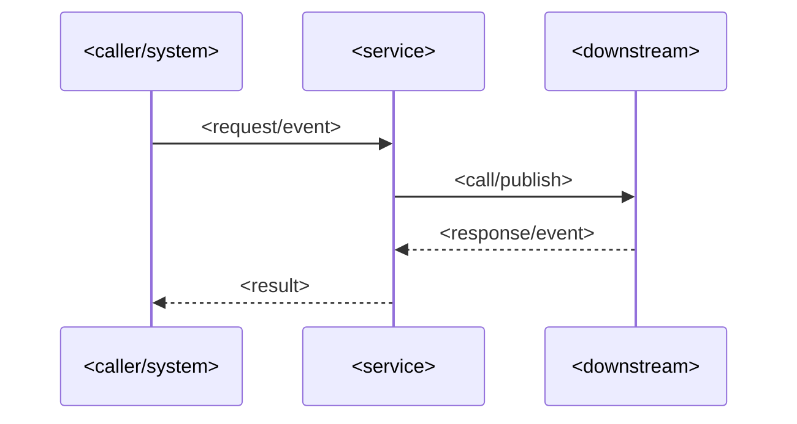

# <Flow Name>

One-sentence description of the business flow and its intent.

> **Minimum review:** Read the flow name and description, **Why this flow exists**, **Sequence (detailed)**, and **Open points to finalize**. These sections establish the purpose, intended interactions, and outstanding questions; review the remaining sections as relevant to your role.

## Why this flow exists

Describe the user/business need and required conditions.

## Sequence (detailed)

<!-- Authoring: one sequence statement per line. Use commas or   in labels and notes, never raw semicolons. A literal semicolon is #59;. Run check-mermaid-diagrams.ps1 -Path <file> before delivery; -LintOnly is an early check, not parser evidence. -->

## Open points to finalize

- <Open point 1>
- <Open point 2>

## UX contract

Delete this section when no screenshot, design file, prototype, video, or other UX artefact was supplied. When UX is supplied, it is a direct implementation instruction: reproduce its visible hierarchy, content, controls, layout, and represented states. Use the detailed sequence above to define when screens appear, how controls behave, and how states transition.

| Field | Value |
| --- | --- |
| Supplied UX | `None` or <path/link and exact frame/node where available> |
| Implementation authority | `Not applicable` when Supplied UX is `None`; otherwise `Direct instruction` |
| Flow and behaviour authority | `Sequence (detailed)` |
| Screen/state mapping | <map each supplied screen/state to the applicable sequence message, branch, and user action> |
| Design inspection matrix | <for each applicable state: target implementation surface, sequence transition, measurable hierarchy/layout/spacing/typography/colour/assets/interaction properties, responsive behavior, reused components/tokens, and intentional adaptations> |
| Visual verification | <screenshot/render comparison command and retained evidence path, or Planned while Draft/Ready> |
| UI/UX acceptance test | <app/UI automation test path for every mapped state, or Planned while Draft/Ready> |
| Rendered evidence | <repository-relative actual screenshot and comparison/diff image paths, or Planned while Draft/Ready> |
| Comparison result | <Passed with tool/reviewer and tolerance, or Planned while Draft/Ready> |

Before implementation, inspect every applicable state at readable resolution and complete the design inspection matrix. Capture the measurable visual, interaction, and responsive properties represented by the artefact, and identify existing components and design tokens to reuse. Implement and visually compare one representative state before expanding the remaining states. If an artefact cannot be opened, is ambiguous, or conflicts with the sequence flow, record the conflict under `Open points to finalize` and keep the goal out of delivery. Do not downgrade supplied UX to inspiration or design context because an inspectable Figma node is unavailable. A supplied UI/UX goal cannot become `Complete` without a completed design inspection matrix, an executable UI acceptance test, retained renders and comparison evidence, and a passing comparison result for every mapped state.

## High-level behaviour

1. <Step 1>
2. <Step 2>
3. <Step 3>

## Integration points

| Component | Responsibility |
| --- | --- |
| `<component>` | `<responsibility>` |
| `<component>` | `<responsibility>` |

Diagram presentation: use Mermaid's default unstyled presentation without background or fill colours, borders, boundary boxes or containers (`box`/`subgraph`), custom themes, `style`, or `classDef`. Label repository-owned resources and participants with their actual project names where applicable.

## Agent delivery constraints

- Target solution/project path: `<owning .sln or .csproj path>`
- New implementation path, when needed: `<path>`
- New test path, when needed: `<path>`
- Contract source files to read: `<path(s)>`
- Endpoint/event/query/command names: `<exact names>`
- Configuration and secret handling: `<environment variables, placeholders, and no-secret expectations>`
- Harness command: `<dotnet test or script command>`

## Key non-functional considerations

- **Idempotency**: <expectation>
- **Correlation**: <expectation>
- **Retry behavior**: <expectation>
- **No-op path**: <expectation>

## Failure paths to capture in implementation

- <Failure mode 1>
- <Failure mode 2>

Expected behavior:

- <Retry/fallback/rollback expectation>
- <Logging/observability expectation>

## Expected harness

- <Primary test/script sensor path>
- <Additional sensor path>

## Agent Loop Goal

| Field | Value |
| --- | --- |
| Goal | <Outcome this diagram is trying to deliver> |
| Status | `Draft` |
| Delivery surface | `Backend` |
| Owner | <Owning team/project maintainers> |
| Review cadence | Monthly and on behavior/contract/dependency change |
| Last reviewed | YYYY-MM-DD |
| Harness Sensor | Planned: <test/script path or planned harness note> |
| Promotion verification | Fast |
| Acceptance evidence | <Concrete evidence that implementation satisfies the diagram, normally passing harness plus changed-code alignment> |
| Done when | <Clear completion condition for this goal> |

## Associated delivery pull requests

The draft coordinator PR and its row are created when this goal enters `InProgress`. Every production and QA agent is then recorded here on its own branch and PR. The coordinator PR remains draft until every current child PR is merged, integrated verification passes, and open questions are resolved.

The workflow populates this table for delivery surfaces hosted in other GitHub repositories.

| Surface | Repository | Base branch | Head branch | PR | State | Merged at UTC |
| --- | --- | --- | --- | --- | --- | --- |

## Agent Loop Closure Evidence

No closure evidence recorded yet. Lifecycle evidence is accumulated on the open draft coordinator PR. Completion evidence is committed before the PR becomes ready. The finalizer appends merged evidence on `main`, closed-unmerged abandonment evidence on the delivery branch when available, or a sanitized standalone abandonment record on `main` when that branch was already deleted.
