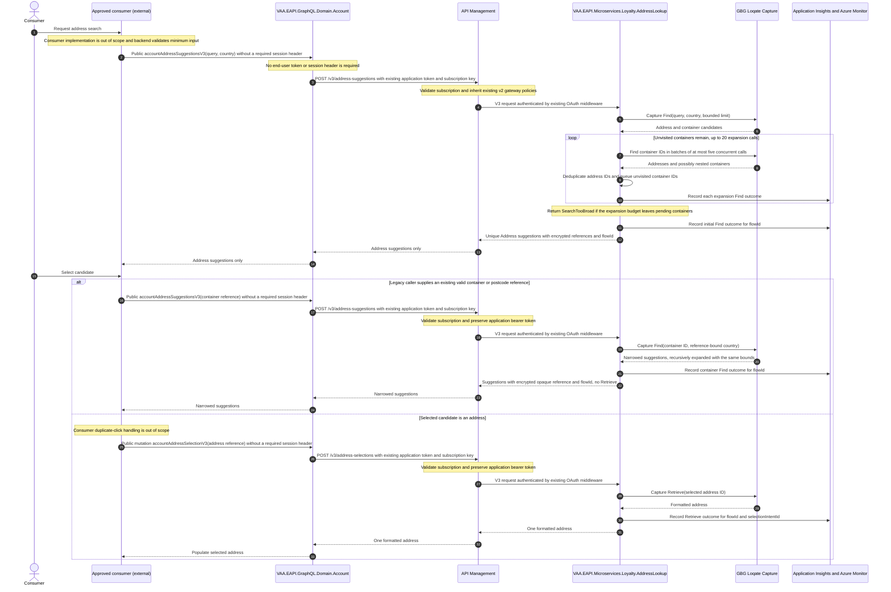

# Address Lookup v3 Suggestions and Selected-Address Retrieval

Draft goal for an additive v3 flow that uses Find for suggestions and calls Retrieve only for an explicitly selected address. Existing v2 endpoints and behaviour remain supported and unchanged. Production savings are a target, not a result already demonstrated by this PR.

> **Minimum review:** Read the flow name and description, **Why this flow exists**, **Sequence (detailed)**, and **Open points to finalize**. These sections establish the purpose, intended interactions, and outstanding questions; review the remaining sections as relevant to your role.

## Why this flow exists

`POST /AddressDetailsV2` currently uses GBG Loqate Capture Find and then retrieves up to `GbgSearchRecordLimit` matching items whose type is `Address`, in parallel. `GbgSearchRecordLimit` is `20` in every current deployment parameter file. The Account GraphQL `accountAddressDetails` resolver is configured to call this endpoint when the Azure endpoint flag is enabled.

Capture Find returns display candidates and temporary identifiers; Capture Retrieve returns formatted address details and consumes credit. The present v2 contract returns formatted details before a customer selects a candidate. For example, three address candidates result in three chargeable Retrieves when the intended customer journey requires one selected address. The v3 flow changes the contract so selection, not discovery, authorizes a paid retrieve.

## Sequence (detailed)

As of 2026-10-06, suggestions recursively expand provider containers before returning. Batches contain at most five concurrent Find calls; at most 20 expansion calls follow the initial Find. Provider IDs are deduplicated within this request to prevent repeated container dispatch and duplicate address output. Only Address candidates are returned. The existing per-Find limit remains; this is not an exhaustive postcode lookup. If unvisited containers remain after the budget, return `422 SearchTooBroad`; failures/cancellation do not return partial success or trigger retries. Tests: `AddressLookupV3ExpansionTests` (real connector/mock fixtures) and scheduling/budget/cancellation tests in `AddressLookupV3ServiceTests`. This supersedes the earlier client-driven container navigation description.

## Open points to finalize

- Confirm the approved backend consumers that call `AddressDetailsV2` directly and the v3 adoption owner; no Website, app, mobile, or other consumer change is a delivery surface for this goal. Public v3 access is constrained by the reviewed GraphQL-to-APIM subscription boundary, v2 application OAuth, inherited gateway controls and APIM-only service ingress; references remain replayable by any holder through public GraphQL.
- Confirm the REST and GraphQL names above, v3 adoption/retention ownership (without changing v2), the approved Key Vault authenticated-encryption-key ownership/rotation process for five-minute stateless references, existing server-side OAuth credentials and APIM subscription keys.
- Obtain GBG Loqate contractual confirmation of charge semantics, provider retry behaviour, rate limits, datasets, and operation-attributed reporting that separates v3 billing from v2 on the shared default key.
- Agree address-data classification, legal basis, and whether manual entry is permitted when the provider is unavailable.
- Establish current baselines by caller/key: inbound v2 calls, Find calls, paid Retrieve calls, Retrieve-to-selection ratio, duplicate/cancelled requests, provider errors, latency, cost, and the measured potential for duplicate query/address reuse. Agree an independently validated v3 canary denominator and version-attributed provider reporting before claiming the 1.05 target. Audit persistence is removed and sampled events are not an authoritative substitute. The 28-day, 1,000-intent sample target remains pending an agreed measurement method; lower-volume analysis needs explicit owner approval.
- After two to four weeks of v3 baseline data, decide whether server-side replay, request coalescing, or a privacy-reviewed cross-user formatted-address cache meet an agreed savings threshold. Do not adopt any of them solely on assumed household or postcode repetition.
- Agree initial backend operational thresholds: suggestion cap, minimum input, timeout/retry budget, per-caller rate limit, daily cost budget, target p95 latency, telemetry limitations, and acceptable address-quality change.

## Direct implementation status

The backend implementation is complete in the delivery branch without invoking an agent loop: it adds the additive v3 service, public GraphQL fields, APIM policy/configuration, safe application diagnostic events, and focused tests. The goal remains `Draft` rather than being marked `Complete` because the stated completion contract also requires real environment provisioning, deployment, provider-contract confirmation, and a 28-day production canary with 1,000 trusted dispatch intents. Those facts cannot be created or evidenced from a source-code change.

## Current PR scope

[PR #2071](https://github.com/VAAD1ST/eapi/pull/2071) adds the Address Lookup v3 service endpoints, public Account GraphQL query/mutation, APIM/configuration/deployment support, Bruno examples and focused backend tests. Both v3 operations reuse the existing default GBG credential. Suggestions and container expansion call Find only; selection accepts an Address reference and makes one Retrieve attempt without automatic retry. Repeated selections can still cause additional paid calls.

Shared HTTP connectors remain unchanged. The Account v3 provider uses the existing non-generic connector overload with `noWait: true`, which adds `x-nowait` once, preserving no-follow behaviour without altering other callers. At the user's review decision, the REST-only exclusion attribute/filter is removed: normal REST routing and associated capability discovery apply to both v3 operations. Both Common libraries and the REST router match main.

Not delivered here: client UI/debounce, a new result cache, replay/idempotency/coalescing, session binding, end-user authentication, resolver policies, audit persistence/recovery/retention timers, v3 no-store/cache bypasses, or custom telemetry processors. Existing platform caching remains configuration-driven.

Independent draft reviews, not part of v3 implementation or evidence:

- [#2306 — opt-in shared HTTP logging suppression](https://github.com/VAAD1ST/eapi/pull/2306); merging the generic mechanism alone does not enable it for v3.
- [#2308 — shared HTTP TLS validation and cache storage security](https://github.com/VAAD1ST/eapi/pull/2308).
- [#2309 — GraphQL host logging and authorization-policy handling](https://github.com/VAAD1ST/eapi/pull/2309).

Production approval must address remaining platform logging/TLS/cache risks and bearer-reference replay. Removing or separating controls is not security approval.

## Authentication simplification (2026-10-05)

The user explicitly requested v2's existing access path instead of the v3-only security layer introduced in #2071. [Recovery PR #2343](https://github.com/VAAD1ST/eapi/pull/2343) removes signed APIM context, additional Function-key injection and APIM Key Vault reads while retaining the normal server OAuth, subscription and network controls. Empty environment APIM parameter files remain to preserve existing stage wiring, including production policy replacement. Incremental deployment leaves old unused secrets/named values intact; no vault or permission changes are introduced.

Roll out GraphQL first, then coordinate service and APIM policy replacement: the old policy strips the application token needed by the new service. This is not a zero-downtime compatibility claim. The reference payload version changes to `v2` and old references are rejected before dispatch; fetch fresh suggestions. Reference-holder replay across users remains a production abuse-review concern, not an approved security exception.

## UX contract

| Field | Value |
| --- | --- |
| Supplied UX | `None` |
| Implementation authority | Backend only; no Website, app, or other consumer code is in scope. |
| Flow and behaviour authority | `Sequence (detailed)` describes the backend contract and assumed caller behaviour only. |
| Screen/state mapping | Out of scope. Consumer adoption, UX, debounce, duplicate-click prevention, and manual-entry experience require separate work. |
| Design inspection matrix | Not applicable to this backend-only Draft. |
| Visual verification | Not applicable to this backend-only Draft. |
| UI/UX acceptance test | Not applicable to this backend-only Draft. |
| Rendered evidence | Not applicable to this backend-only Draft. |
| Comparison result | Not applicable to this backend-only Draft. |

## High-level behavior

Account GraphQL also accepts the v2 field names `countryCode`, `postCode` and `addressLine1` for initial v3 suggestions. It combines trimmed, nonblank address-line and postcode values into one downstream Find query. Existing free-text `query` remains supported; address fields cannot be combined with `query` or a container `reference`. V3 keeps its own input type, suggestions response and reference-only selection mutation; it does not retrieve full details for every candidate.

1. The backend accepts a validated, normalised address query from the public v3 suggestion operation. V3 does not require a client session header. V3 uses the existing platform cache configuration, with no operation-specific cache bypass or `no-store` enforcement. Any consumer debounce or minimum-input UX is outside this goal; the backend independently validates its configured minimum input.
2. Address Lookup calls GBG Loqate Find, recursively expands returned containers in batches of five with a maximum of twenty expansion calls, and returns unique Address suggestions with five-minute stateless authenticated-encrypted opaque references and a non-PII `flowId`. Each reference contains a server-issued `selectionIntentId` and validated country, but no caller-class, dataset or session binding. It does not call Retrieve. Exhausting the expansion budget returns `422 SearchTooBroad` instead of partial results.
3. A consumer sends one selection mutation with only the encrypted opaque address reference. Address Lookup derives `flowId` and `selectionIntentId` only from the validated authenticated-encrypted address reference; the caller does not send either as a separate request field. The server-issued `selectionIntentId` is the trusted diagnostic correlation; no client-generated selection identifier is accepted. A container reference instead triggers another Find drill-down. The initial release does not retain results for replay or share results between customers.
4. After validation the service sends one Retrieve without an audit-storage write or audit-availability check. It protects the operation with v2's existing GraphQL-to-APIM subscription boundary, application OAuth authentication, inherited gateway controls, cancellation, and application-event correlation, and returns controlled errors rather than retrying into excess provider cost.

## Integration points

| Component | Responsibility |
| --- | --- |
| Consumer (out of scope) | Uses the backend contract to request suggestions, container drill-down, and address selection. No consumer code, UX, browser caching, debounce, duplicate-click handling, or automation is delivered by this goal. |
| `VAA.EAPI.GraphQL.Domain.Account` | Retains the existing `accountAddressDetails` v2 resolver and schema unchanged. Adds `accountAddressSuggestionsV3` and `accountAddressSelectionV3` to the public GraphQL schema without a resolver policy. It uses a v3 outbound path that reuses the existing server-side `EnrolmentMSOcpKey` used by v2 without requiring a client session header; it does not send an end-user bearer. It acquires the existing application token for `AddressLookupAPIAppId` through `IOAuthTokenProvider`, including for Development/loopback/non-Azure local testing. No custom signing mode remains. |
| `VAA.EAPI.GraphQL.Rest` | Uses unchanged route discovery for both public v3 resolvers: `POST /api/v1/accountAddressSuggestionsV3` and `POST /api/v1/accountAddressSelectionV3`. Request bodies use the existing `request` wrapper. There is no special v3 exclusion or expected exclusion-driven 404. Normal REST/capability discovery and host configuration apply. |
| API Management and Address Lookup authorisation | Reuses v2's existing subscription, server-to-server OAuth authentication and APIM-only network restrictions. GraphQL sends its existing `EnrolmentMSOcpKey` and application token; enrolling users supply neither. V3 triggers are host-key-anonymous with the standard authentication middleware and OAuth2 OpenAPI metadata, just like v2. No v3 Function key, signed context, caller-class/dataset claim, dedicated subscription, or separate rate policy remains. APIM explicitly replaces the old policy with inherited base policies so Authorization is preserved. No v3 APIM Key Vault named values or secret-read dependency remain. |
| `VAA.EAPI.Microservices.Loyalty.AddressLookup` | Owns input and stateless authenticated-encrypted-reference validation, provider gateway calls, controlled errors, safe application diagnostic events, and use of the pre-existing URI logging flag. This is not comprehensive sensitive-request or telemetry redaction. The v3 release adds no address-selection/result state or audit persistence; it does not replay or deduplicate selections. |
| GBG Loqate Capture | Supplies Find candidates, container drill-down, and one chargeable Retrieve for a selected address. |
| Application Insights, Azure Monitor, and GBG reporting | Find/Retrieve events retain safe diagnostic correlation, but can be sampled or lost and are not a durable billing ledger. V3 shares the existing GBG default key with v2; provider-attributed reporting must distinguish versions. With the audit removed, authoritative per-selection cost measurement requires an owner-approved alternative before claiming the numerical savings target. |

## Agent delivery constraints

### Current enrolment constraints (2026-09-28)

- Both v3 operations are registered on the public GraphQL schema and require no end-user bearer token, B2C claim, role, or resolver-specific policy.
- No client `api-session-id` is required for suggestions, container drill-down, or selection. Shared tracing is unchanged; v3 does not use session IDs for reference validation.
- APIM retains standard subscription authentication; GraphQL reuses its existing server-side `EnrolmentMSOcpKey` and application token for `AddressLookupAPIAppId`. Clients need no additional v3 key or end-user token. Inherited gateway policies apply, with no separate v3 rate-limit or signed-context policy.
- The v3 Functions match v2: `AuthorizationLevel.Anonymous` with the existing authentication middleware and OAuth2 OpenAPI security. No extra Functions key is required; application OAuth and network protection remain.
- V2 routes and contracts remain unchanged; both v3 resolvers participate in existing GraphQL REST route discovery.
- V3 reuses the default (empty `ClientId`) entry in the existing `GbgServiceKeyMap`. No separate v3 GBG key map or new provider credential is required. Missing or malformed default-key configuration returns `503 ProviderKeyUnavailable` before GBG.
- With a shared key, distinguish v3 dispatch measurements from provider-billed totals that also include v2. V3 billing acceptance requires operation-attributed reporting.

### Implementation and verification boundaries

Earlier authenticated-account/session requirements are superseded. Their decision history is retained in the [delivery execution plan](../exec-plans/active/2026-09-21-address-lookup-v3-delivery.md), not as current implementation instructions.

- HTTP routes: `POST /v3/address-suggestions` and `POST /v3/address-selections`; GraphQL fields: `accountAddressSuggestionsV3` and `accountAddressSelectionV3`.
- Both Functions declare the same OAuth2 OpenAPI security as v2 and use its standard authentication middleware. Container expansion uses the country inside the validated reference; selection rejects non-Address references before Retrieve.
- Provider parameters are percent-encoded. No paid Retrieve is automatically retried; references do not implement deduplication.
- `flowId`, reference-derived `selectionIntentId` and per-attempt `dispatchId` are diagnostic correlation only, never a durable billing denominator or client-supplied selection identifier.
- Shared TLS/cache, host authorization/logging and opt-in HTTP suppression are outside this PR, as listed above. Do not add address-specific decisions to shared files.

- Preflight verification: run the smallest focused projects with run-scoped TRX/XPlat coverage and `scripts/analyse-test-run-results.ps1`: `VAA.EAPI.Microservices/VAA.EAPI.Microservices.Loyalty.AddressLookup.Tests/VAA.EAPI.Microservices.Loyalty.AddressLookup.Tests.csproj`, `VAA.EAPI.Microservices/VAA.EAPI.Infrastructure.Tests/VAA.EAPI.Infrastructure.Tests.csproj`, `VAA.EAPI.GraphQL/VAA.EAPI.GraphQL.Domain.Account.Tests/VAA.EAPI.GraphQL.Domain.Account.Tests.csproj`, `VAA.EAPI.GraphQL/VAA.EAPI.GraphQL.Infrastructure.Tests/VAA.EAPI.GraphQL.Infrastructure.Tests.csproj`, and `VAA.EAPI.GraphQL/VAA.EAPI.GraphQL.Rest.Tests/VAA.EAPI.GraphQL.Rest.Tests.csproj`.
- Mandatory full promotion gate: run `scripts/verify.ps1 -SolutionPath VAA.EAPI.Microservices/VAA.EAPI.Microservices.Loyalty.sln`; `scripts/verify.ps1 -ProjectPath VAA.EAPI.Microservices/VAA.EAPI.Infrastructure.Tests/VAA.EAPI.Infrastructure.Tests.csproj`; and `scripts/verify.ps1 -SolutionPath VAA.EAPI.GraphQL/VAA.EAPI.GraphQL.sln`. Also run `scripts/check-deployment-projects.ps1 -SolutionPath VAA.EAPI.Microservices/VAA.EAPI.Microservices.Loyalty.sln` and `scripts/check-deployment-projects.ps1 -SolutionPath VAA.EAPI.GraphQL/VAA.EAPI.GraphQL.sln`, inspect the v3 deployment-template/parameter assertions named above, then run `scripts/check-sequence-diagram-status.ps1`, `scripts/check-behavior-harness.ps1`, and `scripts/check-mermaid-diagrams.ps1 -Path docs/sequence-diagrams/vaa-eapi-address-lookup-v3-cost-control.md`. Record the individual TRX analyser summaries and coverage tables for the focused projects; no subset can promote the goal by itself.

## Key non-functional considerations

- **Paid-call target, not an absolute invariant**: Find never triggers a Retrieve. The normal selected-address path sends one Retrieve. Without server-side replay or coalescing, duplicate requests and ambiguous provider failures can still cause another charge. V3 reuses the default key from `GbgServiceKeyMap`; separate GBG credentials are not required for these savings. Use v3 Find/Retrieve events for operational diagnosis only; there is no durable per-selection denominator. Provider-billed acceptance remains a target of at most `1.05` over 28 days and at least 1,000 intents, but requires v3-attributed reporting that excludes v2 and an owner-approved independently validated denominator. Do not treat shared-key billing totals or sampled Application Insights as v3-specific evidence.
- **Input and cancellation**: enforce a configurable minimum query length and bounded suggestion count. Cancellation before outbound dispatch reaches no provider. Once dispatch starts, cancellation only stops local waiting and may not stop Loqate processing or charging; record that as an uncertain dispatched attempt and do not retry it automatically.
- **Duplicate selection**: the backend does not depend on any caller-side duplicate-selection control. The selection mutation has a no-automatic-retry policy. The initial release does not add server-side idempotency, selection replay, or in-flight request coalescing; it explicitly accepts the residual risk of a retry or non-conforming caller creating another Retrieve. Diagnostic telemetry may help identify repeats but does not provide durable reconciliation.
- **Caching decision (2026-09-30)**: at the user's explicit request, remove the v3-specific cache bypasses and `no-store` headers entirely. Restore the existing shared cache implementations and leave existing cache settings unchanged. A matching cache configuration can therefore store or serve v3 responses, including references with a five-minute lifetime; do not claim end-to-end non-cacheability. Any future deliberate shared address-result cache still requires measured benefit and privacy/retention review.
- **Retry behaviour**: retain no automatic retry after dispatch for both v3 operations. Never retry a Retrieve after an ambiguous timeout or lost response because the provider may have charged it. Cache behaviour is independent and governed by the existing platform configuration.
- **Privacy, reference security, and diagnostics**: address input and formatted addresses are personal data. Define approved cache retention, encryption, access scope, deletion/expiry, log redaction, and a threat-model review before any future persistence. V3 adds no audit persistence. Existing historical audit data is not deleted by this change; its owner must arrange retention/disposal because the retention timer is removed. At the user's request, references have no caller-class, dataset or session binding: any holder able to invoke the public GraphQL operation can replay one until expiry. Standard application OAuth and APIM subscription/network controls protect the backend but do not make references single-use. Keep references out of logs and review inherited gateway abuse controls. The service owner must review the resulting abuse controls before production rollout. The caller-held reference is authenticated-encrypted rather than a readable signed token, so its provider ID, selection intent, country and expiry remain confidential. Keep provider secrets in Key Vault. Production requirement (not fully implemented by this PR after the user-requested logging split): the v3 GBG and GraphQL-to-APIM hops must suppress/redact the entire request URI and all request/response bodies in normal, exception, and completion diagnostics. The separately reviewed logging control and subsequent v3 adoption must ensure that `HttpConnector`, `DefaultDelegatingHandler`, GraphQL `HttpConnector`, and APIM diagnostics log only safe correlation, method/host, status, duration, operation, and safe error code; they never log an APIM subscription key, provider key, raw address input, provider ID, authenticated-encrypted reference, or formatted address. Remove/redact sensitive `Exception.Data` before connector logging. Both the GraphQL and microservice v3 automatic telemetry filters were explicitly removed and must not be represented as active safeguards.
- **Availability and no-op path**: malformed or too-short input reaches no provider. Provider throttling or provider unavailability returns a controlled outcome. Consumer manual-entry behaviour is out of scope.
- **Observability**: retain initial/container Find outcome events with `flowId`, and Retrieve outcome events with reference-derived `flowId`/`selectionIntentId` and per-attempt `dispatchId`. Events exclude addresses, references, provider IDs, credentials and high-cardinality aggregate dimensions. There are no dispatch/outcome table writes, storage retries, recovery events or audit timers. Telemetry can be sampled or unavailable and a crash can lose an outcome; it is diagnostic data, not proof of whether GBG charged. Billing validation requires independently attributed provider evidence and an owner-approved measurement method.

### Audit removal (2026-10-01)

The user explicitly removed audit persistence and both retention/recovery timers because the records are not used operationally. This supersedes the earlier durable recovery approval. Selection no longer fails with `DispatchAuditUnavailable` or requires audit settings, storage access or retention configuration. Reference validation, safe diagnostic events and no automatic GBG Retrieve retry remain.

Existing tables, rows and secrets are left untouched. The owner must arrange retention or disposal of any historical audit records separately. The numerical production savings target remains unproven until an independent measurement method is agreed; sampled Application Insights is not a replacement durable ledger.

## Failure paths to capture in implementation

- Query is blank, too short, malformed, rate-limited, or cancelled before provider dispatch.
- GBG Loqate Find returns no items, a temporary provider error, or an invalid response, including a failed container drill-down.
- APIM receives a missing/invalid server subscription key, or Address Lookup receives a missing/invalid application OAuth token. Existing network restrictions deny non-APIM ingress in deployed environments.
- An authenticated-encrypted reference cannot be decrypted/authenticated, has expired, uses the retired payload version, or carries an invalid country, or maps to a wrong item type.
- GBG Loqate Retrieve times out, is cancelled, or returns an error after dispatch, so charging status is unknown.
- A selection mutation is retried by a non-conforming caller or intermediary despite the no-automatic-retry contract.
- Operational telemetry may be unavailable or sampled; it does not provide durable recovery or proof of charge.

Expected behavior:

- Return controlled `400`, `401`/`403`, `408`, `422`, `429`, or `503` outcomes as appropriate, without calling the provider when validation, APIM subscription/application OAuth authentication, authenticated-encrypted-reference validation, or rate-limit logic can resolve the request. Deployed service ingress retains the existing APIM-only network restrictions and v2 application-token validation.
- Reject an invalid authenticated-encrypted selection/container reference before provider dispatch; the client restarts with Find rather than attempting direct provider retrieval.
- Never automatically retry a selection after dispatch. Cache behaviour follows the existing platform configuration. Record an ambiguous dispatch as an uncertain cost outcome and reconcile it using v3-attributed provider reporting; preserve the server-issued selection intent ID, flow ID, and a safe technical error code, never the caller-supplied selection ID. The test requirement is no automatic retry after ambiguous dispatch, not an assertion that no charge occurred.
- Audit storage is not consulted and cannot gate a valid selection; never retry GBG to fill missing telemetry or reconstruct a lost outcome.
- Production prerequisite, not implemented redaction coverage: owner-reviewed controls must prevent sensitive request/response data, credentials and references leaking through shared diagnostics, exception data and automatic telemetry. Current application events omit these values, but the pre-existing URI flag does not cover every shared logging path.

## Expected harness

- `VAA.EAPI.Microservices/VAA.EAPI.Microservices.Loyalty.AddressLookup.Tests`: new service and controller tests with checked-in GBG Find/Retrieve mock responses. Prove no Retrieve on suggestion, one Retrieve on selected address, container drill-down produces a percent-encoded `Container` request rather than `Text` and uses only the encrypted-reference country, altered/expired/retired-version/wrong-country authenticated-encrypted-reference rejection before provider dispatch, server-issued address-only `selectionIntentId` creation and extraction, reference-only selection inputs and a repeated address reference retaining the same trusted intent identity, selection succeeding without audit infrastructure, v2/v3 authentication metadata parity, pre-dispatch cancellation, and no automatic retry after ambiguous Retrieve dispatch while retaining safe uncertain-outcome diagnostics. Generate/inspect `swagger.json` to prove the two v3 Function operations, OAuth2 security, request/response schemas, and expected error responses.
- Separate logging-hardening PR and subsequent v3 adoption (not current evidence in this PR): prove GBG requests invoke URI and body diagnostic suppression; microservice `HttpConnector` success/exception diagnostics and all `DefaultDelegatingHandler` send/response-completion diagnostics omit the URI and bodies; sensitive values are absent or fixed-redacted in `HttpRequestException.Data`; and a test telemetry channel confirms emitted `ExceptionTelemetry` and `DependencyTelemetry` omit provider keys, free text, container IDs, address IDs, references, bearer tokens, APIM subscription keys, and formatted addresses.
- `VAA.EAPI.GraphQL/VAA.EAPI.GraphQL.Domain.Account.Tests` and provider tests: prove the public v3 query and mutation work without an end-user bearer token or session header; the existing `EnrolmentMSOcpKey` is request-scoped, retired v3 key settings are ignored, and a missing existing key fails before dispatch; the existing application token is acquired for `AddressLookupAPIAppId`, no custom signed-context or Function-key header is emitted, and local loopback is limited to Development outside Azure; v2 remains unchanged; and the pre-existing microservice URI logging flag remains. The new shared logging-suppression mechanism and v3 adoption are outside this PR; logging hardening remains a production prerequisite. The GraphQL telemetry processor and its tests are removed at the user's request. Shared infrastructure must not contain address operation names or address-specific configuration.
- `VAA.EAPI.GraphQL/VAA.EAPI.GraphQL.Rest.Tests`: prove the unchanged router discovers both v3 operations as POST routes and retains existing REST regression behaviour. GraphQL registration remains public; no v3-specific route exclusion exists.
- GraphQL connector/provider coverage must retain a single `x-nowait` header and the existing server-side APIM subscription header without an end-user bearer. Shared connector URI/body/error-data redaction is not current v3 coverage; it belongs to the separate logging review and explicit adoption. Neither host has a v3-specific Application Insights processor.
- Deployment and configuration checks prove generated v3 routes and environment settings, v2's existing APIM subscription, application OAuth and network restrictions, explicit replacement of the old custom policy, absence of v3 APIM Key Vault named-value resources, reference-key lifetime/rotation, absence of audit settings/timers and no automatic Retrieve retry. `scripts/test-apim-access-cleanup.ps1` exercises unconditional cleanup, targeted web-configuration updates, default deny before restoring APIM access, idempotence and original failure propagation without stopping apps. Both pipelines retain the existing shared APIM publication job; no new permission-provisioning or Swagger-fetch machinery is added. Failed lockdown requires immediate operator recovery; APIM no longer reads v3 secrets; the service retains its existing vault/identity for provider credentials and reference encryption. Coordinate GraphQL/service/APIM rollout because the old policy strips Authorization; fetch fresh references after the payload-version change. Telemetry events carry safe flow/selection/dispatch correlation only, not payloads or high-cardinality aggregate dimensions. Actual deployment, permissions and operational alerting require environment validation.
- `scripts/check-sequence-diagram-status.ps1`, `scripts/check-behavior-harness.ps1`, and `scripts/check-mermaid-diagrams.ps1 -Path docs/sequence-diagrams/vaa-eapi-address-lookup-v3-cost-control.md` validate this Draft goal artifact.

## Agent Loop Goal

| Field | Value |
| --- | --- |
| Goal | Deliver a versioned Address Lookup v3 contract that separates Find-only address suggestions from selected-address retrieval and provides diagnostic telemetry targeting no more than 1.05 paid GBG Loqate Retrieves per trusted selected-address intent. Both v3 operations are public-GraphQL and use authenticated-encrypted opaque selection references without caller-class, dataset or session binding. The initial release adds no server-side replay, request coalescing or cross-user result cache; existing platform caching remains configuration-driven. |
| Status | `Draft` |
| Delivery surface | `Backend` |
| Owner | Loyalty Address Lookup and Account GraphQL maintainers |
| Review cadence | On address-lookup contract, GBG Loqate commercial terms, cache policy, backend consumer, or deployment change |
| Last reviewed | 2026-10-06 |
| Harness Sensor | Implemented: focused Address Lookup and Account GraphQL contract tests, fixture-backed GBG gateway tests, storage-independent selection and no-retry tests, session-independent reference and v2-authentication parity tests, and safe diagnostic-event tests. |
| Promotion verification | Full |
| Acceptance evidence | Passing focused backend tests prove that suggestions never invoke Retrieve; a selected-address mutation invokes one Retrieve in the normal path; container drill-down invokes Find only with the country carried from a validated reference; the public GraphQL schema, session-independent reference validation, existing server-side OAuth application token and APIM subscription-key hop, cancellation, no-automatic-retry behaviour, and safe application-event correlation are covered. Comprehensive URI/body redaction and shared TLS/cache/host security are not delivered by this PR; they require separate review and adoption. Selection has no audit-storage dependency and both audit timers are removed. Generated OpenAPI describes both new HTTP triggers and APIM imports them. Public GraphQL retains both v3 resolvers and the existing REST router discovers both operations without a v3-specific exclusion. A production canary must demonstrate at most 1.05 paid Retrieves per trusted selected-address intent over at least 28 days and 1,000 intents, without a material loss in successful selection. An independently validated measurement method and v3-attributed provider reporting remain owner gates: there is no durable selection denominator, shared-key totals include v2, and sampled telemetry cannot prove this target. Consumer UI changes, duplicate-click prevention, and channel automation are outside this backend-only goal. Server-side replay, coalescing, or cross-user caching, if later introduced, each have an approved privacy design and measured benefit. |
| Maximum agent resources | Not applicable while the goal is Draft. |
| Production code agent resources | Not applicable while the goal is Draft. |
| Automation code agent resources | Not applicable while the goal is Draft. |
| Actual agent resources | Not applicable while the goal is Draft. |
| Lifecycle agent resources | Not applicable while the goal is Draft. |
| Done when | The secure, additive backend v3 suggestion-and-selection contract is available while the existing v2 REST and GraphQL contracts remain unchanged and supported. Production evidence demonstrates the target of at most 1.05 paid Retrieves per trusted selected-address intent, using an independently validated measurement method, address-quality outcome, security controls, and rollback readiness. Consumer adoption and any future v2 deprecation are separate, explicitly approved pieces of work. |

## Associated delivery pull requests

Every production and QA agent is recorded here on its own branch and PR. The coordinator row is added only after all child PRs merge and this goal is `Complete`.

The workflow populates this table for delivery surfaces hosted in other GitHub repositories.

| Surface | Repository | Base branch | Head branch | PR | State | Merged at UTC |
| --- | --- | --- | --- | --- | --- | --- |

## Agent Loop Closure Evidence

Direct implementation started on 2026-09-21 under [`Address Lookup v3 Delivery`](../exec-plans/active/2026-09-21-address-lookup-v3-delivery.md); no agent loop is invoked. The backend implementation and focused validation are complete, but the goal remains `Draft` pending the external release and measurement gates below. GBG commercial terms, existing service-vault configuration, privacy and operational approvals, and the production canary remain explicit release gates rather than inferred closure evidence.
