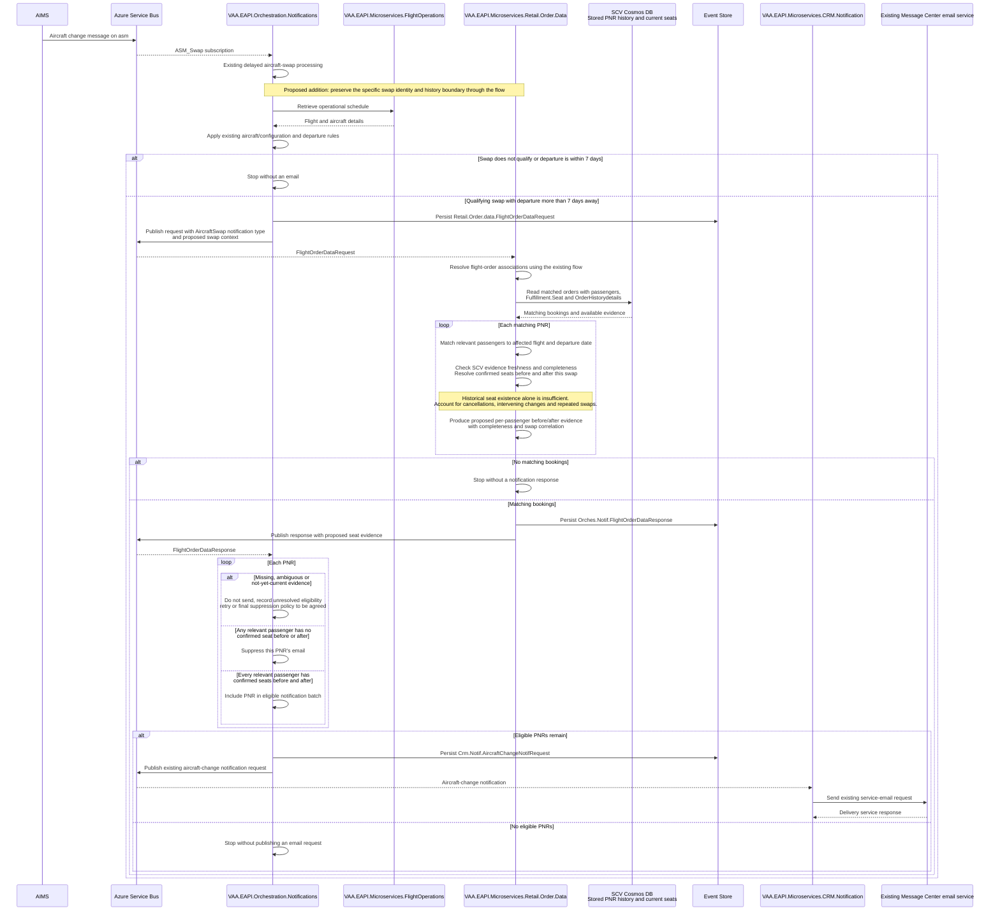

# Aircraft Swap Email Eligibility Using SCV Seat History

Proposed phase 2 flow for [ADO 856713](https://dev.azure.com/virginatlantic/Digital%20Distribution/_workitems/edit/856713), building on [ADO 821899](https://dev.azure.com/virginatlantic/Digital%20Distribution/_workitems/edit/821899). Use the PNR history and current seat records already stored in SCV to establish seating before and after a qualifying swap, then send the existing service email only when every relevant passenger has a confirmed seat on both sides of that change.

> **Minimum review:** Read the flow name and description, **Why this flow exists**, **Sequence (detailed)**, and **Open points to finalize**. These sections establish the purpose, intended interactions, and outstanding questions; review the remaining sections as relevant to your role.

## Why this flow exists

Customers without confirmed seats on either aircraft must not receive this email. Eligibility applies to the whole PNR for the affected flight: one relevant passenger without a seat suppresses that PNR's email. Paid, complimentary, loyalty and assistance-team assignments are equivalent. SSRs, bassinet requests, meals and other ancillary requests do not establish seat eligibility. A confirmed seat need not change number to satisfy this additional rule; the existing aircraft/configuration eligibility rules still apply.

### Existing capability and proposed change

Order Data already models `OrderHistorydetails.HistoryActionItem` (action code, free text and ordinal), history signatures and current `Fulfillment.Seat` records. The notification response currently includes current seats filtered to the flight. The shared PSS `PNRRetrieveHistoryRQMapper` requests history using `HistoryOnFlag`, but `PNRRetrieveHistoryRSMapper` does not expose historical seat assignments. These capabilities are reusable foundations; they do not yet implement the rule below.

The selected data source is SCV, accessed through Retail Order Data's existing `OrderSCVDBEndpoint`, `OrderDB` and `OrdersCollection` configuration. The SIT configuration resolves to `OrderDB/OrderCollectionDigital`. Retail Order Data resolves passenger/flight seat evidence from `OrderHistorydetails` and `Fulfillment.Seat`; Notifications orchestration applies the email eligibility gate. No live Air4/PSS retrieval call or duplicate history store is part of this design. The shared PSS history mapper is background context only, not an integration dependency for this flow.

A read-only query against the SIT-configured SCV source confirmed historical seat records alongside current seats. This establishes availability, not completeness, freshness or reliable reconstruction for a specific aircraft swap. SCV ingestion is expected to be near real time, as confirmed during refinement. Evaluate after the existing notification delay; near-real-time ingestion does not establish ordering between the swap event and its SCV update. Missing, stale or ambiguous evidence remains unresolved and cannot authorize an email. Do not silently fall back to a host call; any future fallback requires a separate design decision.

## Sequence (detailed)

## Open points to finalize

1. **SCV historical-seat availability validated; swap reconstruction remains open.** A live read-only query against the SIT-configured SCV database found bookings with historical seat numbers, status transitions, matching history-signature ordinals and current seat records. This supersedes the earlier fixture-only evidence for availability. A history action code alone is not a confirmed-seat event. Validate SCV freshness and completeness as well as source status semantics. Establish a supported free-text/action-code mapping and demonstrate a specific aircraft swap with identifiable passengers, affected segment, confirmation status and transaction ordering.
2. **Current identity and coalescing validated; swap boundary remains open.** `AircraftMessage.Id` is flight date plus flight number. The registered delayed dispatcher uses `LastWriteWins`: successive pending messages with that ID replace one another. A message arriving while the existing item is processing cannot replace it, and the caller does not act on the false scheduling result. The downstream `FlightOrderDataRequest` drops aircraft/configuration details and contains no swap identity or history boundary. Agree whether the eligibility boundary is each swap or the coalesced change, then preserve that context end to end.
3. **Available passenger data validated; business definition remains open.** Source `CustomerDetails` has passenger name numbers, `PTC` and `VirginHolidayBookingFlag`. However, the notification mapper emits only one selected email contact in `Passengers`; this is not the full booked-passenger set. ADO still explicitly leaves lap infants for refinement. Confirm relevant-passenger and Holidays-only scope, and build evidence from the full source passenger set rather than the contact list.
4. **Existing delay and cutoff validated; convergence policy remains open.** The flow delays using `AircraftChangeNotifDelay`, and checks departure UTC against `DateTime.UtcNow` using strictly greater than seven days. Environment delay values are Key Vault-backed, so no deployed duration is established by this review. Existing delay/dispatch retry does not implement seat-history convergence. Agree retry limits, terminal suppression and whether the cutoff is rechecked before sending after a retry.
5. **Contract gaps validated; additive shape remains proposed.** `FlightOrderDataRequest`, Order Data's `FlightBookingQuery`, `FlightOrderNotificationResponse` and orchestration's `FlightOrderData` need compatible swap/evidence propagation. Keep the existing contact-oriented `Passengers` contract intact. Proposed approach: add a separate full-passenger seat-evidence collection with passenger/segment identity, before/after seat and confirmation evidence, completeness and swap boundary. Retail Order Data should interpret source history/status values; Notifications should apply the whole-PNR gate. Final field names, status semantics and deployment compatibility still need agreement and tests.
6. **Some phase 1 behavior validated; configuration-only and end-to-end replay remain open.** Focused tests pass for same-model suppression, changed-model request publication, dispatcher replacement and current notification handling. The handler compares `Aircraft.ModelCode` with `AircraftMessage.AircraftCode` and returns on equality without comparing `SeatConfig`; same-model configuration changes therefore require explicit review against ADO 821899/856713. Dispatcher coalescing is not proof of per-PNR/per-swap email deduplication. Add configuration-only, repeat-swap, exact seven-day boundary and delivery-replay evidence before Ready.

### Technical work that can proceed

The following work can progress without deciding the outstanding business rules. These are planned deliverables, not completed implementation or authority to promote this goal to Ready. Start with history validation, additive contract design and the configuration-only regression case.

| Work item | Work that can proceed | Completion evidence and dependency |
| --- | --- | --- |
| History validation (open point 1) | Inspect existing fixtures and source models, document candidate seat-history formats, and prepare synthetic cases for normal swaps, cancellations, oversales, intervening seat changes and repeated swaps. Implement a parser/prototype only for formats supported by evidence, leaving unknown formats unresolved. | Mapping specification and focused reconstruction tests show passenger/segment matching and ordering. Final source validation requires representative anonymised aircraft-swap history with a known before/after outcome; synthetic cases alone do not close this point. |
| Additive contract design (open points 2, 3 and 5) | Specify swap context and a separate passenger seat-evidence collection across `FlightOrderDataRequest`, `FlightBookingQuery`, `FlightOrderNotificationResponse` and `FlightOrderData`. Preserve the existing email-contact `Passengers` collection. Define missing/unknown evidence semantics and an incremental producer/consumer rollout. | Reviewable field/type definitions, synthetic request/response examples and a compatibility test matrix cover absent new fields, old messages, other notification types and multiple passengers. Final swap identity and relevant-passenger rules remain dependent on business decisions. |
| Configuration-only regression (open point 6) | Add a focused test for unchanged model with changed seat configuration, characterize current suppression, and identify comparable configuration fields in both source systems. Prepare the correction to compare model and configuration once their meanings and availability are verified. | An isolated reproduction demonstrates the gap; the correction passes same-model/same-config, same-model/different-config and different-model cases plus the existing departure gate. Missing configuration must have an explicit outcome. Track this phase 1 correction separately from the new seating rule; do not merge a deliberately failing test on its own. |
| Eligibility and evidence implementation preparation (open points 1, 3, 4 and 5) | Design an evaluator that accepts a caller-supplied relevant-passenger set and normalized before/after evidence. Draft cases for eligible, ineligible and unresolved outcomes, including an empty passenger set and incomplete evidence. | The design does not hard-code lap-infant, Holidays or retry decisions. Production history mapping and the active notification gate depend on validated source semantics and the agreed business rules. |
| Replay protection design (open points 2 and 6) | Identify existing durable storage/delivery mechanisms and specify a notification identity based on booking, flight/date and the agreed change identity. Design atomic claiming, failure recovery and retention, with test cases for concurrent duplicates and later legitimate changes. | Reviewable design explains replay before/after publication and crashes around email submission, including any downstream idempotency limitations. Implementation and acceptance depend on agreement about individual swaps versus a consolidated change window; do not claim exactly-once delivery from a local deduplication record alone. |

### Proposed contract contents

These describe information requirements for the contract-design work, not finalized JSON names or a new published API:

- **Swap context:** stable change identity, affected carrier/flight/date/segment, old/new model and configuration where available, and the source event or history boundary used for reconstruction. Represent unknown boundaries explicitly rather than inventing a timestamp.
- **Passenger seat evidence:** stable source passenger references and affected segment, before/after seat numbers, normalized confirmation state, supporting history transaction references and completeness/reason information. Do not transmit raw history text merely to support eligibility.
- **Evaluation:** proposed `Eligible`, `Ineligible` and `Unresolved` outcomes. Confirmed absence of a required seat is ineligible; insufficient or ambiguous evidence is unresolved. Neither can cause an email. Empty passenger evidence must not pass an all-passengers check.
- **Compatibility:** retain the existing contact collection and existing event names. Define old-message and missing-field behavior explicitly, scope the new gate to aircraft-swap notifications, and stage rollout so older producers cannot accidentally bypass the gate. Verify these rules with serialization and consumer tests before activation.

### Decisions still needed from the business

| Decision | Recommendation for review, not an agreed rule | Dependent work |
| --- | --- | --- |
| Relevant passengers | Include passengers occupying their own seat, including seated infants; exclude lap infants. Confirm how the source represents these cases. | Passenger selection and final eligibility acceptance. |
| Audience | Preserve the existing audience until the product owner confirms whether phase 2 is Holidays-only. | Any new booking/channel filter. |
| Change boundary | Consider preserving existing delayed consolidation while retaining the first boundary and final configuration. Confirm whether intermediate swaps must each be evaluated or one email may represent the consolidated change. | History reconstruction boundary, change identity and replay protection. |
| Retry and suppression | Retry unresolved evidence within an agreed bounded window, then suppress with a safe reason. Recommend rechecking the seven-day cutoff immediately before sending. Duration, attempt limit and terminal outcome require agreement. | Convergence retry orchestration and final timing acceptance. |

The goal remains Draft while these decisions and representative source evidence are outstanding. Completion of a technical work item above narrows an open point; it does not imply the full feature is deliverable.

### Validation evidence (2026-10-16)

**Live SCV validation:** A bounded read-only query against the SIT-configured `OrderDB/OrderCollectionDigital` returned 20 candidate bookings with history and current seat records. One inspected candidate contained 97 history entries and 13 history signatures. Six seat-history entries showed seat numbers `20D` and `44F`, followed by status transitions and entries without seat numbers; current seat records had blank seat assignments. All six entries had a matching signature ordinal. This confirms that SCV retains historical seating data even when current seats are blank.

The observed prefixes included `SEAT RS/NN`, `SEAT XR/RS` and `SEAT PN/XR`; their confirmation/cancellation semantics have not been independently validated. Passenger-name matching returned two current seat records per history entry, so affected-flight/segment matching is still essential. The inspected current-seat records carried departure year `25`; this is historical evidence, not proof of current ingestion latency or a recent swap. No aircraft-change event was correlated and no direct Air4 call was made. Keep freshness, completeness and swap reconstruction open.

Sanitised local evidence: `TestResults/scv-history-validation/sanitized-evidence.json`. Candidate identifiers and credentials are not included in this document; local query evidence remains ignored. The original fixture review and focused test results below remain useful baseline evidence.

Reviewed working-tree code based on `main` commit `7851179452` and reread ADO 856713. These findings confirm current behavior and narrow the remaining questions; they do not approve the proposed business rules or establish deployed production behavior.

| Evidence | Finding |
| --- | --- |
| [Order Data repository](../../VAA.EAPI.Microservices/VAA.EAPI.Microservices.Retail.Order.Data/Infrastructure/Repositories/OrdersRepoQueryHandler.cs), [notification mapper](../../VAA.EAPI.Microservices/VAA.EAPI.Microservices.Retail.Order.Data/Domain/Entities/FlightOrderNotification/FlightOrderNotificationResponse.cs) and [source customer model](../../VAA.EAPI.Microservices/VAA.EAPI.Microservices.Retail.Order.Data/Domain/Entities/FlightBookings/Entity/CustomerDetail.cs) | Orders are read by OrderID with the full document. The mapper selects one contact with an email, falling back to the first customer. Source passenger references/type/holiday flag are not carried as full-passenger eligibility evidence. |
| [Flight notification service](../../VAA.EAPI.Microservices/VAA.EAPI.Microservices.Retail.Order.Data/Application/Query/FlightOrderNotification/Service/FlightOrderNotificationDetails.cs) | Current seats are filtered by flight/route and, when present, date/year. This service has no Holidays-only eligibility filter or historical seat reconstruction. |
| [Aircraft message](../../VAA.EAPI.Orchastration/VAA.EAPI.Orchestration.Notifications/Domain/Entities/AircraftMessage.cs), [dispatcher registration](../../VAA.EAPI.Orchastration/VAA.EAPI.Orchestration.Notifications/Program.cs) and [incoming handler](../../VAA.EAPI.Orchastration/VAA.EAPI.Orchestration.Notifications/Application/Events/AircraftSwapsEventCommandHandler.cs) | Flight/date identity, LastWriteWins registration and ignored schedule result establish the current coalescing boundary. The parsed message has no explicit swap occurrence timestamp or history transaction boundary. |
| [Schedule handler](../../VAA.EAPI.Orchastration/VAA.EAPI.Orchestration.Notifications/Application/Events/AcSwapsFlightDataRequestEventCommandHandler.cs) and [outbound request](../../VAA.EAPI.Orchastration/VAA.EAPI.Orchestration.Notifications/Domain/Entities/FlightOrderDataRequest.cs) | Model-code equality suppresses processing, the departure gate is strictly greater than seven days, and swap identity/configuration/history boundary are absent from the booking request. |
| Order Search `TestDataSamples/OrderSearchMS` JSON fixtures | `BookingQueryOrderDocResponse.json` has two history collections with 18 and 15 entries; `OrderDocResponse.json` has collections with 75 and 122 entries. Other inspected fixtures have null or placeholder history. This establishes available history examples, not a validated before/after seat reconstruction contract. No raw customer history is reproduced here. |
| [Dispatcher tests](../../VAA.EAPI.Orchastration/VAA.EAPI.Orchestration.Notifications.Tests/AircraftSwapsDelayedDispatcherServiceTests.cs), [schedule tests](../../VAA.EAPI.Orchastration/VAA.EAPI.Orchestration.Notifications.Tests/AcSwapsFlightDataRequestEventCommandHandlerTests.cs) and [response-handler tests](../../VAA.EAPI.Orchastration/VAA.EAPI.Orchestration.Notifications.Tests/FlightOrderDataEventCommandHandlerTests.cs) | Focused run: 10 passed, 0 failed, 0 skipped. TRX analyser: no failed tests. This is existing behavior coverage, not phase 2 acceptance. |

Test evidence is local and ignored: `TestResults/aircraft-swap-open-points-native/aircraft-swap-open-points.trx`. This project uses Microsoft.Testing.Platform and ignores VSTest filter/logger/coverage arguments. The first invocation ran all 23 tests successfully but did not produce the requested evidence; a second invocation used the runner's native class filters and `--report-xunit-trx` to produce the focused 10-test TRX, which was analysed. No coverage table was produced: the configured runner does not expose a coverage option and ignored the XPlat collector request. No test project or production code was changed for this review.

## High-level behaviour

1. Receive and delay the aircraft-change event using the existing Notifications flow.
2. Retrieve the operational schedule and apply existing aircraft/configuration and departure eligibility rules.
3. Request bookings for the affected flight, carrying the proposed specific-swap context.
4. Retail Order Data resolves each relevant passenger's confirmed seating immediately before and after that swap from SCV-stored PNR history and current seat data, after checking freshness and completeness.
5. Notifications suppresses PNRs with unknown evidence or any relevant passenger lacking a confirmed seat on either side of the swap.
6. Publish the existing aircraft-change notification request for eligible PNRs and use the existing CRM email delivery path.

## Integration points

| Component | Responsibility |
| --- | --- |
| AIMS | Supplies aircraft-change messages. |
| Azure Service Bus | Carries `asm` input and the existing `servicenotifications` request/response events. |
| `VAA.EAPI.Orchestration.Notifications` | Owns delayed swap processing, flight eligibility and the proposed whole-PNR seating gate. |
| `VAA.EAPI.Microservices.FlightOperations` | Supplies operational flight and aircraft details. |
| `VAA.EAPI.Microservices.Retail.Order.Data` | Resolves booking/passenger data and proposed before/after seat evidence. |
| SCV Cosmos DB | Supplies stored `OrderHistorydetails` and `Fulfillment.Seat` through the existing Retail Order Data repository. |
| Event Store | Persists outbound events before publication under existing rollback conventions. |
| `VAA.EAPI.Microservices.CRM.Notification` | Maps eligible bookings into existing aircraft-change email requests. |
| Existing Message Center email service | Accepts requests through the existing email delivery integration. |

## Agent delivery constraints

- Target projects: `VAA.EAPI.Orchastration/VAA.EAPI.Orchestration.Notifications/VAA.EAPI.Orchestration.Notifications.csproj` and `VAA.EAPI.Microservices/VAA.EAPI.Microservices.Retail.Order.Data/VAA.EAPI.Microservices.Retail.Order.Data.csproj`. Keep CRM email content and delivery unchanged.
- Read `Application/Events/AcSwapsFlightDataRequestEventCommandHandler.cs`, `Application/Events/FlightOrderDataEventCommandHandler.cs`, `Domain/Entities/FlightOrderDataRequest.cs` and `Domain/Entities/FlightOrderData.cs` in Notifications; read `Application/Query/FlightOrderNotification/Service/FlightOrderNotificationDetails.cs`, `Domain/Entities/FlightBookings/Entity/OrderHistorydetails.cs` and `HistoryActionItem.cs` in Order Data.
- Reuse `Retail.Order.data.FlightOrderDataRequest`, `Orches.Notif.FlightOrderDataResponse` and `Crm.Notif.AircraftChangeNotifRequest` on `servicenotifications`. Proposed request/response extensions must carry the swap correlation boundary and sufficient passenger-level evidence to distinguish confirmed absence from unknown data. Exact fields and version compatibility remain open.
- Preserve `AircraftSwapEnabled`, `AircraftSwap:FlightMs:OperationalScheduleUri`, existing broker connections and batch-size configuration. No new configuration is agreed yet; specify any retry settings during refinement.
- Match passenger identity and the affected flight/date, not merely the count of seat records or passenger names. Evaluate the full relevant-passenger set; an empty set must not pass through an all-passengers predicate accidentally.
- Preserve existing aircraft/configuration detection, suppression, subsequent qualifying swaps and the greater-than-seven-days boundary. Validate the phase 1 baseline rather than treating this diagram as proof that every legacy rule is implemented correctly.
- Read SCV through the existing Retail Order Data repository and configuration. Do not add a direct host-history lookup, a host fallback or a duplicate history persistence mechanism. Do not interpret `PreviousStatus` as a previous seat number. Do not infer confirmation from an SSR or ancillary request.
- Preserve CloudEvent correlation, event-store persistence before publication and existing rollback conventions. Specify replay identity per PNR, flight and swap so retries cannot create duplicate emails while a later qualifying swap remains eligible.
- Keep passenger details and raw history out of telemetry. Record safe eligibility reason codes and correlation identifiers.
- Run `scripts/verify.ps1 -ProjectPath <each target project above>` for implementation acceptance. For this documentation-only change, use the Notifications project with `-SkipBuild`. Validate this file with `scripts/check-mermaid-diagrams.ps1 -Path docs/sequence-diagrams/vaa-eapi-aircraft-swap-pnr-history-seat-eligibility.md` and run `scripts/check-sequence-diagram-status.ps1`.

## Key non-functional considerations

- **Idempotency**: correlate delivery to PNR, flight and specific swap. Replays must not duplicate email delivery, while subsequent qualifying swaps must remain eligible. Confirm the exact mechanism during refinement.
- **Correlation**: preserve CloudEvent correlation and the proposed swap/history boundary across delayed dispatch and request/response messages.
- **Retry behavior**: distinguish transient data convergence from confirmed no-seat outcomes. Agree bounded retry and cutoff behavior before Ready.
- **No-op path**: no qualifying swap, no matching bookings or no eligible PNRs produces no email request.
- **Privacy**: use safe eligibility reason codes and correlation identifiers rather than raw history or passenger details in telemetry.

## Failure paths to capture in implementation

- Operational schedule retrieval fails or returns no matching flight.
- Booking/history retrieval fails, history is incomplete or a passenger/flight reference cannot be resolved.
- Delayed processing encounters another swap before the evaluated swap's seat state is established.
- Event persistence, Service Bus publication or downstream email delivery fails.

Expected behavior:

- Preserve existing event-store rollback and transport failure conventions, and test recovery without duplicate delivery.
- Never send when before/after seat eligibility cannot be established. Record a safe reason and apply the retry or terminal suppression policy agreed during refinement.

Unknown history is not evidence of a confirmed seat. A missing historical record must not silently become eligible, and a temporary gap must be distinguishable from a confirmed no-seat outcome. The retry duration, final suppression outcome and handling of a seven-day cutoff crossed during retry require agreement. Retain the existing transport and delivery behavior while testing publish failure and replay paths; this proposal does not claim exactly-once email delivery already exists.

Current seats must represent the post-swap state relevant to the evaluated change. A delayed event processed after another swap cannot simply use the latest seats without proving that association. Preserve the swap boundary through the delayed dispatcher and resolve this timing case before implementation readiness.

## Expected harness

Planned extensions to existing test projects; these cases are acceptance targets, not completed coverage:

| Area | Required evidence |
| --- | --- |
| Order Data history reconstruction | SCV-derived, anonymised fixtures and synthetic cases prove passenger/flight/date matching, transaction ordering, cancellations, unchanged seats, intervening manual changes and multiple swaps. Validate representative source payload structure without retaining customer data. |
| Notifications eligibility | All relevant passengers seated before and after sends; no seats, mixed seating, old-only seats and new-only seats suppress the whole PNR. Empty passenger lists and missing evidence never pass. |
| Assignment semantics | Paid, FOC, loyalty and assistance-assigned confirmed seats behave identically; SSR-only, bassinet and meal requests do not confer eligibility. |
| Timing and recovery | Delayed history, later swaps, replayed events, publish failures and the seven-day boundary have deterministic outcomes. |
| Regression | Existing aircraft/configuration rules, repeated qualifying swaps, other notification types and existing CRM payload/template remain unchanged. |

Extend `VAA.EAPI.Orchastration/VAA.EAPI.Orchestration.Notifications.Tests/FlightOrderDataEventCommandHandlerTests.cs` and the existing aircraft-swap tests. Add focused history-evidence tests under `VAA.EAPI.Microservices/VAA.EAPI.Microservices.Retail.Order.Data.Tests/`. Run project-scoped tests with run-scoped TRX and XPlat Code Coverage, then `scripts/analyse-test-run-results.ps1` against that run. Update [the behavior sensor catalog](../behavior-harness.md) with executable coverage when implemented.

## Agent Loop Goal

| Field | Value |
| --- | --- |
| Goal | Reuse SCV-stored PNR history and current seats to restrict qualifying aircraft-swap emails to PNRs whose relevant passengers have confirmed seats before and after the specific swap. |
| Status | `Draft` |
| Delivery surface | `Backend` |
| Owner | Notifications and Retail Order Data maintainers; business definition owned by My Trips |
| Review cadence | During technical refinement and before implementation |
| Last reviewed | 2026-10-16 |
| Harness Sensor | Planned: Notifications `FlightOrderDataEventCommandHandlerTests.cs`, aircraft-swap regression tests and Retail Order Data history-evidence tests described above. |
| Promotion verification | Full |
| Acceptance evidence | Representative history mapping validated; expected harness passes with analysed TRX and coverage; end-to-end evidence confirms eligible delivery and ineligible suppression while preserving phase 1 behavior. |
| Done when | Open points are resolved, the proposed contracts and eligibility gate are implemented, and executable acceptance evidence covers all eight ADO criteria plus history timing and replay cases. |

## Associated delivery pull requests

The draft coordinator PR and its row are created when this goal enters `InProgress`. Every production and QA agent is then recorded here on its own branch and PR. The coordinator PR remains draft until every current child PR is merged, integrated verification passes, and open questions are resolved.

The workflow populates this table for delivery surfaces hosted in other GitHub repositories.

| Surface | Repository | Base branch | Head branch | PR | State | Merged at UTC |
| --- | --- | --- | --- | --- | --- | --- |

## Agent Loop Closure Evidence

No closure evidence recorded yet. Lifecycle evidence is accumulated on the open draft coordinator PR. Completion evidence is committed before the PR becomes ready. The finalizer appends merged evidence on `main`, closed-unmerged abandonment evidence on the delivery branch when available, or a sanitized standalone abandonment record on `main` when that branch was already deleted.
