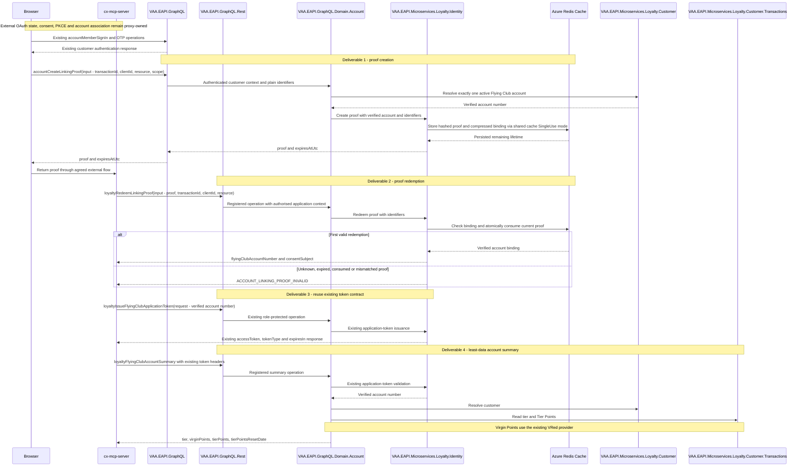

# Alexa account linking — agreed EAPI contract

This document restores the external contract from [the original integrated flow](https://github.com/VAAD1ST/eapi/blob/b107b0e8e881b08ab0c6961864059908a9e01ee1/docs/sequence-diagrams/vaa-eapi-alexa-mcp-proxy-account-linking.md), following the delivery owner's instruction on 2 October 2026. The diagram shows EAPI work and its immediate callers, not the complete external OAuth implementation.

> **Minimum review:** Read the flow name and description, **Why this flow exists**, **Sequence (detailed)**, and **Open points to finalize**. These sections establish the purpose, intended interactions, and outstanding questions; review the remaining sections as relevant to your role.

## Why this flow exists

Support the agreed Alexa account-linking journey through proof creation, single-use redemption, existing broker-token issuance, and least-data account retrieval.

## Sequence (detailed)



## Open points to finalize

No outstanding EAPI code-delivery decisions remain. Formal goal closure still requires a passing scoped Full verification run and recorded evidence; the documentation-only reconciliation did not establish that gate.

## Separate activation and operational follow-ups

These are tracked separately from merged EAPI code delivery in [issue #75](https://github.com/VAAD1ST/cx-mcp-server/issues/75):

- Populate agreed client/resource/application configuration and verify roles/vault access.
- Resolve Redis eviction/continuity risk and run live atomicity tests before activation.
- Deploy and test the external login-to-account journey; verify proxy-owned state/PKCE, consent, refresh/revocation and lost-response recovery.
- Vault cleanup is recorded in [Four deliverables](#four-deliverables); verify retained settings and vault-reference resolution before activation. The 2 October configuration snapshot recorded three required client/resource/caller values disabled in each environment; it is historical evidence, not a current environment audit.
- Track the separate REST startup-hook repair in [PR #2441](https://github.com/VAAD1ST/eapi/pull/2441), still open at this review. It does not reopen the four merged account-linking code deliveries.

## Four deliverables

### Delivery snapshot — 13 October 2026

Status is **Complete for EAPI code delivery**. PRs [#2152](https://github.com/VAAD1ST/eapi/pull/2152) and [#2153](https://github.com/VAAD1ST/eapi/pull/2153) merged on 24 September; [#2156](https://github.com/VAAD1ST/eapi/pull/2156) and [#2157](https://github.com/VAAD1ST/eapi/pull/2157) merged on 25 September. Corrective [PR #2325](https://github.com/VAAD1ST/eapi/pull/2325) merged on 5 October 2026, including the restored public contracts, review/CI fixes, shared-cache single-use refactor, removal of the additional linked-token API and application-level encryption, and four-setting documentation. The delivery owner subsequently confirmed deployment to the DEV instances. This status reconciliation does not establish runtime health, live Redis acceptance or external end-to-end acceptance.

Azure cleanup was completed on 2 October: six obsolete secrets per Identity vault were soft-deleted and verified absent from the active lists in DEV (`avadeunkveapis`), SIT (`avateunkvems`) and UAT (`avaseunkvems`) — 18 entries total. They remain recoverable until 31 December 2026. Shared Redis/authentication and retained settings were untouched. The matching code/deployment cleanup is merged in #2325; environments must use that revision or later, not an earlier revision referencing removed secrets. No new vault audit or external end-to-end acceptance is claimed by this status update.

| Story | EAPI capability | External contract |
| --- | --- | --- |
| cx-mcp-server #176 | Create an opaque proof | `accountCreateLinkingProof(input)` with plain transaction identifiers; returns `proof`, `expiresAtUtc` |
| cx-mcp-server #177 | Redeem the proof once | `loyaltyRedeemLinkingProof(input)` returns `flyingClubAccountNumber`, `consentSubject` |
| cx-mcp-server #178 | Use a verified account through existing broker-token issuance | Existing `loyaltyIssueFlyingClubApplicationToken(request)`; no account-binding assertion required |
| cx-mcp-server #179 | Return least-data account information | `loyaltyFlyingClubAccountSummary` validates the ordinary broker token and returns tier, Virgin Points, Tier Points and reset date |

The unrequested signed linked-token operation and its dedicated validation endpoint are removed. The agreed journey reuses existing ordinary token issuance; previously issued linked-purpose tokens remain rejected by ordinary validation.

Trust boundary: the existing ordinary-token operation authorises the application to request a token for an account number; it does not independently prove prior redemption. The approved proxy must use the redeemed account and maintain that association. This is the original contract's trust model, not the stronger signed-binding model. Review this boundary before activation; do not claim EAPI verifies external consent or cryptographically links every subsequent ordinary token to a redemption.

## External contract

```graphql
accountCreateLinkingProof(input: AccountCreateLinkingProofInput!): AccountCreateLinkingProofPayload!

input AccountCreateLinkingProofInput {
  transactionId: ID!
  clientId: String!
  resource: String!
  scope: String!
}

type AccountCreateLinkingProofPayload {
  proof: String!
  expiresAtUtc: DateTime!
}

loyaltyRedeemLinkingProof(input: LoyaltyRedeemLinkingProofInput!): LoyaltyRedeemLinkingProofPayload!

input LoyaltyRedeemLinkingProofInput {
  proof: String!
  transactionId: ID!
  clientId: String!
  resource: String!
}

type LoyaltyRedeemLinkingProofPayload {
  flyingClubAccountNumber: String!
  consentSubject: String!
}
```

Creation uses the existing customer bearer. Redemption uses the approved application bearer and `Loyalty.Identity.AccountLinkingProof.Redeem` role. Existing token issuance retains `Loyalty.Identity.ApplicationToken.Issue`. Summary retains `Loyalty.AccountSummary.Read` and the existing application-bearer/secondary-broker-token convention. No new headers or external signing keys are introduced. Existing broad profile access remains unchanged.

Creation input lengths are bounded to 128 characters for transactionId, 256 for clientId and 2048 for resource; control characters are rejected. Identity requires an exact configured client/resource and `account:read`. Proof expiry is generated by EAPI, at most 120 seconds. Up to three replacements invalidate the previous proof and do not extend the transaction window. Every repeated redemption fails, including an exact retry; after an uncertain result restart linking.

Domain failures use `ACCOUNT_LINKING_AUTH_REQUIRED` (401), `ACCOUNT_LINKING_ACCOUNT_INVALID` (403), `ACCOUNT_LINKING_CLIENT_FORBIDDEN` (403), `ACCOUNT_LINKING_TRANSACTION_INVALID` (400), `ACCOUNT_LINKING_PROOF_INVALID` (400), and `ACCOUNT_LINKING_DEPENDENCY_UNAVAILABLE` (503), with `httpStatusCode`, `retryable` and `correlationId` extensions. Existing shared host authentication/authorization and malformed GraphQL errors can reject a request before domain execution and retain their platform envelopes; no global filter changes are part of this work.

## Agent delivery constraints

- Only Account GraphQL and Loyalty Identity own the changed contracts. Preserve existing sign-in/OTP/token/profile behavior and domain-agnostic hosts. The reviewed REST/MCP error translation is explicitly opted into through `transportStatusCode`; operations without that extension retain legacy handling. REST preserves domain error metadata; MCP places it in `error.data.errors` and uses the numeric status in `error.code`.
- External callers cannot choose an account during proof creation. Account GraphQL derives it from the existing authenticated customer and sends it using its trusted application identity.
- Plain identifiers prove binding consistency, not external transaction authenticity or consent. The proxy must enforce state/PKCE, consent and account association. `consentSubject` is an opaque identifier, not a signed consent receipt. No external component implementation is claimed here.
- Reuse DistributedCacheService single-use mode, EAPI compression helpers and Redis resource security; keep atomic scripts, server expiry and role checks. No application-level encryption key is required. No Cosmos dependency or public EAPI account-linking subrouter is required.
- Use `VAA.EAPI.GraphQL/VAA.EAPI.GraphQL.Domain.Account` and `VAA.EAPI.Microservices/VAA.EAPI.Microservices.Loyalty.Identity`, with their sibling test and Bruno projects. Microservice URLs remain internal to GraphQL implementations.
- Configuration is documented in [the deployment table](../../VAA.EAPI.Microservices/VAA.EAPI.Microservices.Loyalty.Identity/ACCOUNT-LINKING-DEPLOYMENT.md). Only four account-linking-specific settings remain; the additional signing settings and Redis encryption key ring are removed from code and deployment definitions. Azure cleanup is tracked separately.
- Run owning project tests with TRX analysis and `scripts/verify.ps1 -ProjectPath <owning-project.csproj> -SkipBuild`.

## Expected harness

- GraphQL schema/JSON tests verify exact input/output names and absence of assertion fields.
- Existing DI and HTTP mock files verify server-derived account identity, invalid/missing inputs and ordinary-token summary validation.
- Identity tests validate exact configured client/resource, scope, server-controlled expiry and trusted creation caller.
- Dedicated Redis tests cover expiry, replacement limits, binding mismatch, account mismatch and one winner under concurrent redemption. Key rotation is no longer applicable after application-level encryption removal. Skipped Redis tests are not acceptance evidence.
- Token regression tests verify ordinary issuance/validation, rejection of linked-purpose tokens and absence of the removed operation.

## Agent Loop Goal

| Field | Value |
| --- | --- |
| Goal | Support the agreed Alexa account-linking flow without imposing new external signing or browser-proof contracts. |
| Status | `InProgress` |
| EAPI code delivery | Complete — all four delivery PRs and corrective #2325 merged; formal verification closure remains pending. |
| Owner | Account GraphQL and Loyalty Identity maintainers |
| Review cadence | On contract, authentication or proof-persistence changes |
| Last reviewed | 2026-10-13 |
| Harness Sensor | VAA.EAPI.GraphQL/VAA.EAPI.GraphQL.Domain.Account.Tests/AccountLinkingSchemaContractTests.cs; VAA.EAPI.GraphQL/VAA.EAPI.GraphQL.Domain.Account.Tests/AccountLinkingProofMutationTests.cs; VAA.EAPI.Microservices/VAA.EAPI.Microservices.Loyalty.Identity.Tests/LinkingTransactionValidatorTests.cs; VAA.EAPI.Microservices/VAA.EAPI.Microservices.Loyalty.Identity.Tests/AccountLinkingProofRepositoryContractTests.cs; VAA.EAPI.GraphQL/VAA.EAPI.GraphQL.Domain.Account.Tests/FlyingClubSummaryProviderTests.cs |
| Promotion verification | Full |
| Actual agent resources | Recorded automatically at completion from retained JSONL budget evidence |
| Acceptance evidence | Four delivery PRs #2152/#2153/#2156/#2157 and corrective PR #2325 merged to main; existing contract tests and recorded TRX evidence cover EAPI implementation. Merge states checked 13 October 2026. This documentation reconciliation is not a new full test run; live Redis and external end-to-end acceptance remain separate activation work. |
| Done when | EAPI code and contract-test coverage for server-derived identity, compressed single-use proof binding, existing token issuance and least-data account retrieval are delivered to main, and scoped Full verification passes with recorded evidence. Environment activation and external component acceptance are tracked separately. |

## Associated delivery pull requests

The historical EAPI delivery PRs are recorded in the delivery snapshot above. No external repository implementation is claimed by this EAPI goal. The table below is reserved for associated delivery surfaces hosted in other repositories.

| Surface | Repository | Base branch | Head branch | PR | State | Merged at UTC |
| --- | --- | --- | --- | --- | --- | --- |

## Delivery progress

### Delivery: Coordinator
```json
{
  "branch": "codex/reconcile-account-linking-goal-status",
  "repository": "VAAD1ST/eapi",
  "runId": "38418456360",
  "runAttempt": 1,
  "status": "InProgress",
  "startedAtUtc": "2026-10-13T15:03:21.0845829Z",
  "completedAtUtc": null,
  "automaticContinuations": 0,
  "continuationStage": "Delivery",
  "continuationLimit": 3,
  "continuationPolicy": "Each delivery/completion stage resumes automatically up to three times; Blocked work or exhausted recovery requires an explicit restart.",
  "goals": [
    {
      "verificationMode": "Full",
      "diagram": "docs/sequence-diagrams/vaa-eapi-alexa-mcp-proxy-account-linking.md",
      "title": "Support the agreed Alexa account-linking flow without imposing new external signing or browser-proof contracts.",
      "harnessSensor": "VAA.EAPI.GraphQL/VAA.EAPI.GraphQL.Domain.Account.Tests/AccountLinkingSchemaContractTests.cs; VAA.EAPI.GraphQL/VAA.EAPI.GraphQL.Domain.Account.Tests/AccountLinkingProofMutationTests.cs; VAA.EAPI.Microservices/VAA.EAPI.Microservices.Loyalty.Identity.Tests/LinkingTransactionValidatorTests.cs; VAA.EAPI.Microservices/VAA.EAPI.Microservices.Loyalty.Identity.Tests/AccountLinkingProofRepositoryContractTests.cs; VAA.EAPI.GraphQL/VAA.EAPI.GraphQL.Domain.Account.Tests/FlyingClubSummaryProviderTests.cs"
    }
  ],
  "verification": [],
  "commits": [],
  "failure": null
}
```

## Agent Loop Closure Evidence

Reconciled on 13 October 2026 against merged PRs #2152, #2153, #2156, #2157 and #2325. The prior snapshot incorrectly described #2325 as awaiting merge. EAPI code delivery is complete, but formal goal promotion remains InProgress pending passing Full verification evidence. This does not imply unmerged code, nor close external implementation, configuration verification, live Redis acceptance or the separate REST startup incident. Historical verification limitations remain recorded above and in issue #75.
