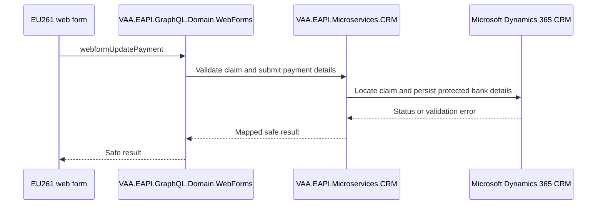

# VAA EAPI CRM — All GraphQL Scenarios

**Status:** Implemented

> **Minimum review:** Read the flow name and description, **Why this flow exists**, **Sequence (detailed)**, and **Open points to finalize**. These sections establish the purpose, intended interactions, and outstanding questions; review the remaining sections as relevant to your role.

## Why this flow exists

<a id="purpose"></a>

Maps the CRM GraphQL automation for EU261 web-form payment details. Bank data is highly sensitive: examples are synthetic, and account, IBAN, routing and payment identifiers must not be logged.

## Sequence (detailed)

<a id="service-level-sequence"></a>



## Open points to finalize

- None currently recorded; add explicit blockers here before moving this diagram back to Ready or InProgress.

## Agent delivery constraints

- Target solution/project path: Use the smallest owning solution or project implied by the `Harness Sensor`, integration points, and documented component ownership.
- New implementation path, when needed: Prefer the owning project paths already named in this diagram; do not create new services or broaden ownership without recording a blocker.
- New test path, when needed: `VAA.EAPI.Automation/VAA.EAPI.Automation.CRM/Tests/EU261_Claims/WebFormUpdatePayment.cs`
- Contract source files to read: Existing files referenced by this diagram, the named GraphQL operations, HTTP endpoints, message/event names, request payloads, and nearest tests.
- Endpoint/event/query/command names: Use only the operation, route, event, command, or scenario names documented in this diagram unless a compile/test failure proves a rename.
- Configuration and secret handling: Use existing configuration keys, environment variables, and secret references only; never commit real secrets, tokens, PII, payment data, or passenger documents.
- Harness command: Run the scoped verification selected by Promotion verification; for Fast, use scripts/verify.ps1 -SolutionPath <owning-solution> -SkipBuild or the nearest project equivalent.

## Current implementation alignment

The GraphQL boundary is `VAA.EAPI.GraphQL.Domain.WebForms`. Its `webformUpdatePayment` mutation calls the CRM microservice, which owns the Dynamics 365 integration.

## GraphQL payload

```json
{
  "operationName": "Mutation",
  "query": "mutation Mutation($formName: String, $payment: PaymentInput) { webformUpdatePayment(formName: $formName, payment: $payment) { status } }",
  "variables": {
    "formName": "EU261",
    "payment": {
      "paymentNumber": "<synthetic-payment-number>",
      "bankCountryName": "United Kingdom",
      "sortCode": "<synthetic-sort-code>",
      "bankName": "TEST BANK",
      "accountNumber": "<synthetic-account-number>",
      "iban": "<synthetic-iban>",
      "payeeAddress": "<synthetic-address>",
      "routingCode": "",
      "ifscCode": "",
      "accountHolderName": "TEST PASSENGER",
      "swiftCode": "<synthetic-swift>",
      "clabeNumber": "",
      "bankCodeNumber": "",
      "street": "TEST STREET",
      "town": "TEST TOWN",
      "state": "",
      "country": "GB",
      "postCode": "TE1 1ST",
      "accountSuffix": ""
    }
  }
}
```

```json
{ "data": { "webformUpdatePayment": { "status": "SUCCESS" } } }
```

## Automated scenarios

- verify an existing payment number;
- create new web-form payment details;
- country-specific bank field validation;
- duplicate bank details;
- incorrect or blank payment number;
- missing bank name;
- missing account-holder name;
- missing bank-country name;
- supported and unsupported country names.

## Backlog stories

Secure claim lookup; country-dependent bank form; submission/idempotency; duplicate handling; validation messages; CRM failure/retry; PII masking; audit without bank values.

## Automation sources

- Test: `VAA.EAPI.Automation.CRM/Tests/EU261_Claims/WebFormUpdatePayment.cs`
- Payload: `VAA.EAPI.Automation.CRM/Requests/Body/CRM/WebFormUpdatePayment.json`
- Factory/endpoint: `VAA.EAPI.Automation.CRM/Requests/Factory/GraphQl.cs`, `Requests/Endpoint/GraphQl.cs`

## Failure paths

- Reject missing, incorrect, or unknown payment numbers without exposing claim data.
- Return field-level validation for required and country-specific bank fields.
- Handle duplicate submissions idempotently and map CRM/Dynamics failures to safe errors.
- Never log or return unmasked account, IBAN, routing, or payment identifiers.

## Expected harness

The CRM automation test and checked-in request payload listed under Automation sources are the current behavior sensors. Coverage should assert successful creation and lookup, validation variants, duplicate behavior, safe downstream failure mapping, and PII-safe diagnostics.

## Agent Loop Goal

| Field | Value |
| --- | --- |
| Goal | Maintain the imported scenario catalogue as an implemented sequence-diagram reference. |
| Status | `Complete` |
| Owner | `VAA.EAPI.Microservices.CRM maintainers` |
| Review cadence | Quarterly and when scenario coverage changes |
| Last reviewed | 2026-07-28 |
| Harness Sensor | `VAA.EAPI.Automation/VAA.EAPI.Automation.CRM/Tests/EU261_Claims/WebFormUpdatePayment.cs` |
| Promotion verification | Fast |
| Acceptance evidence | Imported scenarios align to existing automation coverage and are tracked by the sequence-diagram index. |
| Done when | Scenario catalogue remains aligned with implemented behavior and referenced harness coverage. |

## Associated delivery pull requests

The draft coordinator PR and its row are created when this goal enters `InProgress`. Every production and QA agent is then recorded here on its own branch and PR. The coordinator PR remains draft until every current child PR is merged, integrated verification passes, and open questions are resolved.

The workflow populates this table for delivery surfaces hosted in other GitHub repositories.

| Surface | Repository | Base branch | Head branch | PR | State | Merged at UTC |
| --- | --- | --- | --- | --- | --- | --- |

## Agent Loop Closure Evidence

Record final closure evidence here. Existing verification and delivery records remain in their respective sections.
