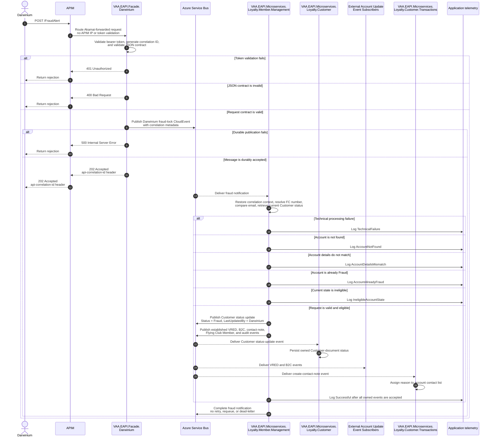
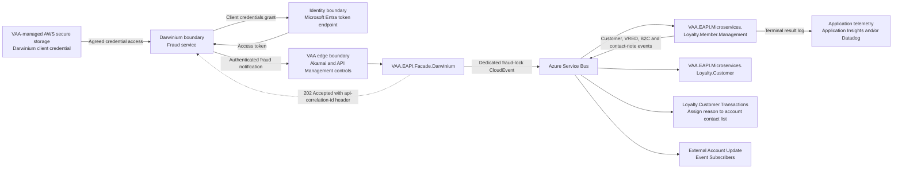

# VAA EAPI Darwinium Flying Club Fraud Account Lock Flow

This proposed flow replaces the manual Darwinium email and Loops Power App hand-off with a new `VAA.EAPI.Facade.Darwinium` service. The facade exposes an authenticated webhook, accepts a defined fraud-notification JSON contract, and publishes a dedicated Darwinium fraud-lock message to Service Bus. It is a new service, not an extension of an existing facade project.

The inbound request and Service Bus message explicitly contain the Flying Club number, email address, and fraud reason; neither reuses nor extends `MemberStatusUpdate`. A thin `DarwiniumFraudLockSubscriber` in `VAA.EAPI.Microservices.Loyalty.Member.Management` delegates to `ProcessDarwiniumFraudLockCommandHandler`, which owns fraud-alert validation and the existing Member Management-style event orchestration. `VAA.EAPI.Microservices.Loyalty.Customer` remains the owner of its Customer document and persists the status update through its existing Customer-document event subscriber.

> **Minimum review:** Read the flow name and description, **Why this flow exists**, **Sequence (detailed)**, and **Open points to finalize**. These sections establish the purpose, intended interactions, and outstanding questions; review the remaining sections as relevant to your role.

## Why this flow exists

Darwinium protects Flying Club customer accounts from fraudulent activity. Today it emails a VAA business user, who manually locks the account through the Loops Power App. The webhook removes that manual hand-off while preserving identity, network, validation, privacy, audit, and status-change controls.

Loyalty Member Management already owns the comparable Loops bulk-member-status orchestration: it resolves members and publishes Customer, VRED, B2C, Customer Transactions, Flying Club Member, and audit events. The Darwinium flow is a dedicated single-member use case, not a call to the blob/CSV-oriented `BulkMemberUpdate` endpoint or handler. This preserves Customer data ownership while avoiding a second status-change orchestration path in Loyalty Customer.

## Sequence (detailed)

<a id="sequence-of-vaa-responsibilities"></a>



## Open points to finalize

- Confirm whether the first delivery scope requires all existing Bulk Member Management fan-out events (including Flying Club Member and audit) or only Customer, VRED, B2C, and contact-note events. The default documented scope includes all established events so the automated route remains equivalent to the existing Loops status-update path.
- Agree the status-precedence and atomic conditional-update behavior required when an account status changes between Member Management validation and Loyalty Customer persistence.
- Confirm the operational owner and alerting/SLO for an accepted Customer-document update event that later fails in Loyalty Customer. The Member Management terminal outcome is intentionally a durable-event acceptance outcome, not downstream-completion confirmation.

## High-level behavior

1. Darwinium retrieves its client credential through the agreed access mechanism from VAA-managed AWS secure storage and obtains an OAuth access token from Microsoft Entra using the client-credentials grant. VAA's standard token lifetime applies; this integration introduces no custom token TTL.
2. Darwinium sends `fcNumber`, `emailAddress`, and `reason` to `POST /FraudAlert` through Akamai and Azure API Management (APIM).
3. Akamai applies IP allowlisting and rate limiting before forwarding the request. APIM trusts Akamai-forwarded traffic and applies routing only; it does not perform source-IP or OAuth-token validation.
4. `VAA.EAPI.Facade.Darwinium` applies the repository's token-validation rules for token integrity, validity period and expiry, configured audience, and configured issuer. It requires no additional application role or scope claim.
5. The facade generates the authoritative workflow correlation ID and validates only the JSON contract: an exactly 10-digit `fcNumber` containing digits `0`–`9`, a valid email format, and a trimmed `reason` of 1–20 characters. It does not perform account lookup, account comparison, or account-status evaluation.
6. For a valid contract, the facade maps the request to `DarwiniumFraudLockMessage` in the standard `CloudEvent.Data` field. Both CloudEvent `Type` and `Subject` are the exact case-sensitive value `VAA.Loyalty.Member.Management.DarwiniumFraudLock`. The facade publishes through the shared Service Bus abstraction with the generated correlation metadata, then returns `202 Accepted` and the correlation ID only after durable broker acceptance.
7. A thin `DarwiniumFraudLockSubscriber` in `VAA.EAPI.Microservices.Loyalty.Member.Management` verifies the CloudEvent type and subject, restores EAPI context, deserializes `Data`, and delegates to `ProcessDarwiniumFraudLockCommandHandler`. It contains no account validation or event-orchestration business logic.
8. The handler uses the existing Member Management Customer-search client to resolve the supplied Flying Club number to a Customer ID and authoritative email address. It validates and canonicalizes both email values by trimming outer whitespace, normalizing Unicode to Form C, canonicalizing the domain through IDNA, and using ordinal case-insensitive comparison. It must not remove dots, strip `+tags`, or apply provider-specific alias rules.
9. With the Customer ID, the handler retrieves the authoritative Customer document through the existing Loyalty Customer document API. It uses the status returned immediately before event publication to apply the semicolon-delimited `DarwiniumFraudEligibleStatuses` policy. `Fraud` produces `AccountAlreadyFraud`; an unlisted state produces `IneligibleAccountState`; missing, empty, or invalid configuration produces `TechnicalFailure`. None of those outcomes publishes a downstream update.
10. For an eligible account, the handler maps the validated data to the established Member Management event contracts. It publishes a `VAA.Loyalty.Customer.UpdateCustomerDocument` event to request the Customer status update; the event includes `Status = Fraud`, the Customer ID, and a server-controlled `LastUpdatedBy = Darwinium`. Loyalty Customer's existing Customer-document subscriber persists that update. The handler also publishes the existing VRED, B2C, Customer Transactions create-contact-note, Flying Club Member status, and audit events. The existing contact-note contract carries the validated Customer ID and the supplied reason.
11. Member Management records `Successful` only after Service Bus has durably accepted every event it owns. The result does not confirm completion by the Customer, VRED, B2C, Customer Transactions, Flying Club Member, or audit subscribers; their established telemetry and failure handling remain their own responsibility.
12. On every success, no-action, or technical-failure branch, the subscriber writes a privacy-safe, correlation-keyed terminal log and completes the fraud-alert message. It must not abandon, defer, requeue, explicitly retry, or dead-letter it.

## Inbound facade payload

The facade request is modelled as `DarwiniumFraudLockRequest` with exactly these JSON property names:

```json
{
  "fcNumber": "0012345678",
  "emailAddress": "someone@somewhere.com",
  "reason": "Duplicate accounts"
}
```

| JSON property | Model property | Type | Purpose |
| --- | --- | --- | --- |
| `fcNumber` | `FcNumber` | `string` | Required. Exactly 10 numeric digits (`0`–`9`), preserving leading zeroes, and the key for the Member Management Customer-search lookup. |
| `emailAddress` | `EmailAddress` | `string` | Required. Valid format and compared downstream with the authoritative Customer-search email. |
| `reason` | `Reason` | `string` | Required. Outer whitespace is trimmed and the result must contain 1–20 characters. On a successful orchestration path it becomes the Customer Transactions contact-note text. |

The facade acceptance gate covers JSON syntax and field validation only. A malformed body, missing field, invalid FC number, invalid email address, or empty/out-of-range reason returns `400` without Service Bus publication. Account lookup, authoritative email comparison, and status eligibility run after `202` in Loyalty Member Management.

`DarwiniumFraudLockMessage` contains `FcNumber`, `EmailAddress`, and `Reason` and is carried in standard `CloudEvent.Data`. Both CloudEvent `Type` and `Subject` are `VAA.Loyalty.Member.Management.DarwiniumFraudLock`, centralized as `DarwiniumFraudLockEventType` and `DarwiniumFraudLockEventSubject`. The facade uses `AsyncContext` and the shared publisher so the standard envelope and Service Bus properties preserve the workflow correlation ID. The message must not inherit from, extend, or be serialized as the existing `MemberStatusUpdate` model.

## Integration points

| Component | Responsibility |
| --- | --- |
| Darwinium | Detects suspected fraud, obtains an application token, and submits the defined fraud notification. |
| VAA-managed AWS secure storage | Stores the Darwinium Entra client credential; it is never sent in the webhook payload. |
| Microsoft Entra token endpoint | Authenticates the Darwinium service principal and issues a token for the facade audience. |
| Akamai | Enforces the external source-IP allowlist and rate limit. |
| Azure API Management | Routes traffic trusted from Akamai; it does not validate source IPs or OAuth tokens for this closed B2B route. |
| `VAA.EAPI.Facade.Darwinium` | Validates the protected HTTP contract, creates the correlation ID, and durably publishes `DarwiniumFraudLockMessage`. |
| `VAA.EAPI.Microservices.Loyalty.Member.Management` | Owns the dedicated subscriber and application handler. It validates the member, email, current status, and eligibility policy; publishes the established downstream event contracts; uses the fixed, server-controlled `Darwinium` audit origin; logs the terminal outcome; and settles the inbound fraud-alert message. |
| `VAA.EAPI.Microservices.Loyalty.Customer` | Remains the data owner. Its existing Customer-document subscriber consumes `VAA.Loyalty.Customer.UpdateCustomerDocument` and persists the `Fraud` status. It is not the Darwinium fraud-alert subscriber and does not own Member Management's fan-out or settlement. |
| `VAA.EAPI.Microservices.Loyalty.Customer.Transactions` | Consumes the existing create-contact-note event and assigns the supplied reason to the validated account's contact list. |
| Azure Service Bus | Durably accepts the fraud alert and established downstream event contracts. |
| External Account Update Event Subscribers | Consume the existing VRED and B2C status-update events. |
| Application Insights and/or Datadog | Receives privacy-safe, correlation-keyed terminal outcome telemetry. |

## Agent delivery constraints

- Target solution/project paths: `VAA.EAPI.Facade/VAA.Facade.sln`, `VAA.EAPI.Microservices/VAA.EAPI.Microservices.Loyalty.Member.Management`, and the existing `VAA.EAPI.Microservices/VAA.EAPI.Microservices.Loyalty.Customer` Customer-document subscriber.
- New implementation paths: a dedicated Darwinium facade project; Member Management `Triggers/ServiceBus/DarwiniumFraudLockSubscriber.cs`; a single-member `ProcessDarwiniumFraudLockCommandHandler`; a Customer-document query client; and feature-specific request, message, outcome, mapper, configuration, and test files.
- Contract source files to read: `VAA.EAPI.Microservices/VAA.EAPI.Domain/Events/CloudEvent.cs`; `VAA.EAPI.Microservices/VAA.EAPI.Microservices.Loyalty.Member.Management/Application/Query/CustomerSearchDocumentServiceQueryHandler.cs`; `VAA.EAPI.Microservices/VAA.EAPI.Microservices.Loyalty.Member.Management/Mapper/BulkMemberUpdate/UpdateBulkEventDataMapper.cs`; `VAA.EAPI.Microservices/VAA.EAPI.Microservices.Loyalty.Member.Management/Mapper/BulkMemberUpdate/BulkTransactionEventRequestMapper.cs`; `VAA.EAPI.Microservices/VAA.EAPI.Microservices.Loyalty.Customer/Triggers/ServiceBus/CustomerDocumentSubscriber.cs`; and `VAA.EAPI.Microservices/VAA.EAPI.Microservices.Loyalty.Customer/Triggers/Http/CustomerDocumentController.cs`.
- Endpoint/event/query/command names: `POST /FraudAlert`; `DarwiniumFraudLockRequest`; `DarwiniumFraudLockMessage`; `VAA.Loyalty.Member.Management.DarwiniumFraudLock`; `DarwiniumFraudLockSubscriber`; `ProcessDarwiniumFraudLockCommandHandler`; `VAA.Loyalty.Customer.UpdateCustomerDocument`; and `DarwiniumFraudEligibleStatuses`.
- Configuration and secret handling: keep settings in the owning `Constants.Environment` classes; use the shared configuration reader and `IHttpConnector`; use Key Vault-backed connection strings and externally provisioned non-secret topic, subscription, and eligibility settings; never log or commit tokens, credentials, full account numbers, full email addresses, or the fraud reason.
- Harness command: for this documentation PR, run `pwsh -NoProfile -ExecutionPolicy Bypass -File scripts/check-sequence-diagram-status.ps1`. Implementation uses the repository TRX/analyser contract for the facade, Member Management, and changed Loyalty Customer tests.

## Implementation boundaries

- Create a dedicated single-member `ProcessDarwiniumFraudLockCommandHandler` in Loyalty Member Management. Do not repurpose `BulkMemberUpdateController`, `BulkMemberUpdateCommandHandler`, its blob file contract, or its PowerApps-specific request model.
- Reuse the existing Member Management Customer-search client for Flying Club number and email validation. Add a focused Customer-document query client, using the existing Customer document API and shared `IHttpConnector`, to retrieve the authoritative current status by Customer ID. Do not read Loyalty Customer's data store directly.
- Centralize the fraud topic, subscription, and eligibility-policy setting names in Loyalty Member Management `Constants.Environment`. Use a dedicated `%DarwiniumFraudLockServiceBusTopicName%` and `%DarwiniumFraudLockServiceBusSubscriptionName%`, with `ServiceBusConnectionString` as the connection key; do not reuse its general `ServiceBusTopicName` setting.
- Centralize the facade publisher topic and both event-name constants. The facade and Member Management use `VAA.Loyalty.Member.Management.DarwiniumFraudLock` as the exact event type and subject; Customer's existing `VAA.Loyalty.Customer.UpdateCustomerDocument` contract is unchanged.
- Publish through the established event-store and shared Service Bus abstractions. Each downstream event must retain the fraud workflow correlation ID and must not log the full Flying Club number, email address, or reason.
- The `Darwinium` audit attribution is server controlled. It is not accepted from the webhook and must not alter the `WEB-MYA` attribution of existing Customer status-update paths.
- This flow has eventual downstream delivery. Do not claim that the Member Management terminal result proves Customer-document persistence or downstream side effects. Monitor and investigate those consumers through their existing event-store and application telemetry.

## Key non-functional considerations

- **Defence in depth**: Akamai enforces the source-IP allowlist and rate limit; the facade validates OAuth tokens. Existing cloud controls and any required firewall allowance are provisioned outside this goal.
- **Privacy**: FC number, email address, and reason are sensitive. The facade and subscribers log correlation IDs, outcome categories, and technical codes—not raw payload values.
- **Status policy**: Do not hard-code source statuses. Parse `DarwiniumFraudEligibleStatuses` as semicolon-delimited values, trim entries, remove empties and duplicates, reject unknown values, and compare case-insensitively. A missing or invalid setting fails closed.
- **Repeated notifications**: No dedicated duplicate store is required. Each delivered message validates against the authoritative Customer state. A later notification after a Customer update is published resolves as `AccountAlreadyFraud` when the authoritative read has caught up; otherwise the normal delivery guarantees and downstream idempotency apply.
- **Concurrent status changes**: Member Management must read the Customer status immediately before fan-out. Since Customer persistence occurs asynchronously, it cannot prevent a later competing Customer update. Status precedence and an atomic conditional Customer update remain an open enhancement and must be agreed before any requirement to guarantee conflict resolution is accepted.
- **Terminal outcomes**: Emit `Successful` at information level only after all events owned by Member Management are durably accepted. Emit `AccountNotFound`, `AccountDetailsMismatch`, `AccountAlreadyFraud`, and `IneligibleAccountState` at warning level; emit `TechnicalFailure` at error level. Telemetry failure must not cause redelivery.
- **Settlement**: The fraud-alert subscriber completes all controlled and unhandled terminal paths without retry, requeue, abandon, defer, or dead-letter settlement. This does not change the retry and failure handling of Customer or other downstream subscribers.

## High-level boundary integration



## Failure paths to capture in implementation

- Entra rejects the client, audience, or credential; Akamai rejects an IP or rate-limits the caller; and APIM/edge `403` or `429` behavior remains external to the facade.
- Token validation, malformed JSON, missing fields, invalid FC number/email, or an empty/out-of-range reason prevent publication.
- The fraud subscriber cannot deserialize the CloudEvent or typed payload, receives an unexpected type/subject, or cannot restore context.
- Customer search returns no member; the returned authoritative email does not safely match; Customer-document lookup fails; the current state is already `Fraud`; the current state is ineligible; or the eligibility configuration is invalid.
- One of the event-store or broker publications owned by Member Management fails. Log `TechnicalFailure`, complete the fraud message, and use the existing event-store/reconciliation path to investigate any partially accepted fan-out.
- Loyalty Customer or another downstream consumer subsequently fails to apply an accepted event. That is not a successful end-to-end lock, but it is downstream of the completed Darwinium message and requires the consumer's existing observability, retry, and support path.
- A competing Customer status update occurs after the authoritative read but before Customer persists the event. The current flow does not introduce fraud-specific concurrency control; the agreed status-precedence and conditional-update enhancement remains open.

## Expected harness

- Facade HTTP, token-validation, request-binding, request-validation, correlation, and durable-publication tests for `POST /FraudAlert`, including `202`, `400`, `401`, and `500` outcomes and no account lookup in the facade.
- Facade messaging tests proving `DarwiniumFraudLockMessage` uses standard `CloudEvent.Data`; type and subject are exactly `VAA.Loyalty.Member.Management.DarwiniumFraudLock`; and no bespoke envelope, topic value, or SDK client is introduced.
- Loyalty Member Management subscriber tests for envelope/type/data validation, context restoration, one handler invocation, privacy-safe terminal logging, and completion on every returned or thrown outcome without retry or dead-letter settlement.
- `ProcessDarwiniumFraudLockCommandHandler` tests for safe email matching; Customer-search and Customer-document lookup; configured status eligibility; `AccountAlreadyFraud`; no-action branches; and the server-controlled `Darwinium` audit origin.
- Event-mapping and publication tests proving the eligible path publishes the existing Customer-document update, VRED, B2C, create-contact-note, Flying Club Member status, and audit contracts with the workflow correlation ID; the contact note uses only the validated Customer ID and the exact validated reason; and a failed publication cannot log `Successful`.
- Loyalty Customer existing Customer-document subscriber tests proving it persists the received `Fraud` status and `LastUpdatedBy = Darwinium` without changing its data-ownership boundary. Existing Customer, VRED, B2C, Customer Transactions, Flying Club Member, and audit consumer tests remain their own behavior sensors.
- An integration/security test proving direct or spoofed callers cannot publish a fraud-lock message and privacy tests proving terminal logs omit raw account data, email, and reason.

For this documentation change, run `pwsh -NoProfile -ExecutionPolicy Bypass -File scripts/check-sequence-diagram-status.ps1`. Implementation must use run-scoped TRX results and the repository analyser for the facade, Loyalty Member Management, and any changed Loyalty Customer tests.

## Agent Loop Goal

| Field | Value |
| --- | --- |
| Goal | Enable Darwinium to submit a suspected Flying Club fraud alert to a VAA HTTPS endpoint, validate it asynchronously through Loyalty Member Management, and publish the established updates that flag the validated account as `Fraud`. |
| Status | `Draft` |
| Delivery surface | `Backend` |
| Owner | Loyalty Member Management / Loyalty Customer / Facade / EAPI Security maintainers |
| Review cadence | Monthly and on webhook, identity, network-policy, customer-lookup, account-update, or event-contract change |
| Last reviewed | 2026-09-04 |
| Architecture decision | [Use Loyalty Member Management for Darwinium fraud-lock orchestration](../decisions/2026-09-04-darwinium-member-management-orchestration.md) |
| Harness Sensor | Planned: facade contract/security and dedicated fraud-message publication tests; thin Member Management subscriber transport/settlement tests; `ProcessDarwiniumFraudLockCommandHandler` business-orchestration tests; Customer lookup/document-query tests; and event-mapping/publication tests for Customer, VRED, B2C, Customer Transactions, Flying Club Member, and audit events. |
| Promotion verification | Full |
| Acceptance evidence | The agreed webhook and event contracts are implemented; scoped tests cover facade token validation, request validation, durable fraud-message publication, Member Management validation and fan-out, correlation propagation, message settlement, audit attribution, and every documented application rejection/failure branch. Repository-standard deployment projects and environment-agnostic templates are present for the new facade and changed Loyalty Member Management service, use the Digital Subscription project theme, and pass deployment-project validation. The new facade application, test, and deployment projects are registered in `VAA.EAPI.Facade/VAA.Facade.sln`. The Member Management solution and the facade solution pass their required build and test verification. |
| Done when | An authenticated Darwinium alert that passes basic facade validation is durably published to Service Bus and acknowledged with a traceable `202` carrying a generated GUID in the `api-correlation-id` response header. Loyalty Member Management validates the member-number/email combination and authoritative current status, applies the configured eligibility policy, and, when eligible, durably publishes the existing Customer-document status update, VRED, B2C, contact-note, Flying Club Member, and audit events with a server-controlled `Darwinium` audit origin. Loyalty Customer subsequently persists its owned Customer-document status through its existing subscriber. The fraud-alert message is completed without being returned to Service Bus. A successful Member Management outcome confirms durable acceptance of all events it owns; it does not confirm that downstream subscribers have already applied them. Tests prove every documented branch. Environment-specific configuration, infrastructure deployment, and operational alerting are separately provisioned activities. |

## Associated delivery pull requests

The draft coordinator PR and its row are created when this goal enters `InProgress`. Every production and QA agent is then recorded here on its own branch and PR. The coordinator PR remains draft until every current child PR is merged, integrated verification passes, and open questions are resolved.

The workflow populates this table for delivery surfaces hosted in other GitHub repositories.

| Surface | Repository | Base branch | Head branch | PR | State | Merged at UTC |
| --- | --- | --- | --- | --- | --- | --- |

## Agent Loop Closure Evidence

No closure evidence recorded. This goal remains `Draft` pending implementation, security review, environment provisioning, and operational readiness.
