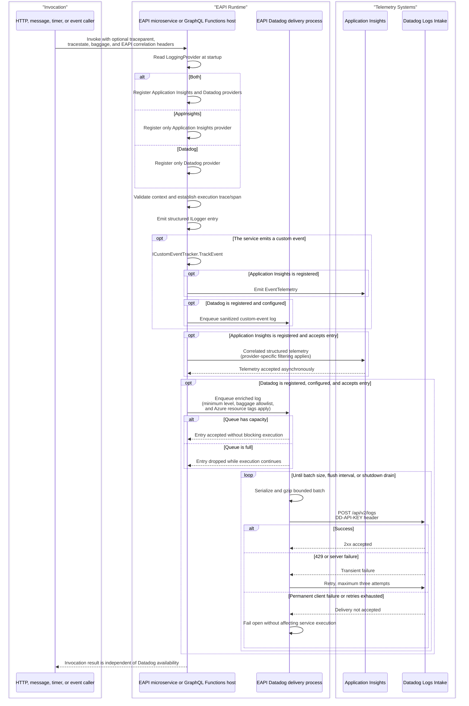

# VAA EAPI Dual Application Insights and Datadog Logging Flow

This document reflects the implemented shared logging flow across EAPI microservices, GraphQL, GraphQL REST/Mobile, GraphQL Stitch, orchestration, and NDC Function hosts. Each Azure Functions host can select Application Insights, direct Datadog delivery, or both through `LoggingProvider`, while preserving W3C correlation and baggage privacy.

> **Minimum review:** Read the flow name and description, **Why this flow exists**, **Sequence (detailed)**, and **Open points to finalize**. These sections establish the purpose, intended interactions, and outstanding questions; review the remaining sections as relevant to your role.

## Why this flow exists

EAPI services need to retain Application Insights as the Azure-native telemetry destination while optionally forwarding the same structured application logs directly to Datadog without using the Datadog SDK. Both destinations must carry enough W3C context to correlate an execution, but neither destination may receive raw baggage or secrets.

## Sequence (detailed)

## Open points to finalize

- None currently recorded. Move the goal back to `Draft` if the provider topology, delivery contract, or privacy policy changes.

## High-level behavior

1. An invocation enters an EAPI microservice, GraphQL, GraphQL REST/Mobile, or GraphQL Stitch Function host with optional `traceparent`, `tracestate`, and `baggage` headers.
2. At startup, `LoggingProvider` selects `Both`, `AppInsights` (the default), or `Datadog`; only the selected provider registrations are added.
3. The service validates and snapshots the W3C execution context, then emits structured entries through `ILogger` and, where required, business-safe custom events through `ICustomEventTracker`.
4. Each registered provider applies its own enablement and minimum-level filters.
5. Application Insights submits accepted logs and custom events through its existing worker telemetry pipeline when selected.
6. Datadog enriches accepted entries, adds only explicitly allowlisted baggage, and writes them to a bounded in-memory queue when selected and configured. Its custom-event sink writes sanitized custom events directly to that queue when `Datadog` or `Both` is selected.
7. The Datadog delivery process batches, gzip-compresses, and posts logs through a dedicated HTTPS client with platform certificate validation, retrying transient failures without failing the application execution.
8. ARM deployments append the Function App or slot Azure resource identity to `DatadogTags`, allowing logs to correlate with resources collected by the Datadog Azure integration.

## Integration points

| Component | Responsibility |
| --- | --- |
| EAPI microservice or GraphQL Functions host | Initializes execution context and emits structured `ILogger` entries. EAPI microservices use `ICustomEventTracker` to emit custom events independently to Application Insights and/or Datadog according to `LoggingProvider`. GraphQL host and REST share `VAA.EAPI.GraphQL.Common`; isolated GraphQL Stitch owns an equivalent provider under `VAA.EAPI.GraphQL.Stitch.Core`. |
| Application Insights | Accepts provider-filtered telemetry with EAPI and W3C correlation properties. |
| EAPI Datadog delivery process | Applies Datadog filtering and privacy rules, buffers entries, and performs bounded asynchronous delivery. |
| Dedicated Datadog HTTPS client | Uses platform-default TLS certificate validation and does not inherit the shared internal-service certificate bypass. |
| Datadog Logs Intake | Accepts gzip-compressed JSON batches over the configured regional HTTPS `/api/v2/logs` endpoint. |
| Azure Key Vault-backed application settings | Supply the Datadog API key and environment-specific configuration without committing secrets. |
| Datadog Azure integration | Collects Azure resource metadata that matches the deployment-generated `subscription_id`, `resource_group`, `name`, `type`, and `resource_id` log tags. |

## Agent delivery constraints

- Target project paths: `VAA.EAPI.Microservices/VAA.EAPI.Common/VAA.EAPI.Common.csproj`; `VAA.EAPI.Microservices/VAA.EAPI.Infrastructure/VAA.EAPI.Infrastructure.csproj`
- Implementation paths: `VAA.EAPI.Microservices/VAA.EAPI.Common/Diagnostics/Logging/Datadog/`; `VAA.EAPI.Microservices/VAA.EAPI.Common/AsyncContext.cs`; `VAA.EAPI.Microservices/VAA.EAPI.Infrastructure/Middleware/FunctionContextAccessorMiddleware.cs`
- Test path: `VAA.EAPI.Microservices/VAA.EAPI.Microservices.Tests/AsyncContextTests.cs`
- Contract source files to read: `VAA.EAPI.Microservices/VAA.EAPI.Common/Extensions/ServiceCollectionExtension.cs`; `VAA.EAPI.Microservices/VAA.EAPI.Common/Diagnostics/Telemetry/DefaultTelemetryInitializer.cs`; `VAA.EAPI.Microservices/VAA.EAPI.Common/Diagnostics/Logging/Datadog/DatadogLogSender.cs`
- Endpoint/header names: Datadog `/api/v2/logs`; `DD-API-KEY`; W3C `traceparent`, `tracestate`, and `baggage`
- Configuration and secret handling: `LoggingProvider` accepts `Both`, `AppInsights`, or `Datadog` and defaults to `AppInsights`; selecting `Datadog` or `Both` enables direct delivery and requires `DatadogLogsEndpoint`, `DatadogApiKey`, and `DatadogService`; source `DatadogApiKey` from an Azure Key Vault reference and never write it to logs or documentation.
- Deployment contract: every microservice, GraphQL, GraphQL REST/Mobile, and GraphQL Stitch Function ARM template and environment parameter file exposes these app settings through one secure `DataDog` object parameter. `ApiKey` uses the common `Common-Config-Datadog-ApiKey` Key Vault secret, and templates append the deployed Function App Azure resource tags. Use `LoggingProvider` as the sole capability switch.
- Harness command: `scripts/verify.ps1 -ProjectPath VAA.EAPI.Microservices/VAA.EAPI.Common/VAA.EAPI.Common.csproj -SkipBuild`; repeat for Infrastructure and Microservices.Tests when those projects change.

## Key non-functional considerations

- **Idempotency**: Log delivery is best-effort and may retry a transiently failed batch; consumers must tolerate a duplicate log entry.
- **Correlation**: Valid inbound W3C parent context is preserved, the execution uses its active trace/span identifiers, and allowed context is attached consistently to both telemetry paths.
- **Datadog APM correlation**: Logs retain full hexadecimal `w3c.trace_id` and `w3c.span_id` values and also emit `dd.trace_id` and `dd.span_id` as Datadog-compatible unsigned 64-bit decimal strings. Correlation is available when Datadog has ingested the matching APM trace.
- **Retry behavior**: Datadog delivery retries `429` and server failures up to three attempts with a short bounded delay; permanent client failures are not retried.
- **No-op path**: An unconfigured or disabled Datadog provider emits nothing to Datadog and does not affect Application Insights or the application execution.
- **Privacy**: Raw W3C baggage is not copied into either telemetry destination; only configured baggage keys are decoded and emitted to Datadog.
- **Custom-event privacy**: The custom-event tracker sends to each selected telemetry destination. Its Datadog sink forwards the event name, message, severity, correlation context, and a fixed business-safe property allowlist; it never forwards raw request data, customer identifiers, email addresses, or downstream responses.
- **Transport security**: Direct Datadog delivery uses a dedicated client with platform-default server certificate validation.
- **Azure resource correlation**: Deployment-generated tags identify the Azure subscription, resource group, Function App or slot name, resource type, and full resource ID.
- **Back pressure**: The Datadog queue is bounded and drops excess entries rather than blocking application work.

## Failure paths to capture in implementation

- Missing or invalid `LoggingProvider` defaults to `AppInsights`.
- Selecting `AppInsights` omits all Datadog provider and hosted-delivery registrations; selecting `Datadog` omits Application Insights telemetry and initializer registrations but retains direct custom-event delivery to Datadog.
- Missing, disabled, non-HTTPS, or incomplete Datadog configuration disables Datadog delivery even when `Both` or `Datadog` is selected.
- Provider-specific log-level filters can cause an entry to reach one destination but not the other.
- Invalid `tracestate` is discarded without losing a valid `traceparent`.
- Invalid or non-ASCII baggage members are rejected; non-allowlisted baggage is never emitted as Datadog properties.
- A full queue drops the new Datadog entry rather than blocking the application.
- Oversized Datadog payloads are split; an oversized individual entry is replaced with a bounded warning entry.
- Datadog `429`, server errors, timeouts, or network failures remain fail-open after bounded retries.
- Host shutdown completes the queue and drains accepted entries within the supplied shutdown cancellation window.

Expected behavior:

- When selected, Application Insights remains operational regardless of Datadog enablement or availability.
- Datadog failures never throw back into the originating `ILogger` call, custom-event tracking, or application execution.
- Both accepted telemetry paths retain safe execution correlation without exposing raw baggage or the Datadog API key.

## Expected harness

- `VAA.EAPI.Microservices/VAA.EAPI.Microservices.Tests/AsyncContextTests.cs`
- `VAA.EAPI.Microservices/VAA.EAPI.Microservices.Tests/HttpClientFactoryTests.cs`
- `VAA.EAPI.GraphQL/VAA.EAPI.GraphQL.Common/VAA.EAPI.GraphQL.Common.csproj`
- `VAA.EAPI.GraphQL/VAA.EAPI.GraphQL.Rest/VAA.EAPI.GraphQL.Rest.csproj`
- `VAA.EAPI.GraphQL/VAA.EAPI.GraphQL.Stitch/VAA.EAPI.GraphQL.Stitch.csproj`
- `scripts/verify.ps1 -ProjectPath VAA.EAPI.Microservices/VAA.EAPI.Common/VAA.EAPI.Common.csproj -SkipBuild`
- `scripts/verify.ps1 -ProjectPath VAA.EAPI.Microservices/VAA.EAPI.Infrastructure/VAA.EAPI.Infrastructure.csproj -SkipBuild`
- `scripts/verify.ps1 -ProjectPath VAA.EAPI.Microservices/VAA.EAPI.Microservices.Tests/VAA.EAPI.Microservices.Tests.csproj -SkipBuild`

## Agent Loop Goal

| Field | Value |
| --- | --- |
| Goal | Preserve dual-destination structured logging with consistent W3C correlation, bounded Datadog delivery, and no raw baggage disclosure. |
| Status | `Complete` |
| Owner | `VAA.EAPI.Common`, `VAA.EAPI.GraphQL.Common`, and their Function host maintainers |
| Review cadence | Monthly and on changes to shared logging, `AsyncContext`, telemetry initialization, outbound HTTP, or Datadog configuration |
| Last reviewed | 2026-08-26 |
| Harness Sensor | `VAA.EAPI.Microservices/VAA.EAPI.Microservices.Tests/AsyncContextTests.cs` |
| Promotion verification | Fast |
| Acceptance evidence | The focused `AsyncContextTests` coverage passes and `scripts/verify.ps1` passes for the Common, Infrastructure, and Microservices.Tests projects. |
| Done when | Eligible `ILogger` entries and business-safe custom events remain independently available to each selected destination with aligned W3C identifiers, allowlisted baggage only, and fail-open bounded Datadog delivery. |

## Associated delivery pull requests

The draft coordinator PR and its row are created when this goal enters `InProgress`. Every production and QA agent is then recorded here on its own branch and PR. The coordinator PR remains draft until every current child PR is merged, integrated verification passes, and open questions are resolved.

The workflow populates this table for delivery surfaces hosted in other GitHub repositories.

| Surface | Repository | Base branch | Head branch | PR | State | Merged at UTC |
| --- | --- | --- | --- | --- | --- | --- |

## Agent Loop Closure Evidence

Implementation is present on the Datadog/W3C logging change branch. Focused tests cover W3C parsing, baggage privacy, dual telemetry enrichment, outbound trace behavior, payload bounds, and shutdown draining; repository harness verification is the ongoing acceptance sensor.
