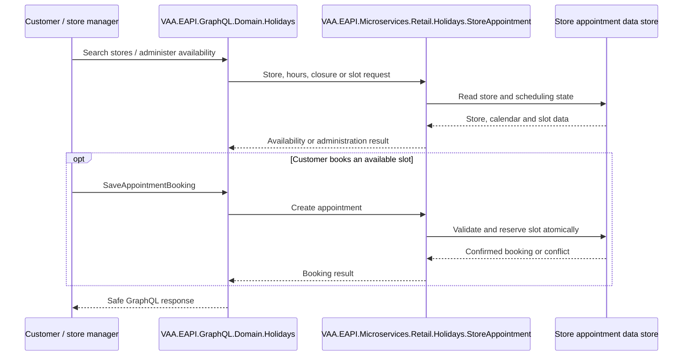

# VAA EAPI Explore — All GraphQL Scenarios

**Status:** Implemented

> **Minimum review:** Read the flow name and description, **Why this flow exists**, **Sequence (detailed)**, and **Open points to finalize**. These sections establish the purpose, intended interactions, and outstanding questions; review the remaining sections as relevant to your role.

## Why this flow exists

<a id="purpose"></a>

Maps `VAA.EAPI.Automation.Explore`, covering appointment booking and store administration GraphQL.

## Sequence (detailed)

<a id="service-level-sequence"></a>



## Open points to finalize

- None currently recorded; add explicit blockers here before moving this diagram back to Ready or InProgress.

## Agent delivery constraints

- Target solution/project path: Use the smallest owning solution or project implied by the `Harness Sensor`, integration points, and documented component ownership.
- New implementation path, when needed: Prefer the owning project paths already named in this diagram; do not create new services or broaden ownership without recording a blocker.
- New test path, when needed: `VAA.EAPI.Automation/VAA.EAPI.Automation.Explore/Tests/AppointmentBooker/SaveAppointmentBookingTests.cs`
- Contract source files to read: Existing files referenced by this diagram, the named GraphQL operations, HTTP endpoints, message/event names, request payloads, and nearest tests.
- Endpoint/event/query/command names: Use only the operation, route, event, command, or scenario names documented in this diagram unless a compile/test failure proves a rename.
- Configuration and secret handling: Use existing configuration keys, environment variables, and secret references only; never commit real secrets, tokens, PII, payment data, or passenger documents.
- Harness command: Run the scoped verification selected by Promotion verification; for Fast, use scripts/verify.ps1 -SolutionPath <owning-solution> -SkipBuild or the nearest project equivalent.

## Current implementation alignment

The GraphQL boundary is `VAA.EAPI.GraphQL.Domain.Holidays`, backed by `VAA.EAPI.Microservices.Retail.Holidays.StoreAppointment`. Store administration and customer appointment calls converge on the same owning microservice and its store.

## Operations and scenarios

| Area | Operations/scenarios |
|---|---|
| Appointment Booker | retrieve nearby stores by search parameter; store details by ID/origin; calendar availability; slots by date; save appointment; booked slots reflected in calendar |
| Store Manager | admin store list; admin store by ID; store by ID; opening hours; closures; slot rules; replace opening hours; replace slot rules; database mapping validation |

## Example payloads

```json
{ "query": "query RetrieveAllNearByStores($searchParameter: String!) { retrieveAllNearByStores(searchParameter: $searchParameter) { ... } }", "variables": { "searchParameter": "London" } }
```

```json
{ "data": { "retrieveAllNearByStores": [{ "storeId": "<opaque-store-id>", "name": "Test Store", "distance": 1.2 }] } }
```

```json
{
  "query": "mutation SaveAppointmentBooking($request: AppointmentInput!) { saveAppointmentBooking(request: $request) { ... } }",
  "variables": { "request": { "appointmentType": "TRAVEL", "appointmentReason": "BOOKING_HELP", "bookingReference": "<synthetic-reference>", "locationId": "<opaque-store-id>", "firstName": "TEST", "lastName": "CUSTOMER", "email": "synthetic@example.test", "phone": "<synthetic-phone>", "slotId": "<opaque-slot-id>" } }
}
```

```json
{ "data": { "saveAppointmentBooking": { "bookingId": "<opaque-appointment-id>", "status": "CONFIRMED" } } }
```

## Backlog

Store search/details; availability; slot selection; appointment confirmation; concurrency/no-longer-available handling; opening-hours/closure administration; slot-rule administration; PII redaction and notifications.

## Automation sources

Tests: `VAA.EAPI.Automation.Explore/Tests/`; payloads: `VAA.EAPI.Automation.Explore/Requests/Body/`; builders/endpoints: `VAA.EAPI.Automation.Explore/Requests/Factory/GraphQL.cs`, `Requests/Endpoints/GraphQL.cs`.

## Failure paths

- Return no-results and invalid-store responses without leaking administrative data.
- Reject unavailable, expired, or concurrently reserved slots without double booking.
- Validate opening hours, closures, and slot-rule updates before replacing stored configuration.
- Map Store Appointment and datastore failures to safe GraphQL errors with correlation context.

## Expected harness

The Explore tests and request payloads listed under Automation sources are the current sensors. They should cover public appointment booking, secure store administration, concurrency conflicts, mapping validation, and downstream error behavior.

## Agent Loop Goal

| Field | Value |
| --- | --- |
| Goal | Maintain the imported scenario catalogue as an implemented sequence-diagram reference. |
| Status | `Complete` |
| Owner | `VAA.EAPI.Microservices.Retail.Holidays.StoreAppointment maintainers` |
| Review cadence | Quarterly and when scenario coverage changes |
| Last reviewed | 2026-07-28 |
| Harness Sensor | `VAA.EAPI.Automation/VAA.EAPI.Automation.Explore/Tests/AppointmentBooker/SaveAppointmentBookingTests.cs` |
| Promotion verification | Fast |
| Acceptance evidence | Imported scenarios align to existing automation coverage and are tracked by the sequence-diagram index. |
| Done when | Scenario catalogue remains aligned with implemented behavior and referenced harness coverage. |

## Associated delivery pull requests

The draft coordinator PR and its row are created when this goal enters `InProgress`. Every production and QA agent is then recorded here on its own branch and PR. The coordinator PR remains draft until every current child PR is merged, integrated verification passes, and open questions are resolved.

The workflow populates this table for delivery surfaces hosted in other GitHub repositories.

| Surface | Repository | Base branch | Head branch | PR | State | Merged at UTC |
| --- | --- | --- | --- | --- | --- | --- |

## Agent Loop Closure Evidence

Record final closure evidence here. Existing verification and delivery records remain in their respective sections.
