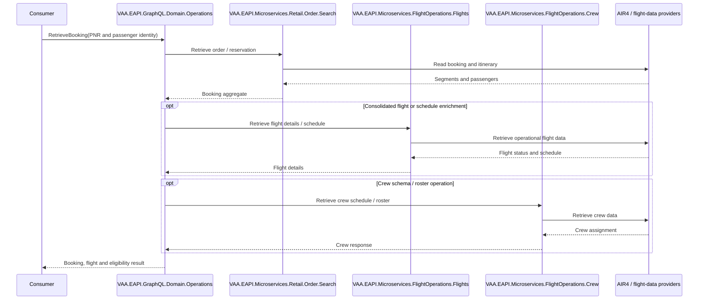

# VAA EAPI Flight Operations — All GraphQL Scenarios

**Status:** Implemented

> **Minimum review:** Read the flow name and description, **Why this flow exists**, **Sequence (detailed)**, and **Open points to finalize**. These sections establish the purpose, intended interactions, and outstanding questions; review the remaining sections as relevant to your role.

## Why this flow exists

<a id="purpose"></a>

Maps the Flight Operations booking-retrieval GraphQL tests. Supporting flight schedule and crew-roster microservices are dependencies, not GraphQL operations.

## Sequence (detailed)

<a id="service-level-sequence"></a>



## Open points to finalize

- None currently recorded; add explicit blockers here before moving this diagram back to Ready or InProgress.

## Agent delivery constraints

- Target solution/project path: Use the smallest owning solution or project implied by the `Harness Sensor`, integration points, and documented component ownership.
- New implementation path, when needed: Prefer the owning project paths already named in this diagram; do not create new services or broaden ownership without recording a blocker.
- New test path, when needed: `VAA.EAPI.Automation/VAA.EAPI.Automation.FlightOperations/Tests/GraphQl/RetrieveBooking.cs`
- Contract source files to read: Existing files referenced by this diagram, the named GraphQL operations, HTTP endpoints, message/event names, request payloads, and nearest tests.
- Endpoint/event/query/command names: Use only the operation, route, event, command, or scenario names documented in this diagram unless a compile/test failure proves a rename.
- Configuration and secret handling: Use existing configuration keys, environment variables, and secret references only; never commit real secrets, tokens, PII, payment data, or passenger documents.
- Harness command: Run the scoped verification selected by Promotion verification; for Fast, use scripts/verify.ps1 -SolutionPath <owning-solution> -SkipBuild or the nearest project equivalent.

## Current implementation alignment

The GraphQL boundary is `VAA.EAPI.GraphQL.Domain.Operations`. Booking retrieval is composed from the retail order boundary; flight, schedule and crew coverage is supplied by the dedicated Flight Operations microservices. The sequence represents current implemented capability; the backlog records future enhancements.

## Payload: retrieve by PNR

```json
{
  "operationName": "RetrieveBooking",
  "query": "query RetrieveBooking($bookingRef: String!, $firstName: String!, $lastName: String!) { retrieveBooking(bookingRef: $bookingRef, firstName: $firstName, lastName: $lastName) { recordLocator bookingDate segments { cabin departure destination eligibility marketingFlight { airlineCode number } operatingFlight { airlineCode number } origin segmentID } passengers { firstName frequentFlyerNumber lastName passengerId selectedMeal } } }",
  "variables": { "bookingRef": "<synthetic-pnr>", "firstName": "TEST", "lastName": "PASSENGER" }
}
```

```json
{ "data": { "retrieveBooking": { "recordLocator": "<synthetic-pnr>", "segments": [{ "origin": "LHR", "destination": "JFK", "cabin": "ECONOMY", "eligibility": true }], "passengers": [{ "passengerId": "<opaque-passenger-id>", "selectedMeal": null }] } } }
```

## Automated scenarios

- retrieve booking using a loyalty account;
- retrieve booking using PNR identity;
- journey/reservation variants;
- record locator, dates, segments, marketing/operating flights, cabin and eligibility;
- passenger identity, frequent-flyer number and selected meal;
- supporting consolidated flight details, e-commerce schedule, crew schedule and crew roster schema/data.

## Backlog

Backlog: lookup identity, itinerary/eligibility, passenger/loyalty/meal mapping, invalid booking, downstream errors and PII masking.

## Automation sources

Tests: `VAA.EAPI.Automation.FlightOperations/Tests/GraphQl/`; payloads: `VAA.EAPI.Automation.FlightOperations/Requests/Body/GraphQL/`.

## Failure paths

- Reject invalid booking identity and unknown PNRs without disclosing reservation data.
- Preserve controlled partial behavior when schedule or crew enrichment is unavailable.
- Map Order Search, Flight Operations, and provider timeouts or contract failures safely.
- Redact passenger, loyalty, meal, and operationally sensitive crew data from telemetry.

## Expected harness

The Flight Operations GraphQL tests and payloads listed under Automation sources are the current sensors. Coverage should validate booking identity, mapped itinerary/passenger fields, schedule and crew contracts, authorization failures, and downstream error mapping.

## Agent Loop Goal

| Field | Value |
| --- | --- |
| Goal | Maintain the imported scenario catalogue as an implemented sequence-diagram reference. |
| Status | `Complete` |
| Owner | `VAA.EAPI.Microservices.FlightOperations maintainers` |
| Review cadence | Quarterly and when scenario coverage changes |
| Last reviewed | 2026-07-28 |
| Harness Sensor | `VAA.EAPI.Automation/VAA.EAPI.Automation.FlightOperations/Tests/GraphQl/RetrieveBooking.cs` |
| Promotion verification | Fast |
| Acceptance evidence | Imported scenarios align to existing automation coverage and are tracked by the sequence-diagram index. |
| Done when | Scenario catalogue remains aligned with implemented behavior and referenced harness coverage. |

## Associated delivery pull requests

The draft coordinator PR and its row are created when this goal enters `InProgress`. Every production and QA agent is then recorded here on its own branch and PR. The coordinator PR remains draft until every current child PR is merged, integrated verification passes, and open questions are resolved.

The workflow populates this table for delivery surfaces hosted in other GitHub repositories.

| Surface | Repository | Base branch | Head branch | PR | State | Merged at UTC |
| --- | --- | --- | --- | --- | --- | --- |

## Agent Loop Closure Evidence

Record final closure evidence here. Existing verification and delivery records remain in their respective sections.
