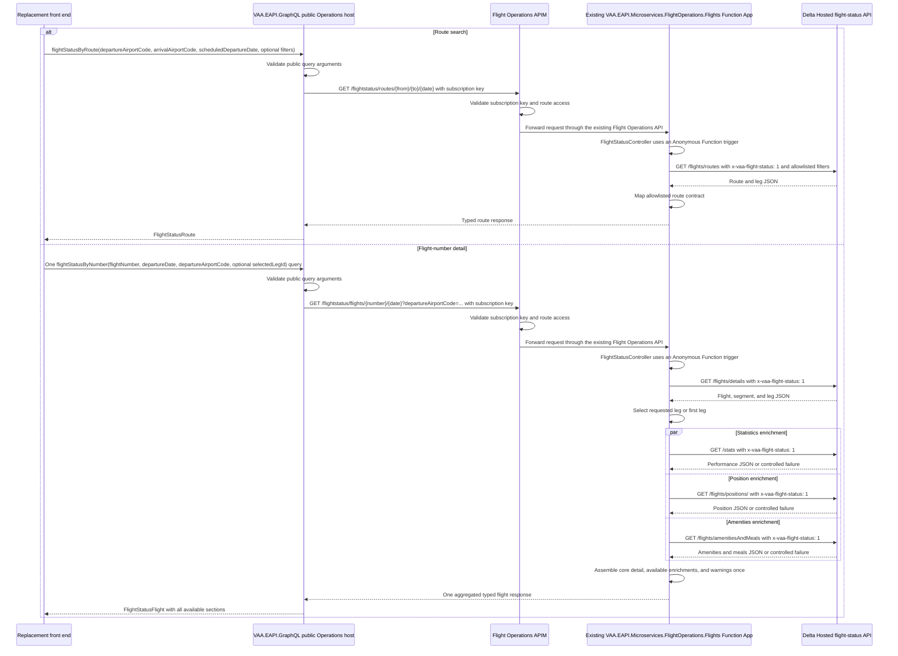
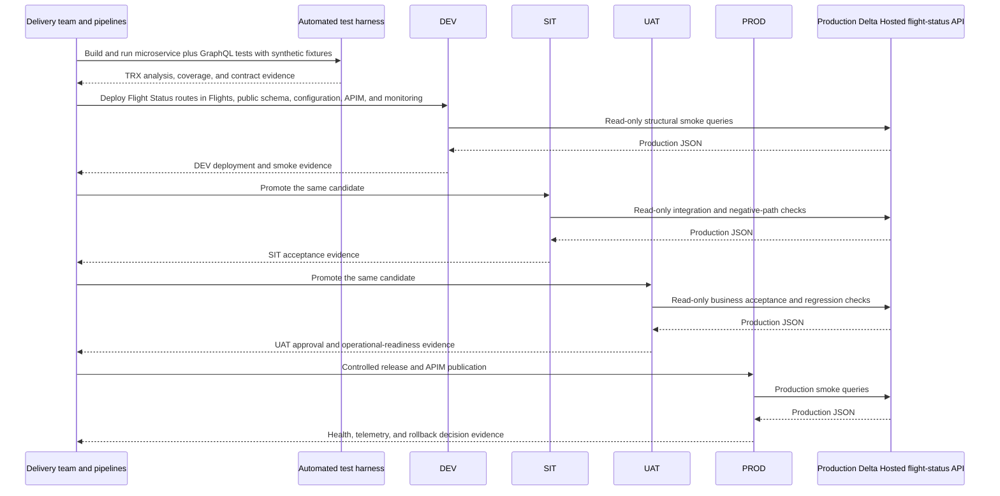

# Flight Operations Flight Status Delivery Flow

This goal adds Flight Status route-search and flight-number operations to the existing `VAA.EAPI.Microservices.FlightOperations.Flights` microservice and adds public queries in `VAA.EAPI.GraphQL.Domain.Operations`. The capability wraps the production Delta Hosted flight-status API used by the current website, while presenting stable, typed EAPI contracts to replacement front ends.

The HTTP triggers and Flight Status service components are an additive feature in the existing Flights Function App. They use its existing project, APIM API, deployment resources, and pipeline; there is no separate `FlightOperations.FlightStatus` project or Function App. This is the business-approved boundary for PR #2392, recorded in [the service-boundary decision](../decisions/2026-10-11-flight-status-existing-flights-boundary.md). The public GraphQL query type and provider remain in Operations, separate from the existing secure Operations flight-search operation. Existing Flights operations continue to work alongside the new Flight Status routes.

> **Minimum review:** Read the flow name and description, **Why this flow exists**, **Sequence (detailed)**, and **Open points to finalize**. These sections establish the purpose, intended interactions, and outstanding questions; review the remaining sections as relevant to your role.

## Why this flow exists

The current flight-status front end is being replaced, but its production Delta Hosted API remains authoritative. Front-end developers need public GraphQL operations that insulate them from the downstream endpoints, query-string conventions, response drift, and multi-call enrichment sequence.

The live application was inspected on 2026-09-22 and calls these Delta Hosted API resources through `www.virginatlantic.com`:

- `GET https://www.virginatlantic.com/flights/routes`
- `GET https://www.virginatlantic.com/flights/details`
- `GET https://www.virginatlantic.com/stats`
- `GET https://www.virginatlantic.com/flights/positions/`
- `GET https://www.virginatlantic.com/flights/amenitiesAndMeals`

These are the resources used across both queries, not five calls for every query. Route search calls only `/flights/routes`; flight-number detail calls `/flights/details` and then applicable statistics, position, and amenities/meals resources.

Deployed DEV, SIT, UAT, and PROD instances all call the live production Delta Hosted API: set `FlightStatus:DeltaServiceLayerBaseUrl` to `https://www.virginatlantic.com` in each environment. Synthetic HTTP fixtures and mocks are only for isolated unit, contract, and automation tests, not for deployed services or smoke checks. Deployed smoke calls remain bounded and read-only. The approval, data boundary, and operational controls for this exception are recorded in [the Delta Hosted API decision](../decisions/2026-09-25-flight-status-production-delta-hosted-api.md).

Send the HTTP request header `x-vaa-flight-status: 1` on all five calls to the Delta Hosted API. The existing flight-status integration uses this header for routes, details, and statistics. Whether positions and amenities/meals require it has not been verified; send it provisionally and confirm with bounded, read-only smoke tests.

## Sequence (detailed)



## Open points to finalize

- Verify the deployed IP restrictions on the GraphQL and Flights Function Apps allow inbound API traffic only through APIM. APIM must require a valid subscription key with access to both Flight Status operations. The Functions worker does not duplicate these APIM checks.

## Scope

In scope:

- Add route-search and flight-number-detail HTTP triggers and Flight Status service components to the existing `VAA.EAPI.Microservices.FlightOperations.Flights` microservice.
- Add Flight Status downstream DTOs, mapped responses, validation, error handling, telemetry, and OpenAPI contracts within the existing Flights project and test project.
- New public query/provider/model code in `VAA.EAPI.GraphQL.Domain.Operations`.
- Microservice, GraphQL, contract, smoke, and negative-path tests.
- GraphQL configuration plus the existing Flights Function App, APIM API, deployment, pipeline, and monitoring updates required to operate the new routes.

Out of scope:

- Development, testing, deployment, or visual reproduction of the replacement front end.
- Changes to the current website or the production Delta Hosted API.
- Creation of a separate `FlightOperations.FlightStatus` project, Function App, APIM API, deployment project, or pipeline.
- Changes to unrelated existing Flights operations, DTOs, or the secure GraphQL Operations flight-search query.
- Registration of the new public queries in the existing secure Operations flight-search query type.
- Authenticated flight-operations search, notifications, airport autocomplete, booking, check-in, or disruption-management features.

## Public contracts

The public GraphQL schema adds queries only; no mutation is required.

```graphql
flightStatusByRoute(
  departureAirportCode: String!
  arrivalAirportCode: String!
  scheduledDepartureDate: Date!
  timeRange: [Int!]
  stops: [Int!]
  first: Boolean
): FlightStatusRoute

flightStatusByNumber(
  flightNumber: String!
  departureDate: Date!
  departureAirportCode: String!
  selectedLegId: String
): FlightStatusFlight
```

The goal owner approved a permissive initial result model. Keep both query results nullable and expose a broad but explicitly mapped, typed allowlist of route, segment, leg, airport, scheduled/estimated/actual time, aircraft, status, performance, position, amenities, and meals data. Default result and enrichment fields to nullable rather than asserting downstream completeness. Use a warning collection with stable codes for failed optional enrichments; initially distinguish statistics, position, and amenities/meals unavailability. Refine exact field types, names, and nullability against synthetic fixtures, GraphQL integration tests, and consumer contract review before production publication. This flexibility does not permit a raw downstream JSON scalar, arbitrary fields, or unbounded pass-through data.

A single `flightStatusByNumber` query must return the assembled flight-detail payload: core flight and selected-leg data plus applicable performance statistics, position, amenities, and meals. The replacement front end must not call those Delta Hosted resources or issue separate GraphQL enrichment queries. The initial nullable-first schema and its mapping must be snapshot/contract-tested and versioned or reviewed if later tightening would break consumers.

The goal owner confirmed that client-facing failures use the existing GraphQL `errors` response model, not a custom error field in the flight-status payload. Use brief, generic messages for invalid input, no match, and core service unavailability, with stable category codes so clients can distinguish those outcomes. Do not expose downstream responses, raw exception messages, internal URLs, or diagnostic details in GraphQL error messages or extensions. Map failures safely before the existing host `ErrorFilter` can serialize a raw `HttpRequestException` response; preserve correlation in approved telemetry. Optional enrichment failure retains the agreed nullable section and typed warning behavior rather than failing otherwise valid core details.

The schema exposes each accepted variable as a named query argument, without a wrapper input object. Route search requires departure and arrival airport codes and a scheduled departure date; `timeRange`, `stops`, and `first` are optional filters. Flight-number detail requires the flight number, departure date, and departure airport code; the selected-leg identifier is optional. The arrival airport is taken from the selected leg for enrichments and is not a client argument.

### Date filtering

- Both queries require one calendar date, not a start/end range. `flightStatusByRoute` uses `scheduledDepartureDate` to select routes for that scheduled departure date; `flightStatusByNumber` uses `departureDate` to look up flight details for that departure date. The GraphQL provider puts the date in the matching internal route as `yyyy-MM-dd`, and the Flights service sends it to Delta Hosted as the `scheduledDepartureDate` or `departureDate` query parameter, respectively.
- Both GraphQL and the Flights service reject a missing or invalid date and enforce the same inclusive window: from the current UTC calendar date minus one day through the current UTC calendar date plus 331 days. Dates outside that window fail validation before a Delta Hosted call. The consumer UI should apply the same window, but server-side validation remains authoritative.
- `timeRange` is an optional route-search filter alongside the required scheduled departure date; it does not replace that date or extend the permitted date window. Flight-number enrichments use the selected leg's scheduled departure time when calling statistics, position, and amenities/meals resources; they add no separate client-facing date filter.

The existing Flights microservice adds these Flight Status function triggers:

```text
GET /api/flightstatus/routes/{departureAirportCode}/{arrivalAirportCode}/{scheduledDepartureDate}?timeRange=1,2,3&stops=0,1,2&first=true
GET /api/flightstatus/flights/{flightNumber}/{departureDate}?departureAirportCode=LHR&selectedLegId=1
```

The GraphQL provider and other consumers use the APIM-relative path `/flightstatus/...`; the Function route remains `/api/flightstatus/...`. The existing Flights APIM backend `serviceUrl` ends in `/api`, so including that backend prefix again in the APIM-relative path would duplicate it. The Function App's IP restrictions block direct consumer access to `/api/flightstatus/...`.

The GraphQL and microservice contracts must use explicit typed allowlists. They must not expose raw downstream JSON, downstream URLs, internal headers, stack traces, or unbounded arbitrary filtering. Flight Status is a public read capability that any consumer with an appropriate APIM subscription key may call through the existing Flight Operations APIM API. The GraphQL provider sends its configured subscription key without a bearer token. The Function triggers remain `AuthorizationLevel.Anonymous` so APIM can invoke them; APIM requires a valid subscription key and access to the Flight Status operations before forwarding requests. IP restrictions on the Flights Function App block direct inbound calls, including to its `/api` routes. Keep subscription-key settings environment-specific, with secrets backed by Key Vault; do not embed keys in source, OpenAPI examples, or telemetry. The OpenAPI metadata documents the APIM API-key requirement and 401/403 responses.

## High-level behavior

1. A caller submits a public GraphQL route or flight-number query.
2. `VAA.EAPI.GraphQL.Domain.Operations` validates and maps the typed query arguments, then makes one call to the matching Flight Status trigger in the existing Flights Function App through APIM, sending its configured subscription key.
3. Route search calls only the production `/flights/routes` resource and maps route, segment, leg, airport, schedule, aircraft, and status fields. It does not call `/flights/amenitiesAndMeals` or any other detail enrichment resource.
4. Flight-number detail calls production `/flights/details` and selects the requested or first leg. Once the selected leg supplies the required inputs, the microservice fans out applicable `/stats`, `/flights/positions/`, and `/flights/amenitiesAndMeals` requests concurrently rather than serialising independent calls.
5. The microservice waits within a bounded request deadline, then maps one allowlisted response containing core detail and all available enrichment sections. Optional enrichment failures return nullable fields plus typed warnings; failure of the core routes/details call fails the operation.
6. The GraphQL provider returns that assembled public schema type in the original query response, with correlation preserved end to end. No client-side downstream aggregation is required.

## Integration points

| Component | Responsibility |
| --- | --- |
| Public GraphQL host | Expose only the two unauthenticated, read-only queries and apply public-host/APIM controls. The provider calls the existing Flights APIM route with its configured subscription-key header. |
| `VAA.EAPI.GraphQL.Domain.Operations` | Own a separate thin public query type and provider for the new Flight Status HTTP contract; leave existing secure Operations queries unchanged. |
| `VAA.EAPI.Microservices.FlightOperations.Flights` | Host the additive Flight Status triggers and aggregation service alongside existing Flight Operations operations. |
| Delta Hosted flight-status API, accessed through `www.virginatlantic.com` | Authoritative source for route, details, statistics, position, and amenities/meals data in every environment. |
| APIM and deployment pipelines | Add the routes to the existing Flights APIM/API deployment and use its subscription requirement; publish public GraphQL operations separately and promote the same candidate through DEV, SIT, UAT, and PROD. Confirm any additional APIM or network access restrictions from deployed configuration. |
| Application Insights and configured logging provider | Capture dependency latency, failures, warning counts, request outcome, and safe correlation metadata. |

## Agent delivery constraints

- Microservice project paths: add the feature to `VAA.EAPI.Microservices/VAA.EAPI.Microservices.FlightOperations.Flights/VAA.EAPI.Microservices.FlightOperations.Flights.csproj`, with its trigger in `Triggers/Http/FlightStatusController.cs` and tests in `VAA.EAPI.Microservices/VAA.EAPI.Microservices.FlightOperations.Flights.Tests/`. Do not scaffold a separate `FlightOperations.FlightStatus` microservice or Function App.
- Microservice implementation: follow the existing Flights project structure and conventions for the new Flight Status controller, service, downstream models, validation, errors, telemetry, and OpenAPI. Reuse the existing Flights Function App, APIM API, deployment project, and pipeline. Keep unrelated Flights operations and their contracts unchanged.
- GraphQL project paths: `VAA.EAPI.GraphQL/VAA.EAPI.GraphQL.Domain.Operations/VAA.EAPI.GraphQL.Domain.Operations.csproj` and `VAA.EAPI.GraphQL/VAA.EAPI.GraphQL.Domain.Operations.Tests/VAA.EAPI.GraphQL.Domain.Operations.Tests.csproj`.
- New GraphQL implementation path: add `Queries/FlightStatusQuery.cs`, `Interfaces/IFlightStatusProvider.cs`, `Services/FlightStatusProvider.cs`, and dedicated flight-status models within `Domain.Operations`; register the new query type in the public schema and permit registration in the secure schema only when `Debugger.IsAttached` is true for local development. Do not add the type to existing `FlightsQuery`.
- Test paths: keep Flight Status sensors in the existing `VAA.EAPI.Microservices/VAA.EAPI.Microservices.FlightOperations.Flights.Tests/` project and Operations GraphQL sensors in `VAA.EAPI.GraphQL/VAA.EAPI.GraphQL.Domain.Operations.Tests/`, plus synthetic JSON fixtures for every downstream resource and failure class.
- Contract source: the production resources listed under `Why this flow exists`, captured fixture shapes, and the exact trigger/GraphQL names in this goal. Do not couple to current front-end classes or markup.
- Configuration: keep the downstream Delta Hosted base URL, timeouts, retries, and its request settings in the existing Flights service configuration. The GraphQL provider uses environment-specific `FlightStatus:InternalApiUrl` and `FlightStatus:SubscriptionKey` settings to call the existing Flights APIM route; the GraphQL deployment templates supply them from environment parameters. Keep secrets Key Vault-backed and never commit plaintext credentials or live passenger data.
- Deployment paths: extend the existing `VAA.EAPI.Deployments/VAA.EAPI.Microservices.FlightOperations.Flights.Deployment` templates and `VAA.EAPI.Pipelines/FlightOperations.Flight.CICD.Pipeline.yaml` (including its slot/digital variants) for the triggers/APIM API. Update `VAA.EAPI.Pipelines/GraphQL.Operations.Microservice.AFN.CICD.Pipeline.yaml` and its slot/deployment templates for the public Operations host. Do not add a separate Flight Status deployment project or pipeline.
- Bruno/OpenAPI: add requests for both new triggers and both GraphQL operations; regenerate/import the owned OpenAPI/APIM contract where required.
- Harness commands: run both owning project test suites with Release, run-scoped TRX, XPlat coverage, and `scripts/analyse-test-run-results.ps1`; then run `scripts/verify.ps1` for each changed owning solution/project without `-SkipBuild`.

## Key non-functional considerations

- **Public access**: deployed hosts expose the new Operations GraphQL query type through the public/insecure schema. The existing `Debugger.IsAttached` developer-mode switch may also register it in the secure schema during local debugging; the goal owner accepted this exception on 2026-10-13. Do not add it to existing `FlightsQuery`.
- **APIM access**: GraphQL and other consumers send an appropriate APIM subscription key; no Flight Status bearer token or app role is required. The checked-in Flights APIM API template requires a subscription. The Functions host triggers use `AuthorizationLevel.Anonymous`; APIM checks subscription and operation access before forwarding. IP restrictions on both the GraphQL and Flights Function Apps allow inbound API traffic only through APIM; verify the deployed network controls and APIM routing.
- **Input protection**: validate IATA codes, non-identical route endpoints, flight-number format, and the inclusive departure-date window from the UTC calendar date minus one day through the UTC calendar date plus 331 days for both route and flight-number searches. The consumer UI should apply the same date window; GraphQL and the Flights microservice enforce it before calling Delta. Validate filter allowlists and maximum list sizes before any downstream call.
- **Abuse protection**: apply APIM rate limits, GraphQL depth/complexity controls, bounded timeouts, response-size limits, and dependency concurrency limits appropriate to the public read API and the anonymous Function trigger.
- **Idempotency**: all operations are read-only GET/query operations and safe to retry within the defined transient-fault policy.
- **Correlation**: preserve `api-correlation-id`, `api-operation-id`, and W3C trace context from GraphQL through the microservice and downstream dependency telemetry.
- **Retry behavior**: the Flights microservice owns retries for its Delta Hosted GET calls. Retry timeouts, HTTP 429, and transient 5xx responses at most twice per downstream call with jitter and `Retry-After` support; do not retry validation or other 4xx responses. GraphQL makes one request to the microservice and does not retry, avoiding layered retry amplification.
- **Single-call composition**: one client flight-number query maps to one GraphQL-to-microservice request and one assembled response. `/flights/amenitiesAndMeals` is called only for flight-number detail when applicable, never for route search; it is not a separate client request. After core detail resolves the selected leg, run independent statistics, position, and amenities/meals requests concurrently with cancellation, a bounded overall deadline, and controlled dependency concurrency.
- **Partial data**: route/details are core and fail the query when unavailable. Statistics, position, and amenities/meals are nullable enrichments; their failure adds a stable warning code without leaking downstream content.
- **Freshness**: any cache must be configuration-driven, no longer than 30 seconds by default, and expose neither stale data after its TTL nor cross-request mutable state.
- **Failure logging decision**: the goal owner requires a failure record, not raw request or response data. Use the standard structured `ILogger`/platform telemetry mechanisms to record the dependency name, safe status or mapped reason code when available, duration, retry count, outcome, and correlation ID. Do not record request/response bodies, credentials, full Delta Hosted query-string URIs, or untrusted downstream reason text. The shared `IHttpConnector` currently places raw request/response text in failure diagnostics; delivery must add a centrally supported, integration-scoped suppression/redaction path and use it for every Delta Hosted call. The existing GraphQL-to-Flights connector may log its internal request URI for this goal; the goal owner accepted that behavior on 2026-10-13. Tests must prove raw payloads and credentials are absent from logs, traces, and exception data on failures.
- **Privacy**: requests contain only flight, date, route, and correlation data. Do not introduce passenger, booking, identity, or payment data or persist live downstream payloads.
- **Production downstream**: enforce the linked decision's read-only boundary; do not introduce write methods or side effects. Promotion tests must use structural assertions and must not assume a particular live status, gate, time, or aircraft value.

## Delivery and promotion sequence



## Failure paths to capture in implementation

- Missing, malformed, identical, out-of-range, or disallowed input is rejected before any downstream call.
- A production routes/details 404 or no-match condition maps to a generic standard GraphQL error with a stable not-found category code, distinct from technical failure.
- Production 429, timeout, connection, malformed JSON, oversized response, and 5xx failures map to a generic standard GraphQL error with a stable unavailable category code after the bounded retry policy; invalid input uses a separate validation category code.
- A stats, position, or amenities/meals failure does not discard valid core flight details; it produces a nullable field and stable warning code.
- APIM subscription/access or GraphQL-to-microservice configuration failure is controlled and observable without exposing keys or internal topology.
- All five downstream calls include `x-vaa-flight-status: 1`; fixture-backed tests assert the header on routes, details, stats, positions, and amenities/meals. Bounded live smoke checks verify that the assumed header is accepted by the two enrichment resources.
- Unknown downstream fields are ignored; missing required core fields fail mapping explicitly rather than silently defaulting misleading status data.
- Public-host rate-limit, query-complexity, and request-size rejection is verified through APIM/host tests.

Expected behavior:

- Preserve stable public error-category codes and correlation IDs across both boundaries while keeping client-facing GraphQL `errors` messages and extensions generic and free of downstream details.
- Log dependency name, duration, safe status or mapped reason code, retry count, partial-data warning code, final outcome, and correlation ID through standard structured logging without raw payloads, full Delta Hosted query-string URIs, or secrets.
- Alert on sustained core dependency failure, latency/error-rate threshold breach, and repeated partial-enrichment degradation.

## Expected harness

- `VAA.EAPI.Microservices/VAA.EAPI.Microservices.FlightOperations.Flights.Tests/FlightStatusControllerTests.cs`
- `VAA.EAPI.Microservices/VAA.EAPI.Microservices.FlightOperations.Flights.Tests/FlightStatusDeltaMappingTests.cs`
- `VAA.EAPI.GraphQL/VAA.EAPI.GraphQL.Domain.Operations.Tests/FlightStatusQueryTests.cs`
- `VAA.EAPI.GraphQL/VAA.EAPI.GraphQL.Domain.Operations.Tests/FlightStatusProviderTests.cs`
- Synthetic fixture coverage for routes, details, stats, position, amenities/meals, no-match, partial enrichment, malformed JSON, 429, timeout, and 5xx.
- Route-search tests proving one `/flights/routes` downstream call and no details, statistics, position, or amenities/meals calls.
- Contract tests proving one flight-number GraphQL query makes one internal trigger call and returns core details with statistics, position, amenities, and meals in one payload; service tests proving independent enrichment requests overlap after selected-leg resolution, honour the shared deadline, and preserve nullable warning semantics on an enrichment failure.
- GraphQL error-contract tests for invalid input, no match, and core dependency failure proving the standard `errors` model has only generic messages and stable category codes, with no raw connector response or internal detail in extensions.
- Public-schema snapshot/introspection assertion proving both queries expose the named arguments above without an `input` wrapper, are present in public mode, are absent in secure mode without a debugger, and may be present in secure mode when a debugger is attached; fixture-backed tests for the permissive nullable-first allowlist, enrichment warnings, and any field/nullability refinements made during integration.
- Date-filter tests proving both queries and both Flights routes accept the inclusive UTC-date window boundaries, reject dates outside them before any Delta Hosted call, and forward the accepted date under the matching downstream parameter name.
- Boundary checks for the GraphQL provider's subscription-key header and absence of a bearer token, the APIM subscription requirement, operation access, and IP-restricted Function App routing. Downstream-header tests cover all five Delta Hosted resources; failure-telemetry tests prove integration-scoped suppression and safe structured failure records contain no raw request/response payload, full Delta Hosted query-string URI, or credential in logs, traces, or exception data.
- Deployment checks prove the existing Flights Function App/APIM route is deployed, GraphQL environment templates supply the APIM URL and subscription-key settings, secrets remain Key Vault-backed, Function App IP restrictions allow only APIM inbound API traffic, and required APIM operations are present.
- Integration checks prove both Flight Status triggers are additive routes in `FlightOperations.Flights`, without a separate Function App/deployment/pipeline and without changing unrelated Flights triggers or GraphQL `FlightsQuery`.
- DEV, SIT, UAT, and PROD smoke evidence using structural assertions against the live production dependency.

## Agent Loop Goal

| Field | Value |
| --- | --- |
| Goal | Expose route and flight-number status through the existing Flight Operations Flights microservice and public Operations GraphQL queries. |
| Status | `Draft` |
| Delivery surface | `Backend` |
| Owner | Flight Operations service and Operations GraphQL maintainers |
| Review cadence | Monthly and on any public GraphQL contract, trigger, downstream, or deployment change |
| Last reviewed | 2026-10-15 |
| Harness Sensor | Pending rebuild of the Flight Status test suite; planned test paths are listed under Expected harness. |
| Promotion verification | Full |
| Acceptance evidence | Fixture-backed service and GraphQL tests; DEV-to-PROD deployment and read-only smoke evidence; APIM and telemetry checks. |
| Done when | Both public queries are live in PROD through the existing Flights microservice's Flight Status routes and meet their contracts with passing promotion evidence. |

Owner approval is required to move this Draft goal to Ready or change the query names, trigger routes, public visibility, production-downstream use, or partial-data semantics.

## Associated delivery pull requests

The draft coordinator PR and its row are created when this goal enters `InProgress`. Every production and QA agent is then recorded here on its own branch and PR. The coordinator PR remains draft until every current child PR is merged, integrated verification passes, and open questions are resolved.

| Surface | Repository | Base branch | Head branch | PR | State | Merged at UTC |
| --- | --- | --- | --- | --- | --- | --- |

## Agent Loop Closure Evidence

No closure evidence recorded yet. Lifecycle evidence is accumulated on the open draft coordinator PR. Completion evidence is committed before the PR becomes ready.
