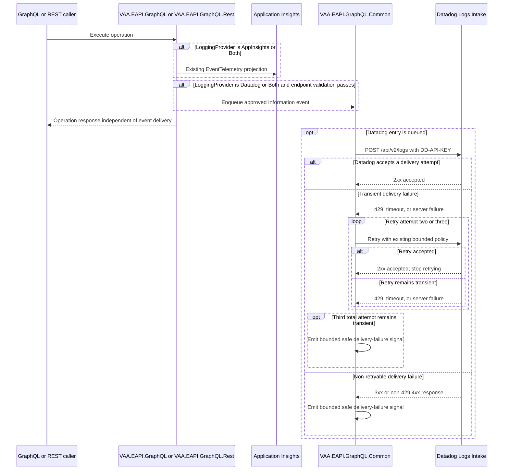

# GraphQL Custom-Event Delivery to Datadog

GraphQL custom events currently reach Application Insights through `ITelemetryService`, with dynamically supplied properties; this flow adds parity with the existing direct Datadog delivery path while filtering those properties into a reviewed, business-safe event envelope without changing GraphQL operation behavior.

> **Minimum review:** Read the flow name and description, **Why this flow exists**, **Sequence (detailed)**, and **Open points to finalize**. These sections establish the purpose, intended interactions, and outstanding questions; review the remaining sections as relevant to your role.

## Why this flow exists

The primary GraphQL and REST hosts already select direct Datadog delivery for `ILogger` entries through `VAA.EAPI.GraphQL.Common`. Their business custom events take a different route: `VAA.EAPI.GraphQL.Infrastructure.Services.Telemetry.TelemetryService` creates `EventTelemetry` and calls `TelemetryClient.TrackEvent` directly. As a result, those events do not reach Datadog when it is selected as the logging destination.

Microservices already solve this through a fan-out custom-event tracker with an Application Insights sink and a Datadog sink. The GraphQL solution needs the equivalent outcome while preserving the existing Application Insights event projection and respecting the stricter privacy risk of its dynamically supplied `TelemetryEvent.Data` properties. Existing producers include PNR, passenger, and boarding-pass data in that Application Insights projection; it must not be treated as the source for a business-safe Datadog payload.

This goal applies to the main `VAA.EAPI.GraphQL` and `VAA.EAPI.GraphQL.Rest` hosts, which both register `ITelemetryService`. `VAA.EAPI.GraphQL.Stitch` has the direct Datadog `ILogger` provider but no current `TrackEvent`, `TrackTelemetry`, or `ITelemetryService` custom-event producer; adding a new Stitch custom-event API is outside this completed goal.

## Sequence (detailed)

## Open points to finalize

None. The delivery decisions are recorded below.

## Description

Route existing GraphQL business custom events according to `LoggingProvider` while preserving the current Application Insights projection and adding a separate, privacy-safe Datadog projection. Datadog delivery is asynchronous, uses only the reviewed fixed event envelope and safe correlation fields, and cannot change a GraphQL or REST operation response.

## Acceptance criteria

### Scenario: Application Insights custom-event delivery

Given `LoggingProvider` is `AppInsights`

When a GraphQL or REST operation tracks a `TelemetryEvent`

Then Application Insights receives the existing `EventTelemetry` projection, including its existing properties

### Scenario: Datadog custom-event delivery

Given `LoggingProvider` is `Datadog` and the Datadog configuration is valid

When a GraphQL or REST operation tracks a `TelemetryEvent`

Then Datadog receives the approved fixed event envelope with safe EAPI and W3C correlation only

### Scenario: Dual destination delivery

Given `LoggingProvider` is `Both` and the Datadog configuration is valid

When a GraphQL or REST operation tracks a `TelemetryEvent`

Then Application Insights receives its existing projection and Datadog receives its separate approved projection

### Scenario: Sensitive properties are excluded from Datadog

Given a `TelemetryEvent` contains PNR, passenger, boarding-pass, authentication, request, response, or other unapproved dynamic properties

When the event is routed to Datadog

Then none of those dynamic properties are included in the Datadog entry

### Scenario: Datadog configuration fails closed

Given `LoggingProvider` selects Datadog and its endpoint is missing, unapproved, non-HTTPS, or not the exact `/api/v2/logs` path

When a GraphQL or REST operation tracks a `TelemetryEvent`

Then no Datadog request or API-key-bearing payload is sent and the invoking operation remains unaffected

### Scenario: Datadog delivery failure is isolated

Given an approved Datadog entry is queued and the intake rejects it permanently or exhausts transient retries

When the background delivery process handles the entry

Then the entry is handled using the bounded delivery policy, a safe low-cardinality diagnostic metric is exported, and the original operation response remains unaffected

## UX contract

| Field | Value |
| --- | --- |
| Supplied UX | `None` |
| Implementation authority | `Not applicable` |
| Flow and behaviour authority | `Sequence (detailed)` |
| Screen/state mapping | `Not applicable` |
| Design inspection matrix | `Not applicable` |
| Visual verification | `Not applicable` |
| UI/UX acceptance test | `Not applicable` |
| Rendered evidence | `Not applicable` |
| Comparison result | `Not applicable` |

## High-level behavior

1. A resolver, provider, or REST-routed GraphQL operation submits a business custom event through the existing GraphQL telemetry boundary.
2. The boundary produces independent projections: the unchanged existing `TelemetryEvent.Data` projection for Application Insights and a separate, reviewed, fixed-envelope projection for Datadog.
3. Application Insights continues to receive the existing `EventTelemetry` projection when `LoggingProvider` is `AppInsights` or `Both`.
4. GraphQL custom events have a trusted fixed `Information` severity. Datadog receives only the approved projection when `LoggingProvider` is `Datadog` or `Both`, Datadog configuration is complete, `DatadogMinimumLogLevel` permits `Information`, and the endpoint passes the approved regional-host and `/api/v2/logs` validation.
5. The existing Datadog sender batches and sends queued entries to the Datadog Logs Intake API. Queue drops, permanent rejections, and exhausted transient retries create a bounded, privacy-safe diagnostic or metric; none can affect the invoking operation.

## Integration points

| Component | Responsibility |
| --- | --- |
| `VAA.EAPI.GraphQL` | Primary GraphQL host. Registers `ITelemetryService` and the common logging defaults used by GraphQL custom-event producers. |
| `VAA.EAPI.GraphQL.Rest` | REST/MCP adapter host. Registers the same `ITelemetryService` and common logging defaults as the primary GraphQL host. |
| `VAA.EAPI.GraphQL.Infrastructure` | Owns `TelemetryEvent`, `ITelemetryService`, and the GraphQL custom-event routing behavior, including independent Application Insights and Datadog projections. |
| `VAA.EAPI.GraphQL.Common` | Owns the direct Datadog queue, sender, endpoint validation, structured-log enrichment, custom-event sink/tracker, and bounded delivery metrics. |
| Application Insights | Receives `EventTelemetry` only when selected by `LoggingProvider`, and receives fixed-name, low-cardinality Datadog delivery `MetricTelemetry` signals through the existing telemetry pipeline. |
| EAPI Datadog delivery process | Enriches, buffers, batches, and fail-open delivers approved GraphQL custom-event entries. |
| Datadog Logs Intake | Receives gzip-compressed event entries at the configured HTTPS `/api/v2/logs` endpoint. |
| Azure Key Vault-backed application settings | Supply the existing Datadog API key and configuration; no secret is emitted in an event or log. |

Diagram presentation: use Mermaid's default unstyled presentation without background or fill colours, borders, boundary boxes or containers (`box`/`subgraph`), custom themes, `style`, or `classDef`. Label repository-owned resources and participants with their actual project names where applicable.

Reviewer-requested internal detail: the reusable delivery participant remains named `VAA.EAPI.GraphQL.Common` to identify its owning resource. Other library-level details are collapsed into the host and delivery process.

## Agent delivery constraints

- Target solution/project path: `VAA.EAPI.GraphQL/VAA.EAPI.GraphQL.sln`; implementation is expected in `VAA.EAPI.GraphQL/VAA.EAPI.GraphQL.Infrastructure` and `VAA.EAPI.GraphQL/VAA.EAPI.GraphQL.Common` with the corresponding test projects.
- New implementation path, when needed: GraphQL equivalents of the existing Microservices custom-event sink/tracker belong in `VAA.EAPI.GraphQL/VAA.EAPI.GraphQL.Infrastructure/Services/Telemetry/` and/or `VAA.EAPI.GraphQL/VAA.EAPI.GraphQL.Common/Diagnostics/Logging/Datadog/`; do not introduce a second Datadog queue, sender, HTTP client, or correlation implementation. Extract and share the existing GraphQL Datadog enrichment behavior rather than duplicating it for custom events.
- New test path, when needed: `VAA.EAPI.GraphQL/VAA.EAPI.GraphQL.Infrastructure.Tests/TelemetryServiceTests.cs`, `VAA.EAPI.GraphQL/VAA.EAPI.GraphQL.Common.Tests/DatadogCustomEventSinkTests.cs`, and `VAA.EAPI.GraphQL/VAA.EAPI.GraphQL.Common.Tests/DatadogLogSenderTests.cs`.
- Testing boundary: `VAA.EAPI.GraphQL.Common/Properties/AssemblyInfo.cs` grants the Common test project friend-assembly access to the internal queue, sender, and custom-event sink; production implementations remain internal.
- Contract source files to read: `VAA.EAPI.GraphQL/VAA.EAPI.GraphQL.Infrastructure/Services/Telemetry/TelemetryService.cs`; `VAA.EAPI.GraphQL/VAA.EAPI.GraphQL.Infrastructure/Services/Telemetry/TelemetryEvent.cs`; `VAA.EAPI.GraphQL/VAA.EAPI.GraphQL.Infrastructure/Interfaces/ITelemetryService.cs`; `VAA.EAPI.GraphQL/VAA.EAPI.GraphQL.Common/Extensions/ServiceCollectionExtensions.cs`; `VAA.EAPI.GraphQL/VAA.EAPI.GraphQL.Common/Extensions/DatadogLoggingExtensions.cs`; `VAA.EAPI.GraphQL/VAA.EAPI.GraphQL.Common/Diagnostics/Logging/Datadog/DatadogLoggingOptions.cs`; `VAA.EAPI.GraphQL/VAA.EAPI.GraphQL.Common/Diagnostics/Logging/Datadog/DatadogLogger.cs`; `VAA.EAPI.GraphQL/VAA.EAPI.GraphQL.Common/Diagnostics/Logging/Datadog/DatadogLogQueue.cs`; `VAA.EAPI.GraphQL/VAA.EAPI.GraphQL.Common/Diagnostics/Logging/Datadog/DatadogLogSender.cs`; `VAA.EAPI.GraphQL/VAA.EAPI.GraphQL.Common/AsyncContext.cs`; and the Microservices reference implementation under `VAA.EAPI.Microservices/VAA.EAPI.Common/Diagnostics/Telemetry/` and `VAA.EAPI.Microservices/VAA.EAPI.Common/Diagnostics/Logging/Datadog/DatadogCustomEventSink.cs`.
- Endpoint/event/query/command names: `ITelemetryService.TrackTelemetry(TelemetryEvent)`; `TelemetryEvent.Type`; `LoggingProvider` values `AppInsights`, `Datadog`, and `Both`; Datadog `/api/v2/logs`; `DD-API-KEY`; W3C `traceparent`, `tracestate`, and `baggage`.
- Configuration and secret handling: Reuse the existing `LoggingProvider`, `DatadogLogsEndpoint`, `DatadogApiKey`, `DatadogService`, `environment` (`ReleaseEnvironment`), `DatadogSource`, `DatadogVersion`, `DatadogTags`, `DatadogBaggageAllowList`, `DatadogMinimumLogLevel`, `DatadogQueueCapacity`, `DatadogBatchSize`, and `DatadogFlushIntervalMilliseconds` configuration. `DatadogApiKey` remains an Azure Key Vault reference. GraphQL custom events use a fixed `Information` severity, so a minimum level above `Information` filters them; the severity is never taken from `TelemetryEvent.Data`. Validate `DatadogLogsEndpoint` against the approved regional Datadog host allowlist and exact `/api/v2/logs` path before any sink or sender uses the API key. Do not create per-domain API keys, put secrets in source, or forward arbitrary `TelemetryEvent.Data` entries.
- Deployment contract: Reuse the existing GraphQL `DataDog` deployment object and app settings. Update GraphQL deployment templates and environment parameter files only if an implementation change requires a documented configuration contract change; do not make portal-only changes.
- Harness command: `scripts/verify.ps1 -SolutionPath VAA.EAPI.GraphQL/VAA.EAPI.GraphQL.sln`; run focused `dotnet test` commands with run-scoped TRX and coverage output, then `scripts/analyse-test-run-results.ps1`, before promotion to `Complete`.

## Key non-functional considerations

- **Destination selection**: `AppInsights` sends the existing full Application Insights event projection only to Application Insights; `Datadog` sends only the separate approved Datadog projection; `Both` sends the independent projections to both. Invalid or missing `LoggingProvider` values retain the established `AppInsights` default.
- **Privacy**: Datadog receives the event type/name, fixed `Information` severity, a reviewed fixed allowlist of business-safe properties, and the existing safe correlation context. It must not receive arbitrary `TelemetryEvent.Data`, raw baggage, PNRs, passenger identifiers, boarding-pass data, customer identifiers, email addresses, authentication data, request/response bodies, or downstream payloads, even where such values are present in the unchanged Application Insights projection.
- **Correlation**: Preserve the current EAPI identifiers and W3C trace/span correlation using the common GraphQL Datadog enrichment rules. Only allowlisted baggage may be emitted.
- **Endpoint validation**: An HTTPS URI alone is insufficient. Before configuring a custom-event sink or delivery sender, require an approved regional Datadog hostname and the exact `/api/v2/logs` path; disable automatic redirects (or revalidate every redirect target against the same allowlist) so the API key and payload cannot be sent to an unapproved host. A failed validation must prevent API-key use and be observable without disclosing the endpoint or event payload.
- **Retry behavior**: Reuse the existing bounded queue, gzip batch sender, and transient retry behavior; the custom-event path must not add synchronous network I/O.
- **No-op path**: Missing, disabled, non-HTTPS, incomplete, or unapproved-endpoint Datadog configuration writes no Datadog custom event and does not affect the Application Insights path or GraphQL response.
- **Back pressure and delivery diagnostics**: A full Datadog queue drops the new entry rather than blocking the resolver, provider, or REST route. The implementation exports a bounded, privacy-safe Application Insights metric for queue drops, permanent rejections, exhausted retries, invalid configuration, and isolated sink failures, without recording event properties, API keys, or response bodies. These operational metrics remain available when `LoggingProvider=Datadog`; they are not Application Insights custom events.

## Failure paths to capture in implementation

- `TelemetryEvent` is null, its type is invalid, or an event property cannot be normalized.
- A supplied property is outside the approved allowlist, contains sensitive data, or exceeds the fixed 4096-character size bound.
- `LoggingProvider` selects Datadog but Datadog configuration is incomplete, non-HTTPS, or fails the approved regional-host and exact-path validation.
- The Datadog queue is full, the sender shuts down, or the intake endpoint returns a transient/permanent failure.
- One custom-event sink throws while the other sink remains available.

Expected behavior:

- Preserve the existing non-throwing custom-event contract and Application Insights projection; an event-routing or Datadog failure must be contained and report only a bounded, privacy-safe diagnostic or metric.
- Drop unapproved or invalid properties rather than serializing them to Datadog; retain only the reviewed fixed envelope and correlation fields. Do not change the existing Application Insights property projection as a side effect.
- Keep Application Insights independent of Datadog selection and availability when `Both` is configured.
- Reuse the existing sender policy for retryable failures; do not retry permanent client failures or block the caller.

## Expected harness

- `VAA.EAPI.GraphQL/VAA.EAPI.GraphQL.Infrastructure.Tests/TelemetryServiceTests.cs` proving destination selection, the unchanged Application Insights projection, the separate approved Datadog projection with its fixed `Information` severity, sink isolation, endpoint-validation no-op behavior, and failure behavior.
- `VAA.EAPI.GraphQL/VAA.EAPI.GraphQL.Common.Tests/DatadogCustomEventSinkTests.cs` proving the fixed allowlist, W3C and EAPI correlation enrichment, fixed-Information severity mapping and minimum-level filtering, event-property bounds, queue behavior, and that arbitrary event data is not forwarded.
- `VAA.EAPI.GraphQL/VAA.EAPI.GraphQL.Common.Tests/DatadogLogSenderTests.cs` proving payload splitting/replacement for oversized entries, transient retry exhaustion, permanent-failure drop behavior, and bounded safe delivery diagnostics.
- `VAA.EAPI.GraphQL/VAA.EAPI.GraphQL.Common.Tests/DatadogLoggingTests.cs` updated only if common registration behavior changes, proving the Datadog sink is registered solely for `Datadog` and `Both`.
- `scripts/check-sequence-diagram-status.ps1`, `scripts/check-behavior-harness.ps1`, and `scripts/check-mermaid-diagrams.ps1 -Path docs/sequence-diagrams/vaa-eapi-graphql-datadog-custom-events.md`.

## Decisions recorded for this delivery

- Datadog's fixed GraphQL event envelope is `event.name`, `event.id`, `event.origin`, `event.timestamp`, and the trusted fixed `event.severity=Information`, plus existing EAPI and allowlisted W3C correlation fields. `DatadogMinimumLogLevel` filters this known severity; all dynamic `TelemetryEvent.Data` fields are excluded, including PNR, passenger, boarding-pass, request, response, and authentication data.
- Event-name and approved-property values use the existing fixed 4096-character limit. No undocumented configurable property-size setting was introduced.
- The exact HTTPS `/api/v2/logs` endpoint is required. The accepted intake hosts are the documented Datadog regional log intakes for US1, EU1, US3, US5, AP1, AP2, UK1, US1-FED, and US2-FED. Redirects are disabled before any API-key-bearing request is made.
- Queue rejection, permanent intake responses, exhausted transient retries, invalid configuration, and isolated sink failures create low-cardinality `VAA.EAPI.GraphQL.Datadog` measurements. The hosted exporter sends them as fixed-name Application Insights `MetricTelemetry` with a bounded `reason` tag, never a payload, endpoint, or API key.
- `LoggingProvider=Datadog` suppresses Application Insights custom-event emission. The existing host registration of `TelemetryClient` remains unchanged because it exports the delivery metrics without emitting an Application Insights custom event in Datadog-only mode.
- Stitch remains out of scope because it has no `ITelemetryService` custom-event producer. The existing deployment setting contract is unchanged.

## Agent Loop Goal

| Field | Value |
| --- | --- |
| Goal | Route existing GraphQL `TelemetryEvent` custom events to Application Insights, Datadog, or both according to `LoggingProvider`, with Datadog receiving only an approved business-safe event envelope and property allowlist. |
| Status | `Complete` |
| Delivery surface | `Backend` |
| Owner | `VAA.EAPI.GraphQL.Common` and `VAA.EAPI.GraphQL.Infrastructure` maintainers |
| Review cadence | Review when the Datadog intake contract or GraphQL telemetry envelope changes. |
| Last reviewed | 2026-09-17 |
| Harness Sensor | `VAA.EAPI.GraphQL/VAA.EAPI.GraphQL.Infrastructure.Tests/TelemetryServiceTests.cs`, `VAA.EAPI.GraphQL/VAA.EAPI.GraphQL.Common.Tests/DatadogCustomEventSinkTests.cs`, `VAA.EAPI.GraphQL/VAA.EAPI.GraphQL.Common.Tests/DatadogLogSenderTests.cs`, and `VAA.EAPI.GraphQL/VAA.EAPI.GraphQL.Common.Tests/DatadogDeliveryMetricsExporterTests.cs` |
| Promotion verification | Full |
| Acceptance evidence | Focused Common and Infrastructure suites passed, proving destination selection, Application Insights compatibility, the fixed Datadog event envelope, PII-property exclusion, W3C/EAPI correlation, intake validation, redirect protection, queue rejection, retry policy, strict provider parsing, and export of delivery metrics through Application Insights. Solution verification is recorded with the PR before merge. |
| Maximum agent resources | Recorded automatically at completion from the workflow token and USD limits |
| Production code agent resources | Recorded automatically at completion from production-generation JSONL budget evidence |
| Automation code agent resources | Recorded automatically at completion from automation-generation JSONL budget evidence |
| Actual agent resources | Recorded automatically at completion from retained JSONL budget evidence |
| Lifecycle agent resources | Recorded automatically at PR closure from delivery, AI-review, and human-comment evidence |
| Done when | Completed: every existing GraphQL custom-event producer using `ITelemetryService.TrackTelemetry` independently emits to the selected telemetry destinations, Datadog receives only the fixed approved envelope and safe correlation context, and delivery failure cannot affect a GraphQL or REST response. |

## Associated delivery pull requests

This direct backend delivery is tracked in the repository pull request below.

| Surface | Repository | Base branch | Head branch | PR | State | Merged at UTC |
| --- | --- | --- | --- | --- | --- | --- |
| Backend | `VAAD1ST/eapi` | `main` | `codex/graphql-datadog-custom-events-goal` | [#2062](https://github.com/VAAD1ST/eapi/pull/2062) | Open | |

## Agent Loop Closure Evidence

No closure evidence recorded yet. The PR finalizer appends merge or abandonment evidence here after an agent-loop delivery PR closes.
