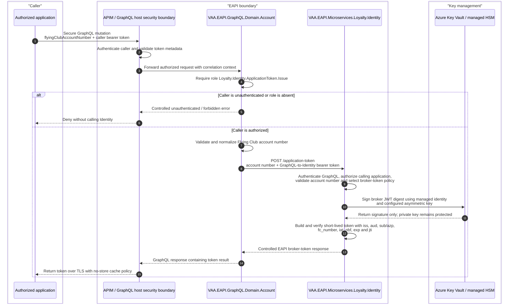

# VAA EAPI GraphQL Flying Club Application Token Flow

- Status: implemented; environment provisioning required
- Owner: Account GraphQL / Loyalty Identity / EAPI Technical Leads
- Last reviewed: 2026-07-27
- Owning projects: `VAA.EAPI.GraphQL.Domain.Account` and `VAA.EAPI.Microservices.Loyalty.Identity`

> **Minimum review:** Read the flow name and description, **Why this flow exists**, **Sequence (detailed)**, and **Open points to finalize**. These sections establish the purpose, intended interactions, and outstanding questions; review the remaining sections as relevant to your role.

## Why this flow exists

Add a secure Account GraphQL mutation that accepts a Flying Club account number and returns a short-lived EAPI broker token whose signed claims contain that account number. The mutation follows the secure registration and role-based authorization shape used by `Mutations/Secure/TransactionMutations.cs`; Identity owns validation and broker-token issuance.

Proposed contract names in this document are placeholders until the API contract is agreed:

- GraphQL mutation: `loyaltyIssueFlyingClubApplicationToken`
- required application role: `Loyalty.Identity.ApplicationToken.Issue`
- Identity route: `POST /application-token`
- request: `{ flyingClubAccountNumber }`
- response: `{ accessToken, tokenType, expiresIn }`

The returned token is sensitive bearer-token material. GraphQL must expose it only from the secure schema, and neither service may log the token, signing-key material, or full request payload.

## Sequence (detailed)

## Open points to finalize

- None for the implemented flow. Reopen if downstream provisioning changes alter issuer, audience, role, signing-key, or claim requirements.

## Agent delivery constraints

- Target solution/project path: Use the smallest owning solution or project implied by the `Harness Sensor`, integration points, and documented component ownership.
- New implementation path, when needed: Prefer the owning project paths already named in this diagram; do not create new services or broaden ownership without recording a blocker.
- New test path, when needed: `VAA.EAPI.GraphQL/VAA.EAPI.GraphQL.Domain.Account.Tests/FlyingClubTokenMutationTests.cs`; `VAA.EAPI.Microservices/VAA.EAPI.Microservices.Loyalty.Identity.Tests/FlyingClubTokenHandlerTests.cs`
- Contract source files to read: Existing files referenced by this diagram, the named GraphQL operations, HTTP endpoints, message/event names, request payloads, and nearest tests.
- Endpoint/event/query/command names: Use only the operation, route, event, command, or scenario names documented in this diagram unless a compile/test failure proves a rename.
- Configuration and secret handling: Use existing configuration keys, environment variables, and secret references only; never commit real secrets, tokens, PII, payment data, or passenger documents.
- Harness command: Run the scoped verification selected by Promotion verification; for Fast, use scripts/verify.ps1 -SolutionPath <owning-solution> -SkipBuild or the nearest project equivalent.

## Expected harness

- `VAA.EAPI.GraphQL/VAA.EAPI.GraphQL.Domain.Account.Tests/FlyingClubTokenMutationTests.cs`
- `VAA.EAPI.Microservices/VAA.EAPI.Microservices.Loyalty.Identity.Tests/FlyingClubTokenHandlerTests.cs`

## Security Decision

An Entra access token is a signed JWT. Identity must not decode an Entra token, add the Flying Club account number, and return the modified serialization: changing the payload invalidates Entra's signature and produces a token that a correctly configured consumer must reject.

Entra also cannot add this value dynamically in the proposed client-credentials flow. Entra knows the calling service principal, resource application, and configured directory attributes, but the arbitrary Flying Club account number in the Identity request is not token-issuance context. Static claims mapping would attach the same configured value to every token, while a custom claims provider would still need a stable authenticated subject from which to look up the account number. Neither mechanism safely transfers a different caller-supplied account number into each application token.

Identity will therefore issue a distinct, short-lived EAPI broker JWT using an approved asymmetric signing key held in Key Vault. The token must have an Identity-owned issuer, a narrowly scoped audience, a unique token ID, and the approved Flying Club claim. The consumer must validate Identity's issuer and public signing key and must not treat the result as an Entra token.

If the eventual downstream API does not require the account number inside a token, prefer the simpler contract: use the ordinary Entra application token to authenticate the calling application and pass the Flying Club account number as validated request data. Do not introduce a second token issuer without a demonstrated consumer requirement.

## Boundary and Implementation Shape

### GraphQL Account

- Add a dedicated resolver type under `VAA.EAPI.GraphQL.Domain.Account/Mutations/Secure`; do not add this responsibility to `TransactionMutations` merely because its authorization shape is similar.
- Protect the mutation with `[Authorize(Roles = new[] { "Loyalty.Identity.ApplicationToken.Issue" })]` and register it only in the `isSecure` branch of Account `Startup.RegisterMutations`.
- Keep the resolver thin. Delegate the Identity call to an interface-backed provider using `IHttpConnector` and `IOAuthTokenProvider`.
- Acquire the existing GraphQL-to-Identity application token using `IdentityMS:AppId`; send the configured Identity subscription key where the existing boundary requires it.
- Validate the account-number contract at the boundary. Do not log it unless Security confirms the permitted masked/audit representation.
- Map Identity errors to controlled GraphQL errors and fail closed on authorization, configuration, signing, connector, or claim-validation failure.

### Loyalty Identity

- Add a thin HTTP trigger under `Triggers/HTTP` with OpenAPI operation, request, bearer security, success, validation, forbidden, and technical-error declarations.
- The trigger delegates to an application handler; the handler delegates token creation and signing to an interface-backed broker-token service. Propagate `CancellationToken` through every I/O boundary.
- Authenticate and authorize GraphQL as a calling application. An anonymous Functions `AuthorizationLevel` does not make an endpoint public only when the standard EAPI authentication middleware and APIM policy both protect it; verify both controls in deployment.
- Validate the account number against the agreed format and, if required by the threat model, an authoritative account source before issuance. Do not imply account ownership merely because an authorized application supplied a syntactically valid number.
- Generate broker claims from a strict allow-list: `iss`, `aud`, `sub` or `azp`, the approved Flying Club claim, `iat`, `nbf`, `exp`, and `jti`. Do not copy arbitrary inbound claims into the token.
- Sign with an approved asymmetric Key Vault or managed-HSM key accessed through the Identity Function App's managed identity. The private key must not be exported into application configuration.
- Keep the lifetime short, make clock skew explicit, and expose the public verification key through an approved JWKS/discovery mechanism or controlled key distribution. Plan key rotation with overlapping verification keys.
- Validate the completed token's signature, issuer, audience, lifetime, and Flying Club claim before returning it. Claim absence is a technical failure, not a partial success.
- Add dependency health/telemetry for the signing service without placing tokens, account numbers, or key material in logs, exception bodies, traces, or metrics dimensions.

## Configuration and Secret Ownership

Names below are proposed semantic keys. Follow the owning deployment's existing naming convention when implementing, centralize them in each project's `Constants/Environment.cs`, and wire them through deployment templates and every environment parameter file.

| Owner | Configuration | Secret | Purpose |
|---|---|---:|---|
| GraphQL | `Identity:MsUrl` | No | Existing Identity microservice base URL. |
| GraphQL | `IdentityMS:AppId` | No | Existing audience/application identifier used to acquire the GraphQL-to-Identity token. |
| GraphQL | `Identity:OcpSubID` | Yes | Existing APIM subscription credential where required. Store as a Key Vault reference. |
| Identity | `FlyingClubToken:Issuer` | No | Identity-owned issuer URI for the broker token. |
| Identity | `FlyingClubToken:AuthorizedParty` | No | Allowlisted GraphQL application ID. Identity requires the request value and authenticated Entra `azp`/`appid` claim to match it, then emits it as the broker token's signed `azp` claim. |
| Identity | `FlyingClubToken:Audience` | No | Exact downstream audience permitted to accept the broker token. |
| Identity | `FlyingClubToken:FlyingClubClaimType` | No | Approved claim name; avoid an ambiguous generic name such as `account`. |
| Identity | `FlyingClubToken:LifetimeSeconds` | No | Approved short token lifetime. |
| Identity | `FlyingClubToken:AllowedClockSkewSeconds` | No | Maximum validation clock skew. |
| Identity | `FlyingClubToken:KeyVaultKeyId` | No | Version-aware Key Vault signing-key identifier or alias. |
| Identity | `FlyingClubToken:SigningAlgorithm` | No | Approved asymmetric algorithm compatible with the consumer. |
| Identity | `FlyingClubToken:JwksUri` | No | Approved public verification-key location where a JWKS endpoint is used. |

No new Entra client ID or client secret is required to inject the Flying Club claim. GraphQL continues to use the existing GraphQL-to-Identity application-token configuration. Identity uses managed identity to invoke the Key Vault signing operation; grant only the minimum key-signing permission and do not configure an exportable private key or application-held signing secret.

## Failure and Response Rules

- Missing/malformed account number: controlled GraphQL validation error; Identity is not called when GraphQL validation fails.
- Missing caller role: deny before the downstream call.
- GraphQL-to-Identity authentication or authorization failure: `401`/`403`, fail closed.
- Missing configuration, inaccessible signing key, or managed-identity authorization failure: technical error with correlation ID; never echo key material or sensitive configuration.
- Key Vault timeout, throttling, or non-success response: map to a controlled dependency error; retry only according to the approved signing-client policy and never issue an unsigned fallback token.
- Completed token has an invalid signature, unexpected issuer/audience, excessive lifetime, or missing/mismatched Flying Club claim: reject it and return a technical error.
- Successful response: return only the token contract fields, use TLS, prevent response caching, and avoid persistence in GraphQL caches.

## Harness

Implemented focused coverage:

- `VAA.EAPI.GraphQL.Domain.Account.Tests/FlyingClubTokenMutationTests.cs` covers successful delegation, normalization, and invalid input;
- `VAA.EAPI.Microservices.Loyalty.Identity.Tests/FlyingClubTokenHandlerTests.cs` covers claim construction, caller binding, lifetime, and invalid input.

Additional deployment/security coverage still required before production enablement:

- GraphQL schema exposure only in secure mode and an end-to-end authorization denial for a caller without the exact role;
- `.mock`-driven GraphQL-to-Identity connector coverage;
- Identity missing-configuration and signing-failure coverage;
- key rotation tests proving tokens signed by the active and permitted previous public keys validate during the overlap window;
- deployment checks proving all settings, managed-identity permissions, signing-key references, and verification-key publication exist in each environment; and
- a security test proving an unauthorized caller cannot cause token issuance.

Use run-scoped TRX output and the repository analyser for both owning test projects. Add the implemented tests to `docs/behavior-harness.md` or the owning project test documentation when the endpoint lands.

## Decisions Required Before Implementation

1. Confirm the mutation, route, input/output field names, and precise Flying Club account-number validation rules.
2. Register and assign the new application role to only the approved caller application(s).
3. Confirm that the downstream consumer genuinely requires `fc_number` inside a token; otherwise use an Entra application token plus validated account number in the request contract.
4. Approve the Identity broker-token trust model in a decision record: issuer, audience, claim name, lifetime, signing algorithm, JWKS/discovery contract, rotation, revocation limitations, and consumer ownership.
5. Confirm whether the Flying Club account number may be supplied entirely by the trusted application or must be checked against another authoritative source before issuance.
6. Provision the Key Vault signing key and least-privilege managed-identity access without exporting private key material.

## Agent Loop Goal

| Field | Value |
| --- | --- |
| Goal | Preserve the implemented secure GraphQL and Loyalty Identity flow for issuing short-lived Flying Club broker tokens. |
| Status | `Complete` |
| Owner | Account GraphQL / Loyalty Identity / EAPI Technical Leads |
| Review cadence | Monthly and before changes to secure Account mutations, Identity broker-token issuance, Key Vault signing, or Flying Club claim handling |
| Last reviewed | 2026-07-27 |
| Harness Sensor | `VAA.EAPI.GraphQL/VAA.EAPI.GraphQL.Domain.Account.Tests/FlyingClubTokenMutationTests.cs`; `VAA.EAPI.Microservices/VAA.EAPI.Microservices.Loyalty.Identity.Tests/FlyingClubTokenHandlerTests.cs` |
| Promotion verification | Fast |
| Acceptance evidence | Referenced harness sensors cover GraphQL request delegation/validation and Identity broker-token creation/signing behavior. |
| Done when | The documented secure mutation, Identity issuance boundary, signing controls, and executable harness coverage remain aligned with implementation. |

## Associated delivery pull requests

The draft coordinator PR and its row are created when this goal enters `InProgress`. Every production and QA agent is then recorded here on its own branch and PR. The coordinator PR remains draft until every current child PR is merged, integrated verification passes, and open questions are resolved.

The workflow populates this table for delivery surfaces hosted in other GitHub repositories.

| Surface | Repository | Base branch | Head branch | PR | State | Merged at UTC |
| --- | --- | --- | --- | --- | --- | --- |

## Agent Loop Closure Evidence

Record final closure evidence here. Existing verification and delivery records remain in their respective sections.
