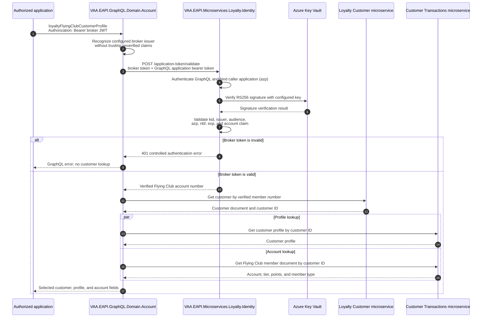

# GraphQL Flying Club Token Customer Profile Query

- Status: implemented
- Owner: Account GraphQL / Loyalty Identity
- Last reviewed: 2026-07-28
- GraphQL query: `loyaltyFlyingClubCustomerProfile`

> **Minimum review:** Read the flow name and description, **Why this flow exists**, **Sequence (detailed)**, and **Open points to finalize**. These sections establish the purpose, intended interactions, and outstanding questions; review the remaining sections as relevant to your role.

## Why this flow exists

<a id="purpose"></a>

Retrieve Customer, Customer Profile, and Flying Club account data only after Loyalty Identity has cryptographically validated a broker JWT issued by `loyaltyIssueFlyingClubApplicationToken`. For this query, that broker JWT is the caller's `Authorization: Bearer` credential; no caller Entra token or GraphQL role is required.

## Sequence (detailed)

<a id="sequence"></a>



## Open points to finalize

- None for the implemented flow. Reopen if token validation, downstream lookup ownership, or returned profile/account fields change.

## Agent delivery constraints

- Target solution/project path: Use the smallest owning solution or project implied by the `Harness Sensor`, integration points, and documented component ownership.
- New implementation path, when needed: Prefer the owning project paths already named in this diagram; do not create new services or broaden ownership without recording a blocker.
- New test path, when needed: `VAA.EAPI.GraphQL/VAA.EAPI.GraphQL.Domain.Account.Tests/FlyingClubCustomerProfileQueryTests.cs`; `VAA.EAPI.Microservices/VAA.EAPI.Microservices.Loyalty.Identity.Tests/FlyingClubTokenValidationHandlerTests.cs`
- Contract source files to read: Existing files referenced by this diagram, the named GraphQL operations, HTTP endpoints, message/event names, request payloads, and nearest tests.
- Endpoint/event/query/command names: Use only the operation, route, event, command, or scenario names documented in this diagram unless a compile/test failure proves a rename.
- Configuration and secret handling: Use existing configuration keys, environment variables, and secret references only; never commit real secrets, tokens, PII, payment data, or passenger documents.
- Harness command: Run the scoped verification selected by Promotion verification; for Fast, use scripts/verify.ps1 -SolutionPath <owning-solution> -SkipBuild or the nearest project equivalent.

## Expected harness

- `VAA.EAPI.GraphQL/VAA.EAPI.GraphQL.Domain.Account.Tests/FlyingClubCustomerProfileQueryTests.cs`
- `VAA.EAPI.Microservices/VAA.EAPI.Microservices.Loyalty.Identity.Tests/FlyingClubTokenValidationHandlerTests.cs`

## Example

```graphql
query FlyingClubCustomerProfile {
  loyaltyFlyingClubCustomerProfile {
    customer {
      customerId
      loyaltyNumber
      firstName
      lastName
      status
    }
    profile {
      reasonForTravel
      brand
      preferences {
        preferenceType
        preferenceValue
      }
    }
    account {
      memberNumber
      tierCode
      totalTierPoints
      virginTierPoints
      memberType
    }
  }
}
```

## Security and harness

- The broker token is supplied only in the Authorization header, not as a GraphQL argument.
- Identity owns verification because it owns the Key Vault signing boundary.
- Validation fails closed before Customer or Customer Transactions is called.
- Token values and account numbers are not written to logs.
- Focused tests cover GraphQL input/delegation and Identity valid/invalid-token handling.

## Agent Loop Goal

| Field | Value |
| --- | --- |
| Goal | Preserve the implemented secure GraphQL customer-profile lookup that validates a Flying Club broker token before downstream customer calls. |
| Status | `Complete` |
| Owner | Account GraphQL / Loyalty Identity |
| Review cadence | Monthly and before changes to broker-token validation, secure Account queries, Customer lookup, Customer Profile lookup, or Flying Club account mapping |
| Last reviewed | 2026-07-28 |
| Harness Sensor | `VAA.EAPI.GraphQL/VAA.EAPI.GraphQL.Domain.Account.Tests/FlyingClubCustomerProfileQueryTests.cs`; `VAA.EAPI.Microservices/VAA.EAPI.Microservices.Loyalty.Identity.Tests/FlyingClubTokenValidationHandlerTests.cs` |
| Promotion verification | Fast |
| Acceptance evidence | Referenced harness sensors cover broker-token validation failure/approval behavior and GraphQL customer/profile/account aggregation from validated identity context. |
| Done when | The documented validation-first lookup, downstream data aggregation, failure paths, and executable harness coverage remain aligned with implementation. |

## Associated delivery pull requests

The draft coordinator PR and its row are created when this goal enters `InProgress`. Every production and QA agent is then recorded here on its own branch and PR. The coordinator PR remains draft until every current child PR is merged, integrated verification passes, and open questions are resolved.

The workflow populates this table for delivery surfaces hosted in other GitHub repositories.

| Surface | Repository | Base branch | Head branch | PR | State | Merged at UTC |
| --- | --- | --- | --- | --- | --- | --- |

## Agent Loop Closure Evidence

Record final closure evidence here. Existing verification and delivery records remain in their respective sections.
