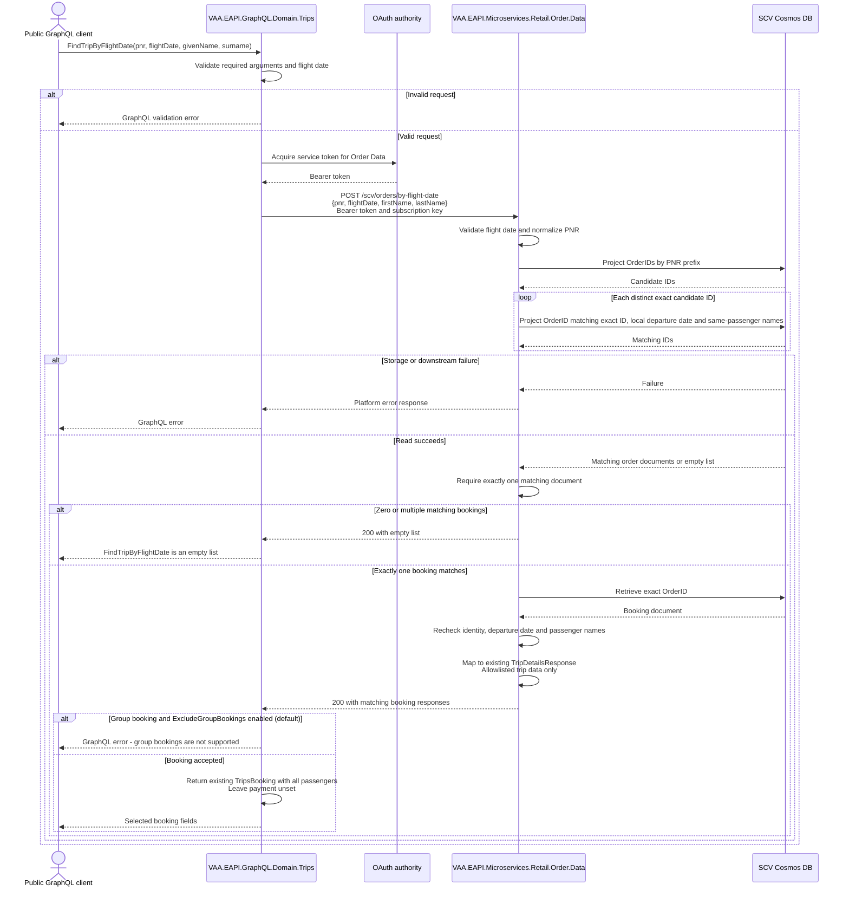

# VAA EAPI GraphQL Find Trip By Flight Date

The public Trips query retrieves bookings from SCV using the PNR and
scheduled local flight departure date. It returns the existing TripsBooking contract used by TripDetails, with payment data excluded.
The existing live `TripDetails` and Servicing validation queries are unchanged.

> **Minimum review:** Read the flow name and description, **Why this flow exists**, **Sequence (detailed)**, and **Open points to finalize**. These sections establish the purpose, intended interactions, and outstanding questions; review the remaining sections as relevant to your role.

## Why this flow exists

Customers know their flight date more readily than their booking creation date. Search candidate OrderIDs by PNR prefix, then require a matching local departure date and both names on the same passenger. Return details only for exactly one matching booking.

## Sequence (detailed)

<a id="sequence"></a>



Token acquisition uses the existing token provider and its caching behavior; the
diagram shows the logical token dependency, not a mandatory remote call per request.

## Open points to finalize

- The flight-date revision is implemented and locally tested; review and deployment are outstanding. See [execution plan](../exec-plans/active/historic-trips-flight-date.md) for validation and rollout gaps.
- Tests use synthetic data and the shared xUnit HTTP harness. Verify the deployed endpoint against a real SCV environment during rollout, deploying Order Data and refreshing its OpenAPI/APIM import before GraphQL.

## Contract

```graphql
query FindTripByFlightDate {
  FindTripByFlightDate(
    pnr: "ABC123"
    flightDate: "31AUG25"
    givenName: "Jane"
    surname: "Doe"
  ) {
    id
    passengers { firstName lastName }
    product {
      reference { pnrLocator bookingDate }
      checkInEligible
      slices {
        segments {
          marketingCarrier { carrierCode flightNumber }
          origin { code }
          destination { code }
          scheduledArrivalUtcDateTime
        }
      }
    }
  }
}
```

All four arguments are required. `flightDate` replaces `bookingDate` and uses
`ddMMMyy`; past, present and future dates are accepted. It matches any segment's scheduled local
departure date in `ScheduledDepartureTime.Local_Date_Time`. The response's
`reference.bookingDate` remains the original creation date.

The parameterized candidate query projects only IDs:

```sql
SELECT c.OrderID FROM c WHERE c.DocType = @DocType AND STARTSWITH(c.OrderID, @Pnr)
```

Each distinct candidate is filtered using exact `c.OrderID = @OrderId` plus
an EXISTS predicate for local departure and another for both trimmed names on one
passenger. Exactly one matching document permits full retrieval. Multiple matching
segments or passengers do not duplicate a result; multiple matching documents
return an empty list, including duplicates with the same OrderID.

The prefix query can fan out across Cosmos partitions. Exact-ID equality supports
partition routing if the deployed partition key is /OrderID. Returning only IDs
does not itself prevent fan-out; verify the partition path and RU/latency in SIT.

## Integration points

| Component | Responsibility |
| --- | --- |
| `VAA.EAPI.GraphQL.Domain.Trips` | Expose the public query, validate arguments and return selected typed booking fields. |
| Existing OAuth token provider | Authenticate the service-to-service request using existing configuration and token caching. |
| `VAA.EAPI.Microservices.Retail.Order.Data` | Locate the exact SCV order, validate the flight date, match the passenger and project the response. |
| SCV Cosmos DB through `SvcOrderRepository` | Retrieve order documents by parameterized, case-sensitive `OrderID`. |

## Lookup and failure rules

- The supplied flight date must be a valid calendar date in `ddMMMyy` format.
  Past, present and future dates are accepted.
- Segment arrival dates and cancellation status do not filter results.
  Missing arrivals are accepted when local departure and passenger names match.
  Missing local departures cannot match. Travel completion is not inferred.
- GraphQL uses the existing `TripSettings:ExcludeGroupBookings` setting, defaulting
  to true, just like `TripsQuery`. Groups produce an error when enabled; disabling
  the setting allows groups. Accepted bookings return all passengers at booking
  and product level. Order Data supplies group classification from SCV customer markers.
- Wrong flight dates, wrong passenger names, missing records and ambiguous matches
  return an empty list. They do not introduce a new GraphQL not-found code.
- Blank inputs and invalid calendar dates fail validation. Token, configuration,
  connector and storage errors remain errors, rather than being converted to an empty list.
- The public query has no staff-role requirement, matching the public `TripDetails`
  registration pattern. Downstream service authentication and gateway controls remain.
- No booking payload, passenger name, PNR or credential is added to feature logging.

## Agent delivery constraints

- GraphQL project: `VAA.EAPI.GraphQL/VAA.EAPI.GraphQL.Domain.Trips/VAA.EAPI.GraphQL.Domain.Trips.csproj`.
- Service project: `VAA.EAPI.Microservices/VAA.EAPI.Microservices.Retail.Order.Data/VAA.EAPI.Microservices.Retail.Order.Data.csproj`.
- Preserve `TripDetails`, `servicingValidatePnrOrder`, and `/svc/orders/search`.
- Keep SCV access in Order Data through `SvcOrderRepository`; GraphQL uses `IHttpConnector`.
- Reuse existing Order Data GraphQL URL, subscription key and application ID, and
  existing SCV endpoint/database/collection configuration. No new secrets or stores.
- Deploy Order Data and refresh its generated OpenAPI/APIM import before the GraphQL consumer.
- Run targeted tests with run-scoped TRX and coverage, then
  `scripts/verify.ps1 -ProjectPath <owning-project.csproj> -SkipBuild -Base origin/main`.

## Response and data protection

The query returns the existing `TripsBooking` type used by `TripDetails`. Order Data
projects SCV records into its existing `TripDetailsResponse` contract: booking identity,
point of sale, passenger and loyalty details, booking reference, flights and legs.
SCV segments are represented in stored order as one slice per segment; live journey
and reference-data enrichment are not inferred. SCV check-in and accessible-travel
eligibility are false. Missing optional dates remain null.

The shared `payment` field always returns null for this query. Payment records,
card credentials, payment types, purchase references, raw ticket/ancillary/history
payloads, storage metadata and untyped fare blobs are not returned. Booking totals
and SCV-only delivery metadata are also omitted. The SCV `id` is the composite
SCV OrderID, not a live trip resource token. Existing live queries are unchanged.

## Expected harness

- `FindTripByFlightDateQueryTests`: execute the query in the public Trips schema,
  verify nested fields, required input and flight-date validation, empty lists,
  connector failures, enabled/disabled group-setting behavior, all-passenger responses, and reuse of TripsBooking and a null payment field, even when downstream supplies payment data.
- `ScvBookingQueryHandlerTests`: verify PNR candidate lookup, ambiguity rejection,
  rejection of another flight date, same-passenger matching, trip-contract mapping and payment exclusions,
  past/present/future flight dates, matching records with missing/future arrivals, cancellation status, group classification, all-passenger projection and request validation.
- Mock HTTP resources are `VAA.EAPI.GraphQL.Domain.Trips.Tests/.mocks/scvBooking_*.mock`.
- Bruno examples are `VAA.EAPI.GraphQL.Bruno/Queries/FindTripByFlightDate.bru` and
  `VAA.EAPI.Microservices.Retail.Order.Data.Bruno/Orders/Find Trip By Flight Date.bru`.
- Run `scripts/check-sequence-diagram-status.ps1` and
  `scripts/check-mermaid-diagrams.ps1 -BaseRef origin/main`.
- Use actual registered implementations with the shared xUnit HTTP factory and `.mock` resources. Keep substitutes limited to boundaries that cannot use that harness, such as the Cosmos repository and deterministic clock.

## Agent Loop Goal

| Field | Value |
| --- | --- |
| Goal | Return exactly one SCV booking matching PNR, local flight departure date and same-passenger names through public Trips GraphQL. |
| Delivery surface | Backend |
| Status | `Complete` |
| Owner | Trips GraphQL and Retail Order Data maintainers |
| Review cadence | Before changes to SCV lookup, passenger matching, flight-date rules or public exposure |
| Last reviewed | 2026-10-09 |
| Harness Sensor | `VAA.EAPI.GraphQL/VAA.EAPI.GraphQL.Domain.Trips.Tests/FindTripByFlightDateQueryTests.cs`; `VAA.EAPI.Microservices/VAA.EAPI.Microservices.Retail.Order.Data.Tests/ScvBookingQueryHandlerTests.cs` |
| Promotion verification | Fast |
| Acceptance evidence | 2026-10-09: 37 GraphQL tests (16 Historic Trips and 21 existing TripDetails) and all 124 Order Data tests passed with run-scoped TRX and coverage analysis. Group rejection and reservation-type assertions failed before the passenger-parity fix; accepted bookings retain all passengers. See the execution plan for current coverage and run evidence. |
| Done when | Implementation, schema, Bruno requests and this diagram agree, and focused tests plus scoped harness checks pass. |

The status records the completed implementation and local acceptance evidence above; it does not claim that the open PR has merged or that production rollout has completed. The branch was refreshed with `origin/main` at `4c92b5c2b3` on 2026-10-09, and this document follows the updated goal review order.
