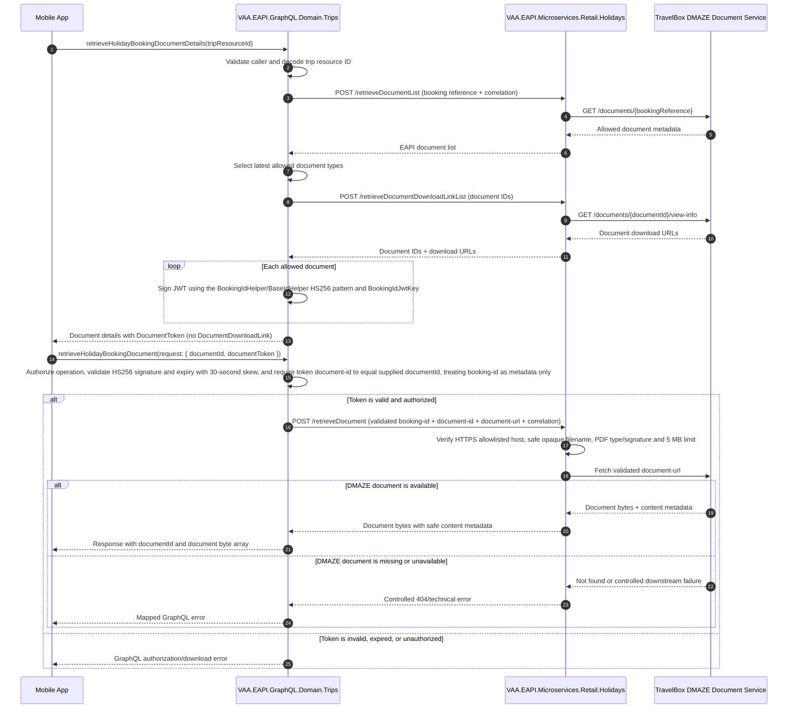

# VAA EAPI GraphQL Holidays Tokenized Document Download

Replace DMAZE document URLs exposed through GraphQL with short-lived JWT document tokens that can be exchanged through a dedicated GraphQL query and Retail Holidays endpoint for the document stream.

> **Minimum review:** Read the flow name and description, **Why this flow exists**, **Sequence (detailed)**, and **Open points to finalize**. These sections establish the purpose, intended interactions, and outstanding questions; review the remaining sections as relevant to your role.

## Why this flow exists

The current `retrieveHolidayBookingDocumentDetails` flow obtains document download links from the Retail Holidays microservice and exposes them as `DocumentDownloadLink`. The new contract removes `DocumentDownloadLink` from the document-details response and introduces `DocumentToken`, a signed, short-lived JWT containing the `booking-id`, `document-id`, and `document-url` claims. The `booking-id` claim is the exact `tripResourceId` supplied to `retrieveHolidayBookingDocumentDetails` and is carried for metadata only; it must not be used to authorize the download. The Mobile App presents both the selected document ID and `DocumentToken` to a dedicated authorized GraphQL operation; GraphQL validates the token, including expiry, and verifies that the requested document ID matches the signed `document-id` claim. It then sends the metadata booking ID plus the validated document ID and URL to Retail Holidays, which retrieves the file from DMAZE and returns the document bytes through the controlled EAPI boundary.

The JWT provides integrity, expiry, and controlled exchange semantics but not confidentiality. JWT payload claims are base64url encoded and can be decoded by the Mobile App, so `document-url` must be treated as visible to the token holder. If URL confidentiality is required, use an encrypted JWE or an opaque server-side reference instead.

## Sequence (detailed)



## Open points to finalize

- None. The implementation decisions for this delivery are settled as follows:
- Public query: `retrieveHolidayBookingDocument(request: { documentId, documentToken })` returning `documentId` and `document`; internal route: `POST /retrieveDocument`.
- Service authentication: existing `Ocp-Apim-Subscription-Key` supplied by `HolidayProvider` from `TripSettings:HolidayProvider:HolidaysMs:OcpSubID`.
- JWT: existing `BookingIdHelper`/`BaseIdHelper` HS256 pattern using `TRIPMS:BookingIdJwtKey`, five-minute lifetime, 30-second clock skew, no issuer/audience validation, replay allowed during the lifetime, and existing shared-key rotation process.
- DMAZE: HTTPS exact-host allowlist, no redirects, no user-info or loopback/private IP-literal targets, no additional hostname DNS validation, 30-second timeout, bounded cancellation-aware 5 MB read, `application/pdf` plus `%PDF-` signature, and a sanitized filename that is rejected if sanitization leaves it empty.

## High-level behavior

1. The Mobile App requests holiday document details using the existing trip resource ID.
2. GraphQL resolves the booking reference and obtains the filtered document list and DMAZE download URLs from Retail Holidays over the internal service boundary.
3. GraphQL signs a short-lived JWT containing metadata-only `booking-id` equal to the request `tripResourceId`, plus `document-id` and `document-url`, for each allowed document and maps it to `DocumentToken`; `DocumentDownloadLink` is not returned.
4. The Mobile App submits the selected document ID and `DocumentToken` to a dedicated GraphQL download query.
5. GraphQL authorizes the operation independently of the metadata-only `booking-id`, validates the token and its expiry, verifies that the requested document ID matches the signed `document-id` claim, and forwards the metadata `booking-id` plus validated `document-id` and `document-url` claims to the Retail Holidays download endpoint.
6. Retail Holidays downloads the document from DMAZE and returns its bytes with controlled content metadata; `retrieveHolidayBookingDocument` returns an object containing the validated identifier as `documentId` and the content as the `document` byte array.

## Integration points

| Component | Responsibility |
| --- | --- |
| Mobile App | Requests document metadata, retains the short-lived token, and exchanges it for one document. |
| `VAA.EAPI.GraphQL.Domain.Trips` | Authorizes the GraphQL operations, issues and validates document tokens, preserves correlation, and passes validated document context to Retail Holidays. |
| `VAA.EAPI.Microservices.Retail.Holidays` | Receives GraphQL calls through the existing `Ocp-Apim-Subscription-Key` boundary, hides DMAZE locations, downloads the validated document, and returns safe document metadata. |
| DMAZE Document Service | Supplies document metadata/view information and the document bytes. |
| GraphQL token configuration | Supplies the existing `TRIPMS:BookingIdJwtKey` symmetric key through `ConfigReader` for both trip-resource IDs and document tokens. |

## Agent delivery constraints

- Target solution/project path: `VAA.EAPI.GraphQL/VAA.EAPI.GraphQL.sln` and the smallest solution containing `VAA.EAPI.Microservices/VAA.EAPI.Microservices.Retail.Holidays/VAA.EAPI.Microservices.Retail.Holidays.csproj`
- New implementation path, when needed: `VAA.EAPI.GraphQL/VAA.EAPI.GraphQL.Domain.Trips/` and `VAA.EAPI.Microservices/VAA.EAPI.Microservices.Retail.Holidays/`
- New test path, when needed: `VAA.EAPI.GraphQL/VAA.EAPI.GraphQL.Domain.Trips.Tests/` and `VAA.EAPI.Microservices/VAA.EAPI.Microservices.Retail.Holidays.Tests/`
- Contract source files to read: `VAA.EAPI.GraphQL/VAA.EAPI.GraphQL.Domain.Trips/Queries/HolidayQuery.cs`; `VAA.EAPI.GraphQL/VAA.EAPI.GraphQL.Domain.Trips/Services/HolidayProvider.cs`; `VAA.EAPI.GraphQL/VAA.EAPI.GraphQL.Domain.Trips/Models/Holidays/HolidayDocumentDetailsResponse.cs`; `VAA.EAPI.Microservices/VAA.EAPI.Microservices.Retail.Holidays/Triggers/Http/BookingController.cs`; `VAA.EAPI.Microservices/VAA.EAPI.Microservices.Retail.Holidays/Application/RetrieveDocumentService.cs`
- Endpoint/event/query/command names: retain `retrieveHolidayBookingDocumentDetails`, `POST /retrieveDocumentList`, and `POST /retrieveDocumentDownloadLinkList`; add GraphQL query `retrieveHolidayBookingDocument(request: { documentId, documentToken })` and internal `POST /retrieveDocument` accepting the validated document context; return GraphQL fields `documentId` and `document`
- Service boundary: use the existing `HolidayProvider` `Ocp-Apim-Subscription-Key` header and `TripSettings:HolidayProvider:HolidaysMs:OcpSubID` configuration for `POST /retrieveDocument`, consistent with the other Retail Holidays calls; retain the current anonymous Function trigger behind that controlled boundary
- Configuration and secret handling: implement document-token generation and validation through a `BaseIdHelper`-derived helper, matching the trip-resource ID pattern in `BookingIdHelper`; use HS256 (`SecurityAlgorithms.HmacSha256Signature`) with the existing `TRIPMS:BookingIdJwtKey` loaded through `ConfigReader`; do not emit or validate issuer or audience, matching `BaseIdHelper`; set token lifetime to five minutes, validation clock skew to 30 seconds, permit replay during that lifetime, and follow the existing booking-ID shared-key rotation process; default the maximum document size to 5 MB (5,242,880 bytes) and the allowed media types to PDF only (`application/pdf`); source the shared signing secret through the existing protected deployment-setting mechanism and never log tokens, the `document-url` claim, or document bytes
- DMAZE download policy: allow HTTPS only; require an exact host match from configurable `Holidays:DocumentDownloadAllowedHosts`; reject user-info, loopback/private IP-literal targets, non-default ports unless explicitly allowlisted, and all redirects; do not perform additional DNS-address validation for allowlisted hostnames; use a configurable timeout defaulting to 30 seconds; reject `Content-Length` above 5,242,880 bytes and enforce the same limit during a bounded, cancellation-aware read; require both `application/pdf` and a `%PDF-` file signature; sanitize the final URL path segment by removing path/control characters and limiting it to 128 characters, and reject the request if no filename remains
- Harness command: `scripts/verify.ps1 -SolutionPath VAA.EAPI.GraphQL/VAA.EAPI.GraphQL.sln -SkipBuild` plus `scripts/verify.ps1 -ProjectPath VAA.EAPI.Microservices/VAA.EAPI.Microservices.Retail.Holidays/VAA.EAPI.Microservices.Retail.Holidays.csproj -SkipBuild`

## Key non-functional considerations

- **Idempotency**: Exchanging the same unexpired token may return the same immutable document unless security review requires single-use enforcement; the operation must not mutate booking or document state.
- **Correlation**: Propagate the EAPI correlation ID from the Mobile App through GraphQL, Retail Holidays, and DMAZE, while keeping it out of the token unless a reviewed binding requires it.
- **Retry behavior**: Retry only approved transient DMAZE failures and never retry JWT validation or authorization failures; do not begin a second downstream download after response streaming has started.
- **No-op path**: If no allowed documents exist, return the established empty/not-found metadata behavior and issue no tokens.

## Failure paths to capture in implementation

- Missing, malformed, tampered, or expired JWT, including expiry outside the configured 30-second clock skew.
- Metadata `booking-id` is missing or malformed; it must not be used to grant or deny authorization.
- Supplied `documentId` is missing or invalid, the token does not contain `document-id`, the claim does not exactly match the supplied value, or the document does not match the caller context authorized by GraphQL.
- `document-url` is missing, malformed, is not HTTPS, contains user-info, uses a loopback/private IP literal, uses a host or port outside the exact configured allowlist, or redirects. TravelBox filenames are opaque and are not required to match `document-id`.
- Document type is not in the allowlist, or the document is no longer available.
- DMAZE view-info succeeds but the file download fails, exceeds the 30-second default timeout, redirects, declares or streams more than 5,242,880 bytes, or is cancelled.
- DMAZE returns a missing/non-PDF media type, content without the `%PDF-` signature, or an unsafe filename or content disposition.
- The downstream connection fails before streaming or disconnects after streaming begins.
- The document exceeds the configured maximum size, initially 5 MB (5,242,880 bytes), or cannot be serialized by the GraphQL byte-array scalar.

Expected behavior:

- GraphQL must fail closed without calling Retail Holidays or DMAZE when token validation or authorization fails.
- GraphQL must call Retail Holidays with the existing `Ocp-Apim-Subscription-Key`; Retail Holidays remains behind that controlled subscription-key boundary and validates the supplied document context.
- Do not expose the DMAZE URL as a standalone GraphQL field or in errors, logs, or traces; it exists only as the readable `document-url` JWT claim and validated internal request context.
- Validate DMAZE targets as HTTPS against the exact configured host/port allowlist, reject user-info and loopback/private IP-literal targets without additional hostname DNS validation, and disable redirects before fetching bytes.
- Propagate cancellation while downloading, enforce the approved size limit before allocation where possible, and materialize only the bounded response into the GraphQL `document` byte array.
- Record structured outcome, latency, size, and correlation telemetry without recording the token, document content, or unnecessary passenger data.

## Expected harness

- GraphQL contract tests proving `retrieveHolidayBookingDocumentDetails` removes the standalone `DocumentDownloadLink` field and populates `DocumentToken` with `booking-id` equal to the request `tripResourceId` and the other required claims.
- GraphQL tests proving the download query requires `documentId` and `documentToken`, returns the validated `document-id` claim as `documentId` and the content as the `document` byte array, rejects a requested ID that differs from the signed `document-id` claim, treats `booking-id` only as metadata without using it for authorization, uses the `BaseIdHelper` HS256 pattern with `TRIPMS:BookingIdJwtKey`, a five-minute lifetime, 30-second clock skew, no issuer/audience validation, and replay permitted within the lifetime, and covers fail-closed behavior, correlation, cancellation, size enforcement, and mapped errors.
- Retail Holidays tests proving GraphQL supplies the existing `Ocp-Apim-Subscription-Key` to the internal endpoint and that validated `booking-id`, `document-id`, and `document-url` context enforces HTTPS, exact host/port allowlisting, no redirects, no user-info or loopback/private IP-literal targets, PDF media type and `%PDF-` signature, sanitized opaque filenames with fail-closed handling when no filename remains, a 30-second default timeout, and the configurable 5 MB maximum.
- `.mock`-backed HTTP tests proving successful DMAZE PDF retrieval plus not-found, timeout, cancellation, redirect, unsafe-target, non-PDF media-type/signature, unsafe-filename, declared oversize, and streamed over-5-MB failures.
- Contract tests for the `documentId` and `document` response fields, safe content metadata where represented, and the absence of URLs, signing material, and sensitive data from public responses and telemetry.
- `VAA.EAPI.Automation.Trips` functional coverage that sources a confirmed holiday booking from storage, confirms document details return tokens instead of URLs, and exchanges an available token through `retrieveHolidayBookingDocument` for the matching identifier and non-empty document bytes.

## Delivery progress

### Delivery: Coordinator
```json
{
  "branch": "codex/goal-document-delivery",
  "repository": "VAAD1ST/eapi",
  "runId": "37446713824",
  "runAttempt": 1,
  "status": "InProgress",
  "startedAtUtc": "2026-10-06T10:00:53.3659328Z",
  "completedAtUtc": null,
  "goals": [
    {
      "harnessSensor": "GraphQL document-token contract tests, Retail Holidays document-download contract tests, and `VAA.EAPI.Automation.Trips` `RetrieveHolidayBookingDocumentDetailsTests.TC16_RetrieveHolidayBookingDocument_ValidDocumentToken_ReturnsValidatedDocumentBytes` storage-backed exchange coverage; historical scoped verification retained in [run 32827696726](https://github.com/VAAD1ST/eapi/blob/17a9cb49adacbb1e616f3c3fff7ab6fd8725cc5c/.codex/agent-loop/runs/32827696726.json)",
      "diagram": "docs/sequence-diagrams/vaa-eapi-graphql-holidays-document-token-download.md",
      "title": "Keep DMAZE document URLs behind the EAPI boundary while allowing the authorized Mobile App to download a holiday document using a short-lived, single-purpose token.",
      "verificationMode": "Fast"
    }
  ],
  "verification": [],
  "commits": [],
  "failure": null
}
```

## Agent Loop Goal

| Field | Value |
| --- | --- |
| Goal | Keep DMAZE document URLs behind the EAPI boundary while allowing the authorized Mobile App to download a holiday document using a short-lived, single-purpose token. |
| Status | `InProgress` |
| Owner | `VAA.EAPI.GraphQL.Domain.Trips` and `VAA.EAPI.Microservices.Retail.Holidays` maintainers |
| Review cadence | Monthly and on document, JWT, GraphQL, DMAZE, or authorization contract change |
| Last reviewed | 2026-08-24 |
| Harness Sensor | GraphQL document-token contract tests, Retail Holidays document-download contract tests, and `VAA.EAPI.Automation.Trips` `RetrieveHolidayBookingDocumentDetailsTests.TC16_RetrieveHolidayBookingDocument_ValidDocumentToken_ReturnsValidatedDocumentBytes` storage-backed exchange coverage; historical scoped verification retained in [run 32827696726](https://github.com/VAAD1ST/eapi/blob/17a9cb49adacbb1e616f3c3fff7ab6fd8725cc5c/.codex/agent-loop/runs/32827696726.json) |
| Promotion verification | Fast |
| Acceptance evidence | Scoped GraphQL and Retail Holidays tests prove that document details omit `DocumentDownloadLink`, populate `DocumentToken` with metadata-only `booking-id` equal to the request `tripResourceId` plus `document-id` and `document-url`, never use `booking-id` for authorization, return the validated document identifier as `documentId` and the content as the `document` byte array, and fail closed for invalid or expired tokens. |
| Status Updated By | `scripts/promote-sequence-goal.ps1` |
| Transition note | Implementation verified, including serialization protection that keeps the internal DMAZE URL out of public JSON responses; no open questions remain for this delivery. |
| Task/Issue | branch:codex/holidays-document-token-diagram-clean |
| Done when | `HolidayDocumentDetailsResponse` no longer exposes `DocumentDownloadLink`, GraphQL returns and validates `DocumentToken` containing `booking-id` equal to `tripResourceId`, `document-id`, and `document-url`, `retrieveHolidayBookingDocument` returns `documentId` from the validated `document-id` claim plus the document bytes in `document`, Retail Holidays retrieves the requested DMAZE document using only validated context from GraphQL, and no DMAZE URL is exposed as a standalone response property or written to telemetry. |

## Associated delivery pull requests

The draft coordinator PR and its row are created when this goal enters `InProgress`. Every production and QA agent is then recorded here on its own branch and PR. The coordinator PR remains draft until every current child PR is merged, integrated verification passes, and open questions are resolved.

The workflow populates this table for delivery surfaces hosted in other GitHub repositories.

| Surface | Repository | Base branch | Head branch | PR | State | Merged at UTC |
| --- | --- | --- | --- | --- | --- | --- |

## Agent Loop Closure Evidence

Record final closure evidence here. Existing verification and delivery records remain in their respective sections.
