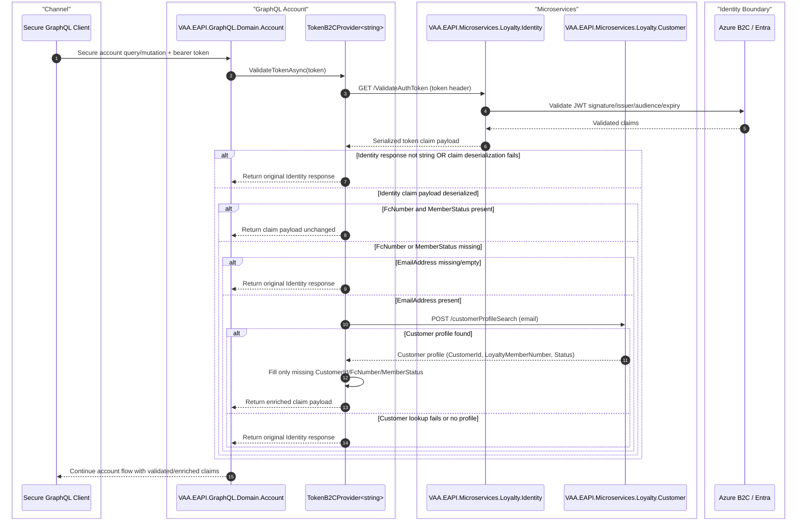

# VAA EAPI GraphQL Identity Token Validation and Conditional Customer Lookup

This document describes the implemented `TokenB2CProvider` behavior in `VAA.EAPI.GraphQL.Domain.Account` for secure account flows that validate identity tokens and conditionally enrich missing member data from Customer.

The implemented contract is:

ITokenB2CProvider<string>.ValidateTokenAsync(token)

GraphQL always validates via Identity first. Customer lookup is a fallback path only when required claims are missing.

> **Minimum review:** Read the flow name and description, **Why this flow exists**, **Sequence (detailed)**, and **Open points to finalize**. These sections establish the purpose, intended interactions, and outstanding questions; review the remaining sections as relevant to your role.

## Why this flow exists

Preserve secure GraphQL Account flows through Identity-first token validation and conditional Customer lookup that enriches only missing member data.

## Sequence (detailed)

<a id="sequence"></a>



## Open points to finalize

- None currently recorded; add explicit blockers here before moving this diagram back to Ready or InProgress.

## Agent delivery constraints

- Target solution/project path: Use the smallest owning solution or project implied by the `Harness Sensor`, integration points, and documented component ownership.
- New implementation path, when needed: Prefer the owning project paths already named in this diagram; do not create new services or broaden ownership without recording a blocker.
- New test path, when needed: `VAA.EAPI.GraphQL/VAA.EAPI.GraphQL.Domain.Account.Tests/TokenB2CProviderTests.cs`
- Contract source files to read: Existing files referenced by this diagram, the named GraphQL operations, HTTP endpoints, message/event names, request payloads, and nearest tests.
- Endpoint/event/query/command names: Use only the operation, route, event, command, or scenario names documented in this diagram unless a compile/test failure proves a rename.
- Configuration and secret handling: Use existing configuration keys, environment variables, and secret references only; never commit real secrets, tokens, PII, payment data, or passenger documents.
- Harness command: Run the scoped verification selected by Promotion verification; for Fast, use scripts/verify.ps1 -SolutionPath <owning-solution> -SkipBuild or the nearest project equivalent.

## Current Behavior

1. GraphQL calls IdentityMS `ValidateAuthToken` with the incoming token.
2. IdentityMS validates token integrity and returns claim payload.
3. GraphQL deserializes claim payload into `TokenB2CResponse`.
4. If both `FcNumber` and `MemberStatus` are already present, GraphQL returns the Identity payload unchanged.
5. If either `FcNumber` or `MemberStatus` is missing, GraphQL attempts fallback enrichment via Customer profile search by email.
6. Fallback only fills missing fields; existing claim values are preserved.
7. If deserialization fails, or Customer lookup fails/returns no profile, GraphQL returns the original Identity response.

## Fallback Enrichment Rules

- Trigger condition: `FcNumber` is empty OR `MemberStatus` is empty.
- Lookup key: `EmailAddress` claim.
- Customer endpoint: `POST /customerProfileSearch`.
- Fill rules:
  - `CustomerId` <- customer profile `CustomerId` only when token `CustomerId` is missing.
  - `FcNumber` <- customer profile `LoyaltyMemberNumber` only when token `FcNumber` is missing.
  - `MemberStatus` <- customer profile `Status` only when token `MemberStatus` is missing.

## Failure Paths

- Identity connector/network failure propagates through GraphQL error handling.
- Identity returns non-string payload for generic type -> fallback skipped by design.
- Identity payload deserialization failure -> warning logged; original payload returned.
- Missing email claim for fallback path -> customer lookup skipped.
- Customer lookup exception -> warning logged; original payload returned.
- Empty customer lookup result -> original payload returned.

## Observability and Controls

- Warning logs emitted for:
  - token response deserialization failures
  - customer profile retrieval failures
- Fallback is fail-safe (preserves Identity response when enrichment cannot be completed).
- Sensitive values are not added to exception payloads in this provider.

## Expected Harness

Implemented coverage includes:

- `VAA.EAPI.GraphQL.Domain.Account.Tests/TokenB2CProviderTests.cs`
  - validates no customer call when Identity already contains `FcNumber` and `MemberStatus`
  - validates fallback population when `MemberStatus` is missing

Related regression coverage (constructor/DI contract impacts) is validated in Account tests that consume `ITokenB2CProvider<string>`.

Focused verification command:

```powershell
dotnet test VAA.EAPI.GraphQL\VAA.EAPI.GraphQL.Domain.Account.Tests\VAA.EAPI.GraphQL.Domain.Account.Tests.csproj --filter FullyQualifiedName~TokenB2CProviderTests
```

## Open Points

- Confirm whether Identity should be the long-term source for all account status fields (removing GraphQL fallback), or whether Customer fallback remains an intentional resilience control.
- Confirm whether email-less fallback should add alternate lookup keys in GraphQL (for example `oid`) or remain Identity-owned only.

## Agent Loop Goal

| Field | Value |
| --- | --- |
| Goal | Document and preserve secure GraphQL Account token validation with conditional Customer lookup enrichment. |
| Status | `Complete` |
| Owner | `VAA.EAPI.GraphQL.Domain.Account` maintainers |
| Review cadence | Monthly and before changes to token validation, Customer profile lookup, or secure account GraphQL flows |
| Last reviewed | 2026-07-27 |
| Harness Sensor | `VAA.EAPI.GraphQL/VAA.EAPI.GraphQL.Domain.Account.Tests/TokenB2CProviderTests.cs` |
| Promotion verification | Fast |

| Acceptance evidence | Referenced harness sensor passes and the sequence diagram remains aligned with implemented behavior. |
| Done when | Identity-first validation, missing-field-only Customer enrichment, and fallback behavior remain implemented and covered by the harness sensor. |

## Associated delivery pull requests

The draft coordinator PR and its row are created when this goal enters `InProgress`. Every production and QA agent is then recorded here on its own branch and PR. The coordinator PR remains draft until every current child PR is merged, integrated verification passes, and open questions are resolved.

The workflow populates this table for delivery surfaces hosted in other GitHub repositories.

| Surface | Repository | Base branch | Head branch | PR | State | Merged at UTC |
| --- | --- | --- | --- | --- | --- | --- |

## Agent Loop Closure Evidence

Record final closure evidence here. Existing verification and delivery records remain in their respective sections.
