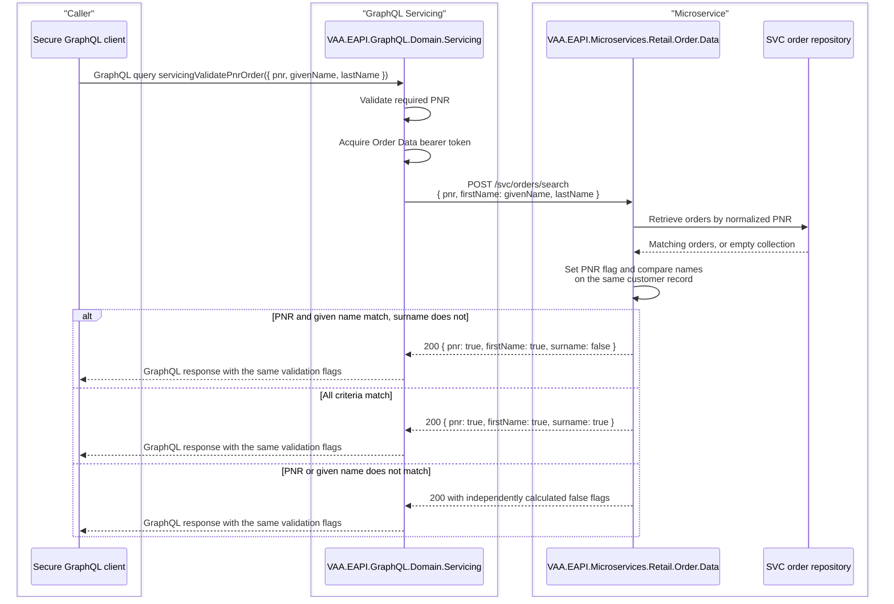

# VAA EAPI GraphQL Servicing PNR Order Validation Flow

This document reflects the implemented secure GraphQL Servicing behavior in `VAA.EAPI.GraphQL.Domain.Servicing` and the validation owned by `VAA.EAPI.Microservices.Retail.Order.Data`. The query reports whether a supplied PNR exists, whether the supplied passenger given name appears on an order for that PNR, and whether the supplied given name and surname match the same customer record.

The implemented GraphQL operation is:

```text
servicingValidatePnrOrder(request: { pnr, givenName, lastName })
```

The operation is registered in the secure GraphQL visibility path. It is also available through the non-secure registration path only when `System.Diagnostics.Debugger.IsAttached` is true for local debugging. The GraphQL caller does not pass an authorization header for this operation; downstream Order Data authorization is handled inside `VAA.EAPI.GraphQL.Domain.Servicing` when it acquires a bearer token and calls the microservice through `IHttpConnector`.

> **Minimum review:** Read the flow name and description, **Why this flow exists**, **Sequence (detailed)**, and **Open points to finalize**. These sections establish the purpose, intended interactions, and outstanding questions; review the remaining sections as relevant to your role.

## Why this flow exists

Allow GraphQL Servicing callers to check whether a PNR exists and whether supplied passenger names match its orders, while keeping passenger details within Order Data.

## Sequence (detailed)

<a id="sequence"></a>



## Open points to finalize

- None currently recorded; add explicit blockers here before moving this diagram back to Ready or InProgress.

## Agent delivery constraints

- Target solution/project path: Use the smallest owning solution or project implied by the `Harness Sensor`, integration points, and documented component ownership.
- New implementation path, when needed: Prefer the owning project paths already named in this diagram; do not create new services or broaden ownership without recording a blocker.
- New test path, when needed: `VAA.EAPI.GraphQL/VAA.EAPI.GraphQL.Domain.Servicing.Tests/PnrOrderValidationProviderTests.cs`; `VAA.EAPI.GraphQL/VAA.EAPI.GraphQL.Domain.Servicing.Tests/PnrOrderValidationQueryTests.cs`
- Contract source files to read: Existing files referenced by this diagram, the named GraphQL operations, HTTP endpoints, message/event names, request payloads, and nearest tests.
- Endpoint/event/query/command names: Use only the operation, route, event, command, or scenario names documented in this diagram unless a compile/test failure proves a rename.
- Configuration and secret handling: Use existing configuration keys, environment variables, and secret references only; never commit real secrets, tokens, PII, payment data, or passenger documents.
- Harness command: Run the scoped verification selected by Promotion verification; for Fast, use scripts/verify.ps1 -SolutionPath <owning-solution> -SkipBuild or the nearest project equivalent.

## Current Behavior

The caller supplies a JSON GraphQL request payload containing required `pnr` and optional `givenName` and `lastName` values. The Servicing domain validates that the PNR is present, requests an access token for the Order Data microservice, and calls Order Data using the configured `OrderData:MSUrl`, `OrderData:OcpSubID`, and `OrderData:AppId` settings.

Order Data is called through:

```text
POST /svc/orders/search
```

The request body contains `pnr`, `firstName`, and `lastName`. Order Data retrieves all orders for the normalized PNR and owns the comparison logic. It returns only the three validation booleans; the order document and passenger details do not cross the microservice boundary. GraphQL forwards the validation response without repeating the comparisons.

## Response Contract

The GraphQL response contains only booleans:

- `pnr`: `true` when Order Data finds at least one order for the requested PNR.
- `firstName`: `true` when any customer on an order for that PNR has a first name matching `givenName`.
- `surname`: `true` when a single customer has both a first name matching `givenName` and a last name matching `lastName`.

Each stage is reported independently. In particular, a valid PNR and given name with a non-matching surname returns `{ pnr: true, firstName: true, surname: false }` rather than a `422` response.

Example response:

```json
{
  "pnr": true,
  "firstName": true,
  "surname": false
}
```

## Failure Paths

- Missing `pnr` fails before the Order Data call. Omitted passenger names produce `false` for the corresponding validation flags.
- The GraphQL caller does not pass an authorization header; exposure is controlled by secure schema registration, with non-secure registration available only during attached-debugger local runs.
- A valid request with no matching PNR or passenger name returns `200 OK` with the applicable flags set to `false`.
- Order Data rejects a missing PNR as a bad request; GraphQL validates this before making the downstream call.
- Other connector, token, configuration, or downstream failures propagate through the GraphQL error handling path without exposing the order document payload.

## Compensating Controls

Because the operation intentionally allows callers without an authorization header and returns separate PNR, first-name, and surname booleans, the gateway or hosting boundary must apply request throttling, abuse monitoring, and alerting for repeated failed validation attempts.

## Expected Harness

The implemented coverage is in:

- `VAA.EAPI.GraphQL.Domain.Servicing.Tests/PnrOrderValidationProviderTests.cs`
- `VAA.EAPI.GraphQL.Domain.Servicing.Tests/PnrOrderValidationQueryTests.cs`
- `VAA.EAPI.GraphQL.Domain.Servicing.Tests/.mocks/pnrOrderValidation_*.mock`
- `VAA.EAPI.Microservices.Retail.Order.Data.Tests/SvcOrderQueryHandlerTests.cs`

The focused verification command is:

```powershell
dotnet test VAA.EAPI.GraphQL\VAA.EAPI.GraphQL.Domain.Servicing.Tests\VAA.EAPI.GraphQL.Domain.Servicing.Tests.csproj -c Release --results-directory TestResults\graphql-servicing-pnr-validation-tokenmock --logger "trx;LogFileName=graphql-servicing-pnr-validation-tokenmock.trx" --collect:"XPlat Code Coverage"
scripts\analyse-test-run-results.ps1 -TrxPath TestResults\graphql-servicing-pnr-validation-tokenmock\graphql-servicing-pnr-validation-tokenmock.trx -SuiteName "GraphQL Servicing PNR validation" -EnvironmentName "local"
```

## Agent Loop Goal

| Field | Value |
| --- | --- |
| Goal | Document and preserve the implemented PNR order-validation behavior for secure GraphQL Servicing. |
| Status | `Complete` |
| Owner | `VAA.EAPI.GraphQL.Domain.Servicing` maintainers |
| Review cadence | Monthly and before changes to Servicing PNR validation, Order Data lookup behavior, or secure schema exposure |
| Last reviewed | 2026-07-20 |
| Harness Sensor | `VAA.EAPI.GraphQL/VAA.EAPI.GraphQL.Domain.Servicing.Tests/PnrOrderValidationProviderTests.cs`; `VAA.EAPI.GraphQL/VAA.EAPI.GraphQL.Domain.Servicing.Tests/PnrOrderValidationQueryTests.cs` |
| Promotion verification | Fast |

| Acceptance evidence | Referenced harness sensor passes and the sequence diagram remains aligned with implemented behavior. |
| Done when | The documented query behavior, failure paths, and executable harness coverage stay aligned with implementation. |

## Associated delivery pull requests

The draft coordinator PR and its row are created when this goal enters `InProgress`. Every production and QA agent is then recorded here on its own branch and PR. The coordinator PR remains draft until every current child PR is merged, integrated verification passes, and open questions are resolved.

The workflow populates this table for delivery surfaces hosted in other GitHub repositories.

| Surface | Repository | Base branch | Head branch | PR | State | Merged at UTC |
| --- | --- | --- | --- | --- | --- | --- |

## Agent Loop Closure Evidence

Record final closure evidence here. Existing verification and delivery records remain in their respective sections.
