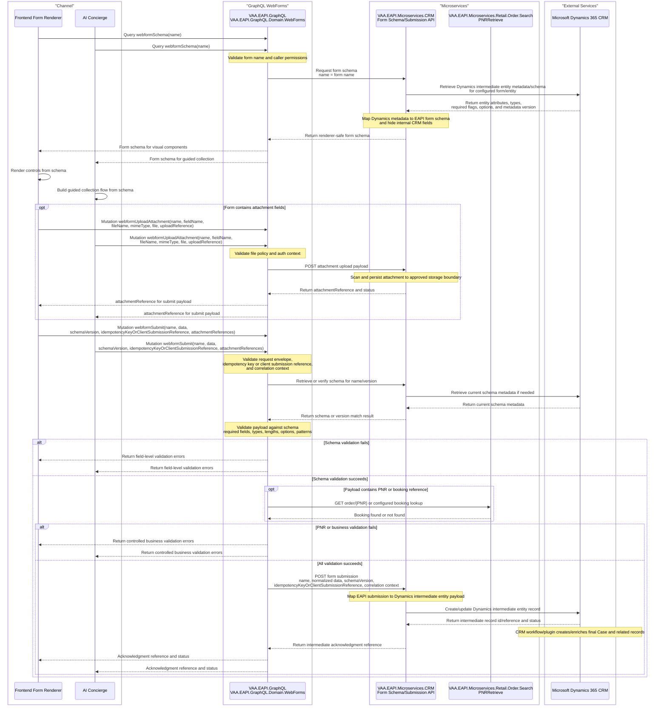

# VAA EAPI GraphQL WebForms Dynamic Form Flow

This agreed flow lets frontend form-rendering components and AI Concierge experiences retrieve a Dynamics-backed form schema, upload attachments, and submit validated form data through GraphQL.

It follows the existing GraphQL WebForms and CRM microservice shape:
- `VAA.EAPI.GraphQL.Domain.WebForms` owns the public GraphQL query and mutation surface.
- GraphQL resolvers stay thin and delegate schema retrieval, validation, and submission orchestration to WebForms services.
- `VAA.EAPI.Microservices.CRM` owns Microsoft Dynamics 365 CRM integration and maps external Dynamics entity metadata/data to EAPI contracts.
- Business validation that depends on another domain, such as checking that a PNR exists, is performed through the owning EAPI microservice rather than direct data-store access.

> **Minimum review:** Read the flow name and description, **Why this flow exists**, **Sequence (detailed)**, and **Open points to finalize**. These sections establish the purpose, intended interactions, and outstanding questions; review the remaining sections as relevant to your role.

## Why this flow exists
Frontend developers and the AI team (for Concierge) need a runtime schema that tells the client which fields, labels, component types, validation rules, picklists, and visibility rules to use, and they need mutations that can upload attachment files and persist submitted form data.

The schema source of truth is Microsoft Dynamics 365 CRM. The submitted values should only be sent to Dynamics after the platform has validated the payload against the schema and completed required business checks.

The implementation decision for this workflow is to submit incoming form data into CRM intermediate entities first, then let CRM workflows/plugins create or enrich the final Case and related records.

## Sequence (detailed)

## Open points to finalize
- Confirm exact GraphQL operation names, for example `webformSchema`, `webformUploadAttachment`, and `webformSubmit`.
- Confirm whether the form argument should be named `name` or `formName` across GraphQL, microservice contracts, and Dynamics mapping.
- Confirm the owning CRM microservice endpoints for schema retrieval and submission persistence.
- Confirm the attachment contract: transport shape, max size, MIME allow-list, scanning behavior, retention, and reference TTL.
- Confirm upload idempotency/client upload reference format, retention period, and duplicate-upload response behavior.
- Confirm the Dynamics metadata source, intermediate entity naming convention (single vs per-form), allowed field types, and schema version strategy.
- Confirm which fields require business validators beyond PNR, and which owning microservices provide those checks.
- Confirm authentication/authorization roles for reading schemas and submitting form data.
- Confirm idempotency key format, retention period, and duplicate-submission response behavior.
- Confirm the customer-facing acknowledgment wording that distinguishes intermediate acknowledgment reference from final case reference.

## Agent delivery constraints

- Target solution/project path: Use the smallest owning solution or project implied by the `Harness Sensor`, integration points, and documented component ownership.
- New implementation path, when needed: Prefer the owning project paths already named in this diagram; do not create new services or broaden ownership without recording a blocker.
- New test path, when needed: `Planned: GraphQL contract tests and CRM/provider fixture tests listed in `docs/behavior-harness.md` planned behavior`
- Contract source files to read: Existing files referenced by this diagram, the named GraphQL operations, HTTP endpoints, message/event names, request payloads, and nearest tests.
- Endpoint/event/query/command names: Use only the operation, route, event, command, or scenario names documented in this diagram unless a compile/test failure proves a rename.
- Configuration and secret handling: Use existing configuration keys, environment variables, and secret references only; never commit real secrets, tokens, PII, payment data, or passenger documents.
- Harness command: Run the scoped verification selected by Promotion verification; for Fast, use scripts/verify.ps1 -SolutionPath <owning-solution> -SkipBuild or the nearest project equivalent.

## High-level behavior
1. The frontend calls a new GraphQL query with a form `name`.
2. `VAA.EAPI.GraphQL.Domain.WebForms` passes the `name` to a WebForms schema service.
3. The schema service calls `VAA.EAPI.Microservices.CRM` with the requested form name.
4. `VAA.EAPI.Microservices.CRM` retrieves the matching Dynamics intermediate entity schema or metadata from Microsoft Dynamics 365 CRM.
5. `VAA.EAPI.Microservices.CRM` maps Dynamics metadata into a frontend-safe form schema and returns it to GraphQL.
6. The frontend renders the schema using the visual component library.
7. If the form includes file fields, the frontend or AI Concierge client calls a GraphQL attachment mutation for each selected file using the same form `name`, field name, file metadata and upload payload, and an upload idempotency/client upload reference.
8. The WebForms attachment service enforces attachment auth context, validates file policy (type, size, count), and forwards the attachment payload to `VAA.EAPI.Microservices.CRM`.
9. `VAA.EAPI.Microservices.CRM` performs malware/security scanning, persists attachment content to the approved storage boundary, and returns an attachment reference/token safe for later submission.
10. The frontend or AI Concierge client calls a GraphQL submit mutation with form `name`, submitted field values, schema version, idempotency key or client submission reference, and the list of attachment references.
11. The WebForms submission service reloads or verifies the schema, validates required fields, field types, allowed values, and schema-specific rules including attachment field requirements.
12. Business validators run for fields that require downstream confirmation, for example validating that a PNR or booking reference exists through `VAA.EAPI.Microservices.Retail.Order.Search`.
13. If validation succeeds, GraphQL posts the normalized submission to `VAA.EAPI.Microservices.CRM`.
14. `VAA.EAPI.Microservices.CRM` maps the EAPI submission contract into the Dynamics intermediate entity payload, links attachment references, and persists it to Microsoft Dynamics 365 CRM.
15. CRM workflows/plugins map from the intermediate entity into Case and related entities (for example classifications and payment-related records), then generate the final CRM case reference when Case creation completes.
16. GraphQL returns the intermediate acknowledgment reference, status, and safe correlation information to the frontend. The final case reference is communicated after CRM workflow completion (for example acknowledgment email or follow-up channel update).

## Integration points

| Component | Responsibility |
| --- | --- |
| Frontend form renderer / AI Concierge client | Requests the schema by name, renders form prompts or controls, uploads attachments where supported, and submits field values |
| `VAA.EAPI.GraphQL` | Hosts the GraphQL endpoint and composes the WebForms domain |
| `VAA.EAPI.GraphQL.Domain.WebForms` query | Exposes the schema query, validates the name argument, and delegates schema retrieval |
| `VAA.EAPI.GraphQL.Domain.WebForms` mutations | Exposes attachment upload and submit mutations, delegates validation and downstream submission |
| `VAA.EAPI.GraphQL.Domain.WebForms` domain project | Calls CRM, maps/cache-controls schema responses if required, validates submissions, and builds the CRM submission request inside the `VAA.EAPI.GraphQL` service boundary |
| `VAA.EAPI.GraphQL.Domain.WebForms.Infrastructure.OrderDataMicroservice` | Provides the WebForms booking/PNR validation adapter used before submission |
| `VAA.EAPI.Microservices.Retail.Order.Search` | Owns PNR retrieval and booking-reference validation, including the `PNRRetrieve` route |
| `VAA.EAPI.Microservices.CRM` | Owns EAPI HTTP endpoints for form schema retrieval, attachment persistence, and form submission persistence |
| `VAA.EAPI.Microservices.CRM` Dynamics gateway/repository layer | Uses `IHttpConnector`, configured endpoints, and approved auth to call Dynamics 365 CRM |
| Microsoft Dynamics 365 CRM | Source of truth for intermediate entity schema and destination for validated form submissions before workflow-driven Case creation |
| Application Insights/logging | Captures correlation IDs, validation outcomes, dependency timings, and controlled failures without raw PII payloads |

## Key non-functional considerations
- **Secure access**: register the query and mutation in the correct secure/public WebForms visibility mode and enforce roles such as `WebForm.Read` and `WebForm.Submit` where required.
- **Validation**: treat the schema as authoritative at submission time; reject unknown fields, missing required values, invalid types, invalid picklist values, and failed business checks.
- **Business ownership**: validate PNRs or booking references through `VAA.EAPI.Microservices.Retail.Order.Search`; do not query another domain's store directly from WebForms or CRM.
- **Idempotency**: include a client submission reference or idempotency key so retries do not create duplicate Dynamics records.
- **Attachment policy**: enforce allowed MIME types, maximum file size, maximum files per submission, malware scanning requirements, and attachment retention rules.
- **Reference numbers**: return an immediate intermediate acknowledgment reference on submit; return/notify final case reference once CRM workflow/plugin processing completes.
- **Workflow latency**: final Case creation is asynchronous relative to submit response and can be delayed by CRM workflow queue depth.
- **Correlation**: propagate correlation ID, operation ID, session ID, channel, and diagnostics flags through GraphQL, HTTP connector calls, CRM microservice logs, and Dynamics calls.
- **PII handling**: do not log raw submitted form data, passenger details, contact details, PNRs, tokens, or downstream Dynamics payloads.
- **Schema freshness**: define whether schema responses are uncached, cached by form name/version, or refreshed using Dynamics metadata versioning.
- **External boundary**: Dynamics metadata and entity payloads must remain behind the CRM microservice boundary and should not leak directly into GraphQL models.
- **Integration boundary**: keep the established EAPI integration boundary (no direct channel-to-CRM API calls unless architecture governance explicitly approves an exception).
- **Document storage**: prefer approved low-cost document storage (for example Azure Blob Storage) with reference-based linking from CRM records instead of long-term CRM binary storage where policy permits.

## Failure paths to capture in implementation
- Unknown, unauthorized, or unsupported form name.
- CRM microservice cannot retrieve the Dynamics schema.
- Dynamics schema changes between rendering and submission.
- Attachment upload fails file-policy checks, malware/security checks, or storage persistence.
- Attachment reference is missing, expired, duplicated, or not owned by the current submission context.
- Submitted payload contains unknown fields, missing required fields, invalid data types, invalid picklist values, or unsafe data.
- PNR or booking reference does not exist, is not accessible to the caller, or cannot be validated because the owning service is unavailable.
- CRM microservice submission fails before Dynamics persistence.
- CRM intermediate entity is created, but downstream CRM workflow/plugin fails to create/enrich Case.
- Dynamics create/update fails, times out, or returns a duplicate/conflict.
- Client retries the mutation after a timeout and the idempotency key already exists.
- Customer receives an intermediate acknowledgment reference before final case reference and later submits the wrong reference in follow-up contact.

Expected behavior:
- Return controlled validation errors for caller-correctable issues.
- Fail closed if schema retrieval, authorization, schema validation, or business validation cannot be completed.
- Preserve correlation context across GraphQL, microservice, and Dynamics calls.
- Avoid duplicate Dynamics records on retries.
- Ensure traceability between intermediate acknowledgment reference and final case reference.
- Log operational metadata and safe identifiers only; do not log raw form submissions or sensitive Dynamics payloads.

## Expected harness
- GraphQL WebForms tests for schema query registration and mutation registration in the correct secure/public mode.
- GraphQL WebForms tests for attachment mutation registration and authorization in the correct secure/public mode.
- Unit tests for schema mapping from CRM microservice responses into renderer-safe GraphQL models.
- Unit tests for attachment policy enforcement, attachment reference validation, and attachment reference mapping in submit payloads.
- Unit tests for payload validation against required fields, types, picklist values, unknown fields, schema version mismatch, and PNR validation failures.
- Provider tests that mock the Retail order/search validation API and CRM microservice submission API.
- Provider tests that mock CRM attachment upload API (success, policy failure, timeout, duplicate upload/idempotent replay).
- CRM microservice tests that mock the Dynamics gateway for schema retrieval, create/update success, duplicate/conflict, and timeout behavior.

## Agent Loop Goal

| Field | Value |
| --- | --- |
| Goal | Define the implementation target for the GraphQL WebForms schema, attachment, and submit workflow. |
| Status | `Draft` |
| Owner | `VAA.EAPI.GraphQL.Domain.WebForms` maintainers |
| Review cadence | Monthly and before moving to `Ready` |
| Last reviewed | 2026-07-06 |
| Harness Sensor | Planned: GraphQL contract tests and CRM/provider fixture tests listed in `docs/behavior-harness.md` planned behavior |
| Promotion verification | Fast |

| Acceptance evidence | Referenced harness sensor passes and the sequence diagram remains aligned with implemented behavior. |
| Done when | The end-to-end flow is implemented and validated against agreed contracts and harness coverage. |

## Associated delivery pull requests

The draft coordinator PR and its row are created when this goal enters `InProgress`. Every production and QA agent is then recorded here on its own branch and PR. The coordinator PR remains draft until every current child PR is merged, integrated verification passes, and open questions are resolved.

The workflow populates this table for delivery surfaces hosted in other GitHub repositories.

| Surface | Repository | Base branch | Head branch | PR | State | Merged at UTC |
| --- | --- | --- | --- | --- | --- | --- |

## Agent Loop Closure Evidence

Record final closure evidence here. Existing verification and delivery records remain in their respective sections.
