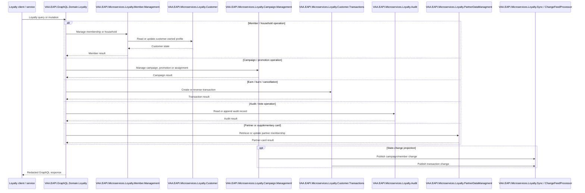
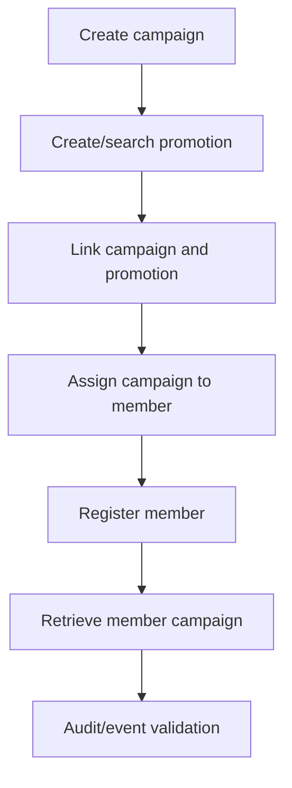

# VAA EAPI Marketing Loyalty — All GraphQL Scenarios

**Status:** Implemented

> **Minimum review:** Read the flow name and description, **Why this flow exists**, **Sequence (detailed)**, and **Open points to finalize**. These sections establish the purpose, intended interactions, and outstanding questions; review the remaining sections as relevant to your role.

## Why this flow exists

<a id="purpose"></a>

Maps GraphQL coverage in `VAA.EAPI.Automation.MarketingLoyalty`. This is an internal/backend capability surface, not a browser-direct API. Customer IDs, membership numbers and transaction data must be storage-driven and redacted.

## Sequence (detailed)

<a id="service-level-sequence"></a>



## Open points to finalize

- None currently recorded; add explicit blockers here before moving this diagram back to Ready or InProgress.

## Agent delivery constraints

- Target solution/project path: Use the smallest owning solution or project implied by the `Harness Sensor`, integration points, and documented component ownership.
- New implementation path, when needed: Prefer the owning project paths already named in this diagram; do not create new services or broaden ownership without recording a blocker.
- New test path, when needed: `VAA.EAPI.Automation/VAA.EAPI.Automation.MarketingLoyalty/IntegrationTests/CampaignManagement/CampaignRegisterEventTests.cs`
- Contract source files to read: Existing files referenced by this diagram, the named GraphQL operations, HTTP endpoints, message/event names, request payloads, and nearest tests.
- Endpoint/event/query/command names: Use only the operation, route, event, command, or scenario names documented in this diagram unless a compile/test failure proves a rename.
- Configuration and secret handling: Use existing configuration keys, environment variables, and secret references only; never commit real secrets, tokens, PII, payment data, or passenger documents.
- Harness command: Run the scoped verification selected by Promotion verification; for Fast, use scripts/verify.ps1 -SolutionPath <owning-solution> -SkipBuild or the nearest project equivalent.

## Current implementation alignment

`VAA.EAPI.GraphQL.Domain.Loyalty` composes the implemented loyalty services. Calls are routed to the bounded service that owns the member, campaign, transaction, audit or partner-card data; asynchronous projections use the loyalty change-feed/sync path.

## Operation families

| Family | Covered operations |
|---|---|
| Campaigns | create, update, search, retrieve, assign, unassign, register, associated members, download, campaign types |
| Promotions | create, update, search/retrieve, link/delink campaign, promotion campaign search |
| Members | customer search, member account, partner details, phone search, VAC profile update |
| Household | retrieve, link, delink, address update and dissolve events |
| Supplementary Silver | retrieve, link, delink and audit |
| Partner cards | retrieve, create and update partner/Centurion membership |
| Notes | create, retrieve, update and delete loyalty notes |
| Transactions | earn, burn, cancellation, related transaction retrieval/cancellation, voucher accrual, SkyTeam retro |
| Audit | address, contact, preference, award, customer profile, Supplementary Silver and Amex Centurion |
| Events/sync | SFPD, campaign registration, LTG, Million Miler, InRule and customer event projections |

## Representative campaign flow



## Example payloads

### Campaign search

```json
{
  "query": "query CampaignSearch($request: CampaignSearchInput!) { campaignSearch(request: $request) { ... } }",
  "variables": { "request": { "campaignCode": "TEST-CAMPAIGN", "status": "ACTIVE", "order": "DESC" } }
}
```

```json
{ "data": { "campaignSearch": { "items": [{ "campaignId": "<opaque-campaign-id>", "campaignCode": "TEST-CAMPAIGN", "status": "ACTIVE" }] } } }
```

### Assign campaign

```json
{
  "query": "mutation AssignCampaign($request: AssignCampaignInput!) { assignCampaign(request: $request) { ... } }",
  "variables": { "request": { "customerId": "<opaque-customer-id>", "memberNumber": "<masked-member-number>", "campaignId": "<opaque-campaign-id>", "campaignCode": "TEST-CAMPAIGN", "createdBy": "automation" } }
}
```

```json
{ "data": { "assignCampaign": { "status": "SUCCESS", "documentId": "<opaque-document-id>" } } }
```

### Retrieve member account

```json
{ "query": "query RetrieveMemberAccountDetails($customerId: String!, $where: String) { retrieveMemberAccountDetails(customerId: $customerId, where: $where) { ... } }", "variables": { "customerId": "<opaque-customer-id>", "where": "ACTIVE" } }
```

```json
{ "data": { "retrieveMemberAccountDetails": { "memberNumber": "<masked-member-number>", "status": "ACTIVE", "pointsBalance": 12000 } } }
```

### Household link

```json
{ "query": "mutation HouseHoldLinking($request: HouseholdLinkInput!) { houseHoldLinking(request: $request) { ... } }", "variables": { "request": { "parentCustomerId": "<opaque-parent-id>", "childCustomerId": "<opaque-child-id>", "initiatedBy": "automation" } } }
```

### Create loyalty note

```json
{ "query": "mutation LoyaltyCreateNote($request: LoyaltyNoteInput!) { loyaltyCreateNote(request: $request) { ... } }", "variables": { "request": { "customerId": "<opaque-customer-id>", "notesGroup": "SERVICE", "noteType": "GENERAL", "text": "Synthetic automation note", "createdBy": "automation" } } }
```

### Retrieve audit history

```json
{ "query": "query RetrievePreferenceAudit($customerId: String!, $memberNumber: String!) { retrievePreferenceAudit(customerId: $customerId, memberNumber: $memberNumber) { ... } }", "variables": { "customerId": "<opaque-customer-id>", "memberNumber": "<masked-member-number>" } }
```

```json
{ "data": { "retrievePreferenceAudit": [{ "changedAt": "2026-07-01T12:00:00Z", "field": "marketingPreference" }] } }
```

## Automated scenario inventory

- full campaign and promotion CRUD, search, linking, assignment and registration lifecycle;
- mandatory-field, invalid identifier, status/date and duplicate-link errors;
- member, partner, household and Supplementary Silver retrieval/link/delink;
- Centurion/partner card create, retrieve and update;
- loyalty contact-note CRUD;
- address/contact/preference/award/profile/card/Supplementary Silver audit histories;
- retail earn/burn/cancel, voucher accrual, related transactions and Sky partner retro;
- VAC profile update, member search by phone and SFPD loyalty sync;
- event integration for campaign, household, LTG, Million Miler and InRule;
- production sanity reads for member, campaign, promotion, audit, balance and statement capabilities.

## Backlog epics

Campaign management; promotion management; member servicing; households; supplementary tiers/cards; transaction servicing; notes; audit; event consistency; operational monitoring and access control.

## Automation sources

- Factory: `VAA.EAPI.Automation.MarketingLoyalty/Requests/Factory/GraphQL.cs`
- Tests: `VAA.EAPI.Automation.MarketingLoyalty/Tests/`
- Integration tests: `VAA.EAPI.Automation.MarketingLoyalty/IntegrationTests/`
- Payloads: `VAA.EAPI.Automation.MarketingLoyalty/Requests/Body/`

## Failure paths

- Reject missing or invalid customer, member, campaign, promotion, and transaction identifiers.
- Prevent duplicate campaign links, assignments, registrations, and transaction reversals.
- Preserve idempotency and traceability when event projection or synchronization is delayed.
- Fail closed for unauthorized internal operations and redact membership and transaction data.

## Expected harness

The unit-style automation and integration suites listed under Automation sources are the current sensors. They should cover each operation family, validation and duplicate cases, event consistency, authorization, safe error mapping, and redacted operational telemetry.

## Agent Loop Goal

| Field | Value |
| --- | --- |
| Goal | Maintain the imported scenario catalogue as an implemented sequence-diagram reference. |
| Status | `Complete` |
| Owner | `VAA.EAPI.Microservices.Loyalty maintainers` |
| Review cadence | Quarterly and when scenario coverage changes |
| Last reviewed | 2026-07-28 |
| Harness Sensor | `VAA.EAPI.Automation/VAA.EAPI.Automation.MarketingLoyalty/IntegrationTests/CampaignManagement/CampaignRegisterEventTests.cs` |
| Promotion verification | Fast |
| Acceptance evidence | Imported scenarios align to existing automation coverage and are tracked by the sequence-diagram index. |
| Done when | Scenario catalogue remains aligned with implemented behavior and referenced harness coverage. |

## Associated delivery pull requests

The draft coordinator PR and its row are created when this goal enters `InProgress`. Every production and QA agent is then recorded here on its own branch and PR. The coordinator PR remains draft until every current child PR is merged, integrated verification passes, and open questions are resolved.

The workflow populates this table for delivery surfaces hosted in other GitHub repositories.

| Surface | Repository | Base branch | Head branch | PR | State | Merged at UTC |
| --- | --- | --- | --- | --- | --- | --- |

## Agent Loop Closure Evidence

Record final closure evidence here. Existing verification and delivery records remain in their respective sections.
