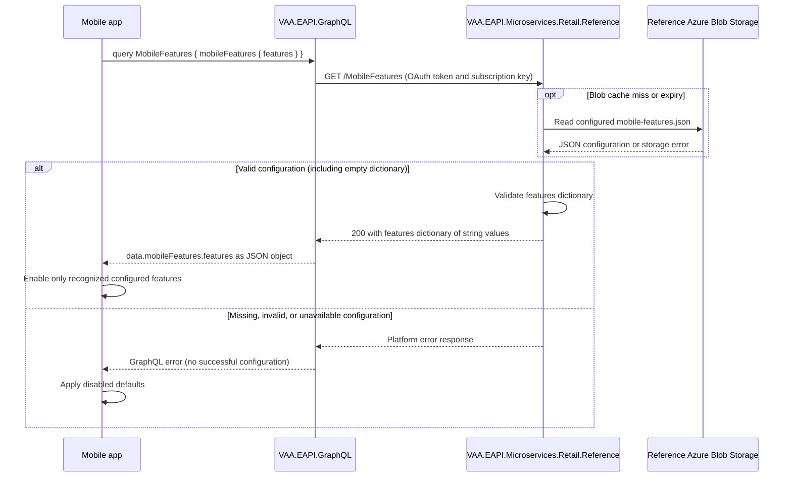

# Mobile Feature Configuration

The mobile app retrieves client-visible feature settings from Retail Reference through the public GraphQL RefData query so it can enable recognized features using centrally managed string values.

Tracking issue: [Mobile feature configuration #180](https://github.com/VAAD1ST/vaa-mobile-delivery-artifacts/issues/180), assigned to `vaa-dimitris-dimitriou` on the Mobile Book Flow board.

> **Minimum review:** Read the flow name and description, **Why this flow exists**, **Sequence (detailed)**, and **Open points to finalize**. These sections establish the purpose, intended interactions, and outstanding questions; review the remaining sections as relevant to your role.

## Why this flow exists

Mobile needs a bootstrap query that returns an object containing `features: Dictionary<string, string>` before member login. Retail Reference owns the configuration in its existing Azure Blob Storage container. Values remain strings end to end, allowing the app to interpret agreed feature switches and other feature settings without adding a new backend field for each key.

The backend supplies configuration only. The mobile application owns feature interpretation and refresh behavior; server-side authorization continues to protect backend operations independently of client flags.

## Sequence (detailed)



## Open points to finalize

- No unresolved backend implementation questions remain.
- Before enabling features, environment owners must select actual feature names/values. DEV, SIT, and UAT have been initialized with an empty `features` dictionary; production provisioning remains a rollout task.
- Before rollout, the mobile and configuration owners must agree refresh timing and the acceptable delay from existing caching. No feature flags have been enabled by the initial configuration.

## High-level behaviour

1. The mobile app calls `mobileFeatures { features }` on the public GraphQL schema.
2. GraphQL obtains a service OAuth token and calls Reference through APIM with the existing subscription key.
3. Reference reads its configured blob through the shared cache and validates the dictionary.
4. GraphQL returns the string dictionary as a JSON object. A valid empty dictionary succeeds; invalid or unavailable configuration produces an error.
5. The mobile app enables only recognized configured features and applies disabled defaults on failure.

### Contract and rollout

```graphql
query MobileFeatures {
  mobileFeatures {
    features
  }
}
```

Example stored document and Reference response:

```json
{"features":{"nativeBooking":"false","minimumVersion":"2.4"}}
```

GraphQL wraps this object in `data.mobileFeatures`. `features` is an `Any` scalar
whose value is an object, not a JSON-encoded string or a list of key/value pairs.
The C# contract is `Dictionary<string, string>`; names and values are not normalized.
There are no platform/version/user filters or per-user targeting in this contract.

The public schema supports app bootstrap before member login. Reference retains
the existing OAuth/APIM/default middleware boundary. Flags must contain only public
client configuration and cannot authorize protected backend operations. Unknown or
missing flags should be disabled by the app. This change supplies the backend;
the mobile application's interpretation and refresh policy remain client work.

`MobileFeaturesBlob` defaults to `mobile-features.json` in Reference deployment
parameters, using existing storage/container/credential settings.
`ReferenceMSMobileFeaturesUrl` points GraphQL to that environment's Reference API.
Upload the document before rollout, deploy Reference and its generated APIM contract,
then deploy GraphQL. On 2026-10-12, the initial `{"features":{}}` document was
uploaded directly to `referencedata/mobile-features.json` in DEV
(`avadeunstreferencems`), SIT (`avateunstreferencems`), and UAT
(`avaseunstreferencems`). All three blobs were absent before creation; uploads
used create-only conditions and exact-content read-back verification. The local
example file was removed. Production storage and application deployment were not
changed by this provisioning step.

The shared blob cache defaults to one day, controlled by
`AzureBlobServiceBlobExpiration`. Existing HTTP/GraphQL cache policies also apply.
Configuration changes are not guaranteed to be immediate; agree the cache lifetime
and mobile refresh behavior before using a flag as an operational switch.

An empty dictionary succeeds. Missing/null features, blank keys, null values,
malformed JSON, or storage failures are errors. Downstream HTTP 404 is explicitly
mapped to GraphQL code `500` because missing server configuration is a technical
failure. Existing REST-router explicit-code handling therefore retains HTTP 500.

## Integration points

| Component | Responsibility |
| --- | --- |
| Mobile app | Fetch bootstrap configuration, interpret agreed string values, and apply disabled defaults. |
| `VAA.EAPI.GraphQL` | Host the public schema and preserve existing host access controls and error handling. |
| `VAA.EAPI.GraphQL.Domain.RefData` | Register `mobileFeatures`, call Reference through the shared connector, and expose the dictionary as an object-valued `Any` scalar. |
| Reference APIM boundary | Apply existing OAuth and subscription-key policy to `GET /MobileFeatures`. |
| `VAA.EAPI.Microservices.Retail.Reference` | Own, read, and validate the feature configuration through its reference-data handler and blob abstraction. |
| Reference Azure Blob Storage | Store the environment-owned `mobile-features.json` document in the existing container. |
| `VAA.EAPI.Microservices.Retail.Reference.Deployment` and `VAA.EAPI.GraphQL.Deployment` | Supply the blob name and environment-specific Reference URL. |

## Agent delivery constraints

- Target solution/project path: `VAA.EAPI.GraphQL/VAA.EAPI.GraphQL.Domain.RefData/VAA.EAPI.GraphQL.Domain.RefData.csproj` and `VAA.EAPI.Microservices/VAA.EAPI.Microservices.Retail.Reference/VAA.EAPI.Microservices.Retail.Reference.csproj`.
- New implementation path, when needed: keep GraphQL work under `VAA.EAPI.GraphQL/VAA.EAPI.GraphQL.Domain.RefData/` and configuration ownership under `VAA.EAPI.Microservices/VAA.EAPI.Microservices.Retail.Reference/`.
- New test path, when needed: `VAA.EAPI.GraphQL/VAA.EAPI.GraphQL.Domain.RefData.Tests/MobileFeaturesQueryTests.cs` and `VAA.EAPI.Microservices/VAA.EAPI.Microservices.Retail.Reference.Tests/MobileFeaturesQueryHandlerTests.cs`.
- Contract source files to read: GraphQL `Queries/MobileFeaturesQuery.cs`, `Models/MobileFeatures.cs`, `Infrastructure/Services/ReferenceServiceProvider.cs`, and `Startup.cs`; Reference `Domain/MobileFeatures.cs`, `Application/Query/MobileFeaturesQueryHandler.cs`, `Application/Interface/IMobileFeaturesQueryHandler.cs`, and `Triggers/Http/MobileFeaturesController.cs` under the owning paths above.
- Endpoint/event/query/command names: GraphQL `mobileFeatures`, Reference HTTP `GET /MobileFeatures`, and Reference `IMobileFeaturesQueryHandler.HandleAsync`. No events or writes are introduced.
- Configuration and secret handling: `MobileFeaturesBlob`, `ReferenceMSMobileFeaturesUrl`, existing `BlobStorageUri`, `ContainerName`, `SasKey`, `ReferenceMSOcpKey`, and `RefDataAPI:AppId`. Use existing credential references; never put secrets or customer data in flags, fixtures, logs, or examples.
- Harness command: run `scripts/verify.ps1 -ProjectPath <owning project path above> -SkipBuild` for each project. Run the owning test projects with run-scoped TRX and coverage, followed by `scripts/analyse-test-run-results.ps1`; commands and results are in the execution plan.

## Key non-functional considerations

- **Idempotency**: both operations are read-only and repeatable; repeated requests do not change configuration.
- **Correlation**: preserve existing GraphQL connector, APIM, and Reference middleware correlation/telemetry behavior. Do not log the full configuration document.
- **Retry behavior**: no feature-specific retries are added. Existing connector/storage behavior applies; mobile refresh and retry timing are client-owned.
- **No-op path**: an explicitly configured empty `features` object succeeds and enables no features.
- **Freshness**: the shared blob cache defaults to one day. Existing HTTP/GraphQL cache policy can add delay; this is not an immediate emergency switch.
- **Security**: expose only client-visible settings on the public bootstrap query. Backend authorization must remain independent of feature flags.

## Failure paths to capture in implementation

- Blob absent, storage unavailable, or storage access denied.
- Malformed JSON, absent/null `features`, blank keys, or null values.
- Reference HTTP failure, missing downstream response, or invalid response shape.
- Downstream HTTP 404 representing unavailable server configuration.

Expected behavior:

- Return an error instead of a successful configuration when retrieval or validation fails. The mobile app should apply disabled defaults.
- Map downstream HTTP 404 to explicit GraphQL code `500`; existing REST-router code handling must retain HTTP 500 rather than classify this as a missing user resource.
- Preserve existing platform exception handling and connector telemetry. No writes, compensation, rollback, or feature-specific retries are required.

## Expected harness

- `VAA.EAPI.GraphQL/VAA.EAPI.GraphQL.Domain.RefData.Tests/MobileFeaturesQueryTests.cs`: execute the query through Hot Chocolate with the real connector and `.mock` responses; assert object-shaped dictionaries, empty configuration, and failure behavior.
- `VAA.EAPI.Microservices/VAA.EAPI.Microservices.Retail.Reference.Tests/MobileFeaturesQueryHandlerTests.cs`: exercise the directly injected handler and HTTP controller through the shared blob/HTTP mock harness; assert configured values, the selected blob URI, and malformed configuration rejection.
- `VAA.EAPI.GraphQL/VAA.EAPI.GraphQL.Rest.Tests/RouterTests.cs`: existing explicit 500-code precedence regression covers technical errors without classifying them as 404.

## Agent Loop Goal

| Field | Value |
| --- | --- |
| Goal | Supply mobile feature configuration from Retail Reference through GraphQL. |
| Status | `Complete` |
| Delivery surface | `Backend` |
| Owner | RefData and Retail Reference maintainers |
| Review cadence | Before changing the mobile configuration contract or caching behavior |
| Last reviewed | 2026-10-12 |
| Harness Sensor | `VAA.EAPI.GraphQL/VAA.EAPI.GraphQL.Domain.RefData.Tests/MobileFeaturesQueryTests.cs`; `VAA.EAPI.Microservices/VAA.EAPI.Microservices.Retail.Reference.Tests/MobileFeaturesQueryHandlerTests.cs` |
| Promotion verification | Fast |
| Acceptance evidence | Executable dictionary-shape, empty-configuration, and failure-path tests with run-scoped TRX evidence. |
| Done when | Query, blob-backed endpoint, deployment settings, tests, and documentation agree. |

## Associated delivery pull requests

Delivery branch: `codex/mobile-feature-configuration`, targeting `main`. See the linked tracking issue for delivery discussion. No merged delivery evidence is recorded; passing local checks do not imply merge or deployment.

| Surface | Repository | Base branch | Head branch | PR | State | Merged at UTC |
| --- | --- | --- | --- | --- | --- | --- |

## Agent Loop Closure Evidence

Local backend validation: 11 RefData GraphQL tests and 41 Retail Reference tests passed; both project-scoped `verify.ps1 -SkipBuild` runs passed. This is local implementation evidence, not deployment or merged-PR evidence.

On 2026-10-12, the branch was fast-forwarded to `origin/main` at `9368517fae`, and this document was aligned with `docs/sequence-diagrams/_template.sequence-diagram.md`. No UX artefact was supplied, so the template's optional UX contract section is omitted.

See the [execution plan](../exec-plans/completed/mobile-feature-configuration.md) for local validation results and limitations.
