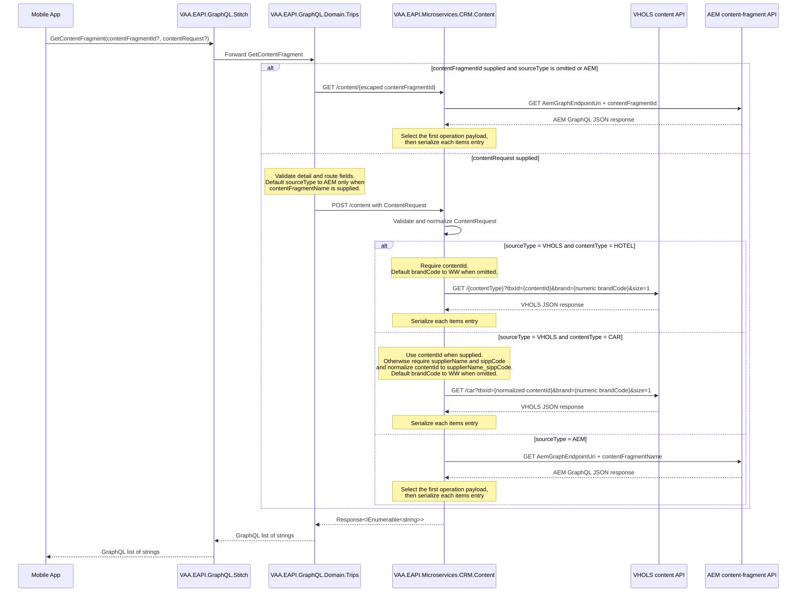

# VAA EAPI Mobile Hotel Content GraphQL Flow

- Scope: Mobile App AEM and VHOLS hotel/car content retrieval
- Participants: Mobile App, Stitch GraphQL gateway, Trips GraphQL domain, CRM Content microservice, VHOLS content API, and AEM

> **Minimum review:** Read the flow name and description, **Why this flow exists**, **Sequence (detailed)**, and **Open points to finalize**. These sections establish the purpose, intended interactions, and outstanding questions; review the remaining sections as relevant to your role.

## Why this flow exists

This sequence describes the current implementation used to retrieve AEM and VHOLS content for the Mobile App. Stitch composes the configured Trips remote schema. Trips exposes the `GetContentFragment` query and delegates content retrieval to the CRM Content microservice.

The query supports two request shapes:

- Existing AEM content can be requested with `contentFragmentId`, or with a `contentRequest` whose `detail.contentFragmentName` is populated. When `sourceType` is omitted for the latter shape, Trips defaults it to `AEM`.
- VHOLS content is requested with `contentRequest.sourceType = VHOLS`, `detail.contentType`, and optional `detail.brandCode`. Hotel content uses `contentType = HOTEL` and requires `contentId`, which carries the VHOLS `tbxId`. Car content uses `contentType = CAR`; it accepts `contentId`, or derives the downstream ID as `{supplierName}_{sippCode}` when `contentId` is absent or `0`. CRM Content defaults an omitted VHOLS `brandCode` to `WW`.

Both paths return an enumerable of JSON item strings through Trips and Stitch.

## Sequence (detailed)

## Open points to finalize

None. The [verification boundaries](#verification-boundaries) describe operational checks outside this repository rather than unresolved implementation decisions.

## Agent delivery constraints

- Target solution/project paths: `VAA.EAPI.GraphQL/VAA.EAPI.GraphQL.Domain.Trips`, `VAA.EAPI.GraphQL/VAA.EAPI.GraphQL.Stitch`, and `VAA.EAPI.Microservices/VAA.EAPI.Microservices.CRM.Content`.
- Preserve the existing GraphQL operation name `GetContentFragment` and the current nested `ContentRequest` contract unless a separately versioned contract change is agreed.
- Preserve `AEM` as the default source only when an AEM content-fragment name is supplied. VHOLS requests must specify `sourceType` and `contentType`; hotels require `contentId`, while cars require either `contentId` or both `supplierName` and `sippCode`.
- Keep the Trips-to-Content base URL and OCP key in the `ContentService:Url` and `ContentService:Ocp` app settings.
- Keep the downstream AEM and VHOLS base URLs in `AemGraphEndpointUri` and `VholsEndPointUri` configuration; do not place secrets in the diagram or fixtures.
- Keep `ContentQuery` registered for the public Trips schema. It currently extends GraphQL `Query` while being added from `Startup.RegisterMutations`; moving that registration is a refactor, not a contract change.

## Flow notes

1. Stitch composes configured remote schemas from `Graphql:Endpoints`; the Trips endpoint must be present in deployed configuration for these operations to be forwarded.
2. The GraphQL operation is `GetContentFragment`, with optional `contentFragmentId` and `contentRequest` arguments.
3. Trips calls `GET /content/{contentFragmentId}` for the legacy AEM ID form and `POST /content` for the structured request form.
4. `sourceType` is the downstream discriminator. Supported values are `AEM` and `VHOLS`.
5. A VHOLS hotel request uses `contentType = HOTEL` and requires `contentId`. A car request uses `contentType = CAR` and accepts `contentId`, or requires `supplierName` and `sippCode` when the ID is absent or `0`; CRM Content normalizes the latter form to `{supplierName}_{sippCode}`.
6. VHOLS URI construction maps the normalized `contentId` to `tbxId`, maps `brandCode` to the numeric `brand` query parameter, lower-cases the content type in the path, and fixes `size=1`.
7. CRM Content owns downstream URI construction and response shaping. Mobile, Stitch, and Trips do not call AEM or VHOLS directly.
8. CRM Content extracts the downstream `items` collection and serializes each item to a string. Trips returns that collection through GraphQL.

## Expected harness

- `VAA.EAPI.GraphQL/VAA.EAPI.GraphQL.Domain.Trips.Tests/Queries/ContentQueryTests.cs` covers the legacy AEM fragment form, structured AEM form, VHOLS hotel form, omitted VHOLS brand, car requests with and without an ID, car validation, and null request validation.
- `VAA.EAPI.Microservices/VAA.EAPI.Microservices.CRM.Content.Tests/ContentRequestHandlerTests.cs` covers AEM success, VHOLS hotel success, VHOLS car success with both ID shapes, null input, and unsupported source type.
- `VAA.EAPI.GraphQL/VAA.EAPI.GraphQL.Stitch/Program.cs` is the implementation sensor for composition: it parses `Graphql:Endpoints`, registers an HTTP client for each entry, and adds each entry as a remote schema.
- `VAA.EAPI.GraphQL/VAA.EAPI.GraphQL.Stitch.Deployment/Parameters/*.json` supplies the environment-specific endpoint collection through Key Vault references; the secret values themselves are intentionally outside the repository.

## Verification boundaries

- Repository verification confirms the implemented contract and configured composition mechanism; it does not reveal Key Vault-backed `Graphql:Endpoints` values or prove the state of a deployed environment.
- The focused tests use fixture-backed HTTP connectors. They do not call live Stitch, AEM, or VHOLS endpoints.
- Validation and downstream HTTP failures flow through the existing GraphQL and Function-host error handling; this diagram does not define a new external error envelope.

## Agent Loop Goal

| Field | Value |
| --- | --- |
| Goal | Document and verify the existing Mobile content flow across Stitch, Trips GraphQL, CRM Content, VHOLS, and AEM. |
| Status | `Complete` |
| Owner | Mobile, GraphQL Trips, and CRM Content maintainers |
| Review cadence | On GraphQL contract, source routing, or downstream content-source change |
| Last reviewed | 2026-08-21 |
| Harness Sensor | `VAA.EAPI.GraphQL/VAA.EAPI.GraphQL.Domain.Trips.Tests/Queries/ContentQueryTests.cs` and `VAA.EAPI.Microservices/VAA.EAPI.Microservices.CRM.Content.Tests/ContentRequestHandlerTests.cs` |
| Promotion verification | Full |
| Acceptance evidence | Implementation review after merging `origin/main` confirmed the Trips resolver/provider, CRM Content controller/handler, Stitch remote-schema composition, configuration keys, AEM routing, VHOLS hotel/car routing, validation, default brand, and response shaping. On 2026-08-21, 10 focused Trips tests and 9 CRM Content tests passed locally. Trips produced analyzed TRX and Cobertura evidence (8.23% project line coverage, 5.74% branch coverage); the CRM project uses Microsoft Testing Platform and did not emit the requested VSTest TRX/coverage artifacts. |
| Status Updated By | `scripts/promote-sequence-goal.ps1` |
| Done when | The documented contract matches the implemented GraphQL resolver, Trips-to-Content calls, CRM Content source routing, validation, downstream URI construction, and response shaping, with focused Trips and CRM Content tests passing. |

## Associated delivery pull requests

The draft coordinator PR and its row are created when this goal enters `InProgress`. Every production and QA agent is then recorded here on its own branch and PR. The coordinator PR remains draft until every current child PR is merged, integrated verification passes, and open questions are resolved.

The workflow populates this table for delivery surfaces hosted in other GitHub repositories.

| Surface | Repository | Base branch | Head branch | PR | State | Merged at UTC |
| --- | --- | --- | --- | --- | --- | --- |

## Agent Loop Closure Evidence

Record final closure evidence here. Existing verification and delivery records remain in their respective sections.
