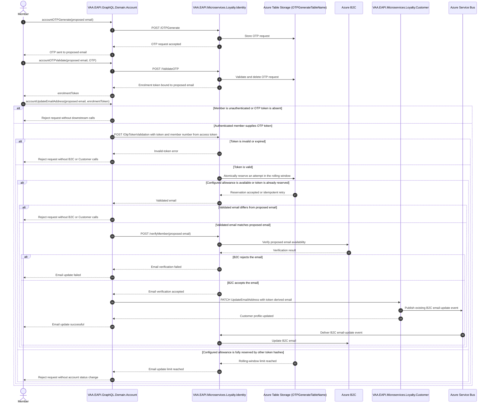

# VAA EAPI MyAccount Email-Update Protection

Draft goal for the OTP-proven and account-rate-limited MyAccount email-change journey. It records the agreed configurable policy while delivery evidence is reviewed and the focused Identity tests are rerun in an execution-enabled environment.

> **Minimum review:** Read the flow name and description, **Why this flow exists**, **Sequence (detailed)**, and **Open points to finalize**. These sections establish the purpose, intended interactions, and outstanding questions; review the remaining sections as relevant to your role.

## Why this flow exists

An unverified email-update request could ask Identity and B2C whether arbitrary client-supplied email addresses were available. The proposed contract requires an OTP validation token, issued only after the proposed address receives and validates an OTP. Loyalty Identity also limits the authenticated Flying Club account before B2C or Customer processing starts.

The agreed self-service policy is a configurable default of two distinct update attempts in a rolling 24-hour window. Once reached, self-service requests are rejected until a reservation leaves the window. The account is not assigned a Fraud (or other) status; members who need another change are directed to the Contact Centre, which can make the change in LOOPS.

## Sequence (detailed)

## Open points to finalize

- Obtain maintainer review of the configurable policy and promote this Draft goal through the defined lifecycle.

## UX contract

| Field | Value |
| --- | --- |
| Supplied UX | `None` |
| Implementation authority | `Not applicable` |
| Flow and behaviour authority | `Sequence (detailed)` |
| Screen/state mapping | `Not applicable` |
| Visual verification | `Not applicable` |

## High-level behavior

1. The member validates an OTP sent to the proposed email and receives an enrolment token bound to that email.
2. `accountUpdateEmailAddress` passes that token to Loyalty Identity together with the Flying Club number derived from the authenticated access token.
3. Loyalty Identity validates the token and atomically reserves the account's configured update allowance in the rolling window in the existing OTP table.
4. Only when the token email matches the requested email and a slot is available does GraphQL ask Loyalty Identity to verify B2C availability, then update the Customer profile. Loyalty Customer then publishes its existing asynchronous B2C-update event.

## Integration points

| Component | Responsibility |
| --- | --- |
| `VAA.EAPI.GraphQL.Domain.Account` | Owns the authenticated `accountUpdateEmailAddress` boundary and denies unproven requests before B2C or Customer calls. |
| `VAA.EAPI.Microservices.Loyalty.Identity` | Validates OTP proof, applies the account/window reservation, and verifies the address against Azure B2C. |
| Azure Table Storage (`OTPGenerateTableName`) | Stores existing OTP records and one account-scoped rate-limit record containing hashed token reservations and timestamps. |
| Azure B2C | Checks the proposed email before profile change and receives the existing asynchronous update after Customer persistence. |
| `VAA.EAPI.Microservices.Loyalty.Customer` | Persists the email change and publishes existing downstream update events. |
| Azure Service Bus | Delivers the existing B2C email-update event from Loyalty Customer to Loyalty Identity. |

## Agent delivery constraints

- Target project paths: `VAA.EAPI.GraphQL/VAA.EAPI.GraphQL.Domain.Account` and `VAA.EAPI.Microservices/VAA.EAPI.Microservices.Loyalty.Identity`.
- Supporting shared-storage path: `VAA.EAPI.Microservices/VAA.EAPI.Infrastructure/AzureStorage/ITableStorageService.cs`.
- Contract source files: `Mutations/UpdateEmailAddressMutation.cs`, `Models/UpdateEmailRequest.cs`, `Services/OTPMutationProvider.cs`, `Application/Command/OtpTokenValidationService.cs`, and `Domain/otpTokenValidationRequest.cs`.
- Endpoint/query names: `accountOTPGenerate`, `accountOTPValidate`, `accountUpdateEmailAddress`, `POST /OtpTokenValidation`, `POST /verifyMember`, and `PATCH /{memberNumber}/UpdateEmailAddress`.
- Configuration and secret handling: use existing Identity, Customer, B2C, subscription-key, and `OTPGenerateTableName` settings. The associated delivery PR [#1990](https://github.com/VAAD1ST/eapi/pull/1990) introduces `EmailUpdateLimit` (default `2`) and `EmailUpdateLimitWindow` (default `1:0:0:0`, or 24 hours). Changing either setting requires normal application-setting deployment and restart. Never log raw OTPs, OTP validation tokens, email addresses, or Flying Club numbers.
- Harness command: run both focused test projects with run-scoped TRX and coverage, then use `scripts/analyse-test-run-results.ps1` for each results directory.

## Key non-functional considerations

- **Idempotency**: a retried OTP validation token reuses its matching reservation rather than consuming another attempt.
- **Concurrency**: strict Azure Table inserts and ETag-guarded replaces reserve the allowance atomically, preventing concurrent requests from exceeding the configured limit.
- **Privacy**: the account row key and token reservations are SHA-256 hashes; the row holds no raw account, email, or token values.
- **Failure behavior**: missing, invalid, expired, mismatched, or over-limit proof fails closed before B2C availability checks or Customer profile updates.
- **Limit consequence**: over-limit self-service requests are rejected; no Fraud or other account-status mutation is made.
- **Reset boundary**: each reservation expires independently after `EmailUpdateLimitWindow`; there is no UTC-calendar-day reset.

## Failure paths to capture in implementation

- Missing member access token or OTP token, expired OTP token, and token-email/request-email mismatch.
- The configured number of active rolling-window reservations is already held by different OTP tokens for the authenticated account.
- B2C verification rejection and Customer profile-update failure.

Expected behavior:

- Do not invoke B2C verification, Customer persistence, or downstream B2C-update processing until proof and the rolling-window limit both pass.
- Reject an over-limit self-service request without applying a Fraud or other account status.
- Return controlled GraphQL or EAPI errors without logging the OTP, token, email address, or Flying Club number.

## Expected harness

- `VAA.EAPI.GraphQL/VAA.EAPI.GraphQL.Domain.Account.Tests/UpdateEmailAddressMutationTests.cs` covers accepted proof and denial without B2C/Customer calls for missing or mismatched proof.
- `VAA.EAPI.Microservices/VAA.EAPI.Microservices.Loyalty.Identity.Tests/OtpTokenValidationServiceTests.cs` covers invalid-token non-consumption, the configurable limit, rolling-window expiry, and idempotent retry.
- `scripts/check-sequence-diagram-status.ps1`, `scripts/check-behavior-harness.ps1`, and `scripts/check-mermaid-diagrams.ps1 -Path docs/sequence-diagrams/vaa-eapi-myaccount-email-update-protection.md` validate this goal artifact.

## Agent Loop Goal

| Field | Value |
| --- | --- |
| Goal | Prevent email-address harvesting through `accountUpdateEmailAddress` while preserving a verified member email-change journey. |
| Status | `Draft` |
| Delivery surface | `Backend` |
| Owner | Account GraphQL, Loyalty Identity, and Loyalty Customer maintainers |
| Review cadence | On MyAccount email-change, OTP, B2C, Customer-profile, or Table Storage behavior change |
| Last reviewed | 2026-09-10 |
| Harness Sensor | `VAA.EAPI.GraphQL/VAA.EAPI.GraphQL.Domain.Account.Tests/UpdateEmailAddressMutationTests.cs` `VAA.EAPI.Microservices/VAA.EAPI.Microservices.Loyalty.Identity.Tests/OtpTokenValidationServiceTests.cs` |
| Promotion verification | Full |
| Acceptance evidence | Existing GraphQL focused tests passed 13/13, including missing and mismatched OTP-proof denial. The focused Identity suite passed through its managed test DLL, covering configurable limit, rolling-window expiry, and idempotent retry; Windows denied only the generated `.exe` test host. The associated delivery PR records the current verification evidence. |
| Maximum agent resources | Not applicable while the goal is Draft. |
| Production code agent resources | Not applicable while the goal is Draft. |
| Automation code agent resources | Not applicable while the goal is Draft. |
| Actual agent resources | Not applicable while the goal is Draft. |
| Lifecycle agent resources | Not applicable while the goal is Draft. |
| Done when | Maintainers approve the two-change rolling-24-hour policy and its evidence, then promote the goal through the defined lifecycle. |

## Associated delivery pull requests

- [#1990: secure Update Email mutation](https://github.com/VAAD1ST/eapi/pull/1990)

## Agent Loop Closure Evidence

No closure evidence recorded while the goal is Draft. The preceding manual implementation history is in `docs/exec-plans/completed/2026-09-08-myaccount-email-update-protection.md`.
