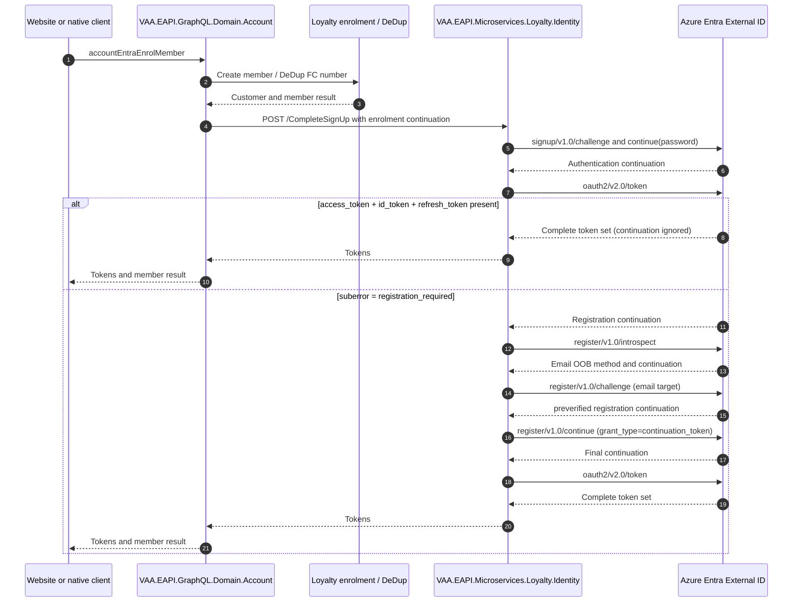

# VAA EAPI MyAccount Entra Native MFA Registration During Enrolment

Implemented Entra native-authentication enrolment flow that completes a required email MFA registration only when the token endpoint has not already issued the complete token set.

> **Minimum review:** Read the flow name and description, **Why this flow exists**, **Sequence (detailed)**, and **Open points to finalize**. These sections establish the purpose, intended interactions, and outstanding questions; review the remaining sections as relevant to your role.

## Why this flow exists

Account enrolment creates the loyalty member before Identity completes the native Entra authentication journey. Entra can require the member to register an email MFA method after the password step. The flow must complete that registration exactly once, while never treating a response that already contains access, ID, and refresh tokens as a registration request.

## Sequence (detailed)

## Open points to finalize

- None. Environment owners must enable the matching Entra Native Authentication capability before deployment, using the existing deployment configuration process.

## High-level behavior

1. Account GraphQL creates the member and calls Loyalty Identity `CompleteSignUp` with the enrolment continuation.
2. Identity completes the native sign-up password step and exchanges its continuation at `oauth2/v2.0/token`.
3. A complete token set returns immediately. Only `suberror=registration_required` enters Entra's `/register/v1.0` contract.
4. The enrolment email is preverified, so registration continues directly to token issuance without an OTP handoff.

## Integration points

| Component | Responsibility |
| --- | --- |
| Website or native client | Calls Account enrolment and receives the completed Identity tokens. |
| `VAA.EAPI.GraphQL.Domain.Account` | Calls Loyalty enrolment and Identity without owning native-registration state or decisions. |
| `VAA.EAPI.Microservices.Loyalty.Identity` | Owns `CompleteSignUp`, the native Entra preverified-register continuation, and token precedence. |
| Azure Entra External ID | Performs native sign-up, token issuance, and MFA registration at `/register/v1.0/*`. |

## Agent delivery constraints

- Target project path: `VAA.EAPI.Microservices/VAA.EAPI.Microservices.Loyalty.Identity`.
- Contract source files: `Application/Command/AccountAccess/CompleteSignUpHandler.cs` and `Infrastructure/Services/EntraService.cs`.
- Endpoint/query names: `POST /CompleteSignUp`, `accountEntraEnrolMember`, `signup/v1.0/start`, `oauth2/v2.0/token`, and `register/v1.0/{introspect,challenge,continue}`.
- Configuration and secret handling: use existing `EntraAPIurlDomain`, `EntraClientId`, and `EntraAPIScope` values; do not log passwords, OTPs, continuation tokens, or issued tokens.
- Harness command: `dotnet test VAA.EAPI.Microservices/VAA.EAPI.Microservices.Loyalty.Identity.Tests/VAA.EAPI.Microservices.Loyalty.Identity.Tests.csproj --no-build`.

## Key non-functional considerations

- **Idempotency**: a fully issued token set is terminal and prevents a duplicate native-registration call. Entra owns the validity and one-time use of continuations and OTPs.
- **Correlation**: Identity keeps its existing enrolment event correlation for post-registration side effects; Entra continuation values are request credentials and must not be logged.
- **Retry behavior**: return a controlled response for missing continuations, unsupported challenges, or unavailable email registration methods; do not replay registration after tokens are issued.
- **No-op path**: ordinary enrolment returns its issued tokens; preverified registration does not send an additional OTP.

## Failure paths to capture in implementation

- Entra token response contains neither the complete token set nor a valid `registration_required` continuation.
- Register introspection does not offer an email `oob` method or email target.
- Register challenge is not preverified, returns a malformed continuation, or returns an Entra error.

Expected behavior:

- Return a controlled Identity error and do not issue partial success.
- Do not log raw Entra payloads, continuation tokens, OTPs, passwords, or tokens.

## Expected harness

- `VAA.EAPI.Microservices/VAA.EAPI.Microservices.Loyalty.Identity.Tests/CompleteSignUpHandlerTests.cs`.

## Agent Loop Goal

| Field | Value |
| --- | --- |
| Goal | Complete the Identity-owned enrolment registration continuation when Entra returns `registration_required`. |
| Status | `Complete` |
| Owner | Loyalty Identity maintainers |
| Review cadence | On Entra Native Authentication, enrolment, or token-contract change |
| Last reviewed | 2026-08-21 |
| Harness Sensor | `VAA.EAPI.Microservices/VAA.EAPI.Microservices.Loyalty.Identity.Tests/CompleteSignUpHandlerTests.cs` |
| Promotion verification | Full |
| Acceptance evidence | Focused Identity tests prove that issued tokens suppress registration and that the `preverified` register continuation yields tokens without a duplicate OTP. |
| Maximum agent resources | Recorded automatically at completion from the workflow token and USD limits |
| Production code agent resources | Recorded automatically at completion from production-generation JSONL budget evidence |
| Automation code agent resources | Recorded automatically at completion from automation-generation JSONL budget evidence |
| Actual agent resources | Recorded automatically at completion from retained JSONL budget evidence |
| Done when | The complete sign-up route handles both token success and the preverified Entra native-registration branch. |

## Associated delivery pull requests

The draft coordinator PR and its row are created when this goal enters `InProgress`. Every production and QA agent is then recorded here on its own branch and PR. The coordinator PR remains draft until every current child PR is merged, integrated verification passes, and open questions are resolved.

The workflow populates this table for delivery surfaces hosted in other GitHub repositories.

| Surface | Repository | Base branch | Head branch | PR | State | Merged at UTC |
| --- | --- | --- | --- | --- | --- | --- |

## Agent Loop Closure Evidence

- 2026-08-20: Implemented and focused Identity verification passed locally. The completed execution plan is `docs/exec-plans/completed/2026-08-20-entra-native-mfa-registration.md`.
