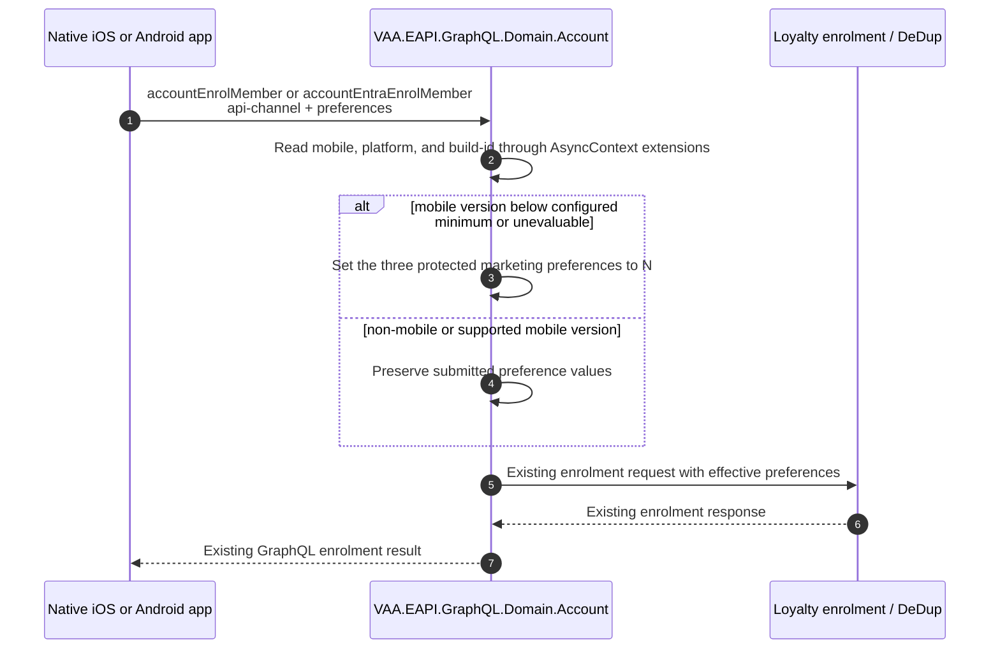

# VAA EAPI MyAccount Mobile Enrolment Marketing Preference Guard

Implemented GraphQL Account enrolment guard that forces three marketing preferences to `N` for iOS and Android app versions below their platform-specific configured minimum before either standard enrolment request is saved downstream.

> **Minimum review:** Read the flow name and description, **Why this flow exists**, **Sequence (detailed)**, and **Open points to finalize**. These sections establish the purpose, intended interactions, and outstanding questions; review the remaining sections as relevant to your role.

## Why this flow exists

Legacy native app versions must not persist affirmative marketing choices that they cannot collect or represent according to the current enrolment policy. The GraphQL Account layer receives the caller context and constructs the downstream enrolment payload, so it applies the compatibility guard immediately before the request is serialized and sent to the enrolment service.

This is privacy-relevant behavior. It may only reduce the three protected marketing permissions to `N`; it must never turn a preference on, alter unrelated preferences, or log customer preference values.

## Sequence (detailed)

## Open points to finalize

- The versioned source delivery is complete with iOS and Android `1.10.0` configured for every checked-in GraphQL deployment environment.

## UX contract

| Field | Value |
| --- | --- |
| Supplied UX | `None` |
| Implementation authority | `Not applicable` |
| Flow and behaviour authority | `Sequence (detailed)` |
| Screen/state mapping | Not applicable; this is a backend compatibility guard. |
| Design inspection matrix | Not applicable. |
| Visual verification | Not applicable. |
| UI/UX acceptance test | Not applicable. |
| Rendered evidence | Not applicable. |
| Comparison result | Not applicable. |

## Channel contract

`api-channel` is an HTTP list-valued header. Commas delimit channel values and semicolons delimit parameters within one value. The guard evaluates the existing `AsyncContext.Channel` entries directly so it can reject duplicate or malformed mobile values, identifies `mobile` case-insensitively, and reads its `platform` and `build-id` parameters. Version components are ASCII decimal digits compared numerically, not lexicographically; whitespace, signs, and non-numeric components are invalid. The requested configured minimums are iOS `1.10.0` and Android `1.10.0`.

## High-level behavior

1. A caller invokes `accountEnrolMember` or `accountEntraEnrolMember` with enrolment details and `api-channel` context.
2. GraphQL Account reads the `mobile`, `platform`, and `build-id` values through `AsyncContext` extensions.
3. GraphQL Account selects the iOS or Android configured minimum and compares it numerically to the supplied version.
4. It sets the three protected marketing preferences to `N` when the mobile version is below the minimum or the mobile context cannot be evaluated unambiguously.
5. Non-mobile and supported mobile versions retain their submitted protected preferences.
6. The downstream enrolment service saves the resulting request through its existing behaviour and returns the existing enrolment response.

## Integration points

| Component | Responsibility |
| --- | --- |
| Native iOS or Android app | Sends the enrolment request and structured `api-channel` value containing `mobile`, `platform`, and `build-id`. |
| GraphQL host context | Parses comma-delimited channel values into `AsyncContext.Current.Channel` and exposes existing channel lookup extensions. |
| `VAA.EAPI.GraphQL.Domain.Account` | Applies the platform/version compatibility guard before either standard enrolment request is serialized downstream. |
| Loyalty enrolment / DeDup | Persists the preference values received in the existing enrolment contract; it does not infer mobile version policy. |

The App, Web, and any other external or upstream systems are context providers only. Changes to their source code, configuration, contracts, release processes, or tests are explicitly out of scope for this goal delivery.

## Agent delivery constraints

- Target solution/project paths: `VAA.EAPI.GraphQL/VAA.EAPI.GraphQL.sln`, `VAA.EAPI.GraphQL/VAA.EAPI.GraphQL.Domain.Account`, and `VAA.EAPI.GraphQL/VAA.EAPI.GraphQL.Domain.Account.Tests`.
- Primary implementation path: `VAA.EAPI.GraphQL/VAA.EAPI.GraphQL.Domain.Account/Services/EnrolmentProvider.cs`, with a small focused policy/helper in the same owning project if needed. Keep both mutation classes thin.
- Shared channel contract sources to read, not duplicate: `VAA.EAPI.GraphQL/VAA.EAPI.GraphQL.Common/AsyncContext.cs` and `VAA.EAPI.GraphQL/VAA.EAPI.GraphQL.Common/Extensions/AsyncContextExtensions.cs`.
- Enrolment and preference contract sources to read: `VAA.EAPI.GraphQL/VAA.EAPI.GraphQL.Infrastructure/Entities/CustomerMS/AccountPreference.cs`, `VAA.EAPI.GraphQL/VAA.EAPI.GraphQL.Domain.Account/Models/Enrolment/CreateCustomerAccountRequest.cs`, and `VAA.EAPI.GraphQL/VAA.EAPI.GraphQL.Domain.Account/Mappers/EnrolmentEventDataMapper.cs`.
- Endpoint/query names: `accountEnrolMember` and `accountEntraEnrolMember`. `accountCreateYoungFlyer` and its dedicated enrolment path are outside the initial scope.
- Protected preference names: `VaaMarketingPermissions`, `VaPartnersMarketingPermissions`, and `VaGroupMarketingPermissions`; comparison uses the enum values rather than string literals.
- Delivery boundary: make changes only in this repository's EAPI GraphQL backend and its owned tests/configuration. Do not modify the App, Web, or any other external or upstream system; their code, configuration, contracts, release processes, and test suites are explicitly out of scope.
- Configuration and version handling: use `MyAccount:MobileEnrolment:MinimumIosVersion` (`1.10.0`) and `MyAccount:MobileEnrolment:MinimumAndroidVersion` (`1.10.0`) through centralized environment keys. Parse and compare numeric version components; do not use direct string, ordinal, or lexicographic comparison. Do not log headers, customer data, or submitted preference values.
- Implementation boundary: mutate the effective request before `EnrolmentEventDataMapper.CreateEnrolmentEventDataMapper(request)` and `Json.Serialize(...)` run for either standard enrolment path. Do not modify the downstream microservice contract or persistence layer for this privacy rule.
- Harness command: run the GraphQL Account tests with a new run-scoped TRX and `XPlat Code Coverage`, then run `scripts/analyse-test-run-results.ps1` for that TRX. Also run `scripts/verify.ps1 -ProjectPath VAA.EAPI.GraphQL/VAA.EAPI.GraphQL.Domain.Account/VAA.EAPI.GraphQL.Domain.Account.csproj` and the sequence/behavior documentation checks.

## Key non-functional considerations

- **Privacy-safe default**: the compatibility action only changes protected preference values to `N`; it never changes `N` to `Y` or modifies another preference type.
- **Trust boundary**: `api-channel` platform and build-id values are caller-controlled compatibility metadata, not server-side app attestation. This guard is a release-compatibility policy, not an authorisation control; moving preservation decisions to an APIM-issued or signed signal requires an upstream contract change outside this delivery.
- **Idempotency**: applying the guard more than once produces the same effective preference values and introduces no additional downstream calls.
- **Correlation**: preserve the existing `AsyncContext` correlation and channel propagation through the enrolment call. Do not replace or rebuild the context.
- **Failure policy**: missing or malformed channel/version/configuration context fails closed by setting the protected preferences to `N`.
- **Scope**: only protected preference values for legacy or unevaluable mobile requests are set to `N`; preference types outside the protected set always pass through unchanged.
- **Observability**: if a decision log is required, log only a privacy-safe outcome category, normalized platform, and correlation identifier. Do not log the full `api-channel` value, build identifier, or preference payload.

## Failure paths to capture in implementation

- `AsyncContext.Current` or its channel collection is unavailable.
- A `mobile` value is present without `platform`, without `build-id`, with an unsupported platform, or with malformed/duplicate parameters.
- The selected platform's minimum-version configuration is missing or malformed.
- The supplied `build-id` does not conform to the numeric comparison grammar.
- The request, customer details, or preferences collection is null, empty, or omits one or more protected preference entries.
- Multiple channel values contain `mobile`, including exact duplicates.

Expected behavior:

- Never infer that `STITCH` or `GRAPHQL` is part of the mobile value; use the shared channel helpers.
- Never persist an affirmative protected preference when required mobile policy evaluation cannot be completed under the fail-closed rule.
- Return existing controlled GraphQL/downstream failures without exposing raw headers, versions, or preference values.
- Do not change request or response contracts solely to report that the guard was applied.

## Expected harness

- Account enrolment tests capture the actual serialized downstream request and prove both `accountEnrolMember` and `accountEntraEnrolMember` reset exactly the three protected enum values for iOS and Android versions below their respective thresholds.
- Boundary tests cover versions below, equal to, and above both platform thresholds, including the numeric regression pair `1.9.1` and `1.10.0`.
- No-op tests cover non-mobile values, case-insensitive mobile/platform values, supported mobile versions, and unrelated preference types.
- Failure-policy tests cover missing/malformed platform, `build-id`, configuration, null/empty preferences, omitted protected preferences, and duplicate mobile values.
- Tests prove the caller's request is transformed before the downstream mapper/serializer and that no additional downstream call is introduced.

For implementation verification, use the repository's run-scoped TRX, analyser, and coverage contract for `VAA.EAPI.GraphQL.Domain.Account.Tests`, followed by project-scoped `scripts/verify.ps1`.

## Agent Loop Goal

| Field | Value |
| --- | --- |
| Goal | Prevent affected legacy iOS and Android app versions from persisting affirmative VAA, VAA partner, or VAA group marketing preferences during Flying Club enrolment. |
| Status | `Complete` |
| Delivery surface | `Backend` |
| Owner | GraphQL Account / MyAccount maintainers |
| Review cadence | On Account enrolment, `api-channel`, mobile release-policy, or marketing-consent contract change |
| Last reviewed | 2026-09-17 |
| Harness Sensor | `VAA.EAPI.GraphQL/VAA.EAPI.GraphQL.Domain.Account.Tests/MobileEnrolmentMarketingPreferencePolicyTests.cs` |
| Promotion verification | Full |
| Acceptance evidence | Account policy and integration tests prove comma-delimited channel parsing, case-insensitive mobile/platform recognition, platform-specific version boundaries, resetting exactly the three protected preferences before both standard enrolment downstream calls, and unchanged behaviour for non-mobile and supported mobile callers. The GraphQL Account project passes repository-standard build and run-scoped test/analyser verification. |
| Maximum agent resources | Not applicable: delivered directly by Codex rather than the automated loop. |
| Production code agent resources | Not applicable: delivered directly by Codex rather than the automated loop. |
| Automation code agent resources | Not applicable: no automated delivery phase retained. |
| Actual agent resources | Not applicable: no automated-loop evidence retained. |
| Lifecycle agent resources | Not applicable: no automated delivery lifecycle retained. |
| Status Updated By | `scripts/promote-sequence-goal.ps1` |
| Task/Issue | branch:codex/mobile-enrolment-marketing-preference |
| Transition note | Completed directly by Codex; automated goal-loop delivery was retired by request. |
| PR | https://github.com/VAAD1ST/eapi/pull/2099 |
| Completed by | Codex direct implementation |
| Done when | Both standard Account enrolment paths evaluate the structured mobile channel before serialization and persist `N` for `VaaMarketingPermissions`, `VaPartnersMarketingPermissions`, and `VaGroupMarketingPermissions` whenever the identified iOS or Android version is below its configured minimum, while all documented no-op and invalid-context paths are covered by tests. |

## Associated delivery pull requests

| Surface | Repository | Base branch | Head branch | PR | State | Merged at UTC |
| --- | --- | --- | --- | --- | --- | --- |
| `Backend` | `VAAD1ST/eapi` | `main` | `codex/mobile-enrolment-marketing-preference` | [#2099](https://github.com/VAAD1ST/eapi/pull/2099) | `OPEN` | n/a |

## Agent Loop Closure Evidence

Completed directly by Codex after the automated delivery attempt was retired. Goal-specific automated-loop evidence was removed at the request of the delivery owner.
