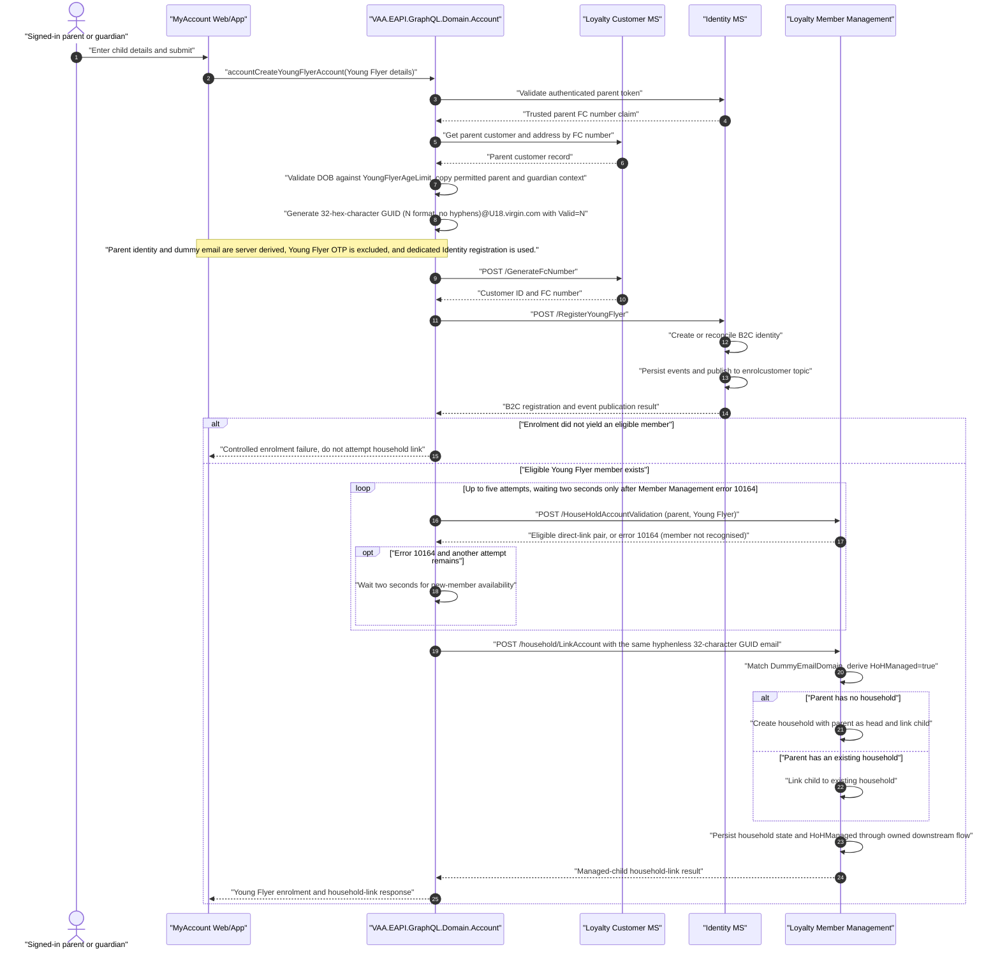

# VAA EAPI MyAccount Young Flyer Enrolment and Household Linking

Proposed authenticated-parent journey for enrolling a Young Flyer into Flying Club with a server-generated `Guid.NewGuid().ToString("N")` email local part and the configured `DummyEmailDomain` (default `U18.virgin.com`), marked `Valid=N`, creating a disabled Identity account, and directly linking the Young Flyer to the parent's household. The GUID local part is exactly 32 hexadecimal characters and contains no `-` hyphens.

> **Minimum review:** Read the flow name and description, **Why this flow exists**, **Sequence (detailed)**, and **Open points to finalize**. These sections establish the purpose, intended interactions, and outstanding questions; review the remaining sections as relevant to your role.

## Why this flow exists

An authenticated parent or guardian needs to add a Young Flyer to Flying Club and the parent's household. The current adult household journey uses an invitation document and a later acceptance action; that is unsuitable for an account managed by the household head.

The existing Account enrolment path also treats a supplied email, enrolment token, password, OTP validation, and optional Identity registration as normal member-enrolment concerns. The Young Flyer journey must make an explicit, owned decision about which of those behaviours do not apply to an account without an independent email identity.

## Sequence (detailed)

## Open points to finalize

None. The following delivery decisions close the previously open items:

- External Azure DevOps ticket IDs are not required for this implementation; the code-level contract in this diagram is the delivery baseline.
- `MyAccount:DeDupFCGenUrl` is treated as synchronous for this mutation. Household linking is attempted only when its response contains both a customer ID and member number.
- This delivery adds a bounded five-attempt, two-second-interval retry only for Member Management validation error `10164` immediately after Young Flyer enrolment. It does not retry or compensate an actual household-link request; those failures return a controlled error after enrolment and rely on the existing DeDup and Member Management eligibility/link idempotency contracts. An event-driven reconciliation flow requires a separately owned follow-up design.

## Current-code reference

- `accountEnrolMember` delegates to `IEnrolmentProvider.EnrolFcMember`. When enabled, that provider validates an enrolment token with Identity, can validate a supplied password, posts the mapped enrolment request to `MyAccount:DeDupFCGenUrl`, and can register an Identity account.
- `accountInviteMember` is the household-linking reference. It authenticates the head account, reads customer, invitation, member, and group state, validates the head/Young Flyer pair with Member Management, then either creates an adult invitation document or directly links a Young Flyer.
- Member Management currently derives `HoHManaged` by comparing `ChildAccount.EmailId` with configured `DummyEmailDomain` (`U18.virgin.com`), then writes that value to the Young Flyer's group history. The Young Flyer request must therefore pass the exact generated dummy email into `ChildAccount.EmailId`; setting a flag in Account alone is insufficient.
- Customer Transactions persists `HoHManaged` on `GroupHistory`; `HoHManaged` must not be duplicated as a general customer attribute.

## High-level behavior

1. The signed-in parent starts the Young Flyer enrolment journey and supplies only permitted Young Flyer data.
2. Account GraphQL derives the parent identity from the validated access token's FC number (Identity does not return a `CustomerId` claim for this journey), loads the parent record by FC number, copies the permitted address and guardian context, validates the configured `YoungFlyerAgeLimit` (default `18`), and generates an email from `Guid.NewGuid().ToString("N")` plus the configured `DummyEmailDomain` (default `U18.virgin.com`) with `Valid=N`; the GUID local part is 32 hexadecimal characters with no `-` hyphens.
3. Account GraphQL submits the Young Flyer through Customer MS `GenerateFcNumber`, then calls Identity `RegisterYoungFlyer`; Identity creates a disabled dummy-email account and publishes the normal customer and VRed/OCDB synchronization events.
4. After a member number is available, Account GraphQL retries Member Management's `10164` not-recognised response for a bounded period while the new member becomes available, then applies the existing household eligibility checks and links with the same dummy email in `ChildAccount.EmailId`.
5. Loyalty Member Management derives `HoHManaged=true` from its configured dummy domain, creates or updates the household, and Customer Transactions persists the Young Flyer relationship state.
6. Account GraphQL returns the enrolment and household-link result.

## Integration points

| Component | Responsibility |
| --- | --- |
| MyAccount Web/App | Starts the authenticated parent journey and presents controlled success or failure; it must not be trusted to provide parent identity or a server-generated child email. |
| `VAA.EAPI.GraphQL.Domain.Account` | Owns the GraphQL mutation, derives trusted parent context, applies the configurable Young Flyer age policy, and orchestrates enrolment and direct linking. |
| Loyalty Customer MS | Supplies trusted parent/customer data, creates/resolves the Young Flyer customer and FC number, and owns the customer event contract. It does not own household relationship state. |
| Customer MS FC generation (`MyAccount:DeDupFCGenUrl`) | Creates/resolves the Young Flyer customer and returns the customer ID and FC number. |
| `enrolcustomer` Service Bus topic | Carries the customer and VRed/OCDB synchronization events to their configured subscribers. |
| VRed / OCDB subscribers | Consume the customer synchronisation event and create or reconcile the downstream Young Flyer records; duplicate delivery must be idempotent. |
| Identity MS | `RegisterYoungFlyer` creates the B2C identity with the existing customer ID and FC number, disables dummy-email accounts, suppresses dummy-email communication, and publishes customer plus VRed/OCDB synchronization events. |
| Customer Transaction MS | Persists household `GroupHistory.HoHManaged`; adult invitation creation is not used for the Young Flyer direct-link path. |
| Loyalty Member Management | Validates the pair, derives managed-young-flyer state from `ChildAccount.EmailId` and `DummyEmailDomain`, and processes `/household/LinkAccount`. |
| CRM Email / CCP | Receives the Young Flyer enrolment confirmation email event published by Loyalty Member Management (template configured via `YoungFlyerEnrolmentConfirmationEmailTemplate`), routed only to the trusted parent's preferred email with `Child_First_Name` and `Child_Membership_Number` merge data; the generated dummy Young Flyer email is never used for delivery. |

## Agent delivery constraints

- Target production projects:
  - `VAA.EAPI.GraphQL/VAA.EAPI.GraphQL.Domain.Account/VAA.EAPI.GraphQL.Domain.Account.csproj`
  - `VAA.EAPI.Microservices/VAA.EAPI.Microservices.Loyalty.Customer/VAA.EAPI.Microservices.Loyalty.Customer.csproj`
  - `VAA.EAPI.Microservices/VAA.EAPI.Microservices.Loyalty.Member.Management/VAA.EAPI.Microservices.Loyalty.Member.Management.csproj`
  - `VAA.EAPI.Microservices/VAA.EAPI.Microservices.Loyalty.Customer.Transactions/VAA.EAPI.Microservices.Loyalty.Customer.Transactions.csproj`
  - Target test projects: matching Account, Identity, Member Management, and Customer Transactions `.Tests` projects; Account HTTP behavior must use repository `.mock` fixtures rather than hand-written connector fakes.
- Contract source files to read: `Services/EnrolmentProvider.cs`, `Mutations/EnrolFlyingClubMemberMutation.cs`, `Mutations/HouseHoldAccount/InviteMemberMutation.cs`, `Mutations/HouseHoldAccount/InviteActionMutation.cs`, and `Services/HouseHoldMutationProvider .cs`.
- GraphQL operation: `accountCreateYoungFlyerAccount`; retain `accountEnrolMember`, `accountInviteMember`, and `accountInviteMemberAction` as reference behaviour, not replacement operations.
- Downstream routes: `MyAccount:DeDupFCGenUrl`, `/HouseHoldAccountValidation`, and `/household/LinkAccount`.
- Configuration and security: derive the parent from the validated access token; validate the DOB against `YoungFlyerAgeLimit` (integer, default `18`); generate the dummy email server-side with GUID `N` format (`Guid.NewGuid().ToString("N")`) so its 32-character local part has no `-` hyphens; use the configured `DummyEmailDomain`; mark it `Valid=N`; never send Young Flyer communications to it; do not log PII, tokens, or raw payloads.
- Harness command: `dotnet test VAA.EAPI.GraphQL/VAA.EAPI.GraphQL.Domain.Account.Tests/VAA.EAPI.GraphQL.Domain.Account.Tests.csproj -c Release --collect:"XPlat Code Coverage"`.

## Key non-functional considerations

- **Authorisation**: reject a missing or invalid parent token before reading customer records or creating a child.
- **Idempotency**: retries must not create duplicate member records, child identities, households, or links.
- **Correlation**: preserve the authenticated-request correlation identifier through enrolment and Member Management calls.
- **Communication safety**: never use a server-generated child identifier as a communication destination without an explicitly owned email-routing contract.
- **No-op path**: return a controlled, deterministic outcome when the child already exists or is already linked.

## Failure paths to capture in implementation

- Parent token is missing, invalid, or cannot be resolved to a customer/member.
- Young Flyer DOB is not below the configured age limit or required Young Flyer fields are invalid.
- Parent address/customer context cannot be loaded.
- Enrolment returns no member number, a duplicate/indeterminate outcome, or a downstream error.
- VRed or OCDB synchronisation fails; retain the correlation ID and downstream sync state, and expose the event to the existing retry/dead-letter or reconciliation process rather than marking the Young Flyer fully synchronised.
- Household eligibility fails because of parent membership, existing Young Flyer link, pending/conflicting invitation, or capacity rules.
- Identity creates a duplicate account, loses the existing customer ID/FC number, enables a dummy-email account, sends communication to the dummy address, or fails to publish the VRed/OCDB sync event.
- The link payload omits `ChildAccount.EmailId`, uses a domain other than configured `U18.virgin.com`, or Member Management derives `HoHManaged=false`.
- Member Management rejects the pair or Customer Transactions cannot persist the managed-child group history.
- A retry occurs after enrolment but before the link response; reconciliation must prevent duplicate household side effects.

Expected behavior:

- Do not call the regular enrolment-token/OTP email-replacement path for a no-email Young Flyer journey.
- Do not create an adult invitation document for the Young Flyer direct-link path.
- Generate a GUID `N`-format `@U18.virgin.com` address whose local part is exactly 32 hexadecimal characters with no `-` hyphens, preserve `Valid=N` in the customer event, pass it unchanged into the direct-link request, and suppress all communication to it.
- Use the dedicated `Identity:RegisterYoungFlyer` contract; dummy-email identities are disabled and communication-suppressed. Verified-email Young Flyer enrolment is out of scope.
- Do not add `HoHManaged` to the primary Customer record; persist it on Customer Transactions `GroupHistory` through Member Management's owned link behavior.
- Return controlled errors with correlation information without exposing personal data, access tokens, or raw downstream responses.

## Expected harness

- Account tests: token-derived parent, configurable date-only age boundary, 32-character GUID `N`-format Young Flyer email with no `-` hyphens, `Valid=N`, guardian and address mapping, no OTP call, dedicated Identity registration, exact `ChildAccount.EmailId`, and no link after indeterminate enrolment. HTTP tests use `.mock` fixtures.
- Loyalty Customer and Identity tests: deserialize, map, publish, and persist `Valid=N` plus guardian data without dropping fields.
- Member Management tests: exact Young Flyer domain derives `HoHManaged=true`; missing/wrong/normal email derives false; Young Flyer communication is suppressed; create/update paths publish group history correctly.
- Customer Transactions tests: create/patch/read preserve `GroupHistory.HoHManaged=true`; existing adult invitation behavior remains covered.

## Agent Loop Goal

| Field | Value |
| --- | --- |
| Goal | Define an implementation-ready Young Flyer MyAccount enrolment and direct household-linking flow, grounded in the current Account and household-linking behaviour. |
| Status | `InProgress` |
| Owner | Account GraphQL, Loyalty Customer, Identity, Loyalty Member Management, and Customer Transactions maintainers |
| Review cadence | Monthly and on Young Flyer ticket, contract, configuration, or dependency change |
| Last reviewed | 2026-09-01 |
| Harness Sensor | Account Young Flyer provider/transport tests, Identity registration/event tests, Member Management household-link tests, and MyAccount functional automation coverage for authenticated Young Flyer creation and direct household linking. |
| Promotion verification | Full |
| Acceptance evidence | `YoungFlyerAccountRequestFactoryTests` proves the 32-character GUID `N`-format dummy email has no `-` hyphens, has `Valid=N`, and carries trusted parent address/guardian context. Account and Identity tests cover the Customer FC-generation, disabled B2C registration, and event-publication paths. |
| Projected agent resources | Recorded automatically when implementation is started. |
| Actual agent resources | Account test-project coverage passed locally: 362 passed, 2 skipped, 0 failed, with TRX analysis and Cobertura output (57.42% line, 38.78% branch aggregate coverage). The focused Young Flyer authorization subset, FC-number-only parent-resolution path, and indeterminate-enrolment stop-before-link regression passed. `scripts/verify.ps1 -ProjectPath VAA.EAPI.GraphQL/VAA.EAPI.GraphQL.Domain.Account/VAA.EAPI.GraphQL.Domain.Account.csproj` passed in Full mode, including Release build, sequence-status, preferred-extension, and unit-test-standard checks. Automation coverage now exercises authenticated managed-Young-Flyer creation/direct household linking and invalid-parent-token rejection in `VAA.EAPI.Automation.MyAccount`; `dotnet restore VAA.EAPI.Automation/VAA.EAPI.Automation.sln` and `dotnet build VAA.EAPI.Automation/VAA.EAPI.Automation.sln -c Release --no-restore` passed with 0 errors (54 existing NU1701 compatibility warnings). The full cross-service workflow suite remains CI verification scope. |
| Status Updated By | `scripts/promote-sequence-goal.ps1` |
| Task/Issue | branch:codex/vaa-eapi-under18-enrolment-diagram-retry-15 |
| Transition note | Young Flyer enrolment, direct linking, dummy-email handling, and no-Moq focused coverage are implemented. The Young Flyer request factory awaits referenced country data rather than blocking async work. Identity does not return a `CustomerId` claim for this journey; GraphQL requires only the trusted parent FC number and resolves the parent customer by FC number. MyAccount functional automation covers the authenticated creation/direct-link journey and controlled invalid-parent rejection without a live execution during generation. The goal remains InProgress pending full cross-service workflow verification. |
| Done when | The operation authorises the parent, carries the Young Flyer email-validity contract through Customer and Identity, links the Young Flyer directly, persists `HoHManaged=true`, suppresses communication to the dummy address, synchronises downstream records through the existing event subscribers, and passes cross-service focused coverage. |

## Associated delivery pull requests

The draft coordinator PR and its row are created when this goal enters `InProgress`. Every production and QA agent is then recorded here on its own branch and PR. The coordinator PR remains draft until every current child PR is merged, integrated verification passes, and open questions are resolved.

The workflow populates this table for delivery surfaces hosted in other GitHub repositories.

| Surface | Repository | Base branch | Head branch | PR | State | Merged at UTC |
| --- | --- | --- | --- | --- | --- | --- |

## Agent Loop Closure Evidence

No closure evidence recorded yet. The PR finalizer appends merged evidence here on `main`, or closed-unmerged abandonment evidence when the delivery branch remains available. If that branch was already deleted, it writes only a sanitized standalone abandonment record under `.codex/agent-loop/abandonments/` on `main`.
