# VAA EAPI Native Search and Book — All Scenarios

> **Minimum review:** Read the flow name and description, **Why this flow exists**, **Sequence (detailed)**, and **Open points to finalize**. These sections establish the purpose, intended interactions, and outstanding questions; review the remaining sections as relevant to your role.

## Why this flow exists

<a id="purpose"></a>

This is the consolidated reference for building native iOS Search and Book using the existing Search and Book GraphQL flows in the automation framework. It covers the end-to-end flow, one-way and return variants, optional seats, payload sequence, scenario catalogue, delivery backlog, and the focused LHR → JFK Upper Class POC.

The examples are representative and use synthetic placeholders. Confirm production query documents, persisted-query IDs, response selection sets, the native `api-channel`, authentication audience, and payment callback contracts with the API owners before implementation.

## Sequence (detailed)

<a id="service-level-sequence"></a>

The sequence shows the downstream microservice calls made by the documented GraphQL operations. Reference-data calls are grouped because the domains retrieve airport, airline, aircraft, cabin, country, and LOPA data as required by the selected response and carrier. Calls in optional blocks occur only for the corresponding journey branch.

```mermaid
sequenceDiagram
    actor Customer
    participant iOS as Native iOS
    participant Search as VAA.EAPI.GraphQL.Domain.Search
    participant Book as VAA.EAPI.GraphQL.Domain.Book
    participant Ref as VAA.EAPI.Microservices.Retail.Reference
    participant Offer as VAA.EAPI.Microservices.Retail.Offer
    participant Basket as VAA.EAPI.Microservices.Retail.Basket
    participant LoyaltyCustomer as VAA.EAPI.Microservices.Loyalty.Customer
    participant LoyaltyRules as VAA.EAPI.Microservices.Loyalty.RulesEngine
    participant LoyaltyVRed as VAA.EAPI.Microservices.Loyalty.Vred
    participant LoyaltySync as VAA.EAPI.Microservices.Loyalty.Sync
    participant Insurance as VAA.EAPI.Microservices.Retail.Insurance
    participant Seat as VAA.EAPI.Microservices.Retail.Seat
    participant Lopa as VAA.EAPI.Microservices.Retail.Lopa
    participant Payment as VAA.EAPI.Microservices.Retail.Order.Payment
    participant HPP as Hosted payment page
    participant Order as VAA.EAPI.Microservices.Retail.Order.Create

    Customer->>iOS: Route, dates, passengers, and optional sign-in
    iOS->>Search: SearchOffers (bearer token when authenticated)
    opt Authenticated reward, tier, or points journey
        Search->>LoyaltyCustomer: Validate/enrich loyalty customer
        LoyaltyCustomer-->>Search: Customer and membership state
    end
    par Search and enrich first slice
        Search->>Ref: Retrieve airport/airline/aircraft/cabin reference data
        Ref-->>Search: Reference data
    and
        Search->>Offer: POST /search
        Offer-->>Search: Flight offers
    and
        Search->>Basket: Create basket
        Basket-->>Search: basketId
    end
    Search-->>iOS: basketId and outbound offers

    alt Return or later slice
        iOS->>Search: SearchOffersNextSlice
        Search->>Basket: Retrieve basket
        Basket-->>Search: Search request and selected offers
        Search->>Offer: POST /search for next slice
        Offer-->>Search: Inbound/later-slice offers
        Search->>Basket: Update offer ID and selected journey offer
        Basket-->>Search: Updated basket
        Search->>Ref: Retrieve result reference data
        Ref-->>Search: Reference data
        Search-->>iOS: Later-slice offers
    end

    iOS->>Search: searchSummary
    par Price and enrich itinerary
        Search->>Basket: Retrieve basket
        Basket-->>Search: Basket and selected offer
    and
        Search->>Offer: POST /search/price
        Offer-->>Search: Priced offer
    and
        Search->>Ref: Retrieve summary reference data
        Ref-->>Search: Reference data
    end
    Search->>Basket: Persist priced offer/summary state
    opt Authenticated reward or tier enrichment
        Search->>LoyaltyCustomer: Retrieve customer/member state
        LoyaltyCustomer-->>Search: Customer and membership state
        Search->>LoyaltyVRed: Retrieve voucher/redemption state
        LoyaltyVRed-->>Search: Voucher and redemption state
        Search->>LoyaltyRules: Evaluate loyalty rules
        LoyaltyRules-->>Search: Loyalty rule results
    end
    Search-->>iOS: Priced itinerary

    iOS->>Book: retrieveBasket
    Book->>Basket: Retrieve basket
    Basket-->>Book: Authoritative basket
    opt Authenticated loyalty basket
        Book->>LoyaltyCustomer: Retrieve customer/member state
        LoyaltyCustomer-->>Book: Customer and membership state
        Book->>LoyaltyVRed: Retrieve voucher/redemption state
        LoyaltyVRed-->>Book: Voucher and redemption state
        Book->>LoyaltyRules: Calculate tier/earn-point rules
        LoyaltyRules-->>Book: Tier and earn-point results
        Book->>Basket: Persist enriched loyalty/earn-point state
        Basket-->>Book: Enriched basket
    end
    Book-->>iOS: People, sectors, totals, and validation

    loop Each passenger
        iOS->>Book: updatePeople
        Book->>Basket: Update passenger
        Basket-->>Book: Updated basket
    end
    iOS->>Book: updateContactDetails
    Book->>Basket: Update contact
    Basket-->>Book: Updated basket
    iOS->>Book: updateTnC
    Book->>Basket: Update terms and conditions
    Basket-->>Book: Updated basket

    opt Insurance
        iOS->>Book: InsuranceQuote
        Book->>Basket: Retrieve basket
        Book->>Offer: Retrieve selected offer
        Book->>Ref: Retrieve airport/cabin reference data
        Book->>Insurance: Request quote
        Insurance-->>Book: Quote
        Book->>Basket: Save insurance quote
        iOS->>Book: insuranceDecision
        Book->>Basket: Update insurance decision
    end

    opt Seats for each sector/passenger
        iOS->>Book: retrieveSeatMap
        Book->>Basket: Retrieve basket
        Book->>Offer: Retrieve selected offer
        Book->>Seat: Retrieve seat map/offer
        Book->>Ref: Retrieve cabin reference data
        opt VS-operated sector
            Book->>Lopa: Retrieve aircraft layout
            Lopa-->>Book: Layout and seat characteristics
        end
        Book-->>iOS: Seat map and server-priced offers
        iOS->>Book: selectSeat
        Book->>Basket: Retrieve basket
        Book->>Offer: Retrieve selected offer
        Book->>Seat: Validate selected seat offer
        Book->>Basket: Persist passenger/sector seat selection
        Book->>Seat: Reprice map with current selections
        opt VS-operated sector
            Book->>Lopa: Retrieve aircraft layout
        end
        Book-->>iOS: Updated seat map and selection
    end

    opt Pay with points
        iOS->>Book: PointsToCurrencyConverterQuery
        Book->>Basket: Retrieve basket
        Book->>Offer: Retrieve selected offer
        Book->>LoyaltyCustomer: Validate authenticated customer
        Book->>LoyaltySync: Convert eligible points to currency
        LoyaltySync-->>Book: Server-owned conversion options
        Book->>Basket: Save points-equivalent currency
        Book-->>iOS: Partial/full-points options
    end

    iOS->>Book: orderPaymentReferenceId
    Book->>Basket: Retrieve authoritative basket
    Book->>Offer: Retrieve selected offer
    Book->>Ref: Retrieve payment mapping reference data
    opt Authenticated journey
        Book->>LoyaltyCustomer: Validate customer/account ownership
    end
    Book->>Payment: Create payment reference/session
    Payment-->>Book: Payment reference and HPP URL
    Book->>Basket: Save payment session
    Book-->>iOS: Payment reference and HPP URL

    opt Co-brand application
        iOS->>Book: synchronyToken
        Book->>Basket: Retrieve basket
        Book->>LoyaltyCustomer: Retrieve authenticated customer
        Book->>Payment: Retrieve engagement score and Synchrony token
        Payment-->>Book: Data-share token
        Book->>Basket: Mark co-brand journey in progress
        Book-->>iOS: Approved co-brand hand-off token
        iOS->>Book: retrieveCoBrandApplicationStatus
        Book->>Payment: Retrieve Synchrony application status
        Payment-->>Book: Approved, declined, or pending
        Book->>Basket: Persist co-brand outcome
    end

    iOS->>HPP: Card, 3DS, PayPal, or approved co-brand route
    HPP-->>iOS: Registered callback
    iOS->>Book: bookUpdatePaymentStatusPqId (bookUpdatePaymentStatus) when required
    Book->>Basket: Retrieve basket and persist HPP status
    opt Authenticated journey
        Book->>Offer: Retrieve selected offer
        Book->>LoyaltyCustomer: Revalidate customer/account
    end

    iOS->>Book: bookCreateOrder
    Book->>Basket: Retrieve basket and mark PROCESSING
    par Assemble authoritative order request
        Book->>Offer: Retrieve selected offer
    and
        Book->>Ref: Retrieve airport/airline/cabin/aircraft data
    and
        Book->>Seat: Retrieve each selected seat offer
    and
        Book->>Payment: Retrieve authoritative payment details
    and
        Book->>LoyaltyCustomer: Validate authenticated customer when present
    end
    Book->>Order: Create order
    alt Alternative payment method
        Book->>Payment: Capture payment after order creation
    else Order creation fails after APM authorisation
        Book->>Payment: Void payment
    end
    Book->>Basket: Delete completed basket or mark RETRY on recoverable failure
    Book-->>iOS: Confirmed order and PNR, or recoverable error
    iOS-->>Customer: Confirmation and authoritative itinerary
```



## Open points to finalize

- None currently recorded; add explicit blockers here before moving this diagram back to Ready or InProgress.

## Agent delivery constraints

- Target solution/project path: Use the smallest owning solution or project implied by the `Harness Sensor`, integration points, and documented component ownership.
- New implementation path, when needed: Prefer the owning project paths already named in this diagram; do not create new services or broaden ownership without recording a blocker.
- New test path, when needed: `VAA.EAPI.Automation/VAA.EAPI.Automation.Book/Tests/NewBookFlow/GraphQL/EndtoEnd/E2EGraphQL.cs`; `VAA.EAPI.Automation/VAA.EAPI.Automation.Book/Tests/NewBookFlow/GraphQL/EndtoEnd/E2ETestHelper.cs`; `VAA.EAPI.Automation/VAA.EAPI.Automation.Book/Tests/NewBookFlow/GraphQL/GraphQLRequestBuilder.cs`
- Contract source files to read: Existing files referenced by this diagram, the named GraphQL operations, HTTP endpoints, message/event names, request payloads, and nearest tests.
- Endpoint/event/query/command names: Use only the operation, route, event, command, or scenario names documented in this diagram unless a compile/test failure proves a rename.
- Configuration and secret handling: Use existing configuration keys, environment variables, and secret references only; never commit real secrets, tokens, PII, payment data, or passenger documents.
- Harness command: Run the scoped verification selected by Promotion verification; for Fast, use scripts/verify.ps1 -SolutionPath <owning-solution> -SkipBuild or the nearest project equivalent.

## Current implementation alignment

**Status:** The Search and Book GraphQL and downstream microservice paths are implemented and exercised by the automation sources below. The native iOS client described here is proposed; production operation documents, persisted-query registrations, native channel values, authentication, and HPP callback contracts still require owner confirmation.

The client-facing boundaries are `VAA.EAPI.GraphQL.Domain.Search` and `VAA.EAPI.GraphQL.Domain.Book`. Their implemented paths call the Retail Offer, Basket, Reference, Seat, Lopa, Insurance, Order Payment, and Order Create microservices. Authenticated reward and pay-with-points branches additionally call Loyalty Customer and Loyalty Sync. The sequence above stays at process/service/system level, matching the repository sequence-diagram convention.

## Automation sources

- `VAA.EAPI.Automation/VAA.EAPI.Automation.Search/Tests/NewBookFlow/GraphQL/OfferSearch/`
- `VAA.EAPI.Automation/VAA.EAPI.Automation.Search/Helpers/OfferSearchHelper.cs`
- `VAA.EAPI.Automation/VAA.EAPI.Automation.Book/Tests/NewBookFlow/GraphQL/EndtoEnd/E2EGraphQL.cs`
- `VAA.EAPI.Automation/VAA.EAPI.Automation.Book/Tests/NewBookFlow/GraphQL/EndtoEnd/E2ETestHelper.cs`
- `VAA.EAPI.Automation/VAA.EAPI.Automation.Book/Tests/NewBookFlow/GraphQL/EndtoEnd/e2e-scenarios.json`
- `VAA.EAPI.Automation/VAA.EAPI.Automation.Book/Tests/NewBookFlow/GraphQL/GraphQLRequestBuilder.cs`
- `VAA.EAPI.Automation/VAA.EAPI.Automation.Book/Tests/NewBookFlow/GraphQL/Seat/`

The data-driven Book catalogue currently contains **88 E2E scenarios**. It covers revenue, reward, pay with points, Flying Club tiers, insurance, seats, card/3DS, PayPal, co-brand, fraud checks, multi-city, Wamos-operated legs, Delta, and post-order validation. The complete current inventory appears below.

## State carried between calls

| State | Produced by | Consumed by |
|---|---|---|
| `basketId` | initial search | every later Search/Book call |
| `offerId` and summary link | search result | next-slice search and final pricing |
| bearer token | sign-in | reward, points and authenticated calls |
| passenger IDs | basket | passenger and seat mutations |
| sector IDs | basket | seat map and seat mutation |
| seat offer ID, seat number, amount and currency | seat map | seat mutation |
| selected points | points converter | payment reference |
| payment reference and HPP URL | payment-reference call | hosted payment, status and order |

The server basket is authoritative. Refresh it after every price-affecting fare, insurance, seat, or points mutation.

## Primary journey scenarios

### One-way without seats

1. Search and select the outbound offer.
2. Price it with `searchSummary`.
3. Retrieve basket.
4. Update passenger, contact and T&C.
5. Optionally accept/decline insurance.
6. Skip seat calls.
7. Create payment session, complete HPP and validate status.
8. Create order and show confirmation.

### One-way with seats

Follow the one-way flow through passenger/contact/T&C, retrieve the outbound seat map, select a seat for every eligible non-infant passenger, refresh the basket, reconcile totals, then pay and create the order.

### Return without seats

1. Search outbound and retain basket/offer.
2. Search inbound using the same basket and outbound selection.
3. Price the complete return itinerary.
4. Retrieve basket and verify both slices.
5. Update passenger/contact/T&C.
6. Skip seat calls, pay and create order.
7. Verify both directions in confirmation.

### Return with seats

Follow the return flow, then iterate every sector in both slices. Retrieve each map and select a seat for every eligible passenger. Retain selections across navigation, reconcile all seat charges, complete payment/order, and verify the final PNR seat count.

## Scenario catalogue

| Dimension | Variants evidenced by automation |
|---|---|
| Journey | one-way, return, multi-city |
| Search | revenue, reward, flexi-date/calendar, promo, deep link |
| Carrier | VS, DL, codeshare, mixed outbound/inbound, direct, connecting |
| Passenger | adult, teen, child, infant, groups |
| Fare/cabin | Economy Classic, Delight, Premium, Upper, flexible and award families |
| Results | airline, stop, price, departure-time and duration filters/sorts |
| Identity | guest, Flying Club Red, Silver and Gold |
| Ancillary | insurance accept/reject, paid/free seats, seat clear-down |
| Payment | card/HPP, 3DS, PayPal, partial/full points, co-brand |
| Exceptions | no offers, insufficient points, GraphQL errors, fraud checks, payment failure |
| Completion | order creation, confirmation, PNR/order-document and seat validation |

## Branch flows missing from the basic revenue journey

### Reward/redemption flow

Reward is not simply revenue search with a different fare label:

1. Retrieve a synthetic loyalty account from the shared storage-table helpers.
2. Sign in and obtain the B2C bearer token before search.
3. Send search with `awardSearch: true` and the bearer token.
4. Select an award fare such as `AWARDECONOMY`, `AWARDCOMFORTPLUSPREMIUMECONOMY`, or `AWARDBUSINESSFIRST`.
5. Price the award offer and validate reward points/availability.
6. Retrieve the basket with authentication; validate `isAwardSearch`, membership points and flight price.
7. Update passenger, contact and T&C using the bearer token.
8. Optionally add insurance or a paid seat according to the scenario.
9. Retrieve the payment reference with authentication and pay any taxes, fees, insurance or ancillary balance through HPP.
10. Create the order with authentication.
11. Validate PNR/order state and refresh the synthetic loyalty balance after booking.

Reward-specific failure states include unauthenticated reward search, insufficient points, voucher handling, expired login, award availability loss, and a changed cash/points balance.

### Pay-with-points flow

The current E2E runner treats pay with points as a revenue search followed by an authenticated points conversion:

1. Complete the normal revenue search and basket-detail updates.
2. Complete optional seats and insurance before final points/payment calculation.
3. Retrieve a suitable synthetic loyalty account from storage and sign in if no bearer token exists yet.
4. Retrieve the existing basket with the bearer token to associate authenticated state.
5. Call the points-to-currency converter for the basket.
6. Choose either a partial-points option or the full-points option returned by the service.
7. Pass the selected points value into `orderPaymentReferenceId`.
8. For partial points, pay the remaining monetary balance through HPP.
9. For full points with no remaining payable ancillary/insurance balance, the runner can skip card HPP and continue to order creation.
10. Create the order with authentication and validate the resulting loyalty balance.

The server owns the balance, conversion options and final split. iOS must not calculate its own points exchange rate.

### Co-brand flow

Co-brand adds an application/status branch before final payment:

1. Retrieve a synthetic loyalty identity and authenticate before search.
2. Complete search, pricing, basket, passenger, contact and T&C with the bearer token.
3. Retrieve the payment reference for the basket.
4. Request the Synchrony/co-brand token.
5. Launch the approved co-brand application experience using that token.
6. Call the co-brand application-status operation and handle approved, declined or pending outcomes.
7. For approved application/payment, append or pass the co-brand token according to the HPP contract and complete payment with the approved card route.
8. For fallback outcomes, use the permitted standard payment route.
9. Create the order with authentication.
10. Validate PNR/order state and update the synthetic loyalty balance.

The current automation uses browser page objects for the application and HPP. Native iOS needs explicit secure-container, callback, background/resume and pending-decision stories.

### Combined insurance flow

Insurance is exercised across revenue, reward, partial PWP, full PWP, paid/free seats and co-brand:

1. Call `InsuranceQuote` after initial basket retrieval.
2. Submit `insuranceDecision` with accept or reject.
3. Update passenger/contact/T&C and any seat selection.
4. Retrieve the final basket after all ancillaries.
5. Reconcile insurance price across quote, decision, basket, payment service and order document.
6. For rejection, verify insurance is not added and does not affect payment.

### Payment variants

- Standard card: payment reference → HPP → authoritative status → order create.
- 3DS: same base flow plus challenge, app background/resume and callback recovery.
- PayPal: HPP/PayPal handoff returns a child payment reference used by the status flow.
- Partial PWP: points reduce the monetary amount sent through HPP.
- Full PWP: HPP may be skipped only when the remaining payable balance is zero.
- Co-brand: token/application result changes the payment handoff.

## Complete current E2E scenario inventory

This inventory is generated from `e2e-scenarios.json` as it exists at the time of this document update. Blank properties in the JSON use the `E2EScenario` defaults, normally one-way, revenue, card, no seats and no insurance.

### Revenue, seats and payment variants (1–32)

1. `Order_OneWay_InsuranceReject_FraudCheck_LHR-ATL_1ADT_1YTH_0CHD_0INF_ValidatesEndToEnd`
2. `Seat_OneWay_SeatSelection_InsuranceReject_LHR-ATL_1ADT_1YTH_0CHD_0INF_ValidatesEndToEnd`
3. `Seat_Return_SeatAllSectors_InsuranceReject_LON-NYC_1ADT_1YTH_0CHD_0INF_ValidatesEndToEnd`
4. `Seat_Return_SeatAllSectors_InsuranceReject_NYC-LHR_1ADT_1YTH_0CHD_0INF_ValidatesEndToEnd`
5. `Seat_Return_SeatAllSectors_InsuranceReject_LHR-ATL_2ADT_1YTH_1CHD_0INF_ValidatesEndToEnd`
6. `Seat_Return_SeatAllSectors_ECONOMYDELIGHT_InsuranceReject_LHR-BOS_2ADT_1YTH_1CHD_0INF_ValidatesEndToEnd`
7. `Seat_Return_SeatAllSectors_ECONCLASSICFLEXIBLE_InsuranceReject_LHR-ATL_1ADT_1YTH_0CHD_0INF_ValidatesEndToEnd`
8. `Seat_Return_SeatAllSectors_ECONDELIGHTFLEXIBLE_InsuranceReject_LHR-ATL_1ADT_1YTH_0CHD_0INF_ValidatesEndToEnd`
9. `Seat_Return_SeatAllSectors_COMFORTPLUSPREMIUMECON_InsuranceReject_LHR-ATL_1ADT_1YTH_0CHD_0INF_ValidatesEndToEnd`
10. `Seat_Return_SeatAllSectors_COMFORTPLUSPREMIUMFLEXIBLE_InsuranceReject_ATL-LHR_1ADT_1YTH_0CHD_0INF_ValidatesEndToEnd`
11. `Seat_Return_SeatAllSectors_BUSFIRST_InsuranceReject_LHR-JFK_1ADT_0YTH_0CHD_0INF_ValidatesEndToEnd`
12. `Seat_Return_SeatAllSectors_BUSFIRSTFLEXIBLE_InsuranceReject_LHR-MCO_1ADT_1YTH_0CHD_0INF_ValidatesEndToEnd`
13. `Seat_OneWay_SeatSelection_BUSFIRST_PayPal_InsuranceReject_LHR-ATL_1ADT_1YTH_0CHD_0INF_ValidatesEndToEnd`
14. `Seat_OneWay_SeatSelection_BUSFIRST_PayPal_InsuranceReject_ATL-LHR_1ADT_1YTH_0CHD_0INF_ValidatesEndToEnd`
15. `Seat_Return_SeatAllSectors_BUSFIRST_PayPal_InsuranceReject_LHR-ATL_1ADT_1YTH_0CHD_0INF_ValidatesEndToEnd`
16. `Seat_Return_SeatAllSectors_BUSFIRSTFLEXIBLE_PayPal_InsuranceReject_LHR-MCO_1ADT_1YTH_0CHD_0INF_ValidatesEndToEnd`
17. `Seat_Return_SeatAllSectors_BUSFIRST_PayPal_InsuranceReject_BOS-LHR_1ADT_1YTH_0CHD_0INF_ValidatesEndToEnd`
18. `Seat_OneWay_SeatClearDown_CombinedBasketUpdate_DirectSearchInput_LHR-DEL_1ADT_1YTH_1CHD_1INF_ValidatesEndToEnd`
19. `Seat_OneWay_SeatClearDown_ECONOMYDELIGHT_CombinedBasketUpdate_DirectSearchInput_ATL-LHR_1ADT_1YTH_0CHD_1INF_ValidatesEndToEnd`
20. `Seat_OneWay_SeatSelection_CombinedBasketUpdate_DirectSearchInput_LHR-ATL_1ADT_1YTH_0CHD_0INF_ValidatesEndToEnd`
21. `Seat_OneWay_SeatSelection_FlyingClubGold_CombinedBasketUpdate_DirectSearchInput_LHR-MCO_1ADT_1YTH_1CHD_1INF_ValidatesEndToEnd`
22. `Seat_OneWay_SeatSelection_BUSFIRST_FlyingClubRed_CombinedBasketUpdate_DirectSearchInput_LHR-JNB_1ADT_1YTH_1CHD_0INF_ValidatesEndToEnd`
23. `Seat_OneWay_SeatSelection_ThreeDS_CombinedBasketUpdate_DirectSearchInput_LHR-TLV_4ADT_1YTH_0CHD_0INF_ValidatesEndToEnd`
24. `Seat_OneWay_SeatSelection_BUSFIRST_ThreeDS_CombinedBasketUpdate_DirectSearchInput_BOS-LHR_1ADT_1YTH_0CHD_0INF_ValidatesEndToEnd`
25. `Seat_Return_SeatAllSectors_ThreeDS_CombinedBasketUpdate_DirectSearchInput_LHR-JFK_2ADT_1YTH_1CHD_0INF_ValidatesEndToEnd`
26. `Seat_Return_SeatAllSectors_BUSFIRST_ThreeDS_CombinedBasketUpdate_DirectSearchInput_BOS-LHR_1ADT_1YTH_0CHD_0INF_ValidatesEndToEnd`
27. `Seat_Return_SeatAllSectors_LHR-MBJ_2ADT_1YTH_1CHD_0INF_ValidatesEndToEnd`
28. `Seat_Return_SeatAllSectors_ECONCLASSICFLEXIBLE_LHR-SVD_1ADT_1YTH_0CHD_0INF_ValidatesEndToEnd`
29. `Seat_Return_SeatAllSectors_ECONDELIGHTFLEXIBLE_LHR-SVD_1ADT_1YTH_0CHD_0INF_ValidatesEndToEnd`
30. `Seat_Return_SeatAllSectors_COMFORTPLUSPREMIUMECON_LHR-SVD_1ADT_1YTH_0CHD_0INF_ValidatesEndToEnd`
31. `Seat_Return_SeatAllSectors_BUSFIRST_LHR-MBJ_1ADT_1YTH_0CHD_0INF_ValidatesEndToEnd`
32. `Seat_Return_SeatAllSectors_BUSFIRSTFLEXIBLE_LHR-MBJ_1ADT_1YTH_0CHD_0INF_ValidatesEndToEnd`

### Reward/redemption variants (33–41)

33. `Redemption_OneWay_RewardSearch_AWARDECONOMY_DirectSearchInput_LHR-JFK_1ADT_1YTH_1CHD_1INF_ValidatesEndToEnd`
34. `Redemption_OneWay_RewardSearch_AWARDCOMFORTPLUSPREMIUMECONOMY_DirectSearchInput_JFK-LHR_1ADT_1YTH_1CHD_1INF_ValidatesEndToEnd`
35. `Redemption_OneWay_RewardSearch_AWARDECONOMY_DirectSearchInput_ATL-LHR_1ADT_1YTH_1CHD_1INF_ValidatesEndToEnd`
36. `Redemption_OneWay_RewardSearch_AWARDBUSINESSFIRST_DirectSearchInput_ATL-LHR_1ADT_1YTH_1CHD_1INF_ValidatesEndToEnd`
37. `Redemption_Return_RewardSearch_AWARDECONOMY_DirectSearchInput_LHR-JFK_1ADT_1YTH_1CHD_1INF_ValidatesEndToEnd`
38. `Redemption_Return_RewardSearch_AWARDCOMFORTPLUSPREMIUMECONOMY_DirectSearchInput_JFK-LHR_1ADT_1YTH_1CHD_1INF_ValidatesEndToEnd`
39. `Redemption_Return_RewardSearch_AWARDECONOMY_DirectSearchInput_ATL-LHR_1ADT_1YTH_1CHD_1INF_ValidatesEndToEnd`
40. `Redemption_Return_RewardSearch_AWARDBUSINESSFIRST_DirectSearchInput_ATL-LHR_1ADT_1YTH_1CHD_1INF_ValidatesEndToEnd`
41. `Redemption_OneWay_RewardSearch_AWARDECONOMY_ThreeDS_DirectSearchInput_LHR-ATL_1ADT_1YTH_0CHD_1INF_ValidatesEndToEnd`

### Standalone pay-with-points variants (42–46)

42. `PartialPwp_OneWay_DirectSearchInput_LHR-JFK_1ADT_1YTH_0CHD_0INF_ValidatesEndToEnd`
43. `PartialPwp_OneWay_DirectSearchInput_ATL-LHR_1ADT_2YTH_0CHD_0INF_ValidatesEndToEnd`
44. `PartialPwp_OneWay_DirectSearchInput_LHR-JFK_1ADT_1YTH_1CHD_1INF_ValidatesEndToEnd`
45. `PartialPwp_OneWay_DirectSearchInput_LHR-JFK_1ADT_1YTH_0CHD_0INF_ValidatesEndToEnd_Case2`
46. `PartialPwp_OneWay_DirectSearchInput_JFK-LHR_1ADT_1YTH_0CHD_0INF_ValidatesEndToEnd`

### Multi-city variants (47–50)

47. `MultiCity_MultiCity_LHR-JFK-JFK-LAX-LAX-LHR_1ADT_1YTH_0CHD_0INF_ValidatesEndToEnd`
48. `MultiCity_MultiCity_IAD-LHR-LHR-DEL-DEL-LHR_1ADT_1YTH_0CHD_0INF_ValidatesEndToEnd`
49. `MultiCity_MultiCity_TLV-LHR-LHR-JFK-ATL-LHR_1ADT_1YTH_0CHD_0INF_ValidatesEndToEnd`
50. `MultiCity_MultiCity_LHR-DEL-DEL-LHR-LHR-JFK_1ADT_1YTH_0CHD_0INF_ValidatesEndToEnd`

### Co-brand variants (51–58)

51. `CoBrand_OneWay_JFK-LHR_1ADT_1YTH_0CHD_0INF_ValidatesEndToEnd`
52. `CoBrand_OneWay_ATL-LHR_1ADT_2YTH_0CHD_0INF_ValidatesEndToEnd`
53. `CoBrand_OneWay_JFK-LHR_1ADT_1YTH_1CHD_1INF_ValidatesEndToEnd`
54. `CoBrand_OneWay_RewardSearch_AWARDECONOMY_JFK-LHR_1ADT_1YTH_0CHD_0INF_ValidatesEndToEnd`
55. `CoBrand_OneWay_RewardSearch_AWARDECONOMY_ATL-LHR_1ADT_1YTH_0CHD_0INF_ValidatesEndToEnd`
56. `CoBrand_OneWay_RewardSearch_AWARDECONOMY_JFK-LHR_1ADT_1YTH_0CHD_0INF_ValidatesEndToEnd_Case2`
57. `CoBrand_OneWay_InsuranceAccept_JFK-LHR_1ADT_1YTH_0CHD_0INF_ValidatesEndToEnd`
58. `CoBrand_OneWay_InsuranceAccept_PaidSeat_FullPoints_JFK-LHR_1ADT_1YTH_0CHD_0INF_ValidatesEndToEnd`

### Combined insurance, reward and PWP variants (59–77)

59. `Order_Return_InsuranceAccept_LHR-JFK_1ADT_1YTH_1CHD_1INF_ValidatesEndToEnd`
60. `Order_Return_InsuranceAccept_JFK-LHR_1ADT_1YTH_1CHD_1INF_ValidatesEndToEnd`
61. `Order_Return_NoSeats_NoInsurance_LHR-JFK_1ADT_1YTH_1CHD_1INF_ValidatesEndToEnd`
62. `Order_OneWay_InsuranceReject_LHR-JFK_1ADT_1YTH_1CHD_1INF_ValidatesEndToEnd`
63. `Order_OneWay_InsuranceReject_JFK-LHR_1ADT_1YTH_1CHD_1INF_ValidatesEndToEnd`
64. `Redemption_OneWay_RewardSearch_AWARDECONOMY_InsuranceAccept_LHR-JFK_1ADT_1YTH_1CHD_1INF_ValidatesEndToEnd`
65. `Redemption_OneWay_RewardSearch_AWARDECONOMY_InsuranceAccept_JFK-LHR_1ADT_1YTH_1CHD_1INF_ValidatesEndToEnd`
66. `Redemption_OneWay_RewardSearch_AWARDECONOMY_InsuranceAccept_PaidSeat_LHR-JFK_1ADT_1YTH_1CHD_1INF_ValidatesEndToEnd`
67. `Redemption_OneWay_RewardSearch_AWARDECONOMY_InsuranceAccept_PaidSeat_JFK-LHR_1ADT_1YTH_1CHD_1INF_ValidatesEndToEnd`
68. `PartialPwp_OneWay_InsuranceAccept_LHR-JFK_1ADT_1YTH_1CHD_1INF_ValidatesEndToEnd`
69. `PartialPwp_OneWay_InsuranceAccept_JFK-LHR_1ADT_1YTH_1CHD_1INF_ValidatesEndToEnd`
70. `FullPwp_OneWay_InsuranceAccept_FullPoints_LHR-JFK_1ADT_1YTH_1CHD_1INF_ValidatesEndToEnd`
71. `FullPwp_OneWay_InsuranceAccept_FullPoints_JFK-LHR_1ADT_1YTH_1CHD_1INF_ValidatesEndToEnd`
72. `FullPwp_OneWay_InsuranceAccept_PaidSeat_FullPoints_LHR-JFK_1ADT_1YTH_1CHD_1INF_ValidatesEndToEnd`
73. `FullPwp_OneWay_InsuranceAccept_PaidSeat_FullPoints_JFK-LHR_1ADT_1YTH_1CHD_1INF_ValidatesEndToEnd`
74. `FullPwp_OneWay_InsuranceAccept_FreeSeat_FullPoints_LHR-JFK_1ADT_1YTH_1CHD_1INF_ValidatesEndToEnd`
75. `FullPwp_OneWay_InsuranceAccept_FreeSeat_FullPoints_JFK-LHR_1ADT_1YTH_1CHD_1INF_ValidatesEndToEnd`
76. `FullPwp_OneWay_InsuranceReject_FullPoints_LHR-JFK_1ADT_1YTH_1CHD_1INF_ValidatesEndToEnd`
77. `FullPwp_OneWay_InsuranceReject_FullPoints_JFK-LHR_1ADT_1YTH_1CHD_1INF_ValidatesEndToEnd`

### Additional route, operated-leg and carrier variants (78–88)

78. `Order_OneWay_DEL-LHR_2ADT_1YTH_1CHD_0INF_ValidatesEndToEnd`
79. `Order_OneWay_BLR-LHR_2ADT_1YTH_1CHD_0INF_ValidatesEndToEnd`
80. `Seat_OneWay_WamosOperatedLeg_COMFORTPLUSPREMIUMECON_MAN-ATL_1ADT_0YTH_0CHD_0INF_ValidatesEndToEnd`
81. `Seat_Return_WamosOperatedLeg_BUSFIRST_MAN-ATL-MAN_1ADT_0YTH_0CHD_0INF_ValidatesEndToEnd`
82. `Seat_OneWay_WamosOperatedLeg_BUSFIRST_MAN-JFK_1ADT_0YTH_0CHD_0INF_ValidatesEndToEnd`
83. `Seat_Return_WamosOperatedLeg_COMFORTPLUSPREMIUMECON_MAN-JFK-MAN_1ADT_0YTH_0CHD_0INF_ValidatesEndToEnd`
84. `Seat_OneWay_WamosOperatedLeg_COMFORTPLUSPREMIUMECON_ATL-MAN_1ADT_0YTH_0CHD_0INF_ValidatesEndToEnd`
85. `Seat_Return_WamosOperatedLeg_BUSFIRST_ATL-MAN-ATL_1ADT_0YTH_0CHD_0INF_ValidatesEndToEnd`
86. `Seat_OneWay_WamosOperatedLeg_BUSFIRST_JFK-MAN_1ADT_0YTH_0CHD_0INF_ValidatesEndToEnd`
87. `Seat_Return_WamosOperatedLeg_COMFORTPLUSPREMIUMECON_JFK-MAN-JFK_1ADT_0YTH_0CHD_0INF_ValidatesEndToEnd`
88. `Order_OneWay_DL_InsuranceReject_ATL-LHR_1ADT_1YTH_0CHD_0INF_ValidatesEndToEnd`

## Core GraphQL calls

The examples preserve the request style used by the automation framework: search and insurance calls include an explicit GraphQL operation document, while registered persisted-query calls retain their `pqId`. Where a persisted-query ID differs from its registered GraphQL field, both are called out explicitly; in particular, `bookOrderCreate` invokes the implemented `bookCreateOrder` mutation.

### 1. `SearchOffers`

```json
{
  "operationName": "SearchOffers",
  "query": "<approved-operation-document>",
  "variables": {
    "request": {
      "flightSearchRequest": {
        "searchOriginDestinations": [
          { "origin": "LHR", "destination": "JFK", "departureDate": "<future-date>", "connectionAirports": [] }
        ],
        "bundleOffer": false,
        "flexiDateSearch": false,
        "calendarSearch": false,
        "nonStopOnly": false,
        "refundableOnly": false,
        "checkInBaggageAllowance": true,
        "carryOnBaggageAllowance": true,
        "offerID": "",
        "currentTripIndexId": "0",
        "cabinTypes": [],
        "fareFamilies": [],
        "awardSearch": false,
        "promoCode": ""
      },
      "customerDetails": [{ "custId": "0", "ptc": "ADT" }]
    }
  }
}
```

Response must supply the opaque `basketId`, offers, fare/segment information, prices, and summary links.

### 2. `SearchOffersNextSlice` — return only

```json
{
  "operationName": "SearchOffersNextSlice",
  "query": "<approved-operation-document>",
  "variables": { "request": {
    "offerId": "<opaque-outbound-offer-id>",
    "currentTripIndexId": 1,
    "basketId": "<opaque-basket-id>"
  }}
}
```

For `SearchOffers` and `SearchOffersNextSlice`, `currentTripIndexId` is the zero-based slice index: `0` for the initial slice and `1` for the inbound slice of a return journey. Multi-city searches continue with `2`, `3`, and later slice indexes.

### 3. `searchSummary`

```json
{
  "pqId": "searchSummary",
  "variables": { "request": {
    "basketId": "<opaque-basket-id>",
    "offerId": "<opaque-final-offer-id>",
    "currentTripIndexId": 1,
    "summaryLink": "<opaque-summary-link>"
  }}
}
```

For `searchSummary`, `currentTripIndexId` is the number of selected journey slices, not the next-slice search index: use `1` for one-way and `2` for return.

### 4. `retrieveBasketDetailsPqId`

```json
{ "pqId": "retrieveBasketDetailsPqId", "variables": { "basketId": "<opaque-basket-id>" } }
```

The response supplies people, validation, slices, sector IDs, assigned seats, and authoritative flight/seat/insurance/payment totals.

### 5. `updatePassengerMuationReqPqId`

```json
{
  "pqId": "updatePassengerMuationReqPqId",
  "variables": { "updatePeopleRequest": {
    "basketId": "<opaque-basket-id>",
    "people": {
      "id": "<opaque-passenger-id>",
      "firstName": "TEST",
      "lastName": "PASSENGER",
      "dateOfBirth": "<synthetic-dob>",
      "profilePassenger": false,
      "gender": "FEMALE",
      "validation": "VALID",
      "type": "ADULT",
      "membershipDetails": { "fqtProgramme": "", "fqtNumber": "" }
    }
  }}
}
```

The registered persisted-query ID contains the existing `Muation` spelling.

### 6. `updateContactDetailsPqId`

```json
{
  "pqId": "updateContactDetailsPqId",
  "variables": { "updateContactDetailsRequest": {
    "basketId": "<opaque-basket-id>",
    "contactDetails": {
      "emailAddress": "synthetic@example.test",
      "phoneNumber": "7700900000",
      "alternativePhoneNumber": "",
      "acceptPost": false,
      "acceptTelephone": false,
      "acceptEmail": false,
      "acceptTextMessage": false,
      "validation": "VALID",
      "countryCode": "44",
      "peopleId": "<opaque-passenger-id>"
    }
  }}
}
```

### 7. `updateTnCMutationPqId`

```json
{
  "pqId": "updateTnCMutationPqId",
  "variables": { "updateTnCRequest": {
    "basketId": "<opaque-basket-id>",
    "termsAndConditions": { "accepted": true }
  }}
}
```

### 8. `InsuranceQuote` — optional

```json
{
  "query": "query InsuranceQuote($basketId: String!, $quoteVersionId: Int) { InsuranceQuote(...) { ... } }",
  "variables": { "basketId": "<opaque-basket-id>", "quoteVersionId": 2 }
}
```

### 9. `insuranceDecision` — optional

```json
{
  "query": "mutation insuranceDecision($request: UpdateInsuranceDecisionRequestInput) { insuranceDecision(...) { ... } }",
  "variables": { "request": { "basketId": "<opaque-basket-id>", "insuranceSelected": true } }
}
```

### 10. `retrieveSeatMap` — optional

```json
{
  "pqId": "retrieveSeatMap",
  "variables": { "request": {
    "basketId": "<opaque-basket-id>",
    "sectorId": "<opaque-sector-id>"
  }}
}
```

The app must retain the returned seat offer ID, seat number, exact amount, and currency.

### 11. `selectSeat` — optional

```json
{
  "pqId": "selectSeat",
  "variables": { "request": {
    "basketId": "<opaque-basket-id>",
    "flightPassengerSeatMap": {
      "sectorId": "<opaque-sector-id>",
      "seatOfferId": "<opaque-seat-offer-id>",
      "passengerId": "<opaque-passenger-id>",
      "seatNumber": "<selected-seat>",
      "price": { "amount": "<server-amount>", "currency": "<server-currency>" }
    }
  }}
}
```

On seat unavailability, refresh the map and ask the customer to choose again.

### 12. `orderPaymentReferenceId`

```json
{
  "pqId": "orderPaymentReferenceId",
  "variables": { "request": {
    "basketId": "<opaque-basket-id>",
    "amountToPay": 0.0,
    "deviceInfo": null,
    "ipAddress": "<approved-value>",
    "browserInfo": "<approved-ios-client-info>",
    "paymentSuccessLink": "<registered-ios-success-link>",
    "paymentFailureLink": "<registered-ios-failure-link>",
    "payWithPointsValue": null
  }}
}
```

Use `null` for `payWithPointsValue` on revenue requests; for pay-with-points, pass the selected points value returned by the converter. Confirm the existing `amountToPay: 0.0` initialisation contract. Never log the returned HPP session or handle card data natively.

### 13. `bookUpdatePaymentStatusPqId`

```json
{
  "pqId": "bookUpdatePaymentStatusPqId",
  "variables": { "request": {
    "basketId": "<opaque-basket-id>",
    "paymentReferenceId": "",
    "hppPaymentStatus": "SUCCESS"
  }}
}
```

Card flows send an empty `paymentReferenceId`; PayPal sends the child PRI returned by its payment handoff. A callback URL alone is not proof of payment authorisation; validate authoritative status.

### 14. `bookOrderCreate` persisted query / `bookCreateOrder` mutation

```json
{
  "pqId": "bookOrderCreate",
  "variables": { "request": {
    "basketId": "<opaque-basket-id>",
    "paymentStatus": "Authorized",
    "deviceInfo": null,
    "ipAddress": "<approved-value>",
    "browserInfo": "<approved-ios-client-info>",
    "ccCheckConsent": false
  }}
}
```

Prevent repeat taps and recover authoritative order state after ambiguous timeouts instead of blindly submitting again.

## GraphQL error handling

HTTP 200 can still be a failure:

```json
{
  "data": null,
  "errors": [{
    "message": "Seat is no longer available",
    "path": ["selectSeat"],
    "extensions": {
      "code": "SEAT_UNAVAILABLE",
      "correlationId": "<opaque-correlation-id>"
    }
  }]
}
```

Map known errors to retryable, correctable, or terminal states; retain safe correlation data and redact sensitive downstream details.

## Focused POC: LHR → JFK, VS Upper Class with seat, no insurance

### POC values

| Item | Value |
|---|---|
| Journey | One-way LHR → JFK |
| Passenger | 1 adult |
| Operating carrier | `VS` |
| Fare family | `BUSFIRST` |
| Cabin | `VSUP` |
| Seat product | `Upper Class seat` |
| Insurance | `None`; do not call either insurance endpoint |

### POC sequence

1. Call `SearchOffers` for LHR → JFK and one adult.
2. Choose an offer only when its fare family is `BUSFIRST` and its relevant operating carrier is `VS`.
3. Call `searchSummary` with trip index `1`.
4. Retrieve basket and retain adult passenger ID and outbound sector ID.
5. Update passenger.
6. Update contact.
7. Accept T&C.
8. Skip both insurance operations.
9. Refresh basket.
10. Retrieve the outbound seat map and choose an available `VSUP`/Upper Class seat.
11. Select the seat using only returned passenger, sector, offer, amount and currency values.
12. Refresh basket and reconcile flight plus seat total, payment amount, currency, and assigned seat.
13. Retrieve payment reference and complete the secure HPP flow.
14. Validate authoritative payment status.
15. Create the order once and display PNR, itinerary, passenger, cabin, seat and final total.

### POC acceptance criteria

1. Only a VS-operated `BUSFIRST` offer is selected.
2. No matching offer produces an explicit alternative state.
3. The same basket flows from search through order creation.
4. Passenger/contact/T&C are valid before seats and payment.
5. No insurance call or insurance charge occurs.
6. Seat selection uses only server-returned values.
7. Final basket amount and assigned seat reconcile before payment.
8. Card data stays within HPP.
9. Payment is authoritative before order creation.
10. Duplicate submission is prevented and ambiguous outcomes are recoverable.
11. Confirmation matches the VS LHR → JFK Upper Class itinerary and selected seat.

### Suggested automation scenario

```json
{
  "testName": "Seat_OneWay_VS_BUSFIRST_NoInsurance_LHR-JFK_1ADT_0YTH_0CHD_0INF_ValidatesEndToEnd",
  "origin": "LHR",
  "destination": "JFK",
  "journeyType": "OneWay",
  "fareFamily": "BUSFIRST",
  "flightType": "VS",
  "adults": 1,
  "teens": 0,
  "children": 0,
  "infants": 0,
  "seatMode": "OneWay",
  "seatProductName": "Upper Class seat",
  "cabinName": "VSUP",
  "insurance": "None",
  "validateSeatCountInPnr": true,
  "validatePaymentRetreive": true,
  "categories": ["BookGraphQLSmoke"]
}
```

`OneWay` and `None` are accepted by the scenario string-enum converters. Runtime dates and booking-shaped test data must continue to come from established configuration and storage-driven helpers.

## Expected harness

The current behavior evidence is the automation suite listed in **Automation sources**, especially the data-driven `E2EGraphQL.cs` flow, `E2ETestHelper.cs`, seat tests, and `e2e-scenarios.json`. This document preserves the full 88-scenario inventory from that suite. Because this change imports and aligns documentation only, no runtime test command is required; future service-flow changes should update both this sequence and the owning automation coverage.

## Delivery backlog

### Client and contracts

- Confirm native channel, persisted queries, auth and versioning.
- Typed GraphQL transport handling HTTP and GraphQL errors.
- Token refresh, basket restoration, correlation and redacted telemetry.
- Error classification and idempotency contracts.

### Search and pricing

- Airports, dates, passenger mix, one-way and return validation.
- Outbound search and return inbound continuation.
- Carrier/connection disclosure and sort/filter.
- Fare benefits, final pricing, price-change and basket-expiry handling.

### Passenger and consent

- Adult, teen, child and infant validation.
- Per-passenger updates and optional Flying Club membership.
- Contact validation and T&C/privacy consent.

### Seats

- Choose now or skip.
- Seat maps per sector with unavailable, restricted, paid and included states.
- Select/change/remove seats, return-sector navigation, tier pricing and race recovery.

### Insurance

- Quote eligibility, accept/decline and repricing.
- Non-blocking unavailable/ineligible handling.

### Payment

- Approved iOS HPP container and signed callbacks.
- 3DS/background/resume and PayPal if in scope.
- Authoritative status, cancellation/retry and duplicate prevention.

### Order and confirmation

- Create only after authorised payment.
- Fraud-check handling, idempotency and recovery.
- PNR, itinerary, passenger, seats and totals.

### Loyalty and later phases

- Flying Club sign-in and tier benefits.
- Reward, vouchers, partial/full points, co-brand and multi-city.

## Recommended MVP order

1. One-way guest revenue, no seats, standard HPP.
2. Return guest revenue, no seats.
3. One-way seats, then all return sectors.
4. Insurance.
5. Flying Club and tier benefits.
6. Reward and pay with points.
7. PayPal/3DS edge cases, co-brand and multi-city by priority.

## Decisions required

- Which features are launch scope: loyalty, reward, points, flexi-date, promo, deep links, insurance, PayPal, multi-city?
- What is the native `api-channel`, and does it affect response shape?
- Which secure HPP container and callback contract are approved?
- Can seats be skipped and resumed later through Trips?
- What are basket TTL, payment uncertainty and order idempotency/recovery contracts?
- What are the exact production operation documents, response roots and PNR fields?

## Agent Loop Goal

| Field | Value |
| --- | --- |
| Goal | Preserve the implemented Search and Book GraphQL/microservice behavior and automation scenario catalogue used for native journey planning. |
| Status | `Complete` |
| Owner | `VAA.EAPI.Automation`, `VAA.EAPI.GraphQL.Domain.Search`, and `VAA.EAPI.GraphQL.Domain.Book` maintainers |
| Review cadence | Monthly and before Search and Book GraphQL, basket, payment, seat, or native journey changes |
| Last reviewed | 2026-07-27 |
| Harness Sensor | `VAA.EAPI.Automation/VAA.EAPI.Automation.Book/Tests/NewBookFlow/GraphQL/EndtoEnd/E2EGraphQL.cs`; `VAA.EAPI.Automation/VAA.EAPI.Automation.Book/Tests/NewBookFlow/GraphQL/EndtoEnd/E2ETestHelper.cs`; `VAA.EAPI.Automation/VAA.EAPI.Automation.Book/Tests/NewBookFlow/GraphQL/GraphQLRequestBuilder.cs` |
| Promotion verification | Fast |

| Acceptance evidence | Referenced harness sensor passes and the sequence diagram remains aligned with implemented behavior. |
| Done when | Implemented GraphQL/microservice Search and Book behavior and the 88-scenario automation catalogue remain aligned with this diagram; native iOS open points stay explicit until implemented. |

## Associated delivery pull requests

The draft coordinator PR and its row are created when this goal enters `InProgress`. Every production and QA agent is then recorded here on its own branch and PR. The coordinator PR remains draft until every current child PR is merged, integrated verification passes, and open questions are resolved.

The workflow populates this table for delivery surfaces hosted in other GitHub repositories.

| Surface | Repository | Base branch | Head branch | PR | State | Merged at UTC |
| --- | --- | --- | --- | --- | --- | --- |

## Agent Loop Closure Evidence

Record final closure evidence here. Existing verification and delivery records remain in their respective sections.
