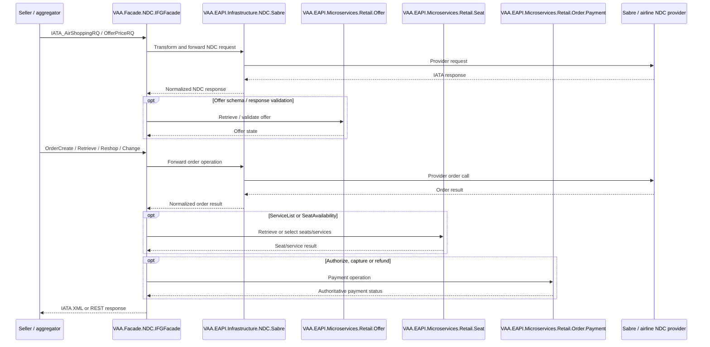

# VAA EAPI NDC — All Backend Scenarios

**Status:** Implemented

> **Minimum review:** Read the flow name and description, **Why this flow exists**, **Sequence (detailed)**, and **Open points to finalize**. These sections establish the purpose, intended interactions, and outstanding questions; review the remaining sections as relevant to your role.

## Why this flow exists

<a id="purpose"></a>

NDC is included because it was explicitly requested, but this project is not a GraphQL suite. It automates IATA NDC XML messages plus Offer, Seats and Order Payment REST microservices.

## Sequence (detailed)

<a id="service-level-sequence"></a>



## Open points to finalize

- None currently recorded; add explicit blockers here before moving this diagram back to Ready or InProgress.

## Agent delivery constraints

- Target solution/project path: Use the smallest owning solution or project implied by the `Harness Sensor`, integration points, and documented component ownership.
- New implementation path, when needed: Prefer the owning project paths already named in this diagram; do not create new services or broaden ownership without recording a blocker.
- New test path, when needed: `VAA.EAPI.Automation/VAA.EAPI.Automation.NDC/Helpers/NDCTestCases.cs`
- Contract source files to read: Existing files referenced by this diagram, the named GraphQL operations, HTTP endpoints, message/event names, request payloads, and nearest tests.
- Endpoint/event/query/command names: Use only the operation, route, event, command, or scenario names documented in this diagram unless a compile/test failure proves a rename.
- Configuration and secret handling: Use existing configuration keys, environment variables, and secret references only; never commit real secrets, tokens, PII, payment data, or passenger documents.
- Harness command: Run the scoped verification selected by Promotion verification; for Fast, use scripts/verify.ps1 -SolutionPath <owning-solution> -SkipBuild or the nearest project equivalent.

## Current implementation alignment

NDC traffic is XML/REST rather than GraphQL. The repository isolates the seller protocol behind the NDC IFG facade and Sabre infrastructure adapter, while offer, seat and payment capabilities remain independently owned microservices.

## Message and API catalogue

| Area | Main contracts |
|---|---|
| Shopping | `IATA_AirShoppingRQ/RS`, direct/departure-time/published/private fares |
| Pricing | `IATA_OfferPriceRQ/RS`, offer TTL and taxonomy validation |
| Order creation | OrderCreate, hold booking, ticketed booking, GST/contact/DOB/gender/email |
| Order access | OrderRetrieve, OrderList and OrderHistory |
| Servicing | ServiceList and SeatAvailability, prime/post-sale and GDS scenarios |
| Reshop | change/cancel reshop, error and response validation |
| Order change | seats, SSRs, confirm held, amend, split PNR, name correction, even/uneven exchange |
| Payments | authorize, capture and refund REST calls; cash/EasyPay cases |
| Supporting MS | Offer and Seats schema/response validation |

## Example XML request and response excerpt

```xml
<IATA_AirShoppingRQ xmlns="http://www.iata.org/IATA/2015/EASD/00/IATA_OffersAndOrdersMessage">
  <Request>
    <FlightRequest>
      <OriginDestCriteria>
        <OriginDepCriteria><IATA_LocationCode>LHR</IATA_LocationCode></OriginDepCriteria>
        <DestArrivalCriteria><IATA_LocationCode>JFK</IATA_LocationCode></DestArrivalCriteria>
      </OriginDestCriteria>
    </FlightRequest>
  </Request>
</IATA_AirShoppingRQ>
```

```xml
<IATA_AirShoppingRS xmlns="http://www.iata.org/IATA/2015/EASD/00/IATA_OffersAndOrdersMessage">
  <Response><OffersGroup><CarrierOffers><Offer OfferID="&lt;opaque-offer-id&gt;"/></CarrierOffers></OffersGroup></Response>
</IATA_AirShoppingRS>
```

## Example payment REST payload

```json
{ "orderId": "<opaque-order-id>", "amount": { "value": 125.50, "currency": "GBP" }, "paymentMethodToken": "<opaque-token>" }
```

```json
{ "paymentId": "<opaque-payment-id>", "status": "AUTHORIZED" }
```

## Automated scenario inventory

- AirShopping regressions, errors, direct flights, departure times, taxonomy, TTL and fare types;
- OfferPrice regression, request/response and invalid-offer validation;
- OrderCreate request/response, hold, ticketed, currency, contacts, DOB/gender, GST and error cases;
- OrderQuote normal/hold/error cases;
- OrderRetrieve identity, DOB/gender, GDS and production sanity;
- ServiceList and SeatAvailability prime/post-sale/GDS/error scenarios;
- OrderReshop change/cancel and error validation;
- OrderChange cancellation, seats, SSRs, held booking, name correction, split PNR and exchanges;
- OrderList, OrderHistory and post-sale services;
- Offer, Seats and Order Payment microservices;
- end-to-end sanity and currency validation;
- XSD conformance against the checked-in IATA schemas.

## Backlog epics

Shopping; pricing; order creation/hold; retrieval/history; seats/services; reshop; amend/cancel/exchange; payments/refunds; schema/version compatibility; GDS interoperability; security and idempotency.

## Automation sources

- Tests: `VAA.EAPI.Automation.NDC/Tests/`
- XML/JSON bodies: `VAA.EAPI.Automation.NDC/Requests/Body/`
- Models/builders: `VAA.EAPI.Automation.NDC/Requests/Models/`, `Requests/XmlRequestBuilder.cs`
- IATA schemas: `VAA.EAPI.Automation.NDC/Tests/Xsds/IATA/`

## Failure paths

- Reject malformed or schema-invalid IATA messages before provider submission.
- Map expired or unknown offers, unavailable seats/services, and invalid order state safely.
- Keep order changes, cancellation, exchange, authorization, capture, and refund idempotent.
- Preserve provider errors for diagnostics without leaking payment, passenger, or credential data.

## Expected harness

The NDC tests, builders, payloads, and checked-in IATA schemas listed under Automation sources are the current sensors. Coverage should validate XSD conformance, provider interoperability, order lifecycle branches, supporting microservice contracts, payment outcomes, and controlled error responses.

## Agent Loop Goal

| Field | Value |
| --- | --- |
| Goal | Maintain the imported scenario catalogue as an implemented sequence-diagram reference. |
| Status | `Complete` |
| Owner | `VAA.EAPI.NDC and Retail NDC maintainers` |
| Review cadence | Quarterly and when scenario coverage changes |
| Last reviewed | 2026-07-28 |
| Harness Sensor | `VAA.EAPI.Automation/VAA.EAPI.Automation.NDC/Helpers/NDCTestCases.cs` |
| Promotion verification | Fast |
| Acceptance evidence | Imported scenarios align to existing automation coverage and are tracked by the sequence-diagram index. |
| Done when | Scenario catalogue remains aligned with implemented behavior and referenced harness coverage. |

## Associated delivery pull requests

The draft coordinator PR and its row are created when this goal enters `InProgress`. Every production and QA agent is then recorded here on its own branch and PR. The coordinator PR remains draft until every current child PR is merged, integrated verification passes, and open questions are resolved.

The workflow populates this table for delivery surfaces hosted in other GitHub repositories.

| Surface | Repository | Base branch | Head branch | PR | State | Merged at UTC |
| --- | --- | --- | --- | --- | --- | --- |

## Agent Loop Closure Evidence

Record final closure evidence here. Existing verification and delivery records remain in their respective sections.
