# VAA EAPI Orchestration Check-in Notification Flow

This flow notifies customers when online check-in has opened for a flight.

It follows the current implementation in `VAA.EAPI.Orchestration.Notifications`:
- `Program.cs` registers a delayed dispatcher for `Orches.Notif.CheckinOpenRequest`.
- Existing OCI Azure Function timer trigger (`CheckInOpeningTimerFunction`) starts the workflow.
- Flights are retrieved from Flight Operations for the configured check-in opening window.
- A delayed check-in-open message is scheduled for 24 hours before flight departure.
- The delayed event is converted into a Retail Order Data request.
- Retail Order Data returns matching flight order data for bookings on the flight.
- Orchestration builds a CRM Notification request and publishes it for Airship delivery.

> **Minimum review:** Read the flow name and description, **Why this flow exists**, **Sequence (detailed)**, and **Open points to finalize**. These sections establish the purpose, intended interactions, and outstanding questions; review the remaining sections as relevant to your role.

## Why this flow exists
Customers should receive the check-in notification only when both conditions are true:
1. Online check-in has opened for the flight, which is 24 hours before scheduled departure.
2. Flight order data exists for customers booked on the flight.

## Sequence (detailed)

```mermaid
sequenceDiagram
    box "Startup"
    participant Startup as Program.cs / DI Startup
    participant CheckinDispatcher as DelayedDispatcherService for FlightDetail<br/>(Orches.Notif.CheckinOpenRequest)
    end
    box "Orchestration"
    participant OciTimer as CheckInOpeningTimerFunction<br/>(existing OCI timer)
    participant CheckInService as CheckInOpeningService
    participant CheckinOpenSubscriber as CheckinOpenSubscriber
    participant FlightDataHandler as FlightDataRequestEventCommandHandler
    participant FlightOrderSubscriber as FlightOrderDataSubscriber
    participant FlightOrderHandler as FlightOrderDataEventCommandHandler
    end
    box "Microservices"
    participant FlightsMS as VAA.EAPI.Microservices.FlightOperations
    participant ReferenceMS as VAA.EAPI.Microservices.Retail.Reference
    participant OrderDataMS as VAA.EAPI.Microservices.Retail.Order.Data
    participant CrmNotifications as VAA.EAPI.Microservices.CRM.Notification
    end
    box "Messaging and Persistence"
    participant ServiceBus as Service Bus Topic<br/>servicenotifications
    participant EventStore as Event Store
    participant OrderStore as Order Data Stores
    end
    box "External Services"
    participant AimsWebServices as AIMS Web Services
    participant Airship as Airship
    end

    Startup ->> CheckinDispatcher: Register delayed dispatcher<br/>CloudEventSubject/Type = Orches.Notif.CheckinOpenRequest
    Startup ->> CheckInService: Inject dispatcher and IHttpConnector
    OciTimer ->> CheckInService: Run on Notifications:CheckInOpeningTimerSchedule
    Note over CheckInService: Build FlightScheduleRequest from configured offsets
    CheckInService ->> FlightsMS: POST Notifications:FlightMs:ScheduleUri<br/>with FlightOpsKey header
    FlightsMS ->> AimsWebServices: Retrieve active flights for requested window
    AimsWebServices -->> FlightsMS: Return flight schedule data
    FlightsMS -->> CheckInService: Return FlightDetail collection
    CheckInService ->> CheckInService: Keep flights where departure - 24h<br/>falls in the current timer window

    loop Per candidate flight
        CheckInService ->> CheckinDispatcher: Schedule FlightDetail until check-in opens<br/>(24 hours before departure)
        CheckinDispatcher ->> EventStore: Insert Orches.Notif.CheckinOpenRequest
        CheckinDispatcher ->> ServiceBus: Publish delayed Orches.Notif.CheckinOpenRequest
    end

    Note over ServiceBus,CheckinOpenSubscriber: Delayed event becomes due at check-in opening time
    ServiceBus -->> CheckinOpenSubscriber: CheckinOpen subscription receives event
    CheckinOpenSubscriber ->> FlightDataHandler: Handle delayed FlightDetail cloud event
    FlightDataHandler ->> ReferenceMS: GET /airportdetail?airportCodes={departure},{arrival}
    ReferenceMS -->> FlightDataHandler: Airport time zone data
    FlightDataHandler ->> FlightDataHandler: Map FlightDetail to FlightOrderDataRequest<br/>and set scheduled local departure time
    FlightDataHandler ->> EventStore: Insert Retail.Order.data.FlightOrderDataRequest
    FlightDataHandler ->> ServiceBus: Publish Retail.Order.data.FlightOrderDataRequest

    ServiceBus -->> OrderDataMS: FlightOrderDataRequest subscription receives request
    OrderDataMS ->> OrderStore: Query flight-order associations by local date and flight number

    alt Matching orders found
        OrderDataMS ->> OrderStore: Read order documents in configured batches
        OrderStore -->> OrderDataMS: Return order documents
        OrderDataMS ->> OrderDataMS: Map order documents to flight notification data
        OrderDataMS ->> EventStore: Insert Orches.Notif.FlightOrderDataResponse
        OrderDataMS ->> ServiceBus: Publish Orches.Notif.FlightOrderDataResponse

        ServiceBus -->> FlightOrderSubscriber: FlightOrderData subscription receives response
        FlightOrderSubscriber ->> FlightOrderHandler: Handle compressed flight order data
        FlightOrderHandler ->> ReferenceMS: GET /airportdetail?airportCodes={departure},{arrival}
        ReferenceMS -->> FlightOrderHandler: Departure and arrival city data
        FlightOrderHandler ->> FlightOrderHandler: Build NotificationRequest<br/>from CheckInOpenedAlertMessage and CheckInOpenedContent
        FlightOrderHandler ->> EventStore: Insert Crm.Notif.FlightOrderNotifRequest
        FlightOrderHandler ->> ServiceBus: Publish Crm.Notif.FlightOrderNotifRequest

        ServiceBus -->> CrmNotifications: FlightOrderNotif subscription receives request
        CrmNotifications ->> CrmNotifications: Build Airship request from PNRs,<br/>flight number, message, and deep link
        CrmNotifications ->> Airship: POST AirshipApiUri with bearer token
        Airship -->> CrmNotifications: Delivery response
    else No matching orders
        OrderDataMS ->> OrderDataMS: Log no orders found and stop
    end
```

## Open points to finalize
- Confirm Service Bus subscription filters route `Retail.Order.data.FlightOrderDataRequest`, `Orches.Notif.FlightOrderDataResponse`, and `Crm.Notif.FlightOrderNotifRequest` to the expected subscribers.
- Confirm whether the implemented `CheckinCustProfileDataSubscriber` path remains part of the desired production flow or is legacy/alternate behavior.
- Confirm the environment-specific `CheckInOpenedAlertMessage` and `CheckInOpenedContent` values for each deployment stage.

## Agent delivery constraints

- Target solution/project path: Use the smallest owning solution or project implied by the `Harness Sensor`, integration points, and documented component ownership.
- New implementation path, when needed: Prefer the owning project paths already named in this diagram; do not create new services or broaden ownership without recording a blocker.
- New test path, when needed: `VAA.EAPI.Orchastration/VAA.EAPI.Orchestration.Notifications.Tests/CheckInNotificationBehaviorTests.cs`
- Contract source files to read: Existing files referenced by this diagram, the named GraphQL operations, HTTP endpoints, message/event names, request payloads, and nearest tests.
- Endpoint/event/query/command names: Use only the operation, route, event, command, or scenario names documented in this diagram unless a compile/test failure proves a rename.
- Configuration and secret handling: Use existing configuration keys, environment variables, and secret references only; never commit real secrets, tokens, PII, payment data, or passenger documents.
- Harness command: Run the scoped verification selected by Promotion verification; for Fast, use scripts/verify.ps1 -SolutionPath <owning-solution> -SkipBuild or the nearest project equivalent.

## High-level behavior
1. Startup registers `IDelayedDispatcherService<FlightDetail>` for `Orches.Notif.CheckinOpenRequest`.
2. `CheckInOpeningTimerFunction` runs on `Notifications:CheckInOpeningTimerSchedule` and calls `ICheckInOpeningService.SynchronizeAsync()`.
3. `CheckInOpeningService` builds a `FlightScheduleRequest` using `Notifications:CheckInOpeningService:FromOffset` and `Notifications:CheckInOpeningService:ToOffset`.
4. Orchestration calls `Notifications:FlightMs:ScheduleUri` with `FlightOpsKey` and filters flights whose check-in opening time falls inside the current timer window.
5. For each candidate flight, orchestration schedules a delayed check-in event for 24 hours before departure.
6. `CheckinOpenSubscriber` receives the delayed `Orches.Notif.CheckinOpenRequest` event.
7. `FlightDataRequestEventCommandHandler` maps the flight into `Retail.Order.data.FlightOrderDataRequest`, enriches local departure time from Reference MS airport time zone data, stores the event, and publishes it.
8. Retail Order Data consumes the request, finds matching flight orders, reads order documents, stores the response event, and publishes `Orches.Notif.FlightOrderDataResponse`.
9. `FlightOrderDataSubscriber` receives the order-data response.
10. `FlightOrderDataEventCommandHandler` builds `Crm.Notif.FlightOrderNotifRequest` using `CheckInOpenedAlertMessage` and `CheckInOpenedContent`, stores the event, and publishes it.
11. CRM Notification consumes the notification request and sends the Airship request.

## Integration points

| Component | Responsibility |
| --- | --- |
| `Program.cs` / DI startup | Registers delayed dispatcher, handlers, event-store handlers, Service Bus, Redis, and `IHttpConnector` |
| `CheckInOpeningTimerFunction` | Timer trigger that starts check-in opening synchronization |
| `CheckInOpeningService` | Retrieves candidate flights, filters by check-in opening window, and schedules delayed messages |
| `DelayedDispatcherService<FlightDetail>` | Schedules `Orches.Notif.CheckinOpenRequest` messages for the check-in opening time |
| `VAA.EAPI.Microservices.FlightOperations` | Returns flight schedule data from the configured schedule endpoint |
| `VAA.EAPI.Microservices.Retail.Reference` | Provides airport time zone and city-name data via `/airportdetail` |
| `VAA.EAPI.Microservices.Retail.Order.Data` | Resolves flight-order associations and returns flight order data for notification |
| Order data stores | Hold flight association and order documents used by Retail Order Data |
| Service Bus (`servicenotifications`) | Carries delayed check-in, flight-order-data, and notification cloud events |
| Event Store | Stores outbound cloud events before republishing to Service Bus |
| `VAA.EAPI.Microservices.CRM.Notification` | Accepts `Crm.Notif.FlightOrderNotifRequest` and maps it to Airship |
| Airship | Final push notification delivery channel |

## Key non-functional considerations
- **Idempotency**: delayed and republished events should be safe to replay.
- **Correlation**: Service Bus subscribers map diagnostics, `correlationId`, `operationId`, `sessionId`, and channel values from the incoming cloud event.
- **Retry behavior**: the timer uses `[FixedDelayRetry(5, "00:00:10")]`; transient downstream failures should be retried by the relevant trigger or infrastructure.
- **No-op path**: if no candidate flights or matching orders are found, the flow completes without publishing a customer notification.
- **Event-store rollback**: handlers attempt to delete the event-store entry when a downstream publish path fails.

## Failure paths to capture in implementation
- Flight list retrieval failure from Flight Operations or AIMS.
- Reference MS lookup failure for airport time zone or city names.
- Service Bus delayed message scheduling or publishing failure.
- Retail Order Data failure while querying flight associations or order documents.
- CRM Notification or Airship API failure.

Expected behavior:
- Log with correlation context.
- Retry transient failures where trigger or infrastructure retry is available.
- Roll back event-store entries when a handler fails after creating an outbound event.
- Avoid duplicate customer notifications on replay.

## Expected harness

- $harnessSensor
- Keep this sensor passing, or update it with the nearest executable coverage whenever the documented flow changes.

## Agent Loop Goal

| Field | Value |
| --- | --- |
| Goal | Keep the check-in notification workflow accurate for implementation and validation work. |
| Status | `Complete` |
| Owner | `VAA.EAPI.Orchestration.Notifications` maintainers |
| Review cadence | Monthly and on any behavior, contract, or dependency change |
| Last reviewed | 2026-07-06 |
| Harness Sensor | `VAA.EAPI.Orchastration/VAA.EAPI.Orchestration.Notifications.Tests/CheckInNotificationBehaviorTests.cs` |
| Promotion verification | Fast |

| Acceptance evidence | Referenced harness sensor passes and the sequence diagram remains aligned with implemented behavior. |
| Done when | Diagram flow and harness coverage remain aligned with production behavior. |

## Associated delivery pull requests

The draft coordinator PR and its row are created when this goal enters `InProgress`. Every production and QA agent is then recorded here on its own branch and PR. The coordinator PR remains draft until every current child PR is merged, integrated verification passes, and open questions are resolved.

The workflow populates this table for delivery surfaces hosted in other GitHub repositories.

| Surface | Repository | Base branch | Head branch | PR | State | Merged at UTC |
| --- | --- | --- | --- | --- | --- | --- |

## Agent Loop Closure Evidence

Record final closure evidence here. Existing verification and delivery records remain in their respective sections.
