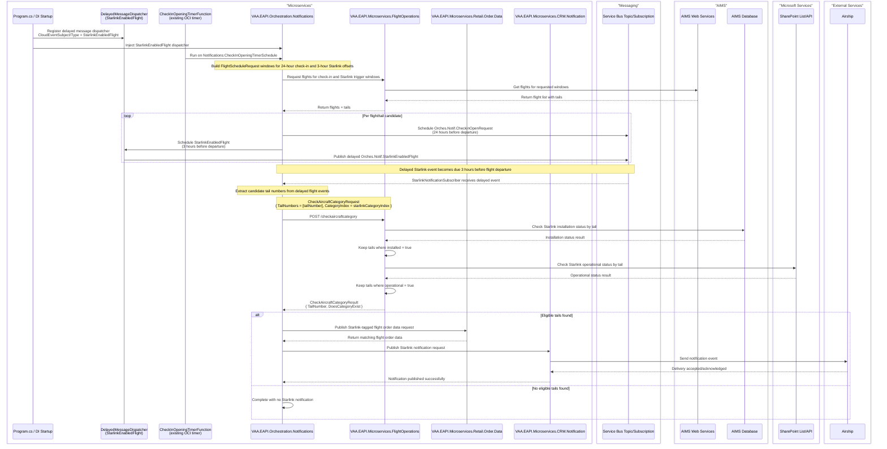

# VAA EAPI Orchestration Notification Starlink Flow

This flow notifies customers when a flight tail becomes eligible for Starlink service.

It follows the existing orchestration pattern used in `VAA.EAPI.Orchestration.Notifications`:
- Existing OCI Azure Function timer trigger (`CheckInOpeningTimerFunction`) starts the workflow.
- Flights are retrieved from Flight Operations.
- A dedicated delayed message dispatcher is registered for `StarlinkEnabledFlight`.
- A separate delayed Starlink message is scheduled 3 hours before departure.
- Starlink eligibility is evaluated by a dedicated Starlink Service Bus listener.
- CRM Notification publishes to Airship after the Starlink listener confirms the tail is eligible.

> **Minimum review:** Read the flow name and description, **Why this flow exists**, **Sequence (detailed)**, and **Open points to finalize**. These sections establish the purpose, intended interactions, and outstanding questions; review the remaining sections as relevant to your role.

## Why this flow exists
Customers should only receive Starlink notifications when both conditions are true for the aircraft tail:
1. Starlink is **installed** (source: AIMS DB).
2. Starlink is **operational** (source: SharePoint operational list).

## Sequence (detailed)

## Open points to finalize
- Confirm the Flight Operations aircraft category endpoint URI behind `Notifications:FlightMs:CheckAircraftCategoryUri`.
- Notification audience rules (all customers vs filtered segments).
- Data freshness SLA for SharePoint operational status.

## Agent delivery constraints

- Target solution/project path: Use the smallest owning solution or project implied by the `Harness Sensor`, integration points, and documented component ownership.
- New implementation path, when needed: Prefer the owning project paths already named in this diagram; do not create new services or broaden ownership without recording a blocker.
- New test path, when needed: `VAA.EAPI.Orchastration/VAA.EAPI.Orchestration.Notifications.Tests/NotificationEventContractTests.cs`
- Contract source files to read: Existing files referenced by this diagram, the named GraphQL operations, HTTP endpoints, message/event names, request payloads, and nearest tests.
- Endpoint/event/query/command names: Use only the operation, route, event, command, or scenario names documented in this diagram unless a compile/test failure proves a rename.
- Configuration and secret handling: Use existing configuration keys, environment variables, and secret references only; never commit real secrets, tokens, PII, payment data, or passenger documents.
- Harness command: Run the scoped verification selected by Promotion verification; for Fast, use scripts/verify.ps1 -SolutionPath <owning-solution> -SkipBuild or the nearest project equivalent.

## High-level behavior
1. `CheckInOpeningTimerFunction` runs on `Notifications:CheckInOpeningTimerSchedule` and fetches flights/tails for the OCI window.
2. Orchestration schedules the existing delayed OCI/check-in opening event per flight at the 24-hour check-in offset.
3. Startup registers a new delayed message dispatcher for the `StarlinkEnabledFlight` cloud event.
4. Orchestration also schedules a separate delayed Starlink event per flight 3 hours before flight departure.
5. The delayed Starlink event triggers Starlink eligibility evaluation using the delayed flight tail.
6. If the Flight Operations `/checkaircraftcategory` response marks the tail/category as eligible, orchestration publishes a Starlink-tagged flight order data request.
7. Retail Order Data returns matching booking data while preserving the Starlink notification type.
8. Orchestration publishes the Starlink CRM Notification request.
9. CRM Notification sends the notification via Airship.

## Integration points

| Component | Responsibility |
| --- | --- |
| `CheckInOpeningTimerFunction` | Existing OCI timer trigger that starts the orchestration schedule flow |
| `DelayedMessageDispatcher` for `StarlinkEnabledFlight` | Schedules Starlink eligibility messages to become available 3 hours before departure |
| `VAA.EAPI.Orchestration.Notifications` | Coordinates scheduling and eligibility-triggered notification |
| `VAA.EAPI.Microservices.FlightOperations` | Returns flight/tail data and evaluates Starlink eligibility inputs from `CheckAircraftCategoryRequest` |
| `VAA.EAPI.Microservices.Retail.Order.Data` | Resolves eligible Starlink flight bookings before the CRM notification request is built |
| AIMS Web Services | Provides flight schedule data |
| AIMS Database | Provides Starlink installation status by tail |
| SharePoint | Provides Starlink operational status by tail |
| Service Bus (`servicenotifications` pattern) | Separate delayed check-in and Starlink subscriptions |
| `VAA.EAPI.Microservices.CRM.Notification` | Accepts notification request and sends to Airship |
| Airship | Final notification delivery channel |

## Key non-functional considerations
- **Idempotency**: delayed messages should be safe to reprocess.
- **Correlation**: propagate `correlationId`, `operationId`, and `sessionId` through cloud events.
- **Retry behavior**: transient dependency failures should retry; poison messages should be dead-lettered.
- **No-op path**: if no eligible tails are found, workflow completes without publishing notification.

## Failure paths to capture in implementation
- Flight list retrieval failure (AIMS Web Services unavailable).
- Eligibility source failure (AIMS DB or SharePoint unavailable).
- Service Bus delayed message processing failure.
- CRM Notification or Airship API failure.

Expected behavior:
- Log with correlation context.
- Retry transient failures.
- Dead-letter unrecoverable messages.
- Avoid duplicate customer notifications on replay.

## Expected harness

- $harnessSensor
- Keep this sensor passing, or update it with the nearest executable coverage whenever the documented flow changes.

## Agent Loop Goal

| Field | Value |
| --- | --- |
| Goal | Define the implementation target for the Starlink eligibility notification workflow. |
| Status | `Complete` |
| Owner | `VAA.EAPI.Orchestration.Notifications` maintainers |
| Review cadence | Monthly and on any behavior, contract, or dependency change |
| Last reviewed | 2026-07-06 |
| Harness Sensor | `VAA.EAPI.Orchastration/VAA.EAPI.Orchestration.Notifications.Tests/NotificationEventContractTests.cs` |
| Promotion verification | Fast |

| Acceptance evidence | Referenced harness sensor passes and the sequence diagram remains aligned with implemented behavior. |
| Done when | Eligibility, notification flow, and harness coverage are implemented and validated. |

## Associated delivery pull requests

The draft coordinator PR and its row are created when this goal enters `InProgress`. Every production and QA agent is then recorded here on its own branch and PR. The coordinator PR remains draft until every current child PR is merged, integrated verification passes, and open questions are resolved.

The workflow populates this table for delivery surfaces hosted in other GitHub repositories.

| Surface | Repository | Base branch | Head branch | PR | State | Merged at UTC |
| --- | --- | --- | --- | --- | --- | --- |

## Agent Loop Closure Evidence

Record final closure evidence here. Existing verification and delivery records remain in their respective sections.
