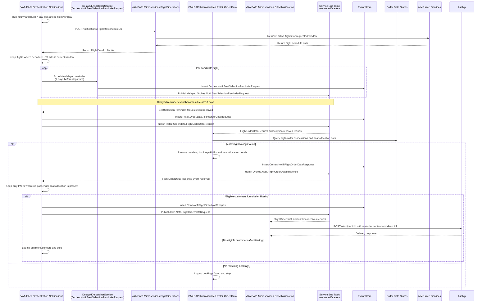

# VAA EAPI Orchestration Seat Selection Reminder Notification Flow

This flow notifies customers 7 days before departure when no seat is allocated to any passenger in the PNR.

It follows the orchestration pattern used in `VAA.EAPI.Orchestration.Notifications`:
- Startup registers a delayed dispatcher for a seat-selection reminder event.
- A timer-triggered orchestration job runs every hour and retrieves upcoming flights in the 7-day look-ahead window.
- A delayed reminder message is scheduled for each candidate flight at 7 days before departure.
- The delayed event triggers a `Retail.Order.data.FlightOrderDataRequest`.
- Retail Order Data returns booking/PNR data with seat allocation details.
- Auto seat assignment is not considered in this flow because it occurs in the check-in window (24 hours before departure), while this reminder runs at T-7 days.
- Orchestration builds and publishes a CRM Notification request for only eligible customers.

> **Minimum review:** Read the flow name and description, **Why this flow exists**, **Sequence (detailed)**, and **Open points to finalize**. These sections establish the purpose, intended interactions, and outstanding questions; review the remaining sections as relevant to your role.

## Why this flow exists
Customers should receive a seat-selection reminder only when all conditions are true:
1. Flight departure is 7 days away.
2. The PNR has no seat allocated to any passenger.

## Sequence (detailed)

## Open points to finalize
- None.

## Agent delivery constraints

- Target solution/project path: Use the smallest owning solution or project implied by the `Harness Sensor`, integration points, and documented component ownership.
- New implementation path, when needed: Prefer the owning project paths already named in this diagram; do not create new services or broaden ownership without recording a blocker.
- New test path, when needed: `VAA.EAPI.Orchastration/VAA.EAPI.Orchestration.Notifications.Tests/FlightDataRequestEventCommandHandlerTests.cs`
- Contract source files to read: Existing files referenced by this diagram, the named GraphQL operations, HTTP endpoints, message/event names, request payloads, and nearest tests.
- Endpoint/event/query/command names: Use only the operation, route, event, command, or scenario names documented in this diagram unless a compile/test failure proves a rename.
- Configuration and secret handling: Use existing configuration keys, environment variables, and secret references only; never commit real secrets, tokens, PII, payment data, or passenger documents.
- Harness command: Run the scoped verification selected by Promotion verification; for Fast, use scripts/verify.ps1 -SolutionPath <owning-solution> -SkipBuild or the nearest project equivalent.

## High-level behavior
1. Startup registers `IDelayedDispatcherService<FlightDetail>` for `Orches.Notif.SeatSelectionReminderRequest`.
2. `SeatSelectionReminderTimerFunction` runs on a configured schedule and calls `ISeatSelectionReminderService.SynchronizeAsync()`.
3. The timer runs every hour and orchestration requests flights in the configured 7-day look-ahead window.
4. For each candidate flight, orchestration uses the delayed dispatcher to schedule a seat-selection reminder event for 7 days before departure.
5. Orchestration consumes the delayed event and publishes `Retail.Order.data.FlightOrderDataRequest` for the flight.
6. Retail Order Data resolves matching bookings/PNRs and seat allocation details.
7. Orchestration checks seat allocation and keeps only PNRs where no passenger has a seat allocated.
8. Orchestration publishes `Crm.Notif.FlightOrderNotifRequest` with seat-selection reminder message content.
9. CRM Notification sends the push notification to Airship.

## Integration points

| Component | Responsibility |
| --- | --- |
| `Program.cs` / DI startup | Registers delayed dispatcher, handlers, Service Bus, and connector services |
| `SeatSelectionReminderTimerFunction` | Timer trigger that starts 7-day seat-reminder synchronization |
| `SeatSelectionReminderService` | Retrieves candidate flights and schedules delayed 7-day reminders |
| `DelayedDispatcherService<FlightDetail>` | Schedules delayed `Orches.Notif.SeatSelectionReminderRequest` messages |
| `VAA.EAPI.Microservices.FlightOperations` | Returns flight schedule data used to identify reminder candidates |
| `VAA.EAPI.Microservices.Retail.Order.Data` | Returns booking/PNR and seat-allocation data used for seat-selection reminder eligibility |
| Service Bus (`servicenotifications`) | Carries delayed reminder, order-data, and CRM notification events |
| Event Store | Stores outbound events before republishing to Service Bus |
| `VAA.EAPI.Microservices.CRM.Notification` | Accepts notification requests and maps them to Airship |
| Airship | Final push notification delivery channel |

## Key non-functional considerations
- **Idempotency**: delayed and republished events must be safe to replay.
- **Correlation**: keep `correlationId`, `operationId`, and `sessionId` across all events.
- **Retry behavior**: transient failures should retry via trigger/infrastructure policies.
- **No-op path**: if no eligible customers exist, the flow completes without customer notification.
- **Deduplication**: avoid sending duplicate seat reminders to the same booking/passenger for the same flight.
- **Timing boundary**: auto seat assignment starts in the check-in window (24 hours before departure), outside this T-7 reminder flow.

## Expected harness
- `VAA.EAPI.Orchastration/VAA.EAPI.Orchestration.Notifications.Tests/FlightDataRequestEventCommandHandlerTests.cs`
- Coverage validates delayed seat-selection reminder handling, `Retail.Order.data.FlightOrderDataRequest` publication, and notification eligibility behavior for bookings without passenger seat allocation.

## Failure paths to capture in implementation
- Flight list retrieval failure from Flight Operations or AIMS.
- Service Bus delayed message scheduling or publish failure.
- Retail Order Data failure retrieving booking/seat attributes.
- Seat-allocation eligibility rule-evaluation failure.
- CRM Notification or Airship API failure.

Expected behavior:
- Log with correlation context.
- Retry transient failures where trigger or infrastructure retry is available.
- Roll back event-store entries when publish fails after persistence.
- Avoid duplicate reminder notifications on replay.

## Agent Loop Goal

| Field | Value |
| --- | --- |
| Goal | Define the implementation target for the 7-day seat-selection reminder workflow. |
| Status | `Complete` |
| Owner | `VAA.EAPI.Orchestration.Notifications` maintainers |
| Review cadence | Monthly and before behavior changes |
| Last reviewed | 2026-07-29 |
| Harness Sensor | `VAA.EAPI.Orchastration/VAA.EAPI.Orchestration.Notifications.Tests/FlightDataRequestEventCommandHandlerTests.cs` |
| Promotion verification | Fast |

| Acceptance evidence | Referenced harness sensor passes and the sequence diagram remains aligned with implemented behavior. |
| Done when | The workflow remains implemented, verified, and aligned with the referenced harness sensor. |

## Associated delivery pull requests

The draft coordinator PR and its row are created when this goal enters `InProgress`. Every production and QA agent is then recorded here on its own branch and PR. The coordinator PR remains draft until every current child PR is merged, integrated verification passes, and open questions are resolved.

The workflow populates this table for delivery surfaces hosted in other GitHub repositories.

| Surface | Repository | Base branch | Head branch | PR | State | Merged at UTC |
| --- | --- | --- | --- | --- | --- | --- |

## Agent Loop Closure Evidence

Record final closure evidence here. Existing verification and delivery records remain in their respective sections.
