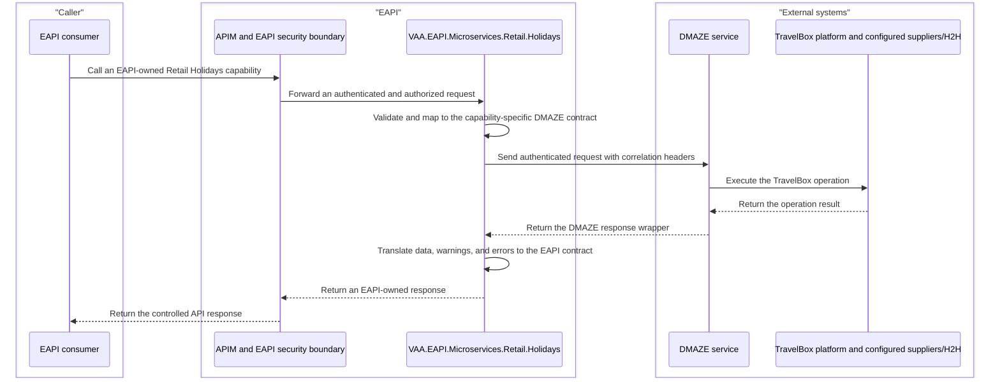

# VAA EAPI Retail Holidays TravelBox DMAZE Flow

- Status: implementation guidance
- Owner: Retail Holidays / EAPI Technical Leads
- Last verified: 2026-07-17
- Owning service: `VAA.EAPI.Microservices.Retail.Holidays`
- Source: [TravelBox APEX (DMAZE) wiki](https://dev.azure.com/virginatlantic/Digital%20Distribution/_wiki/wikis/Digital-Distribution.wiki/32651/TravelBox%E2%84%A2-APEX-(DMAZE))
- Source revision inspected: `a255258907ab2549b0514e94d216645b0be59dfd`

> **Minimum review:** Read the flow name and description, **Why this flow exists**, **Sequence (detailed)**, and **Open points to finalize**. These sections establish the purpose, intended interactions, and outstanding questions; review the remaining sections as relevant to your role.

## Why this flow exists

Expose TravelBox capabilities supplied through DMAZE behind the domain-owned Retail Holidays microservice, using EAPI-owned contracts and integration controls.

## Sequence (detailed)

<a id="sequence"></a>



## Open points to finalize

- None currently recorded; add explicit blockers here before moving this diagram back to Ready or InProgress.

## Agent delivery constraints

- Target solution/project path: Use the smallest owning solution or project implied by the `Harness Sensor`, integration points, and documented component ownership.
- New implementation path, when needed: Prefer the owning project paths already named in this diagram; do not create new services or broaden ownership without recording a blocker.
- New test path, when needed: `VAA.EAPI.Microservices/VAA.EAPI.Microservices.Retail.Holidays.Tests/BookingControllerTests.cs`; `VAA.EAPI.Microservices/VAA.EAPI.Microservices.Retail.Holidays.Tests/RetrieveBookingServiceTests.cs`; `VAA.EAPI.Microservices/VAA.EAPI.Microservices.Retail.Holidays.Tests/RetrieveDocumentServiceTests.cs`
- Contract source files to read: Existing files referenced by this diagram, the named GraphQL operations, HTTP endpoints, message/event names, request payloads, and nearest tests.
- Endpoint/event/query/command names: Use only the operation, route, event, command, or scenario names documented in this diagram unless a compile/test failure proves a rename.
- Configuration and secret handling: Use existing configuration keys, environment variables, and secret references only; never commit real secrets, tokens, PII, payment data, or passenger documents.
- Harness command: Run the scoped verification selected by Promotion verification; for Fast, use scripts/verify.ps1 -SolutionPath <owning-solution> -SkipBuild or the nearest project equivalent.

## Scope and Sources

This document is the EAPI starting context for work that exposes TravelBox capabilities supplied through DMAZE. It records the system boundary, the relevant DMAZE contract conventions, the current repository baseline, and the engineering controls required before a capability is implemented.

The linked DMAZE wiki and the Swagger document exposed by each deployed DMAZE service remain the sources of truth for downstream request and response fields. Do not copy the complete vendor contract into this guide. Recheck both sources when beginning a capability because service contracts and versions can change independently.

## Boundary Decision

TravelBox is a third-party system. EAPI consumers must not call DMAZE directly. TravelBox capabilities must be exposed through a standard, domain-owned EAPI microservice that:

- presents EAPI-owned contracts rather than DMAZE payloads;
- owns validation, authorization, orchestration, error translation, and observability;
- isolates DMAZE authentication, headers, URLs, DTOs, and version changes;
- calls DMAZE through a connector-backed gateway; and
- is published through the normal APIM, deployment, pipeline, health, and support controls.

Coalesce TravelBox capabilities into `VAA.EAPI.Microservices.Retail.Holidays`, which is the TravelBox facade microservice for the Retail Holidays bounded context. The service must remain capability-focused rather than becoming an arbitrary DMAZE proxy. If a proposed capability belongs to a different bounded context or would make Retail Holidays own unrelated product setup, administration, or back-office behaviour, obtain an architecture decision before implementation.

## Current Repository Baseline

`VAA.EAPI.Microservices.Retail.Holidays` is an isolated-worker Azure Functions service targeting the [repository-approved .NET framework](../principles/architecture-principles.md#new-code-standards). It currently integrates with DMAZE Cart and Document services to provide:

- booking retrieval, including list retrieval;
- document and pending-document retrieval; and
- document download-link retrieval, including list retrieval.

The project contains TravelBox-specific infrastructure models and uses `IHttpConnector` plus `IOAuthTokenProvider`. Its sibling test project is `VAA.EAPI.Microservices.Retail.Holidays.Tests`. New DMAZE capabilities should strengthen this existing boundary and incrementally bring touched paths up to current repository standards.

### Existing function and service inventory

These functions and application services form the baseline developers should extend or consolidate:

| Function | Trigger and route | Application service | Current behaviour |
| --- | --- | --- | --- |
| `RetrieveBooking` | `POST /retrieveBooking` | `IRetrieveBookingService.Handle` | Retrieves one DMAZE Cart by booking reference, verifies lead-traveller surname/date of birth, rejects bookings expired by seven days, and maps the response to `TripsDetailsResponse`. |
| `RetrieveBookingList` | `POST /retrieveBookingList` | `IRetrieveBookingService.HandleList` | Retrieves multiple bookings in parallel and returns per-request success or mapped error results. |
| `RetrieveDocumentList` | `POST /retrieveDocumentList` | `IRetrieveDocumentService.Handle` | Retrieves available documents for a booking from DMAZE Document Service. |
| `RetrievePendingDocumentList` | `POST /retrievePendingDocumentList` | `IRetrieveDocumentService.RetrievePendingDocumentList` | Retrieves pending documents for a booking. |
| `RetrieveDocumentDownloadLink` | `GET /retrieveDocumentDownloadLink/{docId}` | `IRetrieveDocumentService.RetrieveDocumentDownloadLink` | Retrieves DMAZE document view information and maps it to an EAPI download-link response. |
| `RetrieveDocumentDownloadLinkList` | `POST /retrieveDocumentDownloadLinkList` | `IRetrieveDocumentService.RetrieveDocumentDownloadLinkList` | Retrieves document links with a maximum concurrency of eight. |
| `AuthorisationTokens` | `POST /authorisationTokens` | `ClaimsController` | Supplies configured `tbx-username` and `tbx-userid` claims for the established token-issuance flow. |
| `Heartbeat` | `GET /heartbeat` | `HealthCheckService` | Returns the registered health-check report. |
| `Warmup` | Azure Functions warmup trigger | `HealthController` | Warms a new Function App instance and records an informational event. |

`RetrieveBookingService` calls `GET {Holidays:RetrieveBookingService:Url}/{bookingReference}` with `expand=all`, the TravelBox user identifier, and `cliId=-1`. `RetrieveDocumentService` calls the configured Document Service for `/documents/{bookingReference}`, `/pending-documents/{bookingReference}`, and `/documents/{documentId}/view-info`.

Both services acquire a token using `IOAuthTokenProvider`, extract the `tbx-userid` claim, and send `Authorization`, `Authorization-Provider`, and `tbx-web-user-id` headers through `IHttpConnector`.

### Existing configuration and errors

| Configuration key | Current purpose |
| --- | --- |
| `Holidays:RetrieveBookingService:Url` | DMAZE Cart service base URL. |
| `Holidays:RetrieveDocumentService:Url` | DMAZE Document service base URL. |
| `Holidays:EntraScope` | Base scope used to acquire the DMAZE access token. |
| `Holidays:AuthorizationProvider` | Value sent in `Authorization-Provider`; defaults to `AZURE`. |
| `Holidays:TbxUsername` | TravelBox username emitted by the token-issuance function. |
| `Holidays:TbxUserId` | TravelBox user identifier emitted by the token-issuance function. |
| `EapiMsClientID` | Platform client identifier appended to the configured Entra scope. |

The checked-in error catalogue currently maps validation/booking conditions to `HOL001`, DMAZE connectivity to `HOL002`, invalid requested parameters to `HOL003`, and uncategorized failures to `HOL000`.

The current implementation is context, not a template where it differs from current standards. Several functions use anonymous Function authorization, triggers pass `CancellationToken.None`, configuration keys are declared inside services, and some failure logs include raw DMAZE response content. New or amended paths must receive explicit security review, propagate cancellation, centralize keys, and avoid logging sensitive downstream payloads.

## DMAZE Capability Map

DMAZE describes a JSON REST API split into these service families:

| Family | Documented capabilities | EAPI boundary consideration |
| --- | --- | --- |
| Product search | Car, hotel, flight, generic, cruise, transfer, tour, insurance, and package search | Prefer capability-focused EAPI search contracts. Search responses may contain inventory from TravelBox contracts or downstream H2H suppliers. |
| Sales and booking | Cart and reservation operations | Treat cart, quote, confirm, and reservation changes as stateful business workflows even though individual HTTP calls are REST operations. |
| Pricing | Markup calculation | Confirm business ownership and prevent vendor pricing structures leaking into public contracts. |
| Pre-sale | Supplier, content, and client data | Confirm whether Retail Holidays owns the use case before extending the service. |
| Product setup | Contract, availability, upgrade, discount, and supplement administration | Administrative capability; requires a separate ownership and authorization review. |
| Back office | Queue, document, and payment operations | Apply heightened authorization, audit, idempotency, and sensitive-data controls. Document retrieval is already partly facaded. |
| Administration | User, permission, configuration, and TravelBox identity operations | Do not expose without explicit security and ownership approval. |
| Utility | Data, loyalty, GDS, postcode verification, and filtering | Route to the bounded context that owns the consumer-facing capability; do not accumulate unrelated utilities in Retail Holidays. |

Search-and-book flows support component products and packages. Documented component types include car, cruise, generic, flight, transfer, tour, hotel, and insurance. Package modes include pre-package, dynamic package, wide search, and elite package. Booking operations also cover repricing, quote conversion, payments, discounts, fees, cancellation, and amendments.

This is a discovery map, not authorization to expose every capability.

## DMAZE Contract Conventions

### Authentication and headers

- DMAZE requires a valid JWT in the `Authorization` header.
- `Authorization-Provider` is optional for the default TravelBox provider and required when an alternative provider is used.
- Credentials, scopes, provider names, client identifiers, and base URLs must come from approved configuration and secret stores.
- Never forward a caller token to DMAZE unless the security design explicitly requires and approves token delegation. Prefer the established service-to-service token flow.

### Response wrapper

DMAZE wraps payloads in a common response containing `data`, `error`, `keyControls`, `links`, `references`, `status`, and `version`.

The documented status values are:

| DMAZE status | Meaning | EAPI handling |
| --- | --- | --- |
| `1` / `SUCCESS` | Operation succeeded | Map the required data into the EAPI response. Do not return the DMAZE wrapper. |
| `0` / `WARNING` | Operation completed with a warning | Define capability-specific semantics. Preserve actionable warnings without treating every warning as success or failure by default. |
| `-1` / `ERROR` | Operation failed | Translate the error to an approved EAPI error code and HTTP status. |

Do not expose `keyControls`, internal references, raw errors, or HATEOAS links unless the EAPI contract has an explicit, reviewed need for equivalent information.

### Tracking and correlation

DMAZE accepts and echoes these HTTP headers:

| DMAZE header | Purpose | EAPI source |
| --- | --- | --- |
| `messageId` | Unique request/message identifier | Generate or map from the current operation/message identifier. |
| `conversationId` | Groups calls in a search-and-book operation | Map from the EAPI operation or conversation context. |
| `sessionId` | Identifies the user session | Map only when a non-sensitive session identifier is available and required. |

Map these through the EAPI `AsyncContext` correlation spine. Include them as structured telemetry fields where safe, but do not log tokens, full payloads, passenger details, payment data, or document contents.

### Versioning and response shaping

- DMAZE service builds use `{major}.{minor}.{patch}` semantic versions and may vary by service.
- Each deployed service exposes Swagger UI at `/docs` and OpenAPI JSON at `/v3/api-docs` according to the DMAZE documentation.
- Search operations are stateless. DMAZE supports `resultLimit`; consumers can use ID lists to partition or externally page searches.
- The optional `expand` query parameter requests additional response nodes and can materially affect payload size and sensitivity.

Pin all implementation and contract tests to the actual target environment contract. Do not assume that the offline wiki, the checked-in legacy Swagger file, and a deployed service are on the same version.

### Wiki-attached OpenAPI specifications

The DMAZE wiki service pages embed Swagger UI and attach point-in-time OpenAPI JSON documents. Attachment paths below are relative to the [TravelBox APEX (DMAZE) wiki](https://dev.azure.com/virginatlantic/Digital%20Distribution/_wiki/wikis/Digital-Distribution.wiki/32651/TravelBox%E2%84%A2-APEX-(DMAZE)) and require the normal Azure DevOps wiki access.

| Family | Wiki page beneath `TravelBox™-APEX-(DMAZE)` | Attached OpenAPI document | Embedded Swagger source |
| --- | --- | --- | --- |
| Product search | `Services/Product-Searches/Car-Search` | `/.attachments/car-search-3baecd3a-9d7b-45f7-9211-2e968c08fb4a.json` | `/swaggers/car-search` |
| Product search | `Services/Product-Searches/Cruise-Search` | `/.attachments/cruise-search-b5270e92-7cb3-4208-b918-5b9389c4ecff.json` | `/swaggers/cruise-search` |
| Product search | `Services/Product-Searches/Flight-Search` | `/.attachments/flight-search-1545e612-9f7c-4086-86d4-f37bea993448.json` | `/swaggers/flight-search` |
| Product search | `Services/Product-Searches/Generic-Search` | `/.attachments/generic-search-42a7466d-12e7-4d09-a372-aa5a93037b8a.json` | `/swaggers/generic-search` |
| Product search | `Services/Product-Searches/Hotel-Search` | `/.attachments/hotel-search-a5993a74-145c-4160-9483-1196da3dcbc0.json` | `/swaggers/hotel-search` |
| Product search | `Services/Product-Searches/Insurance-Search` | `/.attachments/insurance-search-55d7717d-f3a2-4c9d-b633-fc50b8cd1384.json` | `/swaggers/insurance-search` |
| Product search | `Services/Product-Searches/Package-Search` | `/.attachments/package-search-44ea5eac-61dc-4c01-9057-371cbcef7f23.json` | `/swaggers/package-search` |
| Product search | `Services/Product-Searches/Tour-Search` | `/.attachments/tour-search-dbf5e48f-6c93-4761-81d1-974073cff136.json` | `/swaggers/tour-search` |
| Product search | `Services/Product-Searches/Transfer-Search` | `/.attachments/transfer-search-a0886330-c2fb-4fc9-ae06-538460c83687.json` | `/swaggers/transfer-search` |
| Sales and booking | `Services/Sales-&-Booking/Cart-Service` | `/.attachments/cart-service-0b42a612-a4b0-4974-9037-1ff289c930b7.json` | `/swaggers/cart-service` |
| Sales and booking | `Services/Sales-&-Booking/Reservation-Service` | `/.attachments/reservation-service-f24a129d-5c41-4b03-984d-5d29cdb2dec4.json` | `/swaggers/reservation-service` |
| Pre-sale | `Services/Pre%2DSale/Client-Service` | `/.attachments/client-service-5d823562-3f16-407f-81b2-6c6b1f818afb.json` | `/swaggers/client-service` |
| Pre-sale | `Services/Pre%2DSale/Content-Service` | `/.attachments/content-service-3f593552-e513-4cf3-82e5-679c4e2779da.json` | `/swaggers/content-service` |
| Back office | `Services/Back-Office/Document-Service` | `/.attachments/document-service-d82752d7-d20a-4117-91fc-d882abff7ac3.json` | `/swaggers/document-service` |
| Utility | `Services/Utility/Data-Service` | `/.attachments/data-service-8917c39a-3334-4685-aae8-06f05866f344.json` | `/swaggers/data-service` |
| Utility | `Services/Utility/Filter-Service` | `/.attachments/filter-service-6feef693-dee5-439a-946c-2c2b8860fd82.json` | `/swaggers/filter-service` |

Treat attachments as reference snapshots, not automatically current contracts. At the start of a capability, compare the attachment with the target environment's `/v3/api-docs`, record the service version used, and retain only the schemas and operations required by the EAPI contract. Validate an attachment before using code generation: some snapshots contain property names that differ only by casing and can fail parsers that use case-insensitive dictionaries.

## Failure Paths

DMAZE can return transport failures and application errors inside its wrapper. Its error object may include a composite numeric code, a user-oriented message, and internal error strings. Treat all of these as downstream details.

Create a capability-level mapping table before coding:

| Condition | Expected EAPI treatment |
| --- | --- |
| Invalid EAPI input | Reject at the EAPI boundary with the standard validation response; do not call DMAZE. |
| DMAZE authentication or authorization failure | Fail closed; return the approved EAPI authorization/technical error without leaking credential details. |
| DMAZE not found or no results | Map according to capability semantics; distinguish an empty search from a missing booking or resource. |
| DMAZE validation/business error | Translate known stable codes to EAPI-owned errors. Preserve the downstream code only in restricted telemetry if useful. |
| DMAZE warning | Handle explicitly for the capability; never discard a warning that changes price, availability, or booking state. |
| Timeout, dependency outage, malformed response, or unknown code | Return a controlled dependency/technical error with correlation data and emit dependency-failure telemetry. |

Never return DMAZE internal error arrays or exception text to callers.

## Required Implementation Shape

For each new capability:

1. Define an EAPI request, response, and error contract around the consumer use case.
2. Keep the Azure Function trigger transport-only and delegate to a handler.
3. Put validation, sequencing, mapping, and business decisions in the application handler.
4. Define a capability-focused gateway interface, implemented with `IHttpConnector`.
5. Keep DMAZE DTOs under an infrastructure-owned namespace and map explicitly to EAPI domain models.
6. Centralize endpoint, scope, provider, timeout, and feature configuration keys.
7. Add dependency telemetry and a health check appropriate to the specific DMAZE service.
8. Update OpenAPI attributes, APIM import/wiring, deployment templates, pipelines, and the owning service README.

Do not implement a catch-all endpoint that accepts a DMAZE path or arbitrary DMAZE JSON. Do not share DMAZE DTOs with GraphQL, web, or other microservices.

## Security and Data Controls

TravelBox workflows can contain passenger identity, contact, booking, payment, and document data. Before implementation, classify the specific request and response fields and apply the repository security and data principles.

- Store secrets only in Key Vault or another approved managed secret store.
- Minimize fields retrieved with `expand`; request only what the EAPI use case needs.
- Do not cache passenger, payment, booking-document, or identity data without an approved retention and encryption design.
- Use synthetic data in tests, examples, `.mock` files, and documentation.
- Require explicit authorization for booking mutation, payment, cancellation, amendment, document, administration, and identity operations.
- Make retryable writes idempotent. Do not automatically retry an ambiguous cart confirmation, booking, payment, cancellation, or amendment unless the operation has a proven idempotency/reconciliation design.

## Expected Harness

Tests for a new DMAZE-backed capability must include:

- handler validation without a downstream call;
- successful mapping from a checked-in `.mock` DMAZE response;
- DMAZE `WARNING` and `ERROR` wrapper handling relevant to the capability;
- authentication/authorization failure;
- not-found or empty-result semantics;
- timeout, malformed payload, and unknown downstream error handling;
- propagation of cancellation and correlation headers;
- proof that secrets and sensitive payloads are not logged; and
- write idempotency or reconciliation scenarios where applicable.

Use `IHttpConnector`, the shared `HttpClientFactoryFixture`, and `.mock` files. Do not call a live DMAZE environment from unit tests and do not introduce Moq for new or amended tests.

Run verification at project scope:

```pwsh
dotnet test VAA.EAPI.Microservices/VAA.EAPI.Microservices.Retail.Holidays.Tests/VAA.EAPI.Microservices.Retail.Holidays.Tests.csproj -c Release --results-directory TestResults/<run-name> --logger "trx;LogFileName=<run-name>.trx" --collect:"XPlat Code Coverage"
scripts/analyse-test-run-results.ps1 -TrxPath TestResults/<run-name>/<run-name>.trx -SuiteName "Retail Holidays" -EnvironmentName "local"
scripts/verify.ps1 -ProjectPath VAA.EAPI.Microservices/VAA.EAPI.Microservices.Retail.Holidays/VAA.EAPI.Microservices.Retail.Holidays.csproj
```

## Capability Readiness Checklist

Resolve and record the following before implementation starts:

- the user journey and owning bounded context;
- whether an equivalent capability already exists in Retail Holidays and should be extended or consolidated;
- the exact DMAZE service, operation, environment, and deployed OpenAPI version;
- EAPI request/response/error contracts and compatibility requirements;
- authentication provider, token audience/scope, and authorization policy;
- required `keyControls`, tracking headers, query parameters, and `expand` nodes;
- timeout, retry, idempotency, and reconciliation behaviour;
- PII/payment/document classification, retention, cache, and audit rules;
- expected warnings and downstream error-code mappings;
- APIM route, rate limit, consumer allow-list, and ownership;
- support team, SLOs, dashboards, alerting, and dependency health semantics; and
- deployment settings and test-environment data/access.

If any item materially changes the service boundary, sensitive-data handling, or write recovery model, add or update an execution plan and decision record before coding.

## Related Repository Guidance

- [TravelBox DMAZE microservice boundary decision](../decisions/2026-07-17-travelbox-dmaze-microservice-boundary.md)
- [Architecture principles](../principles/architecture-principles.md)
- [Integration principles](../principles/integration-principles.md)
- [Infrastructure principles](../principles/infrastructure-principles.md)
- [Security principles](../principles/security-principles.md)
- [Coding standards](../standards/coding-standards.md)
- [External system facade adapter](../design-patterns/integration-external-system-facade-adapter.md)
- [Connector-based downstream gateway](../design-patterns/integration-connector-based-downstream-gateway.md)
- [Thin trigger to handler](../design-patterns/api-boundary-thin-trigger-to-handler.md)
- [EAPI Function host baseline](../design-patterns/platform-runtime-eapi-function-host-baseline.md)
- [HTTP mocking with MockDelegatingHandler](../design-patterns/testing-and-operations-http-mocking-with-mockdelegatinghandler.md)

## Agent Loop Goal

| Field | Value |
| --- | --- |
| Goal | Document and preserve the Retail Holidays EAPI boundary for TravelBox capabilities supplied through DMAZE. |
| Status | `Complete` |
| Owner | `VAA.EAPI.Microservices.Retail.Holidays` maintainers |
| Review cadence | Monthly and before changes to DMAZE-backed Retail Holidays capabilities, authentication, or mapping behavior |
| Last reviewed | 2026-07-27 |
| Harness Sensor | `VAA.EAPI.Microservices/VAA.EAPI.Microservices.Retail.Holidays.Tests/BookingControllerTests.cs`; `VAA.EAPI.Microservices/VAA.EAPI.Microservices.Retail.Holidays.Tests/RetrieveBookingServiceTests.cs`; `VAA.EAPI.Microservices/VAA.EAPI.Microservices.Retail.Holidays.Tests/RetrieveDocumentServiceTests.cs` |
| Promotion verification | Fast |

| Acceptance evidence | Referenced harness sensor passes and the sequence diagram remains aligned with implemented behavior. |
| Done when | Retail Holidays continues to expose EAPI-owned contracts over DMAZE behavior with executable coverage for booking and document retrieval paths. |

## Associated delivery pull requests

The draft coordinator PR and its row are created when this goal enters `InProgress`. Every production and QA agent is then recorded here on its own branch and PR. The coordinator PR remains draft until every current child PR is merged, integrated verification passes, and open questions are resolved.

The workflow populates this table for delivery surfaces hosted in other GitHub repositories.

| Surface | Repository | Base branch | Head branch | PR | State | Merged at UTC |
| --- | --- | --- | --- | --- | --- | --- |

## Agent Loop Closure Evidence

Record final closure evidence here. Existing verification and delivery records remain in their respective sections.
