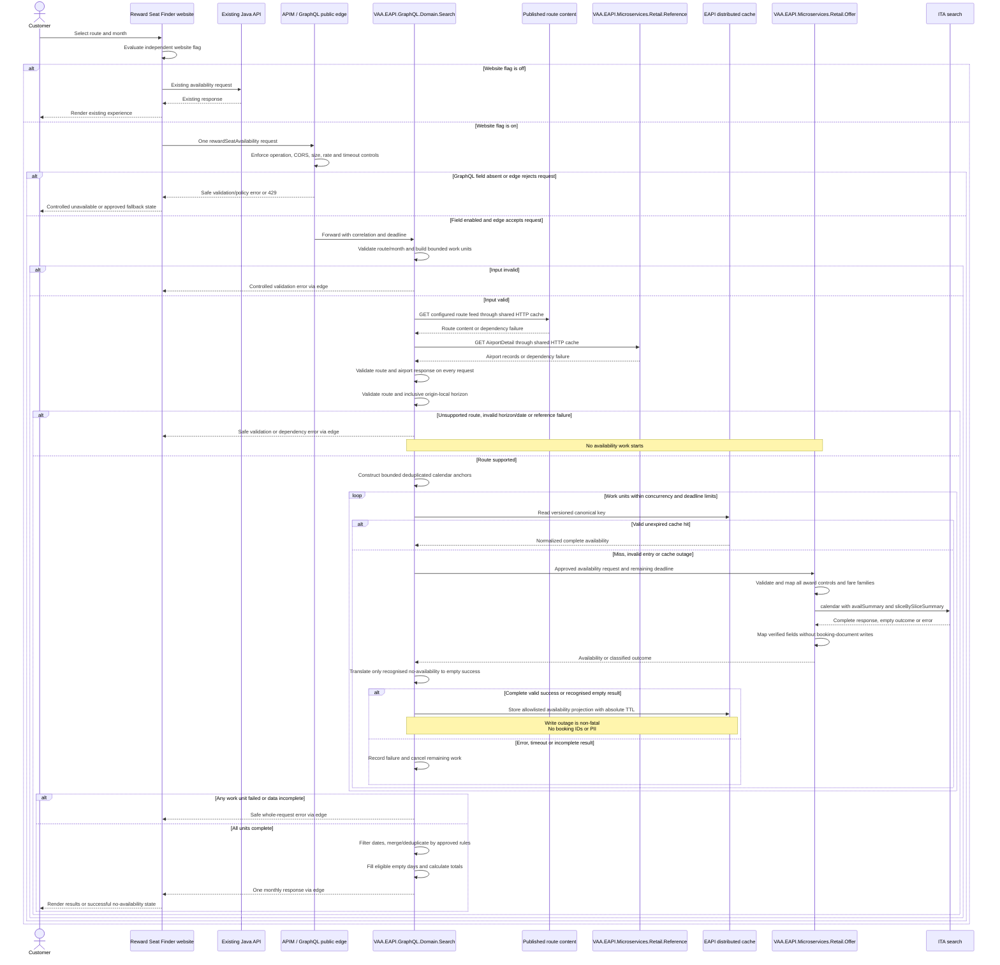

# Reward Seat Finder API Delivery Flow

This backend-only proposal provides a dedicated public Search GraphQL query backed by Retail Offer's ITA search capability for Reward Seat Finder. Flights Digital's website migration is a separate delivery outside this PR and goal.

## Agent Loop Goal

| Field | Value |
| --- | --- |
| Goal | Serve Reward Seat Finder monthly reward availability through EAPI GraphQL by constructing bounded requests for Retail Offer's ITA adapter with an approved availability search contract and preserving the useful shape and semantics of the current website contract. |
| Status | `InProgress` |
| Delivery surface | `Backend` |
| Owner | BE developers for EAPI (`VAA.EAPI.GraphQL.Domain.Search` and `VAA.EAPI.Microservices.Retail.Offer`), with APIM and QA maintainers supporting backend delivery |
| Review cadence | Before implementation and on Reward Seat Finder, Search GraphQL, Retail Offer, ITA search, or public-edge contract changes |
| Last reviewed | 2026-10-06 |
| Harness Sensor | Planned: Retail Offer ITA reward-request/response contract tests, Search GraphQL resolver/schema tests and backend consumer-contract fixtures. |
| Promotion verification | Full |
| Acceptance evidence | Fixture-backed tests prove request validation, complete fare-family mapping, per-date/cabin points, cash/currency, Saver and inventory semantics; cache tests prove hits, expiry and fail-open behaviour; schema tests prove `rewardSeatAvailability` is absent unless `EnableRewardSeatAvailability` is explicitly true; backend contract, APIM, failure, load and observability checks pass; OpenAPI/GraphQL and Bruno examples document the consumer contract. Website changes and traffic cutover are outside acceptance. |
| Status Updated By | `scripts/promote-sequence-goal.ps1` |
| Task/Issue | branch:codex/reward-seat-finder-eapi-1 |
| Transition note | Auto-promoted by sequence goal loop on branch push. |
| Done when | The feature-gated `rewardSeatAvailability` backend query fulfils one request through bounded, non-persisting Retail Offer work units carrying all three confirmed fare families; Search merges and caches normalized availability; cabin points, cash/currency, counts and Saver mapping have fixture-backed verification; backend contract, public-edge, failure, load, observability and configuration rollback checks pass; schema and Bruno examples are ready for consumer integration. Website repository discovery, implementation, release and cutover are not completion gates. No change is made in `VAAD1ST/reward-flight-finder-api`. |

## Why this flow exists

The public Reward Seat Finder currently depends on the Java `reward-flight-finder-api`, whose synchronous `POST /travelplus/reward-seat-checker-api/external/` operation accepts route, month/year, passenger and carrier criteria. The inspected Java contract returns month objects with daily points and cash amount/currency, cabin seat counts and route display names. Per-cabin points, cash prices and Saver flags are not present in the inspected Java `AvailabilitySeat` model. Their source is established by the supplied ITA response; the current website confirms per-cabin points and Saver display behaviour below.

## Consumer reference

The live [Virgin Atlantic Reward Seat Finder](https://www.virginatlantic.com/reward-flight-finder) is the primary consumer reference for the capability this API must support. It defines the customer journey that the replacement must continue to enable:

- select an origin and destination;
- select when to travel;
- request reward-seat availability once;
- view available dates and reward-seat prices at a glance;
- identify Saver rewards and availability by cabin where presented;
- handle no-availability, validation, loading, throttling, and technical-failure states.

A pre-populated booking deep link is not part of the current delivery scope. It remains a potential future value-add that must be specified, secured, tested, and delivered through a separately approved goal.

The website is the behavioral and consumer-experience reference, while the Java models and tests remain a read-only compatibility reference. The supplied ITA response and observed website are sufficient to establish the backend mapping and display baseline; a captured Java API response is not a prerequisite. Do not silently copy obsolete Java behavior or regress a currently visible website capability.

### Observed website baseline and confirmed owners (2026-10-02)

The supplied [LHR to MLE January 2027 results page](https://www.virginatlantic.com/reward-flight-finder/results/month?origin=LHR&destination=MLE&month=01&year=2027) was inspected in a browser. It presents Economy, Premium and Upper Class points on daily cards, a Saver legend and markers, month navigation and reverse-route navigation. Its explanatory text establishes one-way prices for one traveller and the lowest available points across flights on a date; final itinerary prices and multi-passenger prices can differ, and taxes, fees and charges apply. Treat changing numeric prices as observations, not fixed regression expectations.

Select the lowest-points eligible solution for each date/cabin and retain that solution's cash, currency and Saver classification together, using the total ordering and duplicate-conflict policy below. Use sanitized ITA fixtures to verify the mapping and deterministic ties. The inspected month view does not show cash amounts or seat-count caps; retain these backend requirements without claiming the page verifies their display. Keep the existing whole-request failure baseline for incomplete downstream work. Seat aggregation/caps and missing-data behaviour remain backend implementation tests rather than requests for a Java response from the user.

BE developers own this EAPI contract and backend implementation. Flights Digital separately owns website integration and release/testing. Website repository discovery, delivery mapping, code changes and cutover are outside this PR and are not backend dependencies or acceptance gates. The public page is a behaviour reference only; no website source checkout is required for this scope.

Retail Offer remains the selected owner of the ITA integration. Replicate Java's ITA `calendar` approach with both `availSummary` and `sliceBySliceSummary`, using the existing non-streaming ITA transport and XML models. A local compatibility probe successfully deserialized Java's saved response through those models, including all three cabin pricing columns and inventory counts. Add a focused non-persisting calendar availability handler/mapper; the existing booking `POST /Offers` handler requests bundled solutions and writes booking documents, so it is not the selected availability handler.

The website still makes exactly one `rewardSeatAvailability` request. Search GraphQL owns validation, bounded calendar-anchor execution, normalized availability caching and deterministic monthly aggregation. Use Java's month anchors as the starting policy, deduplicate them and exclude past dates; test coverage and paging before rollout. Retail Offer owns the ITA adapter and provider-specific response normalization. GraphQL must not call ITA or expose a generic ITA proxy. No Delta Calendar Search extension is selected.

This is an intentional client contract migration from REST to GraphQL. The GraphQL field value should remain structurally close to the current Java response so that the website mapping is small and independently releasable. The Java repository is a read-only contract reference and is not a delivery surface.

The website interactions and rollout ordering below are end-to-end context for the API contract. Website actions are Flights Digital follow-on work and are not tasks or acceptance gates for this backend goal.

## High-level behavior

1. On startup, Search GraphQL registers `rewardSeatAvailability` in the public schema only when the environment configuration flag `EnableRewardSeatAvailability` parses to explicit boolean `true`; false, missing, or malformed values leave the field absent and make no downstream capability reachable.
2. When both the GraphQL and website flags are enabled, the website submits exactly one request containing the month, year and route to `rewardSeatAvailability` and waits for one merged response. The capability assumes one adult, GB market and VS carrier server-side.
3. APIM and the GraphQL host apply the approved anonymous-public controls, including origin-restricted CORS, request-size and complexity limits, throttling, timeout, and safe error handling.
4. Search validates and normalizes the input, completes authoritative route-support validation, then constructs work units using the approved search strategy. Every work unit carries all three confirmed reward fare families.
5. Search executes the approved non-persisting Retail Offer availability contract with bounded concurrency and an overall deadline. Use a dedicated calendar availability handler over the existing non-streaming ITA transport; preserve the booking `POST /Offers` path.
6. Before calling Offer, Search GraphQL reads a distributed cache using a versioned canonical key for the normalized work unit. A hit returns that work-unit response immediately. A miss calls Offer; a successful, validated response, including a valid no-availability result, is cached with configurable absolute expiry (`RewardSeatAvailability:OfferCacheTtl`, default `00:15:00`).
7. On a cache miss, Retail Offer maps the complete approved request, executes the selected ITA mode, and normalizes fixture-proven cabin data without persisting booking offers. Search translates only a recognised no-availability outcome into a successful empty unit and caches an explicit availability projection, never the detailed Offer envelope.
8. Search merges results by date and cabin using approved duplicate/conflict rules, uses the route display names obtained during validation, fills eligible non-flight days, and calculates agreed totals/capped display strings. Calendar windows must be filtered to the requested month before aggregation.
9. Search GraphQL returns one response with fields named as closely as practical to the Java response, enriched with `price` and `currency` on each cabin child; the website performs no follow-up availability requests.
10. Rollout enables the GraphQL flag before progressively enabling the separate website flag. Rollback disables the website flag first and can then disable the GraphQL flag, removing the field from the schema after host configuration refresh/restart. Retirement of Java infrastructure is separately owned and explicitly outside this goal.

## Delivery sequence

1. **Contract baseline:** use the supplied ITA response, recorded website observations and read-only Java models/fixtures to define backend request, response, validation, empty-result, Saver, seat-cap, route, requested-month, caching and error semantics. Website source/tests are not required inputs.
2. **Calendar contract implementation:** use the saved Java two-summary response and supplied current ITA response as regression fixtures, after sanitization. Add the supplied version `161` / one-adult `ADT` request baseline with both summaries, preserving configuration-backed credentials and GB market policy. Verify current-version compatibility, single-adult coverage, paging and pricing semantics during implementation.
3. **Retail Offer adapter reuse:** retain ITA ownership in Retail Offer and reuse its connector, configuration and proxy models. Add the smallest approved availability mode/path and mappings; preserve existing booking callers. Availability-only execution must not write booking Offer documents. Calendar mode requires its own verified response mapping within the existing adapter; do not assume the streaming bundled-solution mapper can consume it.
4. **Public GraphQL operation and aggregator:** add `rewardSeatAvailability`, bounded request partitioning, controlled concurrent execution, deterministic merge logic, and Java-compatible GraphQL models/mapping in Search. Add the environment-backed `EnableRewardSeatAvailability` flag with a default of false, and register the query in the insecure/public schema only when the flag is explicitly true. Update GraphQL schema and persisted-operation artefacts as applicable.
5. **Offer-response cache:** Search uses the host's registered `IDistributedCache` directly for normalized availability work units. Configure `RewardSeatAvailability:OfferCacheTtl` with an absolute default of 15 minutes and a versioned non-PII key. Validate every cache hit and write only complete success or recognized empty availability. Cache exceptions fall through to Offer; cache operations receive the request cancellation token.
6. **Public edge:** expose only the intended GraphQL operation through the approved APIM/GraphQL host path; configure CORS, throttling, query allowlisting or persisted operation, depth/complexity, timeout, and safe `429`/error behavior. Do not add a second competing response cache unless its interaction with the work-unit cache is explicitly justified and tested.
7. **Consumer contract delivery:** provide the documented GraphQL operation, response semantics and Bruno examples for Flights Digital's separate integration. No website changes or delivery mapping are included in this goal.
8. **Parity and non-functional validation:** compare representative direct/no-availability/Saver/cabin results for agreed route and month matrices; run schema, contract, cache, load, security, telemetry, and rollback tests.
9. **Backend release readiness:** verify GraphQL configuration enablement/disablement, backend telemetry and operational limits. Website rollout, rollback and observation belong to Flights Digital's separate delivery and do not gate this goal.

## Integration points

| Component | Responsibility |
| --- | --- |
| Reward Seat Finder website | Collects the existing criteria, makes exactly one `rewardSeatAvailability` request, maps the single merged GraphQL field value, renders existing states, and retains the cutover/rollback flag until observation completes. |
| Azure API Management / GraphQL public edge | Exposes the approved public GraphQL route and applies CORS, rate, request, operation, timeout, threat-protection and telemetry policies. No Reward Seat Finder response cache is enabled here; Search owns normalized work-unit caching. |
| `VAA.EAPI.GraphQL.Domain.Search` | Owns the fail-closed `EnableRewardSeatAvailability` registration gate, the single public website request, boundary validation, bounded work-unit partitioning and concurrency, work-unit cache policy, deterministic merge, legacy-compatible response projection, route-name enrichment, empty-day/month aggregation, and controlled GraphQL errors. |
| `VAA.EAPI.Microservices.Retail.Offer` | Owns the approved ITA search mode, full award request mapping and fixture-proven availability response; reuses its adapter without persisting booking documents for availability-only calls. Define its internal route and DTOs contract-first during implementation. |
| EAPI distributed cache | Stores successful normalized Offer work-unit responses for a configurable absolute TTL so identical subsequent route/date/fare-family searches avoid Offer and ITA calls. |
| ITA search | Authoritative source selected for reward offers across the approved fare families, including points, cash price/currency, availability and Saver source data where supplied. |
| Published route content | The existing `AirportInfoQuery:RoutesApi` GET feed supplies enabled airports, directed carrier routes and display names. Search reads it through `IHttpConnector`; no website code change is required. |
| `VAA.EAPI.Microservices.Retail.Reference` | Existing `GET /AirportDetail?airportCodes={origin},{destination}` supplies the two airport records, including the origin's IANA timezone. Search uses its existing `IRefDataService<AirportInfo>` connector path with the timezone field added to the Search projection. Airport existence alone does not prove route support. |
| Java `VAAD1ST/reward-flight-finder-api` | Read-only source for current contract discovery; receives no code, configuration, branch, PR, deployment, or retirement change from this goal. |

## Proposed public GraphQL contract

The root GraphQL response envelope is necessarily different from the current REST response. Inside `data.rewardSeatAvailability`, keep the current field names and nesting where the source semantics can be reproduced.

The following SDL is the target contract for implementation and schema snapshots. The root field returns a list containing exactly one month on success; it is nullable so a whole-request failure produces a null field and a safe GraphQL error. All list elements are non-null. `Date` serializes as `YYYY-MM-DD`; `Decimal` uses exact decimal JSON numbers for cash and integral, non-negative decimal JSON numbers for points. Do not convert money through binary floating point. Month enum values serialize as uppercase names. Input list cardinality and numeric ranges are enforced by boundary validation in addition to SDL.

```graphql
scalar Date
scalar Decimal

extend type Query {
  rewardSeatAvailability(request: RewardSeatAvailabilityRequestInput!): [RewardSeatAvailabilityMonth!]
}

input RewardSeatAvailabilityRequestInput {
  slice: RewardSeatSliceInput!
  years: [Int!]!
  months: [RewardSeatMonth!]!
}

input RewardSeatSliceInput {
  origin: String!
  destination: String!
  departure: Date!
}

enum RewardSeatMonth {
  JANUARY FEBRUARY MARCH APRIL MAY JUNE
  JULY AUGUST SEPTEMBER OCTOBER NOVEMBER DECEMBER
}

type RewardSeatAvailabilityMonth {
  pointsDays: [RewardSeatAvailabilityDay!]!
  month: RewardSeatMonth!
  year: Int!
  totalAwardsSeatsForMonth: Int!
  originPrettyName: String!
  destinationPrettyName: String!
}

type RewardSeatAvailabilityDay {
  date: Date!
  minPrice: Decimal
  currency: String
  minAwardPointsTotal: Decimal!
  seats: AvailabilitySeats
}

type AvailabilitySeats {
  awardEconomy: RewardSeatCabin
  awardPremium: RewardSeatCabin
  awardUpperClass: RewardSeatCabin
}

type RewardSeatCabin {
  cabinPointsValue: Decimal!
  price: Decimal!
  currency: String!
  isSaverAward: Boolean
  cabinClassSeatCount: Int!
  cabinClassSeatCountString: String!
}
```

Consumer operation:

```graphql
query RewardSeatAvailability($request: RewardSeatAvailabilityRequestInput!) {
  rewardSeatAvailability(request: $request) {
    pointsDays {
      date
      minPrice
      currency
      minAwardPointsTotal
      seats {
        awardEconomy { cabinPointsValue price currency isSaverAward cabinClassSeatCount cabinClassSeatCountString }
        awardPremium { cabinPointsValue price currency isSaverAward cabinClassSeatCount cabinClassSeatCountString }
        awardUpperClass { cabinPointsValue price currency isSaverAward cabinClassSeatCount cabinClassSeatCountString }
      }
    }
    month
    year
    totalAwardsSeatsForMonth
    originPrettyName
    destinationPrettyName
  }
}
```

GraphQL variables include only route and month selection:

```json
{
  "request": {
    "slice": {
      "origin": "LHR",
      "destination": "JFK",
      "departure": "2026-11-01"
    },
    "years": [2026],
    "months": ["NOVEMBER"]
  }
}
```

Boundary rules to preserve or explicitly replace:

| Concern | Proposed behavior |
| --- | --- |
| Cardinality | Exactly one month and one year. Passenger and carrier criteria are server-owned. |
| Passenger types | One adult (`ADT`) is assumed for the current capability. |
| Route | Uppercase validated IATA codes; route eligibility comes from approved reference/configuration rather than a new hard-coded GraphQL allowlist. |
| Date consistency | `slice.departure`, `years[0]`, and `months[0]` must describe the same calendar month; reject conflicting input before calling Offer. |
| Booking horizon | The month must intersect the inclusive origin-local range `[today, today + RewardSeatAvailability:MaxAdvanceDays]`; clip returned days and anchors to that intersection. The required positive integer setting is server-owned, has no implicit default and must be provisioned before enablement. See the date-boundary rule below. |
| Market | Retail Offer owns the GB market policy at the ITA boundary; GraphQL has no market configuration or public market input. |
| Search mode | ITA `calendar` with both `availSummary` and `sliceBySliceSummary` and all three server-owned fare families. The public caller cannot override fare families, award settings or internal search controls. |
| Request orchestration | The website sends one GraphQL request. After authoritative route validation, Search constructs bounded Retail Offer work units, caps count and concurrency, enforces cancellation/deadlines, and merges complete successful units before responding. |
| GraphQL feature gate | Register only in the `VAA.EAPI.GraphQL` host's public (`!isSecure`) schema when `EnableRewardSeatAvailability` is explicitly true. Keep the query absent from secure schemas, the REST router and MCP capabilities even when the flag is true; debugger attachment must not bypass these gates. False, missing or malformed configuration leaves it absent. |
| Offer response caching | Search GraphQL caches each successful normalized Offer work-unit response using a versioned non-PII key and configurable absolute TTL. The proposed default is 15 minutes; zero disables caching. Cache outage, malformed configuration, or cache serialization failure falls through to Offer and must not fail the search. |
| Cabin naming | `AvailabilitySeats` exposes only award-prefixed Virgin Atlantic customer-facing cabin names: `awardEconomy`, `awardPremium`, and `awardUpperClass`. Do not expose Delta-oriented or generic names such as Comfort Plus, Premium Economy, or Business. |
| Cabin pricing | Every non-null cabin child exposes points, cash `price`, ISO `currency` and Saver from one selected solution. Select the day-level winner from those cabin winners using the ordering below, then copy its points, cash and currency atomically to `minAwardPointsTotal`, `minPrice` and `currency`. `minPrice` is the cash attached to the minimum-points winner, not an independent cash minimum. |
| Passenger and cash basis | `cabinPointsValue` and `price` are one-way totals for the assumed single adult. Day-level `minAwardPointsTotal` and `minPrice` use the same basis. Cash includes applicable taxes, fees and carrier charges; optional extras and an itemised tax breakdown are outside this contract. |
| Saver nullability | Declare `isSaverAward: Boolean` (nullable; C# `bool?`). True means at least one priced fare has a listed Saver designator; false means every priced fare has a non-empty designator and none is listed; null means no Saver match and at least one designator is missing/blank, or no fare designators were supplied. Null is a valid unknown classification, not a failed availability result. |
| Unavailable cabins | A complete provider result may contain only one or two available cabins. A pricing solution is eligible only when its matching nonstop flight/cabin has a positive mapped inventory count; exclude zero-inventory solutions from cabin/day winner selection. Return a cabin child as null when no eligible priced solution remains, while retaining available siblings and preserving empty ITA cells so column positions cannot shift. This is a valid, cacheable result. Missing required data on a returned solution, a pricing solution without matching inventory, or a missing summary/page/work unit is incomplete data and fails safely. |
| Empty days | Return each eligible day in the requested month; days without an eligible offer have `seats: null`, `minAwardPointsTotal: 0`, `minPrice: null` and `currency: null`. |
| Empty month | Return a month with eligible empty days rather than converting a valid no-availability result into a technical GraphQL error. |
| Future booking handoff | A pre-populated booking deep link is explicitly out of scope for this goal. Consider it as a separately specified future value-add; the current schema must not expose `bookingDeepLink` or require booking-flow configuration. |
| Errors | Malformed/unsupported input produces a controlled GraphQL validation error; downstream failure produces a customer-safe error with correlation ID; rate limiting is enforced at the edge. |

### Reference, date and count policies

These are the selected EAPI implementation rules. The referenced fixtures establish source shapes and cap defaults; they are not claims about the currently deployed Java configuration.

- **Route eligibility:** reuse the published GET endpoint configured by `AirportInfoQuery:RoutesApi`, already consumed by `VAA.EAPI.GraphQL.Domain.RefData/Queries/AirportInfoQuery.cs`. Parse `data.airportList.items`: both airports must have `airportEnabled=true`, and the origin item's `routes` must contain the requested `toCode` and `airline`. Match normalized IATA/carrier codes, do not infer reverse routes, and use each enabled item's non-empty `name` for the corresponding pretty name. The checked-in `VAA.EAPI.Microservices/VAA.EAPI.Microservices.Tests/Resources/vaa-routes.json` proves this shape and includes VS LHR–JFK and LHR–MLE. This policy validates a supported route; only ITA determines availability on specific dates. Missing/malformed content or a failed fetch is a dependency error; an absent directed route is unsupported input. Both outcomes cause zero Offer calls.
- **Airport metadata:** call Retail Reference `GET /AirportDetail?airportCodes=LHR,JFK` (codes vary by request) through the configured `RefDataMSGenericUrl` and `RefDataMSOcpKey`. `ReferenceDataController.AirportData` returns the existing successful `Response<IEnumerable<AirportDetail>>` envelope. Extend Search's existing `Infrastructure/Models/ReferenceMS/AirportInfo` projection with `TimeZone` and propagate cancellation/deadlines through the reference connector. Require exactly one record per requested airport and a valid origin timezone. Do not use `TryQuery` here because it converts dependency failures into empty collections. No new Reference API is required.
- **Reference data:** Search requests the directed route feed and both airport details through the existing HTTP connector. The shared HTTP caching pipeline applies its configured policy to those GET requests. Search validates the returned route and airport data on every request, including HTTP cache hits, before checking availability. Missing, malformed, or expired data that cannot be fetched causes a dependency error and zero Offer calls. Route withdrawal blocks older availability hits.
- **Date boundary:** capture one instant from injected `TimeProvider` per public request. Convert it to the origin airport's `TimeZone` using the existing `TimeZoneInfoHelper`; its local date is `today`. Search BE developers provision `RewardSeatAvailability:MaxAdvanceDays=N` through deployment configuration, with integer `1 <= N <= 366`, verified against the supported ITA horizon before enablement. There is no inferred production value: a missing/malformed/out-of-range setting is a controlled configuration error for the enabled operation, with zero Offer calls. The inclusive eligible interval is `[max(monthStart, today), min(monthEnd, today.AddDays(N))]`; an empty intersection is invalid input. `slice.departure` is a month selector and may be the first of the current month even after that date has passed. Keep the 1st/10th/20th/28th anchors inside the interval, add today for the current month, and add the interval endpoints before deduplication so a clipped boundary is covered. Clip provider dates and empty-day fill to the same interval; reapply after cache reads. Include the effective horizon and exact work-unit bounds in cache keys. Never use host-local time or substitute UTC for invalid reference data. Existing fixtures specify `Europe/London`, `America/New_York` and `Indian/Maldives`. Test inclusive endpoints, one day beyond, partially intersecting months, midnight, DST and leap months. This explicit policy replaces Java's deployment-dependent `LocalDate.now()` behaviour.
- **Direct-only eligibility:** this contract accepts only a single nonstop segment from the requested origin to destination on the assumed VS marketing carrier. Connecting itineraries, multi-segment through flights and a single segment containing an intermediate stop are excluded from both pricing and inventory before selection/counting. Missing data needed to prove eligibility is incomplete data. Expanding the policy requires a separately reviewed contract version.
- **Seat caps:** Search owns typed `RewardSeatAvailability:SeatCaps` configuration in its existing environment configuration/deployment path. Default daily Economy/Premium/Upper caps are **9/9/9** and monthly caps are **100/50/50**, from the pinned [Java reward reference fixture](https://github.com/VAAD1ST/reward-flight-finder-api/blob/c0d21f6495dd3341015facf525389f123c4e5ce4/src/test/resources/com/virginholidays/flight/search/core/service/reward-flight-finder.json). Missing overrides use these defaults; invalid or non-positive overrides are configuration errors. Version the effective policy in cache keys.
- **Count calculation:** deduplicate eligible nonstop inventory across anchors by carrier, flight number, origin, destination and local departure date/time before counting. For the same flight/cabin, identical normalized counts collapse; differing counts across required units are conflicting source data and fail the whole request. Clamp a flight's mapped booking-code count to 9. Do not count excluded itineraries or sum duplicate offers for the same flight. Sum unique eligible flight counts per day/cabin, then apply that cabin's daily cap. `cabinClassSeatCountString` is the capped number with `+` when the cap is reached (for example `9+`), otherwise its invariant decimal representation. Missing cabins contribute zero to totals. For each cabin, sum eligible daily capped counts and apply its monthly cap; `totalAwardsSeatsForMonth` is the sum of those three monthly capped values (default maximum 200). Upper uses its own cap, not Java's apparent Premium-cap copy/paste. Empty months total zero.

### Pricing selection and duplicate conflicts

Retail Offer requests one adult (`ADT`) from ITA and maps that solution's `awardPointsTotal` to points and `displayTotal.amount`/`currency` to cash/currency, including applicable taxes, fees and carrier charges. Do not multiply or divide those totals or add taxes again to a tax-inclusive total. This retains the observed one-traveller website baseline.

Select minima and apply every tie-break using the one-adult totals. ITA's mapped totals must cover the single requested adult and cash components. Missing adult coverage or incomplete totals is an incomplete-provider-result error with no successful cache write. Availability remains indicative until booking revalidation.

Normalize and validate eligible solutions before selection. Required points are integral/non-negative and cash is non-negative. Offer validates solution currency against its market policy; GraphQL requires one non-empty currency across returned candidates and fails mixed-currency results rather than comparing currencies or performing implicit FX.

Define a canonical solution identity from local departure date/time, marketing and operating carrier/flight number, origin/destination, cabin/fare family, the assumed single `ADT` and effective GB market, plus the sorted fare components (passenger type, booking code, fare basis and ticket designator, retaining explicit missing markers). Use invariant casing for codes, ordinal string comparisons and unambiguous field boundaries; exclude provider response/solution IDs and anchor order. Missing required flight/fare identity is incomplete data; a missing ticket designator remains permitted. Retain this non-personal identity in the availability projection so live and cached units merge identically. Offer encodes normalized fare components as structured JSON before hashing them into a `v2:` fare-identity suffix. Search treats the non-empty returned fare identity as opaque. The Offer work-unit cache key uses `reward-seat:offer:v4:` so older market-keyed entries are not reused.

For the same canonical identity, exact normalized duplicates collapse. Differences in points, cash, currency, Saver classification or inventory are conflicts: fail the whole request and invalidate implicated cached units; do not choose whichever anchor/page arrived last. A distinct fare composition is a distinct candidate, not a duplicate. Each unit must pass internal conflict checks before caching; a cross-unit conflict is never cached as a merged success.

Within each date/cabin, order candidates by **points ascending, cash ascending, Saver rank (`true`, then `false`, then `null`), canonical identity ordinal ascending**. All candidates use the same currency. These rules fully order distinct candidates after deduplication and keep points/cash/Saver atomic. For day-level compatibility fields, apply the same order to the non-null cabin winners, with canonical identity including cabin. Copy all three day fields from that one winner. Cabin seat counts remain the aggregation of eligible inventory and are not the chosen fare's seat count. For example, Economy at 6,000 points/GBP 243.39 beats Premium at 10,500/GBP 200: the day exposes 6,000 and GBP 243.39, not GBP 200. No candidate yields the explicit empty-day values above. Test shuffled anchor/page/solution order, each tie-break level and conflicting exact identities.

BE developers own these backend configuration records and fixture-backed rules. Flights Digital's website delivery is not needed to determine them.

### Market source and normalization

The current capability always uses the server-owned `GB` market. GraphQL and the Search-to-Offer request contain no market selector or point-of-sale fields. Do not derive market from route, IP address, browser language, arbitrary headers or a session locale.

Retail Offer owns and validates the GB market policy in its environment configuration: `countryIssued=GBR`, `countrySold=GBR`, `currency=GBP` and `salesCity=LON`. Supporting another market requires a separately reviewed Offer contract change.

Search sends only route and date/window criteria to Retail Offer. Offer loads its GB policy and adds one adult (`ADT`), VS carrier, `GBR` issuance/sale, `GBP` currency and `LON` sales city only when constructing the ITA request. GraphQL validates the completeness and consistency of the returned availability projection, including a single currency across candidates, without interpreting or configuring market fields. Offer owns tests for policy changes and invalid configuration.

Search-to-Offer work-unit body (dates shown as an example):

```json
{
  "origin": "LHR",
  "destination": "JFK",
  "anchorDate": "2026-11-10",
  "intervalStart": "2026-11-01",
  "intervalEnd": "2026-11-30"
}
```

## Confirmed request knowledge and evidence (2026-10-02)

The user supplied the following fare families and an ITA test request; credentials are omitted from this document. These values also occur in the [Java request builder at `c0d21f6`](https://github.com/VAAD1ST/reward-flight-finder-api/blob/c0d21f6495dd3341015facf525389f123c4e5ce4/src/main/java/com/virginholidays/flight/search/core/service/ita/ITASearchServiceMapperImpl.java). The subsequently supplied response is recorded below and confirms cabin pricing and Saver source fields. It is supplied response evidence, not an agent-executed ITA call or production configuration approval.

| Customer-facing GraphQL cabin | Confirmed ITA `fareFamilyToPrice` name |
| --- | --- |
| `awardEconomy` | `AWARD-ECONOMY` |
| `awardPremium` | `AWARD-COMFORT-PLUS-PREMIUM-ECONOMY` |
| `awardUpperClass` | `AWARD-BUSINESS-FIRST` |

All three are requested together. Retail Offer BE developers own their records in the existing JSON reference blob selected by `ItaFareFamilyBlobName`, loaded by `IAzureBlobService` and queried through `IFareFamily`/`FareFamily.GetFareFamily`. Add dedicated RowKeys `REWARD-SEAT-FINDER-ECONOMY`, `REWARD-SEAT-FINDER-PREMIUM` and `REWARD-SEAT-FINDER-UPPER`, each mapping to the exact name above; keep booking callers' existing rows unchanged. Search sends the semantic cabin set; Offer resolves and validates all three rows before an ITA call. Missing, duplicate or unsupported mappings are configuration errors. Include the effective mapping version in the cache policy. Provider names stay internal, and response fixtures prove the returned column-to-cabin association.

| Setting | Supplied test request | Inspected Java request builder |
| --- | --- | --- |
| API / dataset | `revenue` / `production` on a test tool | `revenue` / `production` |
| Search name | `calendar` | `calendar` |
| Version | `161` | `141` |
| Summaries | `sliceBySliceSummary` | `availSummary` and `sliceBySliceSummary` |
| Award settings | `awardType=CINCO`, `awardRedeemerPTC=ADT` | `awardType=CINCO`, `awardRedeemerPTC=PFC` |
| Passenger | One `paxTypeCode=ADT` | Passenger types mapped separately from redeemer PTC |
| Point of sale | `countryIssued=GBR`, `countrySold=GBR`, `currency=GBP` | Country/currency from session locale; availability sales city `LON` |
| Carrier / route / date | `VS`, `LHR` to `JFK`, `2026-11-12` | Assumed VS carrier, caller route and calendar anchor dates |
| Other supplied inputs | `allowCuba=true`, `pageSize=100`, `sliceIndex=0` | `allowCuba=true`, `sliceIndex=0`; no page size set in this builder |

The request key remains secret and is deliberately omitted here. The test UI URL is not evidence of the production service endpoint. Use the supplied version and adult request as the new test baseline; retain Java's older values as comparison evidence. Add `availSummary` to preserve inventory counts. Verify version/redeemer differences, availability point of sale and paging through fixtures and integration tests. The current capability always requests one adult under the configured GB policy.

Java searches anchors on the 1st, 10th, 20th and 28th, adding today's date for the current month and filtering past anchors. Its comments describe sparser results further from an anchor; four anchors are a legacy strategy, not proof of complete coverage. The supplied single-date calendar request does not establish the returned date range or eliminate the need for coverage testing.

The [Java calendar mapper](https://github.com/VAAD1ST/reward-flight-finder-api/blob/c0d21f6495dd3341015facf525389f123c4e5ce4/src/main/java/com/virginholidays/flight/search/core/service/ita/mapping/CalendarMapper.java) reads seat counts from `availSummary` booking-code counts, and daily cash/points from `sliceBySliceSummary` solution `displayTotal` / `awardPointsTotal`. It uses a configured indirect-flight policy and seat caps, fills missing eligible days from today onward with `seats=null`, cash/currency null and points zero, and filters results to the requested month. The [display model](https://github.com/VAAD1ST/reward-flight-finder-api/blob/c0d21f6495dd3341015facf525389f123c4e5ce4/src/main/java/com/virginholidays/flight/search/api/loyalty/PointsDuration.java) adds `+` at configured caps. The selected cap defaults, calculation and origin-local timezone policy are defined above, using the pinned reference fixture and existing EAPI airport metadata. Do not copy legacy aggregation quirks or depend on the Java host timezone.

The inspected [Java cabin model](https://github.com/VAAD1ST/reward-flight-finder-api/blob/c0d21f6495dd3341015facf525389f123c4e5ce4/src/main/java/com/virginholidays/flight/search/api/loyalty/AvailabilitySeat.java) contains only count and count-string fields. Its sibling `AvailabilitySeats` uses `awardComfortPlusPremiumEconomy` and `awardBusiness`, whereas this proposal deliberately uses `awardPremium` and `awardUpperClass`. Per-cabin points, cash and Saver fields need new verified mappings and explicit website migration tests. Repository evidence has not been verified against the currently deployed Java revision or website contract.

## Java response trace and EAPI compatibility proof (2026-10-02)

Java requests **two summaries in each calendar search**, not two separate search modes. `ITASearchDaoImpl.searchPointsCalendar` executes the requests produced by the mapper in parallel. Its `getPointsCalendar` path reads cached results; it does not make a second pricing search. The [request mapper test](https://github.com/VAAD1ST/reward-flight-finder-api/blob/c0d21f6495dd3341015facf525389f123c4e5ce4/src/test/java/com/virginholidays/flight/search/core/service/ita/ITASearchServiceMapperImplTest.java) expects four requests for a future month, each containing both summaries. Current-month searches can have fewer anchors after past-date filtering.

The [saved two-summary ITA response](https://github.com/VAAD1ST/reward-flight-finder-api/blob/c0d21f6495dd3341015facf525389f123c4e5ce4/src/test/resources/com/virginholidays/flight/search/core/service/ita/ita-points-calendar-response.xml) supplies these concrete sources:

| Required value | Source and mapping |
| --- | --- |
| Cabin identity | `sliceBySliceSummary.column[].cabin` contains the three exact fare-family names; associate each row's cell by column position, preserving empty cells. |
| Per-cabin points | Corresponding `row.cell[].solution.awardPointsTotal`; honour `awardPointsTotalSpecified` in the EAPI model. |
| Per-cabin cash/currency | The same solution's `displayTotal.amount` / `displayTotal.currency`; retain the points/cash pair from one solution. |
| Seat counts | `availSummary.solution[].itinerary.slice[].segment[].availability[].bookingCodeCount` supplies code/count pairs. Java uses carrier-to-cabin booking-code configuration; its test uses VS `A` / `P` / `G` for Economy / Premium / Upper. Treat those as fixture evidence, not a new universal hard-coded rule. Deduplicate flights across anchors before applying daily/monthly caps. |
| Saver | Java does not map a Saver flag, and this historical fixture contains no ticket designators. The newer user-supplied response below populates ITA `pricing.fare.ticketDesignator`; apply EAPI's existing `Constants.Application.SaverFareTicketDesignators` rule to that source. |

A local in-memory `Add-Type` / `XmlSerializer` probe compiled the unmodified EAPI `Infrastructure/Proxy/ITA/ITAProxy.cs` and deserialized that saved Java response: **100 inventory solutions, 100 slices, 2,500 booking-code counts, 20 pricing rows and three cabin columns**. The first pricing row yielded Economy **10,000 points + GBP 217.36**, Premium **17,500 + GBP 373.36**, and Upper **47,500 + GBP 623.36**. These are historical fixture values, not live fares. The probe asserted the dimensions, non-empty inventory and specified points; it did not call ITA or run the Java suite.

EAPI reuse points are `ItaRepoQueryHandler` -> `IItaService.GetOffers` / `ItaService.GetOffers`, which already serialize a `search`, use the configured connector and deserialize `result.Items` with cancellation. `searchName.calendar`, both summary enum values, `resultAvailSummary`, `resultSliceBySliceSummary`, booking-code counts, cabin columns, points and cash fields already exist. The missing delivery work is the dedicated request/response mapper and availability contract. `FlexiCalendarSearchQueryHandler` demonstrates a non-persisting handler using that transport, but its `flexibleDates` response mapper cannot be used unchanged for these summaries.

Port the provider behaviour rather than Java's lossy projection: its calendar mapper stores one pricing cell per date and can overwrite another cabin's cell. Preserve all three columns and apply explicit daily-minimum rules. The inspected legacy `mapping/loyalty/lhr-jfk-points-calendar-0.xml` fixture uses a different `calendar` response shape; do not treat the calendar-mapper test assertions as execution proof for the two-summary mapper without reconciling that fixture drift.

## Supplied response evidence: points, cash and Saver (2026-10-02)

The user supplied a calendar response containing `sliceBySliceSummary` with **66 rows, three cabin columns and 105 non-empty pricing solutions**. Every solution has a fare ticket designator. Returned travel dates span **2026-11-02 to 2026-12-06**, so filter to the requested month and deduplicate overlapping anchor results; the requested anchor is not the only returned date. No `availSummary` is present in this particular response.

The following are observed values for **2026-11-12**, not quoted live availability. Saver values are derived by applying the existing EAPI rule, rather than reading an ITA boolean:

| GraphQL cabin | Flight | `awardPointsTotal` | `displayTotal.amount` | Currency | `pricing.fare.ticketDesignator` | Derived `isSaverAward` |
| --- | --- | --- | --- | --- | --- | --- |
| `awardEconomy` | VS9 | 6000 | 243.39 | GBP | `AFM06` | `true` |
| `awardPremium` | VS25 | 10500 | 468.39 | GBP | `AFM06` | `true` |
| `awardUpperClass` | VS9 | 350000 | 720.39 | GBP | `AFM01` | `false` |

The response contains `AFM00`, `AFM01`, `AFM02`, `AFM05` and `AFM06`. Under the existing EAPI list, `AFM00`, `AFM05` and `AFM06` are Saver; `AFM01` and `AFM02` are not. Map each selected cabin solution's `pricing[].fare[].ticketDesignator` through the shared existing list, using its any-matching-fare behaviour. Preserve points, cash and Saver from the same selected solution; never mix another flight's or cabin's marker into it. Absent designators are missing source data, not automatically a non-Saver result. Cover missing and mixed-fare cases in implementation tests.

A local in-memory `Add-Type` / `XmlSerializer` probe deserialized this supplied response through the unmodified EAPI models at `ce00eaea0132ee58f8a082e1351def9873a6e46c`. It verified 105 solutions, 66 rows, three columns, specified points and the three sample classifications above against the existing Saver-code list. This closes the remaining Saver **data-source discovery** question; implementing and regression-testing the mapper remains delivery work. No Java changes or outbound ITA calls were made.

The response also includes per-solution `slice.ext.minBookingCodeCount` values (9, 9 and 1 respectively for these samples). These must not be summed across duplicate offers or treated as proof of a complete daily cabin total. Retain `availSummary` in the selected two-summary request and implement flight deduplication, inventory aggregation and display caps with fixtures. Store sanitized minimal examples for regression tests during implementation; credentials and opaque response identifiers are not retained in this document.

## Current capability and gap mapping

| Java response concept | Existing ITA Offer source | Delivery action |
| --- | --- | --- |
| `pointsDays[].date` | Approved work-unit date/window plus returned itinerary data | Validate exact dates for daily units; validate/filter calendar windows to the requested month and fill eligible empty dates in Search mapping. |
| `minAwardPointsTotal` | Java reads ITA `awardPointsTotal`; current Offer pricing mappers map cash, not award points | Map the selected solution's one-adult points total and verify adult coverage before selecting minima. |
| `minPrice` / `currency` | The same ITA solution as the minimum-points cabin/day winner | Copy the one-adult cash total including taxes, fees and carrier charges under the atomic pricing-selection rule; never independently minimize cash. |
| Direct availability | Existing Offer itinerary/segment details | Apply the single-segment nonstop policy above to both summaries before pricing and inventory aggregation; exclude connecting and intermediate-stop results. |
| Cabin seat counts | Java uses `availSummary`; current ITA Offer mapper leaves `AvailableSeatCount` unset | Prove the required summary/fields and map counts explicitly; do not count offers as seats or assume a missing value is zero. |
| Cabin points | Confirmed in saved ITA summary cells and existing EAPI `awardPointsTotal` model | Map every cabin column to the one-adult points total without averaging or scaling the quote. |
| Cabin cash `price` / `currency` | Confirmed in the same cabin cells' `displayTotal` and existing EAPI model | Preserve the one-adult points/cash pair and currency, including taxes, fees and carrier charges; fixtures verify components are included exactly once. |
| `isSaverAward` | Supplied ITA `pricing.fare.ticketDesignator` values match EAPI's existing Saver-code rule; current booking mapper does not project this | Add the calendar mapping using the existing rule, with true/false, mixed-fare and missing-marker regression fixtures. Never infer from price or convert missing source data to false. |
| `cabinClassSeatCountString` | Not exposed | Derive from count and approved display-cap rules in the compatibility projection. |
| Monthly totals | Not exposed | Aggregate daily cabin availability using approved cap rules in the compatibility projection. |
| Route pretty names | Not exposed | Enrich through the established Reference microservice/configuration path. |

## ITA ownership and search strategy decision

| Option | Decision | Rationale and delivery implication |
| --- | --- | --- |
| Retail Offer as the ITA adapter owner | **Selected** | Search calls Retail Offer only; reuse its integration/configuration boundary and keep provider models internal. |
| Daily bundled search through `POST /Offers` | Not selected | Unnecessary daily fan-out and booking persistence for this availability use case. |
| ITA calendar search through Retail Offer | **Selected design baseline** | Replicate Java's two-summary calendar requests using the existing transport and fixture-compatible models. Add focused availability mappings and retain current-version, coverage, paging and load verification as implementation acceptance. |
| Delta Calendar Search | Not selected | It searches up to 34 days but cannot accept cabin/fare-family criteria and currently returns only the cheapest fare. |
| Delta Flexi-Day Search | Not selected | Its plus-or-minus three-day search also cannot accept cabin/fare-family criteria. |
| Delta specific-date offer search | Not selected | Would introduce a separate Delta request/mapping path; this goal retains ITA ownership in Retail Offer. |

The owners, website display baseline, fare families, calendar strategy and inventory/points/cash/Saver source fields are identified. No captured Java response or further ownership answer is required from the requester. The goal is `Ready`; website delivery mapping is outside this backend goal. Existing booking-handler gaps were checked at `1e49483047bf4a63a63ec83de6b2583fee69f920`; historical XML compatibility was probed at `aa2ee0e2c6900e95d306c010cd509038f88c04d4`, and the supplied response and Saver rule at `ce00eaea0132ee58f8a082e1351def9873a6e46c`. This is mapping evidence, not production ITA certification.

## Agent delivery constraints

- Target solution/project paths: `VAA.EAPI.GraphQL/VAA.EAPI.GraphQL.Domain.Search/`, `VAA.EAPI.GraphQL/VAA.EAPI.GraphQL.Domain.Search.Tests/`, `VAA.EAPI.GraphQL/VAA.EAPI.GraphQL.Deployment/`, `VAA.EAPI.Microservices/VAA.EAPI.Microservices.Retail.Offer/`, `VAA.EAPI.Microservices/VAA.EAPI.Microservices.Retail.Offer.Tests/`, their owning deployment/pipeline assets and corresponding Bruno collections. Update representative GraphQL queries/variables and any changed Offer contract examples without adding credentials.
- Delivery boundary: `Backend` only. Do not discover or configure website repositories, generate WebUi changes, or require website release/test evidence for this goal. Flights Digital's separate integration consumes the documented API contract; no website delivery mapping is required for backend promotion or completion.
- New GraphQL implementation paths, when needed: `VAA.EAPI.GraphQL/VAA.EAPI.GraphQL.Domain.Search/Queries/RewardSeatAvailabilityQuery.cs`, `Models/RewardSeatAvailability/`, focused partitioner/orchestrator/merger services under the same domain, and `Startup.cs` insecure query registration.
- Retail Offer paths to reuse or minimally extend: `Infrastructure/Repositories/ITA/ITARepoQueryHandler.cs`, `Infrastructure/Services/ITA/ITAService.cs`, `Infrastructure/Proxy/ITA/ITAProxy.cs`, and existing configuration/connector abstractions. Use the ITA flexible-date handler as a structural example and add dedicated reward-calendar request/response mapping. Leave booking Offer handling intact.
- New test paths, when needed: focused `RewardSeatAvailabilityQueryTests.cs`, schema/serialization snapshots and `.mock` fixtures in `VAA.EAPI.GraphQL.Domain.Search.Tests`, plus focused ITA Offer request/handler/mapper tests in `VAA.EAPI.Microservices.Retail.Offer.Tests`.
- Contract and consumer sources to read: the live [Virgin Atlantic Reward Seat Finder](https://www.virginatlantic.com/reward-flight-finder), the recorded browser observations, and Java `PointsCalendarRequest`, `PointsMonth`, `PointsDay`, `PointsDuration`, `AvailabilitySeats`, `AvailabilitySeat`, and `RewardFlightFinderResource`. Treat the website as the supported-journey reference and the Java types as the current wire-contract reference. Access the Java repository read-only through GitHub; do not clone into it, commit, push, branch, open a PR, edit settings, or deploy it.
- Endpoint/query names: public GraphQL query `rewardSeatAvailability`; dedicated Retail Offer Function `POST /api/reward-seat-calendar-availability` with an explicit route/date DTO. Search uses the full HTTPS calendar URL from `RewardSeatAvailability:OfferCalendarEndpoint`, currently the subscription-required Offer APIM route ending in `/internal/reward-seat-calendar-availability` in deployed environments. Local development uses the Function route directly. Do not append the calendar path to the booking `/Offers/` operation. Reuse the ITA transport rather than the booking handler or generic `POST /ITAOffers` route.
- Anonymous calendar access: the reward availability journey requires no user login, Entra bearer token, application role, or client ID allowlist at GraphQL or the dedicated calendar Function. This is the explicitly approved authentication model for non-personal availability. Remove the former `RewardSeatAvailability:OfferAudience` and `RewardSeatAvailability:AllowedClientIds` settings. Retain route/date validation, bounded work, deadlines, safe errors, and server-side ITA credentials.
- Existing ITA behaviour: preserve the generic `POST /ITAOffers` operation and its APIM policy unchanged. Add no proxy authentication middleware, identity settings, or blocking switches as part of Reward Seat Finder.
- Edge boundary: anonymous consumers call the public GraphQL query. The dedicated calendar operation is included in Offer OpenAPI and routed through its existing APIM product, preserving platform subscription and network controls. Search uses its existing `Search:OfferMS:OCPKey` for APIM; it does not acquire an Entra token. Verify calendar requests without bearer tokens or identity configuration reach the handler, malformed requests are rejected; existing ITA routes retain their previous behaviour.
- Retail Offer request contract: Search supplies only normalized origin, destination, anchor date and interval bounds. Retail Offer adds server-owned one-adult `ADT`, VS carrier, GB point of sale/currency, three fare families and approved award controls at ITA mapping. Serialized-request tests prove these values and paging/completeness.
- Existing Offer envelope, if retained: use one server-owned `ADT` participant with no names, loyalty identifiers or other PII. Use a null account code for this public award search. The dedicated calendar path currently bypasses the booking envelope.
- Non-persisting availability: the current `OfferQueryHandler` creates a `docId`, embeds it in `OfferId`, assigns booking expiry and writes non-empty results to Redis. Add a server-controlled availability mode/path that skips those booking-document writes and returns only required availability data. Existing booking callers retain their current persistence/expiry behaviour; tests must prove both paths.
- No-availability boundary: recognise the specific `Status.BusinessException` / `OfferSearchNoOffers` outcome and translate it to a validated successful empty work unit in the Search adapter before merging/caching. Do not translate all business exceptions or missing bodies into empty availability. Other warnings/errors must follow an explicitly tested classification; technical, malformed and incomplete results fail safely. A calendar path needs the equivalent provider-specific empty-result proof.
- Cancellation/deadlines: extend the selected Offer trigger to accept cancellation and pass it to mediator/handler/repository/connector calls. Propagate an approved remaining deadline across the HTTP boundary and enforce it in Offer with a linked token; cancelling Search's HTTP call alone is not proof that remote work stopped. Stop scheduling units at cancellation/expiry and verify bounded in-flight completion under client disconnect and downstream timeout tests.
- GraphQL partition and merge contract: keep the browser call count at one; derive bounded work units only after validation; enforce configurable maximum work-unit count and concurrency; propagate cancellation; apply one overall deadline; merge by date and cabin using the total ordering and exact-identity conflict rules above; sort days ascending; return exactly one month on success and no partial result on failure.
- Cache contract: use the registered `IDistributedCache` for Search's availability work units with `RewardSeatAvailability:OfferCacheTtl=00:15:00` as the proposed default and `00:00:00` to disable. Key a versioned canonical representation of the Search-to-Offer route and exact anchor/window bounds, effective booking horizon, seat-cap policy, provider/fare-family mapping versions and response contract version. Market, passenger and carrier policy is owned by Offer and is not included in the GraphQL cache key. Cache only the allowlisted availability projection: dates, canonical non-personal flight/fare identity, cabin, verified counts, points, cash/currency, Saver value and completeness. Exclude booking IDs, session IDs, customer or passenger data, credentials and correlation values. Validate each hit; cache only complete success or explicitly translated no-availability units. Cache exceptions fall through to Offer. Reference GET requests use configured shared HTTP cache rules.
- Future value-add boundary: do not add `bookingDeepLink`, booking-flow configuration, or booking-journey integration in this goal. A future goal may define a server-generated, first-party booking handoff after its contract, security, analytics, ownership, and availability-revalidation behavior are approved.
- Public schema and feature gate: add `EnableRewardSeatAvailability` to Search environment constants and provision it explicitly through app configuration when enabling. Read it with `ConfigReader.Try<string>(..., string.Empty).Trim().Is("true")`: `Try<string>` returns the empty default for an absent setting, while the trimmed, case-insensitive literal comparison rejects `y`, `yes`, `1` and `on`. Do not use the throwing `ConfigReader.Get` or permissive `ConfigReader.Try<bool>` for this flag. Register the reward query and validation rule only for the insecure schema when the flag is explicitly true. Keep this gate separate from debugger-permissive schema blocks. Missing or malformed flags leave schema construction healthy with the field absent and make no Reference/Offer calls. Do not expose internal Offer models or a generic downstream proxy.
- Public protection: APIM/GraphQL host configuration must explicitly cover CORS allowlist, throttling/`429`, request size, operation allowlisting or persisted operation, depth/complexity, timeout, introspection posture, safe errors, and telemetry without passenger payload logging.
- GraphQL batches: preserve the existing gateway's single-object request boundary. Its persisted-query normalizer deserializes a `GraphQLModel` and rejects JSON arrays before operation execution; regression tests must prove zero resolver calls for reward and ordinary batches, and successful execution of single-object requests. Do not change gateway-wide exception handling or introduce a new batch HTTP/error contract in this reward delivery. A controlled batch error response is separate gateway work. This scope was narrowed during PR review on 2026-10-08 to preserve existing endpoint behaviour.
- Configuration and secrets: omit default Reward Seat app settings from deployment templates. An absent flag leaves the query disabled; the handler supplies a 15-minute availability cache TTL. Route and airport caching use the shared HTTP cache policies. Provision the validated `RewardSeatAvailability:MaxAdvanceDays`, required work limits, mapping version and calendar endpoint in Search, and the market policy in Offer, before enablement. Enable through owning environment configuration; keep credentials in approved configuration.
- Documentation: update Search and Offer README/schema examples, corresponding Bruno contracts and APIM/deployment assets in the implementation PR; keep the Java repository read-only.
- Harness command: run both affected test projects with separate run-scoped TRX results and `XPlat Code Coverage`, analyse only those runs with `scripts/analyse-test-run-results.ps1`, then run the repository sequence, behavior-harness, and Mermaid checks.

## Key non-functional considerations

- **Public security:** This is anonymous availability, not an authenticated customer operation. Minimize the input and response, validate again at GraphQL and Offer boundaries, apply APIM controls, and expose no customer, loyalty, credential, or downstream diagnostic data.
- **Performance:** Benchmark the calendar-anchor strategy for full-month coverage and load. Search must cap work units and concurrency, avoid duplicate work, propagate cancellation/deadlines, and complete below the public-edge timeout. Budget any required pages/retries as downstream calls; fewer anchors do not prove complete availability.
- **Freshness and caching:** Reward availability is volatile. Cache normalized Offer work-unit responses through the registered distributed cache with a configurable absolute expiry, proposed as 15 minutes. Cache entries contain no PII or request-specific generated values. Cache exceptions are non-fatal. Route and airport freshness follow the configured shared HTTP cache policy, and every returned response is validated before Offer work.
- **Correlation and telemetry:** Preserve correlation from APIM through GraphQL, Retail Offer, and ITA. Reward availability request and response data is non-personal and may appear in existing connector failure diagnostics. Record outcome, latency, route category, result count, cache status, throttling, and dependency failures. Keep credentials, secrets, and passenger data out of logs.
- **Compatibility:** Add the proven availability fields at the Retail Offer boundary and keep website-specific names in GraphQL. Explicitly test renamed cabins and new per-cabin fields; do not claim the existing Offer or Java response already supplies them.
- **Feature gating:** The GraphQL registration flag and website routing flag are independent. Enable GraphQL first and the website second; disable the website first during rollback. The GraphQL flag defaults false and fails closed for missing or malformed configuration.
- **Retry behavior:** Use the established bounded policy only for transient failures and honor the shared cancellation/deadline budget. A retry must not cause the total work-unit or concurrency limits to be exceeded. Do not retry invalid input, no availability, or rate-limit results as transient errors.
- **No-op path:** A valid month with no reward seats returns an empty-availability month shape; it is not an exception and must not trigger retries.
- **Future value-add:** A booking deep link is not part of the current response or delivery. Any later proposal requires a separate threat model and contract covering allowlisted first-party URLs, encoding, open-redirect prevention, PII exclusion, analytics, and authoritative availability revalidation.
- **Rollback:** The website feature flag is the fastest traffic rollback control; the GraphQL flag is the server-side capability kill switch and removes the field after configuration refresh/restart. Keep the Java service unchanged and available until production acceptance is complete; infrastructure retirement requires a separate, explicitly authorized goal.

## Sequence (detailed)

The sequence uses calendar anchors with both inventory and pricing summaries. A dedicated Retail Offer availability handler uses the existing ITA transport without booking persistence.



## Failure paths to capture in implementation

- Missing, malformed, inconsistent, past, too-distant, or unsupported month/route input is rejected before any Offer call.
- `EnableRewardSeatAvailability` is false, missing, malformed, or changed during rollout; the public field remains absent until an explicit true value is loaded during schema construction.
- The route is syntactically valid but outside the approved Reward Seat Finder route set.
- The public rate, request-size, operation, complexity, or timeout policy rejects the call.
- The configured ITA fare-family list is missing, contains unsupported values, or does not cover every required website cabin.
- ITA returns an unexpected fare family, a mismatched daily date or malformed summary. Complete no-offer and unavailable-cabin results are valid business outcomes, not failed work units. Filter mixed direct/indirect results according to policy and calendar dates to the requested month before aggregation.
- A returned available cabin lacks required counts, points or cash/currency, or the response is missing a required summary/page. A missing ticket designator yields `isSaverAward: null` under the explicit tri-state rule; an empty cabin cell with no eligible solution yields a null cabin. Both are valid and do not fail available siblings.
- Authoritative route validation/reference lookup fails; no Offer work starts and display names are not invented.
- Offer or ITA times out, is throttled, returns malformed data, or returns a controlled business/technical error.
- One work unit fails, times out, is cancelled, or has an exact-identity conflict with another result during GraphQL aggregation; fail the single request safely, invalidate implicated cached units and return no partial month.
- The normalized request would produce more work units than the configured GraphQL cap or cannot complete inside the overall deadline.
- Cache is unavailable, corrupt, contains the wrong contract version, or expires during a request; evict or ignore the entry and continue to Offer without failing correctness.
- A cached response contains an error, partial result, or request-specific identifier; such responses must be rejected and never written under the new policy.
- `RewardSeatAvailability:OfferCacheTtl` is zero or malformed; zero disables caching, while malformed configuration logs a safe warning and disables caching rather than applying an unintended lifetime.
- The GraphQL field is omitted by selection; no unnecessary downstream request should run for unselected nested enrichment.
- Website cutover metrics breach agreed error, latency, parity, or conversion thresholds.

Expected behavior:

- Invalid input and no availability are distinct from technical failure. Complete results with one or two unavailable cabins retain the available cabins and are cacheable; failed or incomplete work units are not.
- Errors preserve correlation but never expose ITA payloads, keys, stack traces, topology, or passenger data.
- No unbounded retries or fan-out occur; GraphQL caps work units and concurrency, cancellation reaches every downstream call, and the website still observes one request and one response.
- Route and airport GET requests use configured shared HTTP cache rules; their responses are validated on every search. Repeated normalized availability units can avoid Offer calls within their TTL. A missing or malformed route or airport response blocks Offer even when availability is cached.
- The website can switch back to the unchanged Java endpoint during the observation window without an EAPI or Java deployment.

## Expected harness

- Retail Offer ITA request-mapper tests: calendar anchor/window criteria; all three exact fare-family names; one adult `ADT`; award type/redeemer PTC; GB country/POS/currency; VS carrier and separate direct policy; selected version/search/summaries; paging/completeness; rejection of unsupported required inputs. Prove these are supplied at the ITA boundary and are absent from both incoming request contracts.
- Retail Offer fixture-backed handler/mapper tests: economy, premium and upper-class counts, points, cash price/currency and Saver mapping from the supplied AFM06 true / AFM01 false cases; missing versus zero/false values; sold-out/missing dates; indirect/mixed results; warnings/errors/timeouts; absence of booking-document writes for availability calls; and unchanged booking persistence for existing callers. A calendar response must be tested through its selected mapper, not a bundled-solution fixture.
- Boundary tests: recognised `OfferSearchNoOffers` becomes cacheable empty availability; unrelated business exceptions, absent bodies and unclassified warnings remain failures. Prove the selected HTTP trigger forwards cancellation and enforces a propagated deadline through ITA; client disconnect/timeout stops scheduling and bounds in-flight work. Unsupported routes and reference failures must cause zero Offer calls.
- Search GraphQL resolver/partitioner/orchestrator/merger tests: query absent for false, missing, and malformed `EnableRewardSeatAvailability`; query present only for true; no Reference/Offer call while disabled; insecure-schema registration; exactly one public request; exact input validation; correct approved date/window work units with all three server-owned fare families; work-unit and concurrency caps; shared cancellation/deadline; deterministic date/cabin merge and ordering; duplicate/conflict behavior; whole-request failure for any incomplete unit; Java-compatible output field names and nullability; per-cabin `price`/`currency` and consistent compatibility-level minimum pricing; empty-day fill; totals/caps; pretty names; no-availability success; safe errors; and correlation.
- Search GraphQL cache tests: canonical availability key equivalence/discrimination; default/configured/zero/malformed TTL; hit avoids Offer; recognized no-availability caching; rejection of raw Offer envelopes, IDs and PII; no error/partial caching; corrupt-entry fallback; fail-open cache exceptions. Exercise route and airport reads through the real shared HTTP pipeline.
- GraphQL schema snapshot, representative persisted-operation contract test and corresponding Bruno query/variables; update Offer Bruno examples if its contract changes.
- Host/schema tests: accept trimmed, case-insensitive literal `true` only; reject missing/blank, false, `y`, `yes`, `1`, `on` and malformed values. Exercise the security/flag registration matrix, including a genuinely missing configuration key: schema construction must succeed with the field absent. Prove absence for secure schemas even when enabled or debugging. Restore configuration state so these tests cannot leak into other tests. Resolve the Search cache service through real host DI registrations and verify cache failure remains non-fatal.
- Reference/policy fixtures: prove directed route/carrier matching against the published route feed, disabled/missing airports, Reference failure with zero Offer calls, origin-local midnight/DST/leap-month rules, default/overridden daily and monthly caps, deduplication, `9+` formatting and the default maximum monthly total of 200. Verify malformed/missing fare-family records fail before ITA.
- Saver schema fixtures: introspection declares nullable `Boolean`; all non-Saver markers produce false, any Saver match produces true (including mixed/missing other markers), and no match with a missing marker produces explicit null. Cache round trips must preserve all three values without converting null to false.
- Cache tests: vary route, anchor/window bounds, horizon, seat caps and mapping/provider versions; verify distinct keys. The caller supplies no market selector.
- Availability fixtures: empty cabin cells between populated cells retain their column identities; one/two available cabins succeed and cache correctly; missing required fields on returned solutions or missing summaries/pages fail and are not cached.
- Pricing contract fixtures: shuffle solutions/pages/anchors and mix cached/live units; verify points, cash, Saver-rank and canonical-identity tie-breaks, conflict failure/eviction, single-currency validation and atomic day-level fields. Assert empty days use zero points, null price/currency/seats and contribute zero to totals. Nonstop-only fixtures exclude connections, through flights and intermediate stops from both counts and prices, including cheaper excluded fares.
- Passenger-total fixtures: verify one-adult points and cash totals, including taxes, fees and carrier charges exactly once, and reject provider results missing adult coverage. No caller-supplied passenger composition is supported.
- Metadata/horizon fixtures: route and airport responses are validated on every request, including shared HTTP cache hits. Test malformed metadata, route withdrawal, reference failure and cache exceptions through the HTTP pipeline. Test required horizon configuration, inclusive end date, the following date, past/future non-intersecting months, clipped-month anchors and empty-day fill after availability cache reads.
- Market contract fixtures: verify Offer selects and validates its GB policy without a caller field. Public and Search-to-Offer callers cannot override countryIssued, countrySold, currency or salesCity; GraphQL accepts Offer currency while rejecting inconsistent candidate currencies.
- APIM/deployment checks for calendar route exposure without a calendar-specific deny policy; anonymous direct-host availability requests with no identity configuration; existing APIM subscription controls; and unchanged behaviour for existing `POST /ITAOffers` callers. Verify CORS, throttling, `429`, operation/depth/size/timeout limits, absence of a second APIM response cache, secrets and telemetry.
- Backend consumer-contract fixtures for results, Saver fields, cabin counts, no availability, disabled GraphQL schema, validation, throttling and technical failures. Website UI tests, flags and cutover tests belong to Flights Digital's separate delivery.
- Pre-production consumer parity matrix covering agreed routes, months, cabins, Saver and no-availability cases for one adult against the existing website behaviour and sanitized ITA fixtures; retain redacted evidence.
- Load/resilience tests against the agreed end-to-end latency, GraphQL work-unit/concurrency, downstream-call, cancellation, timeout, cache, and error budgets while proving one browser request per search.
- Backend telemetry tests proving correlation, dependency latency/error measurements and diagnostic output without credentials, secrets, or passenger data. Reward availability payloads do not require blanket redaction.

## Open points to finalize

None for this backend PR. Consumer display behaviour is established by the inspected website and mapping by the supplied ITA response. Website repository identification and migration are outside this scope and are not outstanding backend tasks.

## Implementation and release acceptance

These are delivery tasks and acceptance checks, not additional questions requiring approval before design work can proceed:

- Provision the three specified Retail Offer fare-family blob rows, Search seat-cap settings, Offer market-policy records and supported positive booking horizon through their owning configuration paths. Keep provider settings server-owned; Search cache keys include its effective settings, while Offer policy changes take effect in Search after the bounded availability-cache TTL.
- Implement Saver mapping from ITA fare ticket designators using the existing EAPI code list. Retain sanitized examples of the supplied `AFM06` true and `AFM01` false cases, with missing/mixed-fare tests; no further broad Saver source-discovery exercise is required.
- Implement calendar anchors based on Java's 1st/10th/20th/28th policy, add today for the current month and the eligible interval endpoints, remove out-of-range and duplicate anchors, and preserve all cabin columns. Verify dates, overlaps, completeness and paging against the supplied version-161 baseline and sanitized Java fixtures.
- Use the supplied adult/redeemer `ADT` request baseline; test one-adult totals, country/POS/currency and taxes/fees. Escalate only demonstrated incompatibilities with the older Java `PFC`/version-141 behaviour.
- Implement the dedicated non-persisting handler, recognized no-availability translation, route validation before work, cancellation/deadlines and allowlisted cache projection already specified above. Define the internal route/DTOs and update OpenAPI, Bruno and focused fixtures with that implementation.
- Implement the named route-feed and AirportDetail contracts through existing connectors and shared HTTP cache rules; validate each response before Offer work. Enforce the selected single-segment nonstop baseline and test unsupported directed routes, metadata failures and timezone/horizon boundaries.
- Use the proposed 15-minute absolute availability cache TTL (zero disables); validate freshness, capacity, key/configuration versioning and eviction before release. Configure route and airport expiry through the shared HTTP cache policy.
- Set configuration-backed work-unit/concurrency, retry/page and overall timeout limits; verify them with load/resilience tests below the public-edge timeout. Record measured values in the release evidence.
- Complete the anonymous public-edge controls, backend environment flag propagation/restart and rollback runbook, and backend observation thresholds before enabling the API.
- Compare agreed route/month cases for one adult against the deployed consumer using normalized volatile-availability evidence. Record seat caps, null/zero behaviour and month/year serialization in fixtures.
- Java infrastructure retirement remains a separate future goal; this delivery does not modify or retire that repository or service.

## Associated delivery pull requests

The draft coordinator PR and its row are created when this goal enters `InProgress`. Every production and QA agent is then recorded here on its own branch and PR. The coordinator PR remains draft until every current child PR is merged, integrated verification passes, and open questions are resolved.

The workflow populates this table for delivery surfaces hosted in other GitHub repositories.

| Surface | Repository | Base branch | Head branch | PR | State | Merged at UTC |
| --- | --- | --- | --- | --- | --- | --- |

## Agent Loop Closure Evidence

No closure evidence recorded yet. Verified lifecycle evidence is committed before the coordinator PR is opened. For a question-blocked draft, completion evidence is committed before the PR becomes ready. The finalizer appends merged evidence on `main`, closed-unmerged abandonment evidence on the delivery branch when available, or a sanitized standalone abandonment record on `main` when that branch was already deleted.

## Delivery progress

### Review remediation verification (2026-10-07)

- Passenger validation accepts repeated identical PTC entries for one passenger while still rejecting conflicting/blank codes, incomplete parties and missing fare coverage. An in-memory probe of the supplied version-161 response accepted all 105 pricing solutions through the production passenger validator; this verifies passenger coverage, not complete two-summary ITA parity.
- Origin-local midnight, DST and leap-month tests use the real Search HTTP connector and six checked-in request-matching `.mock` fixtures. No Moq connector is used for these scenarios.
- Focused Search regression tests: 55 passed, with TRX analysis showing no failures and aggregate coverage of 14.87% line / 12.95% branch across the instrumented projects. Focused Offer regression tests: 53 passed using the supported DLL runner, with TRX analysis showing no failures; Offer coverage was not collected because the normal executable launch was blocked locally.
- Formatting, test standards, preferred-extension and documentation checks passed. Both project-scoped `verify.ps1 -SkipBuild` runs failed only the shared operational-harness check because the registry review is older than 30 days; this is not recorded as a successful full verification.
- The remaining implementation and release acceptance tasks above still apply. This remediation does not mark the goal complete or enable the feature.

### Anonymous availability verification — 2026-10-07

- Reward availability now accepts anonymous callers without Entra audience, application-role or client-ID configuration. Search sends no bearer token; Offer's calendar handler bypasses the independent generic-proxy identity guard. Bruno explicitly uses no authentication.
- Focused Search suite: 57 passed, including direct anonymous and APIM-prefixed calendar requests, no bearer header, existing subscription-key forwarding, cache reuse/bypass, cancellation and date boundaries. TRX analysis found no failures; aggregate instrumented-project coverage was 15.92% line and 12.94% branch.
- Focused Offer suite: 55 passed, including calendar access without identity settings even when the generic-proxy guard is enabled. TRX analysis found no failures. The supported DLL runner produced TRX; Offer coverage was not collected.
- All 12 changed deployment JSON files parsed. Both APIM policy expressions produced valid XML for both generic-proxy rollout values, with no calendar-specific denial. Scoped test standards, preferred extensions, C# whitespace formatting and sequence metadata checks passed. These checks do not replace live ITA or environment rollout verification.

### Delivery: Coordinator
```json
{
  "branch": "codex/reward-seat-finder-eapi-1",
  "repository": "VAAD1ST/eapi",
  "runId": "39402036254",
  "runAttempt": 1,
  "status": "InProgress",
  "startedAtUtc": "2026-10-20T09:39:16.2046827Z",
  "completedAtUtc": null,
  "automaticContinuations": 0,
  "continuationStage": "Delivery",
  "continuationLimit": 3,
  "continuationPolicy": "Each delivery/completion stage resumes automatically up to three times; Blocked work or exhausted recovery requires an explicit restart.",
  "goals": [
    {
      "diagram": "docs/sequence-diagrams/vaa-eapi-reward-seat-finder.md",
      "verificationMode": "Full",
      "title": "Serve Reward Seat Finder monthly reward availability through EAPI GraphQL by constructing bounded requests for Retail Offer's ITA adapter with an approved availability search contract and preserving the useful shape and semantics of the current website contract.",
      "harnessSensor": "Planned: Retail Offer ITA reward-request/response contract tests, Search GraphQL resolver/schema tests and backend consumer-contract fixtures."
    }
  ],
  "verification": [],
  "commits": [],
  "failure": null
}
```

### 2026-10-08 — Preserve existing ITA behaviour

Removed the optional generic-proxy authentication middleware, its tests and settings, and the APIM blocking policy introduced during earlier iterations. Restored unused GraphQL token-provider changes and the middleware-only test-context change to the PR base. Existing Offer triggers and ITA transport remain unchanged; the calendar uses the existing transport through its dedicated service. Earlier validation entries describe historical revisions and do not imply that the removed controls remain present.

Validation: Offer 152/152 and Search 148/148 tests passed; both current-run TRX analyses reported no failures. Search aggregate coverage: 41.11% lines (4248/10334), 30.91% branches (1580/5111). Offer project runner ignored VSTest reporting options; the DLL rerun produced TRX but could not locate the coverage collector. All seven Offer deployment templates parse, and whitespace checks pass. Full lightweight verification remains unsuccessful due to environment restrictions, a stale operational registry review and existing preferred-extension findings. Existing Offer controller, ITA transport, APIM templates and restored token-provider files match the PR base.

### 2026-10-08 — PR gate repair

Updated the checkout to PR head 7fb1b1b694 while preserving the compatibility cleanup and local user edits. CI failures in runs 37737236694 and 37737236686 were preferred-string-extension and C# whitespace checks. Replaced the remaining Search built-in whitespace/case-insensitive helpers with equivalent shared extensions and formatted the three test files and Offer response mapper named by CI. No gate thresholds or workflow checks were relaxed. Search regression: 150 passed, TRX analysis clear; aggregate coverage 41.27% lines and 31.93% branches. Offer regression: 173 passed, TRX analysis clear; aggregate coverage 12.94% lines and 32.09% branches. Full lightweight verification is in progress; the CI rerun will validate the published revision.
