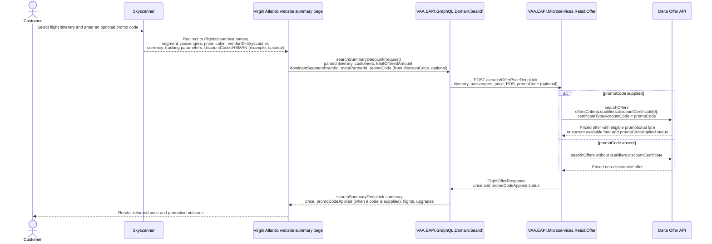

# VAA EAPI Skyscanner Flight Summary Deep-Link Discounted Offer

This proposed flow prices a Skyscanner deep link on the Virgin Atlantic summary page, passing an optional discount code through Search GraphQL and Retail Offer to Delta so that the returned offer reflects the eligible discount.

> **Minimum review:** Read the flow name and description, **Why this flow exists**, **Sequence (detailed)**, and **Open points to finalize**. These sections establish the purpose, intended interactions, and outstanding questions; review the remaining sections as relevant to your role.

## Why this flow exists

Skyscanner currently redirects customers directly to the Virgin Atlantic flight-summary page. The existing `searchSummaryDeepLink` GraphQL query calls the Retail Offer deep-link pricing endpoint, which in turn calls Delta `searchOffers`. A discount in the incoming link is not currently mapped through those request contracts, so Delta cannot price the itinerary using the supplied discount certificate.

The external URL parameter is `discountCode` (for example, `discountCode=HEMAN`). Within EAPI, the canonical contract field should be `promoCode`, matching the existing `PromoCode` fields in the Search-to-Offer and Offer request models. The website maps the URL parameter to the GraphQL input field; no raw browser query string is forwarded downstream.

## Sequence (detailed)

## Open points to finalize

- Confirm the approved public GraphQL input name: this diagram proposes `promoCode` for consistency with existing EAPI contracts, while retaining Skyscanner's `discountCode` URL parameter.
- Confirm the code validation rule (character set, maximum length, normalization) and the customer-facing outcome for invalid or ineligible codes.
- Confirm whether the price in a Skyscanner deep link is pre-discount or discounted, and the expected UI treatment when Delta returns a different price.
- Confirm the Retail Offer test project that owns deep-link Delta mapping coverage if no focused test currently exists.

## High-level behavior

1. Skyscanner redirects the customer to the Virgin Atlantic summary page with the existing itinerary, passengers, price, cabin, partner, and currency parameters plus optional `discountCode`.
2. The website parses and validates the deep-link parameters, maps `discountCode` to `promoCode`, and calls the existing `searchSummaryDeepLink` GraphQL query.
3. Search GraphQL maps `promoCode` to the Retail Offer `POST /search/OfferPriceDeepLink` request.
4. Retail Offer maps the value to Delta `offersCriteria.qualifiers.discountCertificate[].certificateTypeAccountCode`, receives the repriced offer, and returns it through Search GraphQL to the summary page.

## Integration points

| Component | Responsibility |
| --- | --- |
| Skyscanner | Redirects to the Virgin Atlantic summary URL and supplies the optional `discountCode`. |
| Virgin Atlantic website | Parses the summary URL, constructs the GraphQL input, and renders the authoritative returned price. |
| `VAA.EAPI.GraphQL.Domain.Search` | Exposes `searchSummaryDeepLink` and maps its input to the Retail Offer deep-link price request. |
| `VAA.EAPI.Microservices.Retail.Offer` | Handles `POST /Offers/Search/OfferPriceDeepLink`, maps the request to Delta, and returns the priced offer. |
| Delta Offer API | Evaluates the discount certificate while pricing the requested itinerary and returns the authoritative offer. |

## Agent delivery constraints

- Target solution/project paths: `VAA.EAPI.GraphQL/VAA.EAPI.GraphQL.Domain.Search/` and `VAA.EAPI.Microservices/VAA.EAPI.Microservices.Retail.Offer/`.
- New implementation paths, when needed: `Models/FlightOffer/SummaryDeepLink/SearchSummaryDeepLinkQueryRequest.cs`, `Mapper/OfferMSSummaryDeepLinkRequestMapper.cs`, and `Mapper/Delta/FlightOfferPrice/OfferMSToDeltaMapper.cs` in the respective owning projects.
- New test paths, when needed: `VAA.EAPI.GraphQL/VAA.EAPI.GraphQL.Domain.Search.Tests/SummaryDeepLinkQueryTests.cs` and the nearest Retail Offer mapper/handler test project.
- Contract source files to read: `VAA.EAPI.GraphQL/VAA.EAPI.GraphQL/PersistedQueryStore/searchSummaryDeepLink.graphql`, `VAA.EAPI.GraphQL/VAA.EAPI.GraphQL.Domain.Search/Queries/SummaryDeepLinkQuery.cs`, `VAA.EAPI.GraphQL/VAA.EAPI.GraphQL.Domain.Search/Infrastructure/OfferMs/OfferPriceServices.cs`, `VAA.EAPI.Microservices/VAA.EAPI.Microservices.Retail.Offer/Triggers/Http/Delta/FlightOfferPriceController.cs`, and `VAA.EAPI.Microservices/VAA.EAPI.Microservices.Retail.Offer/Mapper/Delta/FlightOfferPrice/OfferMSToDeltaMapper.cs`.
- Endpoint/event/query/command names: GraphQL query `searchSummaryDeepLink`; Retail Offer route `POST /Offers/Search/OfferPriceDeepLink` (called by Search as `/search/OfferPriceDeepLink`); Delta GraphQL operation `searchOffers`.
- Configuration and secret handling: retain existing Search-to-Offer URL, OCP key, channel, and Delta authentication/configuration; do not log the full incoming URL or complete request body.
- Harness command: run the affected Search and Retail Offer test projects with run-scoped TRX and `XPlat Code Coverage`, then analyse only that run using `scripts/analyse-test-run-results.ps1`.

## Key non-functional considerations

- **Input validation**: Treat `discountCode` as optional. Validate its allowed format and maximum length at the website/GraphQL boundary before mapping it to `promoCode`; do not rely on a client-supplied amount as the discounted price.
- **Price authority**: Delta is authoritative for eligibility and price. The website must render the returned offer price, including a price change or an ineligible-code outcome, rather than assume the deep-link price is valid.
- **Correlation**: Preserve the existing correlation context across Search GraphQL, Retail Offer, and Delta. Log only a masked or approved diagnostic representation of the code.
- **Retry behavior**: Retain the existing bounded outbound-call policy. Do not retry invalid or ineligible discount responses as though they were transient failures.
- **No-op path**: When no `discountCode` is supplied, omit `qualifiers.discountCertificate` and retain the current deep-link pricing behaviour.

## Contract mapping

| Boundary | Field | Required behaviour |
| --- | --- | --- |
| Skyscanner → website URL | `discountCode` | Optional URL parameter, e.g. `HEMAN`. |
| Website → `searchSummaryDeepLink` | `request.promoCode` | New optional GraphQL input field populated from `discountCode`. |
| Search → Retail Offer | `DeepLinkSummaryRequest.PromoCode` | Populate from `request.promoCode`; preserve the existing route and all itinerary/pricing fields. |
| Retail Offer → Delta | `offersCriteria.qualifiers.discountCertificate[0].certificateTypeAccountCode` | Populate from `PromoCode`; omit `qualifiers`/`discountCertificate` when the code is absent. |
| Delta → website | priced offer and `promoCodeApplied` | Return Delta's authoritative discounted price and whether the code was applied. |

## Failure paths to capture in implementation

- The URL contains no `discountCode`: price normally without a Delta discount certificate.
- The supplied code is malformed: reject at the input boundary using the established GraphQL error contract; do not call Delta with it.
- Delta finds the code invalid or ineligible for the itinerary: return the current available fare with `promoCodeApplied=false` and a customer-safe explanation; do not silently represent the original link price as discounted.
- Delta returns a technical failure or timeout: preserve the existing controlled downstream error contract and correlation ID; do not expose Delta payloads, credentials, or full deep-link data.
- The Delta price differs from the URL `price`: show the returned price and existing price-change experience.

Expected behavior:

- A valid eligible code is forwarded once and can be evidenced in the Delta request mapping.
- A code must not be considered applied unless the Delta response confirms it through the returned offer/promotion data.
- Existing non-discounted deep links remain behaviourally compatible.

## Expected harness

- `VAA.EAPI.GraphQL/VAA.EAPI.GraphQL.Domain.Search.Tests/SummaryDeepLinkQueryTests.cs`: add mapping/contract coverage for supplied and absent `promoCode` values.
- Retail Offer focused mapper or handler tests: assert the supplied `PromoCode` produces the Delta `DiscountCertificate` qualifier and an absent value omits it.
- Update the Search persisted query and Bruno example/variables when the GraphQL input contract changes.

## Agent Loop Goal

| Field | Value |
| --- | --- |
| Goal | Support an optional Skyscanner deep-link discount code when repricing the selected itinerary on the Virgin Atlantic summary page. |
| Status | `Draft` |
| Owner | `VAA.EAPI.GraphQL.Domain.Search` and `VAA.EAPI.Microservices.Retail.Offer` maintainers |
| Review cadence | Before implementation and on Search GraphQL, Retail Offer, Delta, or meta-partner deep-link contract changes |
| Last reviewed | 2026-09-02 |
| Harness Sensor | Planned: `SummaryDeepLinkQueryTests` contract/mapping coverage and Retail Offer deep-link Delta-request mapper coverage. |
| Promotion verification | Full |
| Acceptance evidence | Focused GraphQL and Retail Offer tests prove that a supplied code reaches Delta as `offersCriteria.qualifiers.discountCertificate[0].certificateTypeAccountCode`, and the resulting discounted offer is returned by `searchSummaryDeepLink`. |
| Maximum agent resources | Recorded automatically at completion from the workflow token and USD limits |
| Production code agent resources | Recorded automatically at completion from production-generation JSONL budget evidence |
| Automation code agent resources | Recorded automatically at completion from automation-generation JSONL budget evidence |
| Actual agent resources | Recorded automatically at completion from retained JSONL budget evidence |
| Done when | The website can supply an optional `discountCode` from a Skyscanner summary deep link; Search GraphQL, Retail Offer, and the Delta request preserve it; valid codes yield the Delta-priced discounted offer; and absent, invalid, or ineligible codes have defined, tested behaviour. |

## Associated delivery pull requests

The draft coordinator PR and its row are created when this goal enters `InProgress`. Every production and QA agent is then recorded here on its own branch and PR. The coordinator PR remains draft until every current child PR is merged, integrated verification passes, and open questions are resolved.

The workflow populates this table for delivery surfaces hosted in other GitHub repositories.

| Surface | Repository | Base branch | Head branch | PR | State | Merged at UTC |
| --- | --- | --- | --- | --- | --- | --- |

## Agent Loop Closure Evidence

No closure evidence recorded yet. The PR finalizer appends merged evidence here on `main`, or closed-unmerged abandonment evidence when the delivery branch remains available. If that branch was already deleted, it writes only a sanitized standalone abandonment record under `.codex/agent-loop/abandonments/` on `main`.
