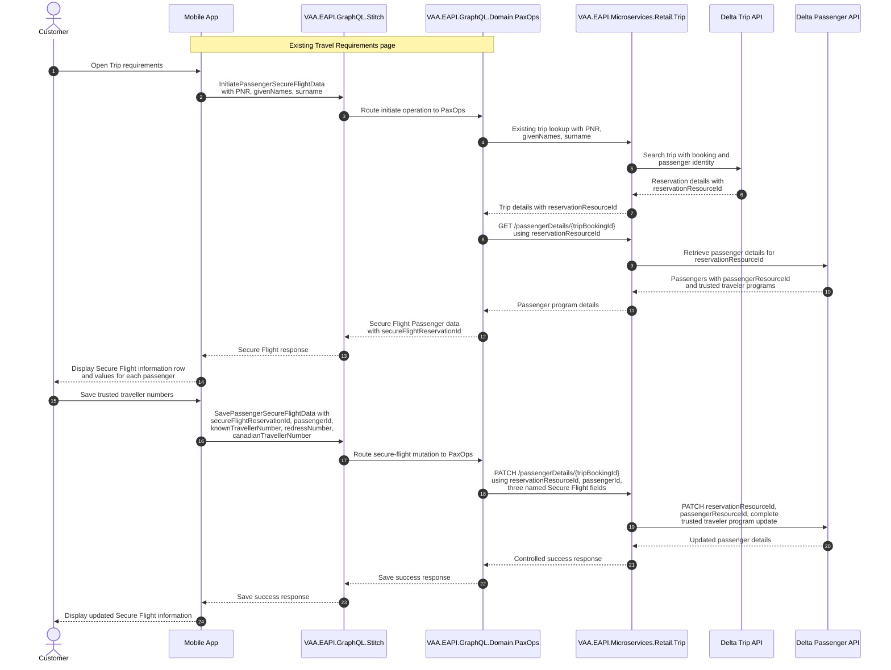

# PaxOps Travel Requirements Secure Flight Passenger Data

Design for the Mobile App to retrieve and save a passenger's Known Traveller Number (KTN), redress number, and Canadian traveller number from the Travel Requirements page through PaxOps GraphQL, Retail Trip, and the Delta Passenger API.

## Agent Loop Goal

| Field | Value |
| --- | --- |
| Goal | Capability to retrieve and save a passenger's Known Traveller Number (KTN), redress number, and Canadian traveller number. |
| Status | `Draft` |
| Owner | `VAA.EAPI.GraphQL.Domain.PaxOps` and `VAA.EAPI.Microservices.Retail.Trip` maintainers |
| Review cadence | Before implementation and on GraphQL, Delta Passenger API, authorization, or data-classification change |
| Last reviewed | 2026-09-24 |
| Harness Sensor | Planned: PaxOps GraphQL query/mutation contract tests, Retail Trip passenger-details service tests, and fixture-backed Delta Passenger API request-shape tests. |
| Promotion verification | Full |
| Acceptance evidence | Tests prove that `InitiatePassengerSecureFlightData` returns the three named Secure Flight fields after a successful PNR, given-names, and surname booking lookup; `SavePassengerSecureFlightData` passes all three submitted fields to Retail Trip; and Retail Trip maps all three fields to the Delta `ADD` request shape. Implementation must also prevent Secure Flight values from being written to logs, telemetry, errors, or caches. |
| Done when | The reviewed design is selected, GraphQL contract and booking-lookup behaviour are implemented, Delta ADD semantics are verified, and automated tests cover retrieve, add/update, booking matching, and controlled downstream failures. |

## Why this flow exists

The Mobile App needs to let a customer manage, per passenger, the trusted traveller program values `KNOWN_TRAVELER_NUMBER`, `REDRESS_NUMBER`, and `CANADA_TRAVELER_NUMBER`. The existing Retail Trip passenger-details route and its Delta models already carry `advancePassengerInformation.trustedTravelerPrograms`, but the current `TripsBooking` response does not expose them and the existing GraphQL loyalty mutation only manages `loyaltyProgramAccounts`.

The full program numbers are sensitive passenger data. The Mobile App requires the full values for the customer who has completed the existing booking lookup. The read contract may return the three number fields only after the PNR, given names, and surname match the reservation. Full values must not appear in logs, telemetry, errors, caches, test fixtures containing real passenger data, or responses when that booking lookup fails. Test fixtures may use clearly synthetic non-production values solely to verify KTN, redress number, and Canadian traveller number mapping and serialization.

## Current repository baseline

- `VAA.EAPI.Microservices.Retail.Trip` already exposes the trip lookup used by PaxOps and `GET /passengerDetails/{tripBookingId}` plus `PATCH /passengerDetails/{tripBookingId}` in `PassengerDetailsController`.
- Retail Trip retrieves trip details through its Delta Trip integration. The Delta Trip response model exposes `TravelReservation.ReservationResourceId`; PaxOps reads this existing booking identifier from the trip lookup response.
- PaxOps uses the existing trip lookup with `pnr`, `givenNames`, and `surname`, then calls existing `GET /passengerDetails/{tripBookingId}` using the returned `reservationResourceId` to retrieve the passenger Secure Flight data.
- For saves, PaxOps validates and unwraps `secureFlightReservationId`, obtains `reservationResourceId`, and calls existing `PATCH /passengerDetails/{tripBookingId}` with the raw reservation resource ID. Retail Trip maps the supplied passenger details to the Delta Passenger PATCH request. It does **not** retrieve current passenger state first.
- `VAA.EAPI.GraphQL.Domain.PaxOps` already owns the pre-check-in Travel Requirements experience; this design adds the Secure Flight composition route to that page while Retail Trip retains passenger-data ownership.
- `manageLoyaltyMemberMutation` is loyalty-specific and must not be extended as the trusted-traveller public contract.

## Identifier mapping

Use the existing identifier names at their owning boundary. There is no current `travelReservationNumber` field in these contracts.

| Boundary | Identifier and source | Purpose |
| --- | --- | --- |
| Mobile App to PaxOps | `PNR`, `givenNames`, `surname` | Initiates the Secure Flight journey from Travel Requirements. |
| PaxOps to Retail Trip trip lookup | `PNR`, `givenNames`, `surname` | Existing trip lookup input; it returns the booking information containing `reservationResourceId`. |
| PaxOps public response | `secureFlightReservationId` | Signed JWT context ID for Secure Flight follow-up saves, created by PaxOps using the existing signed ID pattern. It carries `reservationResourceId` and an expiry. |
| PaxOps to Retail Trip passenger-details routes | `reservationResourceId` | PaxOps reads this value from the trip lookup on initiate and from `secureFlightReservationId` on save, then supplies it to existing `GET` or `PATCH /passengerDetails/{tripBookingId}`. |
| Retail Trip to Delta Passenger API | `reservationResourceId` | Mapped into Delta `ReservationResourceId` in the `PassengerInformation` payload. |
| Passenger-specific updates | `passengerId` publicly; `passengerResourceId` in Retail Trip/Delta | Identifies the selected passenger within the reservation. |

## Secure Flight Passenger data on Travel Requirements page

Secure Flight information appears on the existing Travel Requirements page alongside Passport details, Return/onward travel date, Visa status, and Emergency contact. The page starts `InitiatePassengerSecureFlightData` through `VAA.EAPI.GraphQL.Stitch` and `VAA.EAPI.GraphQL.Domain.PaxOps`. PaxOps composes the existing Retail Trip trip lookup and passenger-details routes. Retail Trip remains the only service that calls Delta APIs.

**Benefits:** a single customer-facing Travel Requirements entry point; available before final check-in; keeps Delta Passenger API credentials, mapping, merge logic, and action selection in Retail Trip.

**Trade-offs:** PaxOps composes existing Retail Trip contracts and owns the Secure Flight context ID. The initiate operation uses booking identity (`PNR`, `givenNames`, and `surname`) to retrieve the trip, then uses its `reservationResourceId` to retrieve passenger details. PaxOps creates `secureFlightReservationId` for the subsequent save using the existing signed JWT ID pattern. `reservationResourceId` is not returned as a separate public GraphQL field; it is carried in the signed context identifier under the existing ID pattern.

### Public contracts

The contracts below are the implementation design.

```graphql
query InitiatePassengerSecureFlightData($input: SecureFlightInitiateInput!) {
  InitiatePassengerSecureFlightData(input: $input) {
    secureFlightReservationId
    passengers {
      passengerId
      knownTravellerNumber
      redressNumber
      canadianTravellerNumber
    }
  }
}

input SecureFlightInitiateInput {
  pnr: String!
  givenNames: String!
  surname: String!
}

mutation SavePassengerSecureFlightData($input: SavePassengerSecureFlightDataInput!) {
  SavePassengerSecureFlightData(input: $input) {
    status
  }
}

input SavePassengerSecureFlightDataInput {
  secureFlightReservationId: String!
  passengerId: String!
  knownTravellerNumber: String!
  redressNumber: String!
  canadianTravellerNumber: String!
}
```

`InitiatePassengerSecureFlightData` is a PaxOps-owned contract, not a raw Delta Passenger API payload. Its input is the booking lookup tuple (`pnr`, `givenNames`, and `surname`); its successful response contains one `secureFlightReservationId` scoped to the resolved booking, plus the reservation passenger records and their three named Secure Flight number fields. PaxOps first uses the existing Retail Trip trip lookup, then calls existing `GET /passengerDetails/{tripBookingId}` with the returned `reservationResourceId`. The request is permitted when the supplied PNR, given names, and surname match the reservation. A field is `null` when the passenger has no value for that number type. PaxOps creates `secureFlightReservationId` as a signed JWT containing `reservationResourceId` and an expiry. On save, PaxOps validates the signature and expiry, then reads `reservationResourceId` through its helper before calling existing `PATCH /passengerDetails/{tripBookingId}`. An unknown booking, a name mismatch, or expired context returns the established controlled GraphQL error and must not disclose whether a passenger number exists. Future passenger fields require an explicit contract and security/privacy review before being added.

### Booking-access model

This flow follows the existing booking-retrieval model. PaxOps passes the PNR, given names, and surname to the existing Retail Trip trip lookup, then uses the returned reservation resource ID with existing passenger-details GET. No additional authenticated customer-to-booking entitlement check is introduced for this flow. The Mobile App sends the `passengerId` returned for the selected passenger by `InitiatePassengerSecureFlightData` when calling the save mutation. Retail Trip maps that value to Delta `passengerResourceId`; it must not derive the identifier from passenger name or passenger number.

Each save request updates one passenger and contains all three named fields: `knownTravellerNumber`, `redressNumber`, and `canadianTravellerNumber`. The fields are required and the Mobile App must not omit any of them. The values represent the passenger's complete current Secure Flight data as displayed from the initial read; an empty string means that field has no value or is intentionally cleared. The Mobile App repeats the request when the customer selects another passenger. Retail Trip does not retrieve Delta Passenger details again during save in order to merge values.

### Save rule

Retail Trip selects the Delta `actionType`; it is not exposed by the Mobile App or PaxOps contract. For every save, the Mobile App sends the complete current values for the selected passenger in the three named fields. Retail Trip maps those fields to the Delta program codes (`KNOWN_TRAVELER_NUMBER`, `REDRESS_NUMBER`, and `CANADA_TRAVELER_NUMBER`) and sends one selected-passenger entry with `actionType: ADD`. `ADD` is the Delta add/update operation for this flow. Retail Trip does not retrieve, compare, or merge Delta Passenger data during save.

For example, if a passenger already has a KTN and the customer adds or changes a Canadian traveller number, the Mobile App sends both values in the save request.

The customer capability is:

- A customer can add a KTN, redress number, or Canadian traveller number.
- A customer can enter only a redress number or only a Canadian traveller number; the other Secure Flight fields do not need values when at least one number is supplied.
- A customer can change an existing number; the Mobile App submits the complete current set of values.
- A customer can remove one saved Secure Flight number when at least one other Secure Flight number remains for that passenger.
- A customer cannot remove the final remaining Secure Flight number because Delta rejects a request where all three number fields are blank.

The UI must prevent a customer from clearing the final remaining Secure Flight number, or display a clear validation message. Retail Trip must also reject an all-blank request before calling Delta.

### Integration points

| Component | Responsibility |
| --- | --- |
| Mobile App | Calls the selected read operation, displays full values after the existing booking lookup succeeds, and sends the three named number fields for an intentional add/update. |
| `VAA.EAPI.GraphQL.Stitch` | Mobile GraphQL gateway that receives the Mobile App GraphQL request and routes it to the PaxOps domain schema. |
| `VAA.EAPI.GraphQL.Domain.PaxOps` | Composes the Travel Requirements experience from existing Retail Trip trip and passenger-details routes; creates and validates `secureFlightReservationId`; and controls the public response, errors, and telemetry. |
| `VAA.EAPI.Microservices.Retail.Trip` | Owns the existing Trip and passenger-details API boundary: retrieves/saves through Delta APIs, maps the three named EAPI fields to/from Delta trusted-traveller enums, and maps controlled Delta results/errors. |
| Delta Passenger API | Supplies current passenger details and performs the Delta `ADD` trusted-traveller update. |

## Agent delivery constraints

- Target solution/project paths: `VAA.EAPI.GraphQL/VAA.EAPI.GraphQL.Domain.PaxOps/`, its nearest test project, `VAA.EAPI.Microservices/VAA.EAPI.Microservices.Retail.Trip/`, and its nearest passenger-details test project.
- New implementation path: add PaxOps GraphQL initiation and save operations plus provider/request/response models. Add `SecureFlightReservationIdHelper` in PaxOps using the existing signed JWT ID pattern, with `reservationResourceId` and expiry claims. PaxOps composes the existing Retail Trip trip lookup, `GET /passengerDetails/{tripBookingId}`, and `PATCH /passengerDetails/{tripBookingId}` routes; no new Retail Trip Secure Flight endpoint is required. Retail Trip maps the three named Secure Flight fields to/from Delta program enums and selects the Delta action before calling Delta Passenger PATCH.
- Contract source files to read: `VAA.EAPI.GraphQL/VAA.EAPI.GraphQL.Domain.PaxOps/Queries/TravelRequirementsQuery.cs`; `VAA.EAPI.GraphQL/VAA.EAPI.GraphQL.Domain.PaxOps/Services/TravelRequirementsServiceProvider.cs`; `VAA.EAPI.GraphQL/VAA.EAPI.GraphQL.Domain.PaxOps/Helper/TravelRequirementsIdHelper.cs`; `VAA.EAPI.Microservices/VAA.EAPI.Microservices.Retail.Trip/Triggers/Http/PassengerDetailsController.cs`; `VAA.EAPI.Microservices/VAA.EAPI.Microservices.Retail.Trip/Application/PassengerDetailsService.cs`; `VAA.EAPI.Microservices/VAA.EAPI.Microservices.Retail.Trip/Application/TripService.cs`; and `VAA.EAPI.Microservices/VAA.EAPI.Microservices.Retail.Trip/Infrastructure/Services/DeltaPublic/DeltaTripsDetailsService.cs`.
- Endpoint/query/command names: existing Retail Trip trip lookup, `GET /passengerDetails/{tripBookingId}`, and `PATCH /passengerDetails/{tripBookingId}`; PaxOps `InitiatePassengerSecureFlightData` query and `SavePassengerSecureFlightData` mutation. Do not expose Delta `actionType` to the Mobile App.
- Configuration and secret handling: retain existing Retail Trip Delta endpoint/token configuration; use the established GraphQL-to-Trip subscription-key path; do not add secrets or log/telemetry fields containing full trusted-traveller values. Configure cache bypass/disablement for both Secure Flight GraphQL operations; do not rely on a global cache setting.
- Harness command: `scripts/verify.ps1 -SolutionPath VAA.EAPI.GraphQL/VAA.EAPI.GraphQL.sln` and the smallest Retail Trip owning solution/project verification command; use run-scoped TRX plus the analyser for any direct test execution.

### Key non-functional considerations

- **Booking access and privacy:** Register the new PaxOps query and mutation in the public GraphQL schema. Apply the existing PNR, given-names, and surname booking lookup before returning Secure Flight values or submitting an update. No additional authenticated customer-to-booking entitlement check is introduced for this flow.
- **Signed context identifier:** PaxOps creates and validates `secureFlightReservationId` using the existing signed JWT ID pattern used for reservation, trip, and check-in context IDs. This is an integrity-protected context identifier, not an encrypted or opaque token. Include only `reservationResourceId` and expiry claims; do not include PNR, names, passenger IDs, or Secure Flight values, and do not accept a separate raw `reservationResourceId` parameter from the Mobile App.
- **Idempotency:** If Delta confirms `ADD` is an upsert, repeated save requests with the same value should produce the same final state. Do not retry a non-idempotent Delta request without a verified contract.
- **Correlation and logging:** Preserve the existing correlation ID from Mobile App through GraphQL, Retail Trip, and Delta. Permit only correlation ID, operation name, outcome category, safe error code, and timing/status metadata in logs and telemetry; never log `secureFlightReservationId`, PNR/name lookup values, passenger IDs, program numbers, request/response bodies, or raw Delta passenger payloads.
- **Caching:** Caching is not required for this flow. Explicitly disable or bypass shared GraphQL full-response caching for `InitiatePassengerSecureFlightData` and `SavePassengerSecureFlightData`.
- **At-least-one-number rule:** The Mobile App may clear a field when another Secure Flight number remains. It must prevent a request in which all three number fields are blank; Retail Trip also rejects that request before calling Delta.
- **Complete save input:** Each save contains all three current named Secure Flight fields from the Mobile App. Retail Trip maps the submitted fields to the Delta `ADD` request and sends it for every valid save; it does not retrieve, compare, or merge Delta state during save.


### Sequence — Initialize and update Secure Flight Passenger data

This alternative fits the provided Travel Requirements page: add a `Secure Flight information` row near Passport details. It is an operational travel requirement, not a travel document.



PaxOps operations are `InitiatePassengerSecureFlightData` and `SavePassengerSecureFlightData`. The initiate operation uses `PNR`, `givenNames`, and `surname` and returns `secureFlightReservationId`; the save operation uses that ID. `reservationResourceId` is not a separate public GraphQL field. PaxOps creates and validates the signed context identifier, then supplies the reservation resource ID to the existing Retail Trip passenger-details routes.

## Failure paths to capture in implementation

- The PNR, given names, and surname do not match a booking, or Delta Passenger does not recognise the selected passenger in the update.
- Passenger-details retrieval returns no passenger, a Delta business error, timeout, or controlled technical failure.
- Delta rejects an `ADD` update or returns a response that cannot be mapped safely.
- The request contains KTN, redress number, and Canadian traveller number all blank. Retail Trip rejects it before calling Delta.
- A GraphQL full-response cache, error, log, trace, or test fixture would expose a full program number.

Expected behavior:

- Fail closed before returning full values when the PNR/name booking lookup fails.
- Preserve correlation IDs while logging only safe decision/outcome fields; never log full values or raw Delta passenger payloads.
- Map Delta business and technical errors to the established EAPI/GraphQL error contract.
- Do not submit a request where KTN, redress number, and Canadian traveller number are all blank to Delta. Tell the customer that at least one Secure Flight number must remain.

## Expected harness

- GraphQL contract tests proving the three full number fields are returned only after the PNR/name booking lookup succeeds, the Secure Flight operations bypass GraphQL full-response caching, and no full values enter logs, telemetry, errors, or caches; include a test that a non-matching booking lookup cannot select the fields.
- GraphQL mutation tests covering trusted traveller program-detail mapping to Retail Trip and mapped downstream failures.
- Retail Trip `.mock`-backed tests covering existing trip lookup and passenger-details GET/PATCH orchestration, passenger matching, Delta-confirmed update-via-ADD for every valid save, POST/PATCH serialization for all three program values, and controlled Delta error mapping. Include the case where the Mobile App submits both an existing `KNOWN_TRAVELER_NUMBER` and a changed `CANADA_TRAVELER_NUMBER`.
- Tests covering all three named fields in one save, removal of one number while another remains, and rejection before Delta when all three submitted fields are blank. Verify Retail Trip maps the submitted fields to the Delta enum list without a save-time Delta retrieval.

## Open points to finalize

- None. The implementation requirements, contracts, identifiers, security controls, error paths, and expected tests are defined in this design.

## Agent Loop Closure Evidence

No closure evidence recorded yet. The PR finalizer appends merge or abandonment evidence here after an agent-loop delivery PR closes.
