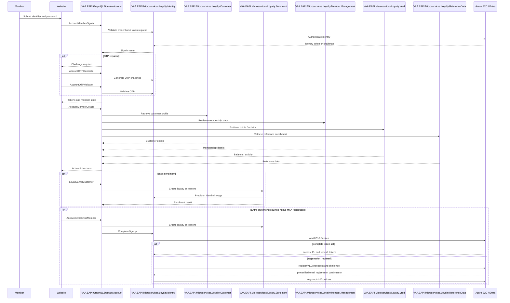

# VAA EAPI Website My Account — All GraphQL Scenarios

**Status:** Implemented

> **Minimum review:** Read the flow name and description, **Why this flow exists**, **Sequence (detailed)**, and **Open points to finalize**. These sections establish the purpose, intended interactions, and outstanding questions; review the remaining sections as relevant to your role.

## Why this flow exists

<a id="purpose"></a>

Maps `VAA.EAPI.Automation.MyAccount/Tests/GraphQlTests` for website account delivery. Examples use synthetic values; passwords, OTPs, tokens, member numbers and PII must never be logged.

## Sequence (detailed)

<a id="service-level-sequence"></a>



## Open points to finalize

- None currently recorded; add explicit blockers here before moving this diagram back to Ready or InProgress.

## Agent delivery constraints

- Target solution/project path: Use the smallest owning solution or project implied by the `Harness Sensor`, integration points, and documented component ownership.
- New implementation path, when needed: Prefer the owning project paths already named in this diagram; do not create new services or broaden ownership without recording a blocker.
- New test path, when needed: `VAA.EAPI.Automation/VAA.EAPI.Automation.MyAccount/Tests/GraphQL/Query/AccountMemberDetailsTests.cs`
- Contract source files to read: Existing files referenced by this diagram, the named GraphQL operations, HTTP endpoints, message/event names, request payloads, and nearest tests.
- Endpoint/event/query/command names: Use only the operation, route, event, command, or scenario names documented in this diagram unless a compile/test failure proves a rename.
- Configuration and secret handling: Use existing configuration keys, environment variables, and secret references only; never commit real secrets, tokens, PII, payment data, or passenger documents.
- Harness command: Run the scoped verification selected by Promotion verification; for Fast, use scripts/verify.ps1 -SolutionPath <owning-solution> -SkipBuild or the nearest project equivalent.

## Current implementation alignment

`VAA.EAPI.GraphQL.Domain.Account` is the implemented composition boundary. Its operations call bounded loyalty microservices rather than one generic account backend; the diagram above names the principal calls covered by this catalogue.

The Entra enrolment branch now has a dedicated implemented sequence: [MyAccount Entra Native MFA Registration During Enrolment](vaa-eapi-myaccount-entra-native-mfa-registration.md). It documents the `registration_required` continuation, complete-token precedence, and the enrolment email's preverified registration path.

## Operation catalogue

| Capability | GraphQL operations |
|---|---|
| Sign-in and tokens | `AccountMemberSignIn`, `RefreshToken`, `AccountValidatePassword` |
| OTP and Entra | `AccountOTPGenerate`, `AccountOTPValidate`, `AccountEntraOTPGenerate`, `AccountEntraOtpValidation`, `AccountEntraPasswordSubmission`, `AccountEntraEnrolMember` |
| Enrolment | `LoyaltyEnrolCustomer`, enrolment `Mutation`, `EnrolmentSignIn`, `InflightEnrolCustomer` |
| Member overview | `AccountMemberDetails`, `AccountManageAccount`, `AccountActivityDetails`, `AccountTenureDetails`, `AccountPointDotComDetails` |
| Profile | `AccountUpdateAddressDetails`, `AccountUpdateEmailAddress`, `UpdateMemberPhoneNumber`, `UpdateMarketingPreference`, `UpdatePreference` |
| Household | `RetrieveHouseHoldAccount`, `AccountInviteMember`, `AccountInviteMemberAction` |
| Rewards | `VoucherDetails`, `MemberVoucherDetails`, `ValidatePcmEligibility`, `AmexRegisterCampaign` |
| Travel and address | `AccountFlightDetails`, address lookup `Query` |
| Inflight | `SetDeviceInflightState`, `AccountEnableIFWifiForDevice` |

## Example payloads and responses

### Sign in

```json
{
  "operationName": "AccountMemberSignIn",
  "query": "mutation AccountMemberSignIn($request: AccountMemberSignInRequest!) { AccountMemberSignIn(request: $request) { ... } }",
  "variables": { "request": { "flyingClubNumber": "<synthetic-member-number>", "password": "<secret>" } }
}
```

```json
{ "data": { "AccountMemberSignIn": { "requiresOtp": true, "memberStatus": "ACTIVE" } } }
```

### Generate and validate OTP

```json
{ "operationName": "AccountOTPGenerate", "query": "mutation AccountOTPGenerate($request: OtpGenerateInput!) { AccountOTPGenerate(request: $request) { ... } }", "variables": { "request": { "email": "synthetic@example.test" } } }
```

```json
{ "operationName": "AccountOTPValidate", "query": "mutation AccountOTPValidate($request: OtpValidateInput!) { AccountOTPValidate(request: $request) { ... } }", "variables": { "request": { "email": "synthetic@example.test", "otp": "<secret-otp>" } } }
```

```json
{ "data": { "AccountOTPValidate": { "valid": true } } }
```

### Member details

```json
{ "operationName": "AccountMemberDetails", "query": "query AccountMemberDetails { AccountMemberDetails { ... } }", "variables": {} }
```

```json
{ "data": { "AccountMemberDetails": { "customerId": "<opaque-customer-id>", "memberNumber": "<masked-member-number>", "tier": "RED", "pointsBalance": 12000 } } }
```

### Update preferences

```json
{
  "operationName": "UpdatePreference",
  "query": "mutation UpdatePreference($request: PreferenceInput!) { UpdatePreference(request: $request) { ... } }",
  "variables": { "request": { "vaaMarketing": true, "preferredPartner": "DL" } }
}
```

```json
{ "data": { "UpdatePreference": { "status": "SUCCESS" } } }
```

### Household retrieval and invitation

```json
{ "operationName": "RetrieveHouseHoldAccount", "query": "query RetrieveHouseHoldAccount { RetrieveHouseHoldAccount { ... } }", "variables": {} }
```

```json
{ "operationName": "AccountInviteMember", "query": "mutation AccountInviteMember($request: HouseholdInviteInput!) { AccountInviteMember(request: $request) { ... } }", "variables": { "request": { "email": "invitee@example.test" } } }
```

```json
{ "data": { "AccountInviteMember": { "status": "INVITED" } } }
```

### Basic enrolment

```json
{
  "operationName": "LoyaltyEnrolCustomer",
  "query": "mutation LoyaltyEnrolCustomer($request: EnrolmentInput!) { LoyaltyEnrolCustomer(request: $request) { ... } }",
  "variables": { "request": { "givenName": "TEST", "surname": "MEMBER", "dateOfBirth": "1990-05-20", "email": "synthetic@example.test", "countryCode": "GB" } }
}
```

```json
{ "data": { "LoyaltyEnrolCustomer": { "customerId": "<opaque-customer-id>", "memberNumber": "<masked-member-number>", "status": "ACTIVE" } } }
```

## Automated scenario inventory

- address lookup: complete/partial postcode, blank country/postcode/address, UK/US/other country, no result and Wesal mapping;
- basic and full enrolment, OCDB synchronisation and duplicate/customer validation;
- Entra and B2C sign-in, Gold member, OTP/no-OTP, refresh token and password reset;
- invalid email, password, OTP, refresh token and unauthorised member/profile/voucher/flight requests;
- account overview, manage-account, activity, address, tenure and point-dot-com details;
- email, address, phone and VAA/OAL marketing preference updates;
- household retrieval, invitation, acceptance/refusal and invalid transitions;
- voucher details and Amex Platinum eligibility/campaign registration;
- inflight sign-up/sign-in, Wi-Fi enablement, member status and already-registered email.

## Backlog epics

Authentication and recovery; enrolment; account overview; profile management; preferences; household accounts; vouchers and campaigns; inflight account/Wi-Fi; authorisation and privacy; error and lockout handling.

## Automation sources

- Tests: `VAA.EAPI.Automation.MyAccount/Tests/GraphQlTests/`
- Payloads: `VAA.EAPI.Automation.MyAccount/Requests/Body/GraphQL/`
- Models: `VAA.EAPI.Automation.MyAccount/Requests/Models/GraphQL/`

## Failure paths

- Fail closed for invalid credentials, tokens, OTPs, passwords, and unauthorized profile access.
- Handle duplicate enrolment, household invitation conflicts, and invalid invitation transitions safely.
- Preserve controlled behavior when identity, customer, membership, VRed, or reference services fail.
- Never log passwords, OTPs, tokens, member numbers, household data, or customer PII.

## Expected harness

The My Account GraphQL tests, payloads, and models listed under Automation sources are the current sensors. Coverage should retain authentication and recovery, enrolment, profile and preference updates, household workflows, rewards, inflight capabilities, authorization failures, and PII-safe diagnostics.

## Agent Loop Goal

| Field | Value |
| --- | --- |
| Goal | Maintain the imported scenario catalogue as an implemented sequence-diagram reference. |
| Status | `Complete` |
| Owner | `VAA.EAPI.GraphQL.Domain.Account maintainers` |
| Review cadence | Quarterly and when scenario coverage changes |
| Last reviewed | 2026-08-21 |
| Harness Sensor | `VAA.EAPI.Automation/VAA.EAPI.Automation.MyAccount/Tests/GraphQL/Query/AccountMemberDetailsTests.cs` |
| Promotion verification | Fast |
| Acceptance evidence | Imported scenarios align to existing automation coverage and are tracked by the sequence-diagram index. |
| Done when | Scenario catalogue remains aligned with implemented behavior and referenced harness coverage. |

## Associated delivery pull requests

The draft coordinator PR and its row are created when this goal enters `InProgress`. Every production and QA agent is then recorded here on its own branch and PR. The coordinator PR remains draft until every current child PR is merged, integrated verification passes, and open questions are resolved.

The workflow populates this table for delivery surfaces hosted in other GitHub repositories.

| Surface | Repository | Base branch | Head branch | PR | State | Merged at UTC |
| --- | --- | --- | --- | --- | --- | --- |

## Agent Loop Closure Evidence

Record final closure evidence here. Existing verification and delivery records remain in their respective sections.
