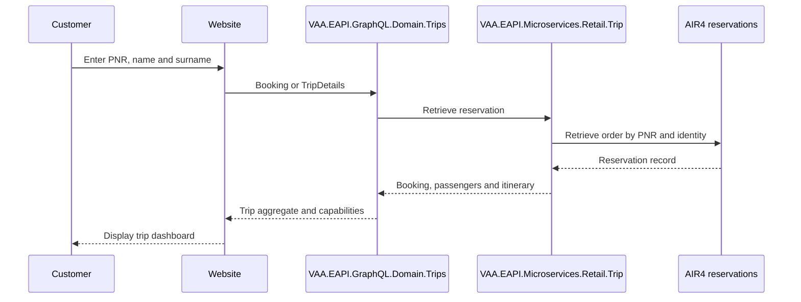
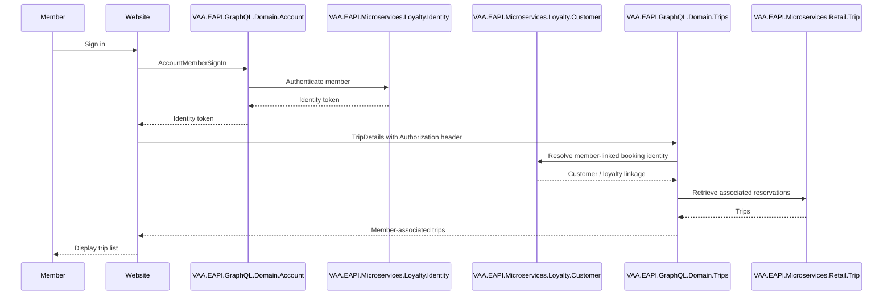
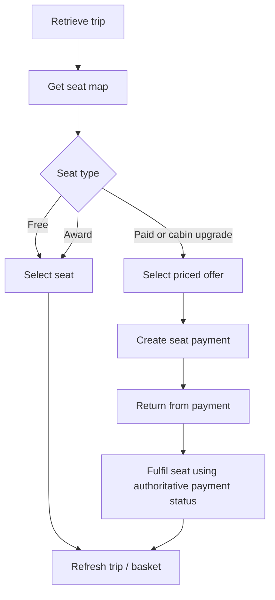
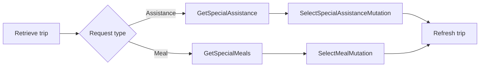
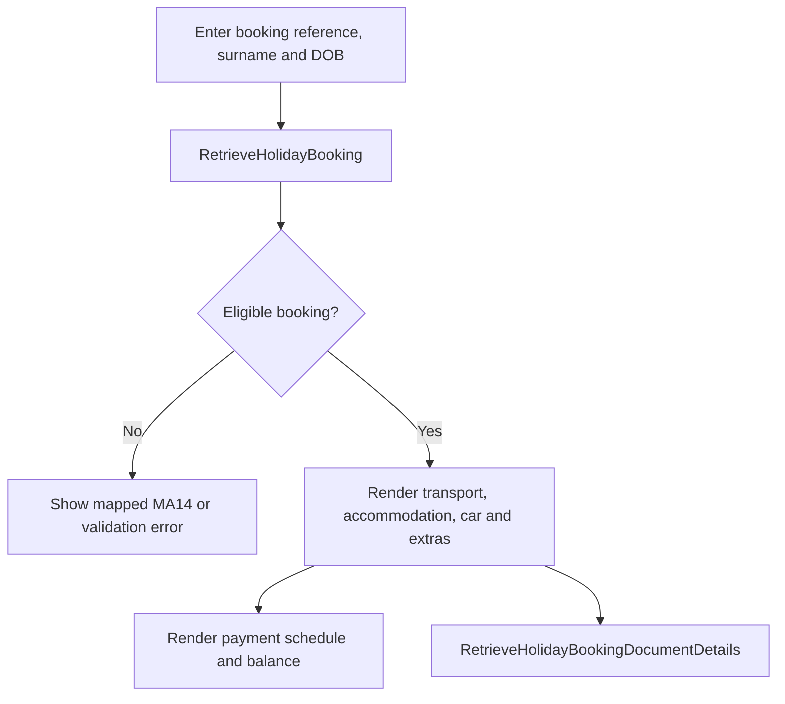
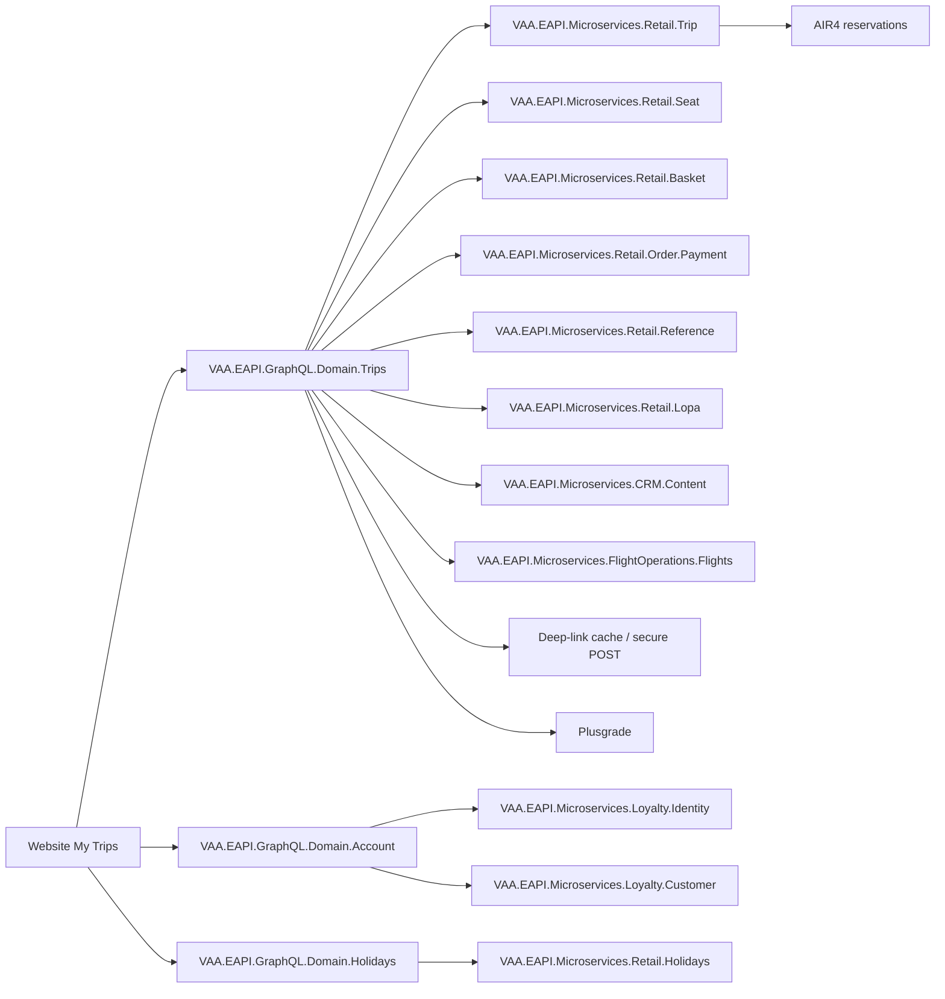

# VAA EAPI Website My Trips — All Scenarios

**Status:** Implemented

> **Minimum review:** Read the flow name and description, **Why this flow exists**, **Sequence (detailed)**, and **Open points to finalize**. These sections establish the purpose, intended interactions, and outstanding questions; review the remaining sections as relevant to your role.

## Why this flow exists

<a id="purpose"></a>

This document maps the existing `VAA.EAPI.Automation.Trips` backend automation into website My Trips journeys, GraphQL and supporting-service calls, example payloads, scenario coverage, and backlog-ready capability groups.

It is an implementation reference, not a source of production credentials or passenger data. All PNR, identity, loyalty and booking values below are synthetic placeholders. Automated tests must continue to retrieve booking and loyalty data from the shared Azure storage tables.

## Sequence (detailed)

<a id="service-level-sequence"></a>

### Anonymous flight booking



### Signed-in Flying Club trip list



### Seat selection



### Special service request



### Virgin Holidays booking



## Open points to finalize

- None currently recorded; add explicit blockers here before moving this diagram back to Ready or InProgress.

## Agent delivery constraints

- Target solution/project path: Use the smallest owning solution or project implied by the `Harness Sensor`, integration points, and documented component ownership.
- New implementation path, when needed: Prefer the owning project paths already named in this diagram; do not create new services or broaden ownership without recording a blocker.
- New test path, when needed: `VAA.EAPI.Automation/VAA.EAPI.Automation.Trips/Tests/TripsTests/GraphQL/TripDetailsTests.cs` or the nearest owning GraphQL test class.
- Contract source files to read: Existing files referenced by this diagram, the named GraphQL operations, HTTP endpoints, message/event names, request payloads, and nearest tests.
- Endpoint/event/query/command names: Use only the operation, route, event, command, or scenario names documented in this diagram unless a compile/test failure proves a rename.
- Configuration and secret handling: Use existing configuration keys, environment variables, and secret references only; never commit real secrets, tokens, PII, payment data, or passenger documents.
- Harness command: Run the scoped verification selected by Promotion verification; for Fast, use scripts/verify.ps1 -SolutionPath <owning-solution> -SkipBuild or the nearest project equivalent.

## Current implementation alignment

The implemented composition boundaries are `VAA.EAPI.GraphQL.Domain.Trips`, `VAA.EAPI.GraphQL.Domain.Account`, and `VAA.EAPI.GraphQL.Domain.Holidays`. They call the owning Retail Trip, Seat, Basket, Order Payment, Reference, LOPA, Loyalty Identity/Customer, CRM Content, Flight Operations, and Retail Holidays microservices shown below. The sequences represent current implemented capability; backlog and delivery-slice sections retain future enhancement context.

## Scope

Included:

- anonymous booking retrieval and multiple-trip retrieval;
- Flying Club authenticated retrieval;
- flight, passenger, cabin, loyalty, aircraft and check-in details;
- seat maps, free, paid, award and cabin-upgrade seats;
- special assistance and special meals;
- Flying Club and partner-airline loyalty numbers;
- travel readiness and checklist messages;
- upsell, bid-for-upgrade and deep links;
- Virgin Holidays retrieval, payments, documents, extras and mixed flight/holiday trips;
- GraphQL, Trips microservices, Basket, Flight Services and AIR4 coverage;
- positive, partial-failure, validation and downstream-error scenarios.

Out of scope:

- Search and Book before a PNR exists;
- OCI steps after the user selects check-in;
- production secrets, real PII and environment-specific credentials;
- browser presentation and accessibility acceptance criteria.

## System view



## GraphQL operation catalogue

| Capability | Operation | Website use |
|---|---|---|
| Single booking | `Booking` | Anonymous lookup using PNR and passenger identity |
| Trip list | `TripDetails` | One, many, mixed flight/holiday or authenticated trips |
| Travel readiness | `GetFlyReadyStatus` | FlyReady status and call-to-action |
| Assistance | `GetSpecialAssistance` | Available and selected assistance |
| Assistance update | `SelectSpecialAssistanceMutation` | Apply SSR to passenger and segments |
| Meals | `GetSpecialMeals` | Available and selected meal options |
| Meal update | `SelectMealMutation` | Apply meal to passenger/segment(s) |
| Loyalty programmes | `LoyaltyProgramsDetails` | Partner programme catalogue |
| Loyalty update | `manageLoyaltyMemberMutation` | Add or update membership on passenger |
| Seat map | `SeatMapQuery` | Seats, availability, restrictions and offers |
| Seat selection | `SelectSeatMutation` | Put selected seat/offer into the trip basket |
| Seat payment | `SeatPaymentMutation` | Initiate paid-seat payment |
| Seat fulfilment | `seatFulfilmentMutation` | Fulfil after authoritative payment outcome |
| Seat status | `paymentStatusMutation` | Payment/confirmation status where enabled |
| Upsell | `UpsellOffersQuery` | Eligible cabin and ancillary offers |
| Deep links | `Deeplink` | Generate destination-specific link or POST cache ID |
| Secure deep link | `GetDeepLinkForPost` | Resolve cached POST details server-side |
| Content | `Query` | Content fragment used by My Trips UI |
| Sign in | `AccountMemberSignIn` | Flying Club or VAC authentication |
| Holiday booking | `RetrieveHolidayBooking` | Holiday itinerary, components and payments |
| Holiday documents | `RetrieveHolidayBookingDocumentDetails` | Customer documents and important information |

## Example GraphQL payloads and response excerpts

The `query` values are shortened for readability. The repository JSON templates contain the authoritative selection sets. GraphQL success means HTTP success **and** no GraphQL `errors` array.

### 1. Retrieve a booking

```json
{
  "operationName": "Booking",
  "query": "query Booking($tripDetailsRequest: TripDetailsRequest!) { Booking(tripDetailsRequest: $tripDetailsRequest) { ... } }",
  "variables": {
    "tripDetailsRequest": {
      "using": "PNR",
      "confirmationNum": "<synthetic-pnr>",
      "givenNames": "TEST",
      "surname": "PASSENGER"
    }
  }
}
```

```json
{
  "data": {
    "Booking": {
      "id": "<opaque-trip-reservation-id>",
      "reference": { "pnrLocator": "<synthetic-pnr>" },
      "passengers": [{ "id": "<opaque-passenger-id>", "givenNames": "TEST" }],
      "slices": [{ "id": "<opaque-slice-id>", "origin": { "code": "LHR" }, "destination": { "code": "JFK" } }]
    }
  }
}
```

### 2. Retrieve one or more trips

```json
{
  "operationName": "TripDetails",
  "query": "query TripDetails($request: TripDetailsRequest!) { TripDetails(request: $request) { ... } }",
  "variables": {
    "request": {
      "tripDetails": [
        {
          "pnrLocator": "<synthetic-pnr>",
          "givenNames": "TEST",
          "surname": "PASSENGER",
          "createdDate": null,
          "bookingReference": null,
          "dateOfBirth": null
        }
      ]
    }
  }
}
```

```json
{
  "data": {
    "TripDetails": {
      "trips": [{ "id": "<opaque-trip-id>", "bookingType": "FLIGHT" }],
      "failures": []
    }
  }
}
```

For a signed-in member, send an empty `tripDetails` array with the member identity token in the `Authorization` header. Never place the token in the GraphQL variables or logs.

### 3. FlyReady status

```json
{
  "operationName": "GetFlyReadyStatus",
  "query": "query GetFlyReadyStatus($tripReservationId: ID!) { GetFlyReadyStatus(tripReservationId: $tripReservationId) { ... } }",
  "variables": { "tripReservationId": "<opaque-trip-reservation-id>" }
}
```

```json
{ "data": { "GetFlyReadyStatus": { "status": "ACTION_REQUIRED", "eligible": true } } }
```

### 4. Get and update special assistance

```json
{
  "operationName": "GetSpecialAssistance",
  "query": "query GetSpecialAssistance($tripReservationId: ID!) { GetSpecialAssistance(tripReservationId: $tripReservationId) { ... } }",
  "variables": { "tripReservationId": "<opaque-trip-reservation-id>" }
}
```

```json
{
  "operationName": "SelectSpecialAssistanceMutation",
  "query": "mutation SelectSpecialAssistanceMutation(...) { SelectSpecialAssistance(...) { ... } }",
  "variables": {
    "tripReservationId": "<opaque-trip-reservation-id>",
    "segmentIds": ["<opaque-segment-id>"],
    "passengerId": "<opaque-passenger-id>",
    "ssrCode": "WCHR",
    "ssrCategoryCode": "MOBILITY"
  }
}
```

```json
{ "data": { "SelectSpecialAssistance": { "tripReservationId": "<opaque-trip-reservation-id>", "updated": true } } }
```

### 5. Get and update special meals

```json
{
  "operationName": "GetSpecialMeals",
  "query": "query GetSpecialMeals($tripReservationId: ID!) { GetSpecialMeals(tripReservationId: $tripReservationId) { ... } }",
  "variables": { "tripReservationId": "<opaque-trip-reservation-id>" }
}
```

```json
{
  "operationName": "SelectMealMutation",
  "query": "mutation SelectMealMutation(...) { SelectMeal(...) { ... } }",
  "variables": {
    "tripReservationId": "<opaque-trip-reservation-id>",
    "segmentId": "<opaque-segment-id>",
    "passengerId": "<opaque-passenger-id>",
    "ssrCode": "VGML",
    "applyToAll": false
  }
}
```

```json
{ "data": { "SelectMeal": { "tripReservationId": "<opaque-trip-reservation-id>", "updated": true } } }
```

### 6. Loyalty programme catalogue and update

```json
{
  "operationName": "LoyaltyProgramsDetails",
  "query": "query LoyaltyProgramsDetails { LoyaltyProgramsDetails { ... } }",
  "variables": {}
}
```

```json
{
  "query": "mutation manageLoyaltyMemberMutation($loyaltyMemberDetailsRequest: LoyaltyMemberDetailsRequest!, $operationName: String!) { manageLoyaltyMember(...) { ... } }",
  "variables": {
    "loyaltyMemberDetailsRequest": {
      "tripReservationId": "<opaque-trip-reservation-id>",
      "passengerId": "<opaque-passenger-id>",
      "loyaltyProgramCode": "DL",
      "loyaltyMemberId": "<synthetic-membership-number>"
    },
    "operationName": "ADD"
  }
}
```

```json
{ "data": { "manageLoyaltyMember": { "status": "SUCCESS" } } }
```

### 7. Seat map and seat selection

```json
{
  "operationName": "SeatMapQuery",
  "query": "query SeatMapQuery($tripReservationId: ID!, $segmentId: ID!) { SeatMap(...) { ... } }",
  "variables": {
    "tripReservationId": "<opaque-trip-reservation-id>",
    "segmentId": "<opaque-segment-id>"
  }
}
```

```json
{
  "data": {
    "SeatMap": {
      "cabins": [{ "name": "ECONOMY", "seats": [{ "number": "21A", "available": true, "offerId": "<opaque-seat-offer-id>" }] }]
    }
  }
}
```

```json
{
  "query": "mutation SelectSeatMutation($selectSeatRequest: SelectSeatRequest!, $operationName: String!) { SelectSeat(...) { ... } }",
  "variables": {
    "selectSeatRequest": {
      "tripReservationId": "<opaque-trip-reservation-id>",
      "segmentId": "<opaque-segment-id>",
      "passengerId": "<opaque-passenger-id>",
      "seatNumber": "21A",
      "seatOfferId": "<opaque-seat-offer-id>"
    },
    "operationName": "ADD"
  }
}
```

```json
{ "data": { "SelectSeat": { "seatNumber": "21A", "status": "SELECTED" } } }
```

### 8. Paid-seat payment and fulfilment

```json
{
  "query": "mutation SeatPaymentMutation($request: SeatPaymentRequest!, $operationName: String!) { SeatPayment(...) { ... } }",
  "variables": {
    "request": {
      "tripReservationId": "<opaque-trip-reservation-id>",
      "paymentSuccessLink": "https://www.example.test/my-trips/seats/payment-success",
      "paymentFailureLink": "https://www.example.test/my-trips/seats/payment-failure",
      "emailAddress": "synthetic@example.test"
    },
    "operationName": "CREATE"
  }
}
```

```json
{ "data": { "SeatPayment": { "paymentReferenceId": "<opaque-payment-reference>", "redirectUrl": "<payment-url>" } } }
```

```json
{
  "query": "mutation seatFulfilmentMutation($request: SeatFulfilmentRequest!, $operationName: String!) { seatFulfilment(...) { ... } }",
  "variables": {
    "request": {
      "tripReservationId": "<opaque-trip-reservation-id>",
      "paymentStatus": "SUCCESS"
    },
    "operationName": "FULFIL"
  }
}
```

```json
{ "data": { "seatFulfilment": { "status": "FULFILLED" } } }
```

The backend must verify payment state. A browser redirect is not proof of payment.

### 9. Upsell offers

```json
{
  "operationName": "UpsellOffersQuery",
  "query": "query UpsellOffersQuery($tripReservationId: ID!) { UpsellOffers(tripReservationId: $tripReservationId) { ... } }",
  "variables": { "tripReservationId": "<opaque-trip-reservation-id>" }
}
```

```json
{ "data": { "UpsellOffers": { "offers": [{ "id": "<opaque-offer-id>", "eligible": true, "currency": "GBP" }] } } }
```

### 10. Deep link and secure POST details

```json
{
  "operationName": "Deeplink",
  "query": "query Deeplink($request: DeeplinkRequest!) { Deeplink(request: $request) { ... } }",
  "variables": {
    "request": {
      "tripReservationId": "<opaque-trip-reservation-id>",
      "deeplinkOption": "POPSMeal",
      "additionalData": ["<opaque-segment-id>"]
    }
  }
}
```

```json
{ "data": { "Deeplink": { "url": "<approved-target-or-null>", "cacheId": "<opaque-cache-id>" } } }
```

```json
{
  "operationName": "GetDeepLinkForPost",
  "query": "query GetDeepLinkForPost($getDeepLinkForPostId: String!) { GetDeepLinkForPost(id: $getDeepLinkForPostId) { ... } }",
  "variables": { "getDeepLinkForPostId": "<opaque-cache-id>" }
}
```

### 11. Content fragment

```json
{
  "operationName": "Query",
  "query": "query Query($contentFragmentId: String!) { content(contentFragmentId: $contentFragmentId) { ... } }",
  "variables": { "contentFragmentId": "<configured-fragment-id>" }
}
```

```json
{ "data": { "content": { "id": "<configured-fragment-id>", "title": "Manage your trip" } } }
```

### 12. Flying Club sign-in

```json
{
  "operationName": "AccountMemberSignIn",
  "query": "mutation AccountMemberSignIn($request: AccountMemberSignInRequest!) { AccountMemberSignIn(request: $request) { ... } }",
  "variables": {
    "request": {
      "flyingClubNumber": "<synthetic-flying-club-number>",
      "password": "<secret-not-logged>"
    }
  }
}
```

VAC uses the same operation with `email` instead of `flyingClubNumber`. Credentials and returned tokens must never be logged or stored in examples.

### 13. Retrieve a holiday booking

```json
{
  "operationName": "RetrieveHolidayBooking",
  "query": "query RetrieveHolidayBooking($request: RetrieveHolidayBookingRequest!) { RetrieveHolidayBooking(request: $request) { ... } }",
  "variables": {
    "request": {
      "using": "BOOKING_REFERENCE",
      "bookingReference": "<synthetic-holiday-reference>",
      "dateOfBirth": "1990-05-20",
      "surname": "PASSENGER"
    }
  }
}
```

```json
{
  "data": {
    "RetrieveHolidayBooking": {
      "tripResourceId": "<opaque-trip-resource-id>",
      "bookingStatus": "CONFIRMED",
      "items": [{ "type": "ACCOMMODATION" }, { "type": "AIRLINE" }],
      "paymentSummary": { "currency": "GBP", "balanceDue": 0 }
    }
  }
}
```

### 14. Retrieve holiday documents

```json
{
  "operationName": "RetrieveHolidayBookingDocumentDetails",
  "query": "query RetrieveHolidayBookingDocumentDetails($request: HolidayDocumentRequest!) { RetrieveHolidayBookingDocumentDetails(request: $request) { ... } }",
  "variables": { "request": { "tripResourceId": "<opaque-trip-resource-id>" } }
}
```

```json
{ "data": { "RetrieveHolidayBookingDocumentDetails": { "documents": [{ "type": "CORE", "available": true }] } } }
```

## Supporting backend API examples

### Trips search microservice

```json
{
  "using": "PNR",
  "confirmationNum": "<synthetic-pnr>",
  "givenNames": "TEST",
  "surname": "PASSENGER"
}
```

```json
{ "id": "<opaque-trip-reservation-id>", "reference": { "pnrLocator": "<synthetic-pnr>" } }
```

Multiple-trip search sends an array of the same shape. Other supporting calls are:

| Service | Method and purpose |
|---|---|
| Trips messages | `GET /digital/trip/messages/{tripBookingId}` for travel checklist |
| Flight Services | `GET /flightservicesmicroservice/ssrs/{tripBookingId}` for SSR comparison |
| Basket | `GET /basketmicroservice/basket/{basketId}` to verify selected/paid seats |
| Deep link | `POST /digital/trip/deeplink` then `GET /digital/trip/deeplinkdetail/{id}` |
| Operational schedule | `GET .../operationalschedule/flights` for aircraft details |
| Plusgrade | Offer creation using protected server-side headers |
| AIR4 | Travel-reservation and SSR retrieval contract coverage |

Subscription keys, API keys, authentication tokens and passwords belong in the existing secret/configuration mechanism, never in website code or this document.

## Existing automated scenario inventory

### Core trip retrieval

- retrieve one booking by PNR;
- retrieve multiple trips;
- retrieve multiple trips for a signed-in Flying Club member;
- include loyalty membership details;
- calculate and expose check-in opening information;
- map aircraft and cabin details;
- AIR4 retrieval across channel, app, journey and reservation variants;
- schema validation across expected response codes.

### Trip-list identity and resilience

- standard surname;
- allowed special characters in surname;
- partial failure when one entry has an unsupported special character;
- invalid `using`, PNR, given name or surname;
- incorrect/missing variables and generic GraphQL error mapping;
- one failed item must not hide successful trips in a multi-trip response.

### Seat scenarios

- VS seat maps for one-way/return, direct/connecting and cabin variants;
- DL-operated seat maps;
- free seats by flight type, cabin and currency;
- paid seats in GBP and USD;
- paid seats that upgrade cabin in GBP and USD;
- award seats by currency and Flying Club tier;
- invalid segment ID and malformed-variable errors;
- basket contains the selected seat after selection/fulfilment;
- generated seat test data and storage cleanup are harness support, not website stories.

### Special assistance and meals

- retrieve available assistance for journey/reservation variants;
- apply assistance by passenger, segment, flight type and category;
- retrieve available meals;
- apply meals by passenger and segment;
- apply meal to all where supported;
- compare GraphQL results with Flight Services SSR data;
- downstream and malformed-variable error handling.

### Loyalty

- retrieve supported airline loyalty partners;
- add partner membership numbers;
- validate supported partner codes;
- empty/invalid loyalty member ID;
- invalid programme, passenger or trip reservation ID;
- malformed variables return a stable generic error.

### Travel checklist

- retrieve FlyReady status for journey/reservation variants;
- retrieve Trips message-centre checklist;
- compare downstream message-centre data with GraphQL output.

### Upsell and deep links

- eligible VS passenger receives upsell offers;
- no-offer cases by flight and cabin type;
- My Trips deep-link options;
- Bid for Upgrade / Plusgrade flow;
- POPS meal link with segment context;
- secure cached POST link retrieval;
- microservice validation by deep-link option and point-of-sale country;
- operational schedule aircraft lookup.

### Virgin Holidays

- successful retrieval with required booking components;
- mixed PNR plus holiday booking in `TripDetails`;
- booking older than seven days after departure;
- invalid reference, DOB and surname combinations;
- Virgin Holidays Cruises exclusion;
- cancelled booking;
- trimmed surname and DOB input;
- hidden extra-element groups excluded;
- airline slice IDs remain sequential;
- car component dates and model mapping;
- Disney extra mapping;
- payment section, payment summary and due-date consistency;
- core documents for firm/definite statuses;
- additional documents when fully paid;
- important-information documents;
- secure Manage Holiday deep link.

## Backlog map

| Epic | Suggested stories |
|---|---|
| Retrieve My Trip | anonymous lookup, validation, loading/error states, trip dashboard |
| My Trip List | multiple PNRs, partial results, ordering, refresh |
| Signed-in My Trips | sign-in handoff, token-bound retrieval, logout/session expiry |
| Flight Details | itinerary, operating/marketing carrier, cabin, aircraft, disruption state |
| Passenger Details | passenger list, contact/identity-safe display, loyalty membership |
| Check-in Entry | opening time, availability, eligibility and OCI handoff |
| Seats | seat map, restrictions, free/award/paid seats, payment and fulfilment |
| Assistance | retrieve, choose, apply, confirm and downstream failure |
| Meals | retrieve, choose, apply-to-one/all, confirm and downstream failure |
| Loyalty | programme list, add/update membership, validation and partner errors |
| Travel Readiness | FlyReady state, checklist messages and calls to action |
| Upsell | offer eligibility, no-offer state, selection and expiry |
| Deep Links | approved destinations, POPS segment context, secure POST handoff |
| Holidays | retrieval, components, payments, documents, extras and exclusions |
| Resilience | GraphQL errors, partial success, downstream timeout, stale IDs and retry |
| Security/Observability | PII redaction, server-side secrets, correlation IDs, safe analytics |

## Cross-cutting acceptance criteria

- The website backend owns calls requiring subscription keys or third-party API keys.
- GraphQL responses are rejected when a non-empty `errors` array is returned, even with HTTP 200.
- Identifiers returned by the backend are treated as opaque and never reconstructed in the browser.
- Paid seat fulfilment uses authoritative backend payment status.
- Multi-trip partial success renders successful trips and identifies failed entries safely.
- PNR, DOB, passport, loyalty, authentication and payment data are redacted from logs and analytics.
- Retry is limited to safe/idempotent reads unless the mutation contract explicitly provides idempotency.
- The UI handles unavailable, ineligible, expired, already-selected and downstream-failure states.
- Automation data remains storage-table-driven via `RetrieveFromStorageTable`.

## Automation sources

| Area | Repository location |
|---|---|
| GraphQL trip retrieval | `VAA.EAPI.Automation.Trips/Tests/TripsTests/GraphQL/TripsTests*.cs` |
| Seats | `VAA.EAPI.Automation.Trips/Tests/TripsTests/GraphQL/Seats/` |
| SSR and meals | `VAA.EAPI.Automation.Trips/Tests/TripsTests/GraphQL/SSR/` |
| Loyalty | `VAA.EAPI.Automation.Trips/Tests/TripsTests/GraphQL/LoyaltyTests.cs` |
| FlyReady | `VAA.EAPI.Automation.Trips/Tests/TripsTests/GraphQL/TravelChecklistTests.cs` |
| Upsell/deep links | `VAA.EAPI.Automation.Trips/Tests/TripsTests/GraphQL/UpsellTests.cs`, `DeepLinksTests.cs` |
| Holidays | `VAA.EAPI.Automation.Trips/Tests/Holidays/GraphQL/` |
| Microservices | `VAA.EAPI.Automation.Trips/Tests/TripsTests/Microservices/` |
| AIR4 | `VAA.EAPI.Automation.Trips/Tests/TripsTests/AIR4Tests/` |
| Payload templates | `VAA.EAPI.Automation.Trips/Requests/Body/` |
| Request builders | `VAA.EAPI.Automation.Trips/Requests/Factory/` |

## Failure paths

- Reject invalid booking identity, expired identifiers, and unauthorized member trip access.
- Preserve successful trips when one entry in a multi-trip request fails, with safe per-entry errors.
- Do not fulfil paid seats until authoritative payment status is confirmed.
- Handle unavailable seats, SSRs, meals, upsells, deep links, and holiday documents without corrupting trip state.
- Redact PNR, DOB, passport, loyalty, authentication, and payment data from logs and analytics.

## Expected harness

The GraphQL, microservice, AIR4, payload, and request-builder locations listed under Automation sources are the current sensors. Coverage should retain the complete scenario inventory, partial failures, service contract parity, payment fulfilment, security controls, and storage-table-driven synthetic data.

## Recommended delivery slices

1. Anonymous single-trip retrieval and dashboard.
2. Multiple and signed-in trip lists with partial failure.
3. Flight/passenger/check-in details and deep-link handoffs.
4. Free-seat selection, followed by paid/award seats and payment fulfilment.
5. Assistance, meals and loyalty management.
6. FlyReady, checklist and upsell capabilities.
7. Virgin Holidays retrieval, payments, documents and extras.
8. Full negative, security, observability and downstream-resilience coverage.

## Agent Loop Goal

| Field | Value |
| --- | --- |
| Goal | Maintain the imported scenario catalogue as an implemented sequence-diagram reference. |
| Status | `Complete` |
| Owner | `VAA.EAPI.GraphQL.Domain.Trips maintainers` |
| Review cadence | Quarterly and when scenario coverage changes |
| Last reviewed | 2026-07-28 |
| Harness Sensor | `VAA.EAPI.Automation/VAA.EAPI.Automation.Trips/Tests/TripsTests/GraphQL/RetrieveBookingTests.cs`<br>`VAA.EAPI.Automation/VAA.EAPI.Automation.Trips/Tests/TripsTests/GraphQL/TripDetailsTests.cs`<br>`VAA.EAPI.Automation/VAA.EAPI.Automation.Trips/Tests/TripsTests/GraphQL/TripDetailsLoggedInUserTests.cs` |
| Promotion verification | Fast |
| Acceptance evidence | Imported scenarios align to existing automation coverage and are tracked by the sequence-diagram index. |
| Done when | Scenario catalogue remains aligned with implemented behavior and referenced harness coverage. |

## Associated delivery pull requests

The draft coordinator PR and its row are created when this goal enters `InProgress`. Every production and QA agent is then recorded here on its own branch and PR. The coordinator PR remains draft until every current child PR is merged, integrated verification passes, and open questions are resolved.

The workflow populates this table for delivery surfaces hosted in other GitHub repositories.

| Surface | Repository | Base branch | Head branch | PR | State | Merged at UTC |
| --- | --- | --- | --- | --- | --- | --- |

## Agent Loop Closure Evidence

Record final closure evidence here. Existing verification and delivery records remain in their respective sections.
