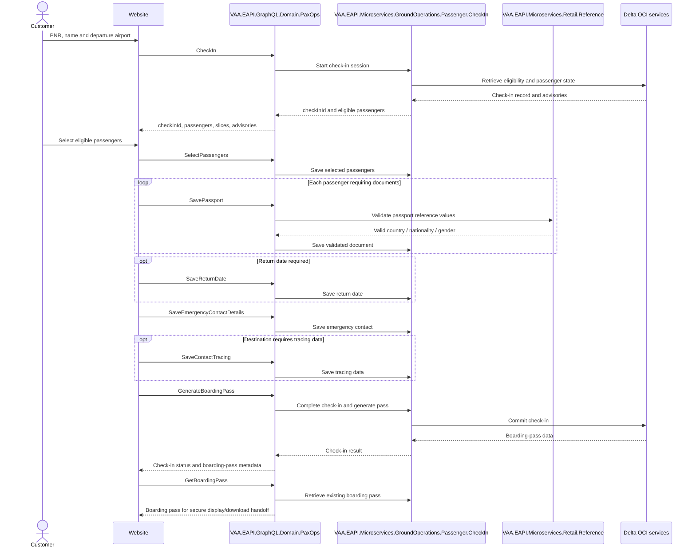
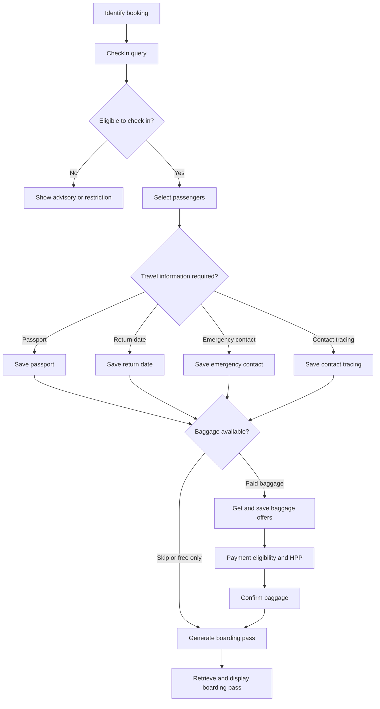
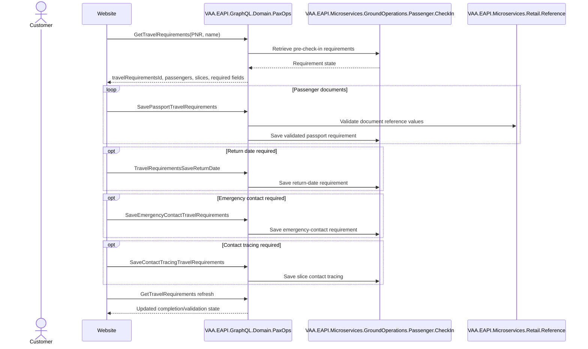
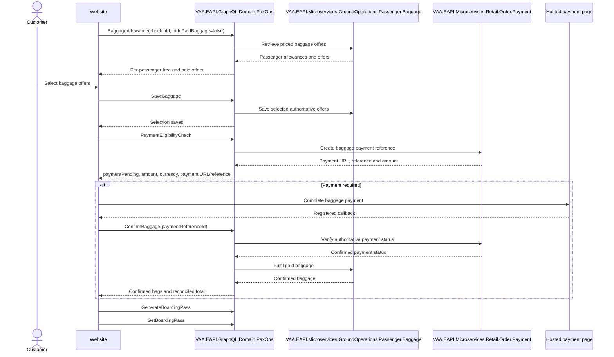

# VAA EAPI Website OCI — All Backend Automation Scenarios

**Status:** Implemented

> **Minimum review:** Read the flow name and description, **Why this flow exists**, **Sequence (detailed)**, and **Open points to finalize**. These sections establish the purpose, intended interactions, and outstanding questions; review the remaining sections as relevant to your role.

## Why this flow exists

<a id="purpose"></a>

This document maps the existing Online Check-In (OCI) backend automation into website journeys. OCI already exists in the mobile app; this reference is for implementing and validating the equivalent website experience. It separates customer-facing GraphQL orchestration from direct microservice, Delta integration, reference/schema, and PNR-provisioning coverage.

All booking-shaped inputs must come from the shared Azure storage-table helpers. Payloads shown here are representative and use placeholders; never place real PNRs, passenger data, passport data, tokens, or boarding passes in source or documentation.

## Sequence (detailed)

<a id="service-level-sequence"></a>



### State carried through the flow

| State | Produced by | Used by |
|---|---|---|
| `checkInId` | `CheckIn` | passenger, document, baggage, payment and boarding-pass operations |
| passenger IDs | `CheckIn`/`SelectPassengers` | passport, return-date, contact and baggage operations |
| slice/sector identifiers | check-in/travel-requirements response | contact tracing and journey-specific requirements |
| `travelRequirementsId` | `GetTravelRequirements` | pre-check-in document/contact/return-date mutations |
| baggage offer ID, count, amount, currency | `BaggageAllowance` | `SaveBaggage` and price reconciliation |
| payment reference and URL | `PaymentEligibilityCheck` | HPP and `ConfirmBaggage` |
| PNR/origin/name | stored synthetic booking | initial check-in and boarding-pass retrieval |

## Open points to finalize

- None currently recorded; add explicit blockers here before moving this diagram back to Ready or InProgress.

## Agent delivery constraints

- Target solution/project path: Use the smallest owning solution or project implied by the `Harness Sensor`, integration points, and documented component ownership.
- New implementation path, when needed: Prefer the owning project paths already named in this diagram; do not create new services or broaden ownership without recording a blocker.
- New test path, when needed: `VAA.EAPI.Automation/VAA.EAPI.Automation.OCI/Tests/Microservices/CheckInMSTests.cs`
- Contract source files to read: Existing files referenced by this diagram, the named GraphQL operations, HTTP endpoints, message/event names, request payloads, and nearest tests.
- Endpoint/event/query/command names: Use only the operation, route, event, command, or scenario names documented in this diagram unless a compile/test failure proves a rename.
- Configuration and secret handling: Use existing configuration keys, environment variables, and secret references only; never commit real secrets, tokens, PII, payment data, or passenger documents.
- Harness command: Run the scoped verification selected by Promotion verification; for Fast, use scripts/verify.ps1 -SolutionPath <owning-solution> -SkipBuild or the nearest project equivalent.

## Current implementation alignment

OCI GraphQL is implemented by `VAA.EAPI.GraphQL.Domain.PaxOps`. The customer journey composes the Passenger Check-In and Passenger Baggage microservices, Retail Reference validation, Retail Order Payment, and Delta OCI integrations. The sequences represent current implemented capability; website backlog sections retain future enhancement context.

## Automation sources

- GraphQL journeys: `VAA.EAPI.Automation.OCI/Tests/GraphQL/`
- GraphQL request builder: `VAA.EAPI.Automation.OCI/Tests/GraphQL/GraphQLRequestBuilder.cs`
- GraphQL endpoint: `VAA.EAPI.Automation.OCI/Requests/Endpoints/GraphQLEndpoint.cs`
- Direct microservice tests: `VAA.EAPI.Automation.OCI/Tests/Microservices/`
- Delta integration tests: `VAA.EAPI.Automation.OCI/Tests/Delta/`
- PNR provisioning: `VAA.EAPI.Automation.OCI/Tests/PnrsCreation/`
- PNR scenario data: `VAA.EAPI.Automation.OCI/Helpers/OCIPnrDataCreationTestCases.cs`

The current GraphQL wrapper sends `api-channel: Web Monitoring`. Website implementation must confirm the supported production web channel and authentication format before reusing the monitoring contract.

## OCI capability map



## Travel-requirements flow

Travel requirements can be completed separately before the final check-in journey:



The automation covers return date, emergency contact with apply-to-all true and false, and contact tracing.

## Paid-baggage flow



Variants include free plus paid, paid only, free only, Upper Class, Economy Classic, unsupported-currency origins, logged-in users and local-run coverage. Infants are excluded from separate baggage offers by the request builder.

## GraphQL operation catalogue

All OCI GraphQL operations currently send a full `query` plus `variables`, not a Book-style `pqId` envelope.

| Operation | Purpose | Principal variables |
|---|---|---|
| `CheckIn` | retrieve booking/check-in state | PNR, e-ticket, given names, surname, origin |
| `SelectPassengers` | choose passengers for check-in | check-in ID, passenger IDs |
| `SavePassport` | save APIS/passport | check-in ID, passenger ID, document, scan/MRZ state |
| `SaveReturnDate` | save onward/return date | check-in ID, passenger ID, date/no-date flag |
| `SaveEmergencyContactDetails` | save emergency contacts | check-in ID, apply-to-all, contacts |
| `SaveContactTracing` | save tracing/contact address | check-in ID, apply-to-all, passenger records |
| `GenerateBoardingPass` | complete check-in/generate passes | check-in ID |
| `GetBoardingPass` | retrieve existing passes | PNR, origin, given names, surname |
| `GetTravelRequirements` | retrieve pre-check-in requirements | PNR, given names, surname |
| `SavePassportTravelRequirements` | save passport before check-in | requirements ID, passenger ID, document |
| `TravelRequirementsSaveReturnDate` | save pre-check-in return date | requirements ID, passenger ID/date |
| `SaveEmergencyContactTravelRequirements` | save pre-check-in emergency contact | requirements ID, apply-to-all, contacts |
| `SaveContactTracingTravelRequirements` | save pre-check-in tracing data | requirements ID, slice ID, tracing records |
| `BaggageAllowance` | retrieve free/paid offers | check-in ID, hide-paid flag |
| `SaveBaggage` | save selected offers | check-in ID, passenger and offer details |
| `PaymentEligibilityCheck` | create/inspect baggage payment | check-in ID |
| `ConfirmBaggage` | confirm paid baggage | check-in ID, payment reference |
| Reference queries | gender, US states, nationality, passport countries | operation-specific/no customer booking state |

### Representative envelopes

```json
{
  "query": "query CheckInQuery(...) { CheckIn(...) { ... } }",
  "variables": {
    "pnrLocator": "<synthetic-pnr>",
    "eTicketNumber": "",
    "givenNames": "<synthetic-given-names>",
    "surname": "<synthetic-surname>",
    "originCode": "LHR"
  }
}
```

```json
{
  "query": "mutation SelectPassengers(...) { SelectPassengers(...) { ... } }",
  "variables": {
    "checkInId": "<opaque-check-in-id>",
    "passengerIds": ["<opaque-passenger-id>"]
  }
}
```

```json
{
  "query": "mutation GenerateBoardingPass(...) { GenerateBoardingPass(...) { ... } }",
  "variables": {
    "checkInId": "<opaque-check-in-id>"
  }
}
```

Passport, contact, PNR and boarding-pass payloads contain sensitive data and must be redacted from telemetry.

## Example request and response payloads

These examples show the envelope and important fields, not the complete production selection sets. The automation loads the actual query documents from `Requests/Body/GraphQL/*.txt`. Response roots and fields shown here are derived from those query documents and assertions; confirm them against the deployed schema before frontend model generation.

### 1. Check in

Request:

```json
{
  "query": "query CheckInQuery($pnrLocator: String!, $eTicketNumber: String!, $givenNames: String!, $surname: String!, $originCode: String!) { CheckIn(...) { ... } }",
  "variables": {
    "pnrLocator": "<synthetic-pnr>",
    "eTicketNumber": "",
    "givenNames": "TEST",
    "surname": "PASSENGER",
    "originCode": "LHR"
  }
}
```

Representative response:

```json
{
  "data": {
    "CheckIn": {
      "checkInId": "<opaque-check-in-id>",
      "applyEmergencyContactToAllPax": false,
      "applyContactTracingToAllPax": false,
      "showBaggageAllowance": true,
      "passengers": [
        {
          "passengerId": "<opaque-passenger-id>",
          "givenNames": "TEST",
          "surname": "PASSENGER",
          "passengerType": { "code": "ADT", "name": "Adult", "category": "ADULT" },
          "requirements": {
            "overall": "INCOMPLETE",
            "passportProvided": false,
            "checkedIn": false,
            "checkinEligible": true
          }
        }
      ],
      "currentSlice": {
        "sliceId": "<opaque-slice-id>",
        "origin": { "code": "LHR" },
        "destination": { "code": "JFK" }
      },
      "onlineCheckInStatus": {
        "available": true,
        "title": "Check in online",
        "message": "Online check-in is available",
        "code": "AVAILABLE"
      }
    }
  }
}
```

Retain the check-in, passenger and slice IDs. Do not persist or log the lookup identity.

### 2. Select passengers

```json
{
  "query": "mutation SelectPassengers($checkInId: String!, $passengerIds: [String!]!) { SelectPassengers(...) { ... } }",
  "variables": {
    "checkInId": "<opaque-check-in-id>",
    "passengerIds": ["<opaque-passenger-id>"]
  }
}
```

```json
{
  "data": {
    "SelectPassengers": {
      "checkInId": "<opaque-check-in-id>",
      "applyEmergencyContactToAllPax": false,
      "applyContactTracingToAllPax": false,
      "showBaggageAllowance": true,
      "passengers": [
        {
          "passengerId": "<opaque-passenger-id>",
          "requirements": { "overall": "INCOMPLETE", "checkinEligible": true }
        }
      ]
    }
  }
}
```

### 3. Save passport

```json
{
  "query": "mutation SavePassport($checkInId: String!, $passengerId: String!, $isScanned: Boolean!, $mRZLine1: String, $mRZLine2: String, $document: PaxOps_DocumentInput!) { SavePassport(...) { ... } }",
  "variables": {
    "checkInId": "<opaque-check-in-id>",
    "passengerId": "<opaque-passenger-id>",
    "isScanned": false,
    "mRZLine1": "",
    "mRZLine2": "",
    "document": {
      "documentType": "PASSPORT",
      "givenNames": "TEST",
      "surname": "PASSENGER",
      "dateOfBirth": "1990-05-20",
      "gender": { "code": "F" },
      "documentNumber": "<synthetic-passport-number>",
      "expirationDate": "2031-05-20",
      "issuingCountry": { "code": "GBR" },
      "nationality": { "code": "GBR" },
      "countryOfResidence": { "code": "GBR" }
    }
  }
}
```

```json
{
  "data": {
    "SavePassport": {
      "checkInId": "<opaque-check-in-id>",
      "passengers": [
        {
          "passengerId": "<opaque-passenger-id>",
          "documents": [
            {
              "documentType": "PASSPORT",
              "documentNumber": "<masked-passport-number>",
              "issuingCountry": { "code": "GBR" }
            }
          ],
          "requirements": {
            "passportProvided": true,
            "passportVerified": true,
            "passportErrors": [],
            "travelRequirementErrors": []
          }
        }
      ]
    }
  }
}
```

For scanned documents, send the agreed `isScanned` and MRZ fields. Passport data must never enter analytics or general application logs.

### 4. Save return date

```json
{
  "query": "mutation SaveReturnDate($checkInId: String!, $passengerId: String!, $returnOn: LocalDate!, $noReturnDate: Boolean!) { SaveReturnDate(...) { ... } }",
  "variables": {
    "checkInId": "<opaque-check-in-id>",
    "passengerId": "<opaque-passenger-id>",
    "returnOn": "2026-09-30",
    "noReturnDate": false
  }
}
```

```json
{
  "data": {
    "SaveReturnDate": {
      "checkInId": "<opaque-check-in-id>",
      "passengers": [
        {
          "passengerId": "<opaque-passenger-id>",
          "requirements": {
            "returnDateStatus": "COMPLETE",
            "isReturnDateDeclined": false,
            "returnDate": "2026-09-30"
          }
        }
      ]
    }
  }
}
```

### 5. Save emergency contact

```json
{
  "query": "mutation SaveEmergencyContactDetails($checkInId: String!, $applyToAllPassengers: Boolean!, $emergencyContacts: [EmergencyContactInput!]!) { SaveEmergencyContactDetails(...) { ... } }",
  "variables": {
    "checkInId": "<opaque-check-in-id>",
    "applyToAllPassengers": true,
    "emergencyContacts": [
      {
        "passengerId": "<opaque-passenger-id>",
        "firstName": "SYNTHETIC",
        "lastName": "CONTACT",
        "phoneCountryCode": "GB",
        "phoneNumber": "7700900000",
        "passengerRefused": false
      }
    ]
  }
}
```

```json
{
  "data": {
    "SaveEmergencyContactDetails": {
      "checkInId": "<opaque-check-in-id>",
      "applyEmergencyContactToAllPax": true,
      "passengers": [
        {
          "passengerId": "<opaque-passenger-id>",
          "emergencyContact": {
            "passengerId": "<opaque-passenger-id>",
            "firstName": "SYNTHETIC",
            "lastName": "CONTACT",
            "phoneCountryCode": "GB",
            "phoneNumber": "<masked-phone-number>",
            "passengerRefused": false
          }
        }
      ]
    }
  }
}
```

### 6. Save contact tracing

```json
{
  "query": "mutation SaveContactTracingMutation($checkInId: String!, $applyToAll: Boolean!, $contactTracings: [ContactTracingInput!]!) { SaveContactTracing(...) { ... } }",
  "variables": {
    "checkInId": "<opaque-check-in-id>",
    "applyToAll": false,
    "contactTracings": [
      {
        "passengerId": "<opaque-passenger-id>",
        "streetAddress": "<synthetic-address>",
        "city": "NEW YORK",
        "state": "NY",
        "zip": "10022",
        "email": "synthetic@example.test",
        "inTransit": false,
        "noEmail": false,
        "noSecondaryPhoneNumber": true,
        "primaryPhoneNumber": "5550100",
        "primaryPhoneNumberCountryCode": "1",
        "secondaryPhoneNumber": "",
        "secondaryPhoneNumberCountryCode": ""
      }
    ]
  }
}
```

```json
{
  "data": {
    "SaveContactTracing": {
      "checkInId": "<opaque-check-in-id>",
      "applyContactTracingToAllPax": false,
      "passengers": [
        {
          "passengerId": "<opaque-passenger-id>",
          "requirements": { "contactTracing": true },
          "contactTracing": {
            "passengerId": "<opaque-passenger-id>",
            "city": "NEW YORK",
            "state": "NY",
            "zip": "10022",
            "inTransit": false
          }
        }
      ]
    }
  }
}
```

### 7. Get travel requirements

```json
{
  "query": "query GetTravelRequirements($request: TravelRequirementsRequestInput) { GetTravelRequirements(request: $request) { ... } }",
  "variables": {
    "request": {
      "pnrLocator": "<synthetic-pnr>",
      "givenNames": "TEST",
      "surname": "PASSENGER"
    }
  }
}
```

```json
{
  "data": {
    "GetTravelRequirements": {
      "travelRequirementsId": "<opaque-requirements-id>",
      "applyEmergencyContactToAllPax": false,
      "passengers": [
        {
          "passengerId": "<opaque-passenger-id>",
          "passport": "TO_COMPLETE",
          "returnDate": "TO_COMPLETE",
          "sliceRequirements": [
            { "sliceId": "<opaque-slice-id>", "contactTracing": "TO_COMPLETE" }
          ]
        }
      ]
    }
  }
}
```

### 8. Save passport through travel requirements

```json
{
  "query": "mutation SavePassportTravelRequirements($request: TravelRequirementsSavePassportRequestInput!) { SavePassportTravelRequirements(request: $request) { ... } }",
  "variables": {
    "request": {
      "travelRequirementsId": "<opaque-requirements-id>",
      "passengerId": "<opaque-passenger-id>",
      "isScanned": false,
      "document": {
        "documentType": "PASSPORT",
        "givenNames": "TEST",
        "surname": "PASSENGER",
        "dateOfBirth": "1990-05-20",
        "gender": { "code": "F" },
        "documentNumber": "<synthetic-passport-number>",
        "expirationDate": "2031-05-20",
        "issuingCountry": { "code": "GBR" },
        "nationality": { "code": "GBR" },
        "countryOfResidence": { "code": "GBR" }
      }
    }
  }
}
```

The pre-check-in return-date, emergency-contact and contact-tracing payloads use `travelRequirementsId` instead of `checkInId`. Contact tracing also requires the server-provided `sliceId`.

### 9. Get baggage offers

```json
{
  "query": "query BaggageAllowance($checkInId: String!, $hidePaidBaggage: Boolean) { BaggageAllowance(...) { ... } }",
  "variables": {
    "checkInId": "<opaque-check-in-id>",
    "hidePaidBaggage": false
  }
}
```

```json
{
  "data": {
    "BaggageAllowance": {
      "checkInId": "<opaque-check-in-id>",
      "showBaggageAllowance": true,
      "passengers": [
        {
          "passengerNiN": "<opaque-passenger-nin>",
          "isInfantPassenger": false,
          "baggageOffers": [
            {
              "baggageOfferId": "<opaque-free-offer-id>",
              "baggageCount": 1,
              "price": { "amount": 0.00, "currency": "GBP", "decimalPrecisionCount": 2 }
            },
            {
              "baggageOfferId": "<opaque-paid-offer-id>",
              "baggageCount": 2,
              "price": { "amount": 75.00, "currency": "GBP", "decimalPrecisionCount": 2 }
            }
          ]
        }
      ]
    }
  }
}
```

### 10. Save baggage selection

```json
{
  "query": "mutation SaveBaggage($request: SaveBaggageRequestInput!) { SaveBaggage(request: $request) { checkInId success } }",
  "variables": {
    "request": {
      "checkInId": "<opaque-check-in-id>",
      "selectedBaggageOffer": [
        {
          "passengerNiN": "<opaque-passenger-nin>",
          "baggageOfferId": "<opaque-paid-offer-id>",
          "baggageCount": 2,
          "totalPrice": 75.00,
          "currencyCode": "GBP",
          "decimalPrecisionCount": 2
        }
      ]
    }
  }
}
```

```json
{
  "data": {
    "SaveBaggage": {
      "checkInId": "<opaque-check-in-id>",
      "success": true
    }
  }
}
```

Use only offer ID, count, amount, currency and precision returned by `BaggageAllowance`. Do not construct or reprice an offer in the browser.

### 11. Check baggage-payment eligibility

```json
{
  "query": "mutation PaymentEligibilityCheck($request: PaymentCheckRequestInput!) { PaymentEligibilityCheck(request: $request) { ... } }",
  "variables": {
    "request": {
      "checkInId": "<opaque-check-in-id>",
      "successRedirectUrl": "<registered-website-success-url>",
      "failureRedirectUrl": "<registered-website-failure-url>"
    }
  }
}
```

```json
{
  "data": {
    "PaymentEligibilityCheck": {
      "checkInId": "<opaque-check-in-id>",
      "paymentPending": true,
      "paymentUrl": "<sensitive-hpp-url>",
      "hPPLink": "<sensitive-hpp-link>",
      "paymentReferenceId": "<opaque-payment-reference>",
      "amount": { "currency": "GBP", "totalAmount": 75.00 }
    }
  }
}
```

The URLs in the current automation builder are temporary test values and must not be copied into website code.

### 12. Confirm baggage after payment

```json
{
  "query": "mutation ConfirmBaggage($confirmBaggageRequest: ConfirmBaggageRequestInput!) { ConfirmBaggage(...) { ... } }",
  "variables": {
    "confirmBaggageRequest": {
      "checkInId": "<opaque-check-in-id>",
      "paymentReferenceId": "<opaque-payment-reference>",
      "paymentStatus": "SUCCESS"
    }
  }
}
```

```json
{
  "data": {
    "ConfirmBaggage": {
      "originAirportCode": "LHR",
      "destinationAirportCode": "JFK",
      "passengerBags": [
        { "passengerNiN": "<opaque-passenger-nin>", "baggageCount": 2 }
      ],
      "totalPrice": { "amount": 75.00, "currency": "GBP" }
    }
  }
}
```

The website must validate payment authoritatively; a success redirect alone must not be trusted.

### 13. Generate boarding pass

```json
{
  "query": "mutation GenerateBoardingPass($checkInId: String!) { GenerateBoardingPass(checkInId: $checkInId) { ... } }",
  "variables": {
    "checkInId": "<opaque-check-in-id>"
  }
}
```

```json
{
  "data": {
    "GenerateBoardingPass": {
      "checkInStatus": "CHECKED_IN",
      "tripsBookingId": "<opaque-booking-id>",
      "boardingPasses": [
        {
          "pnrLocator": "<synthetic-pnr>",
          "passengerId": "<opaque-passenger-id>",
          "originAirportCode": "LHR",
          "destinationAirportCode": "JFK",
          "qrCodeData": "<sensitive-pass-data>"
        }
      ]
    }
  }
}
```

### 14. Retrieve boarding pass

```json
{
  "query": "query GetBoardingPass($pnrLocator: String, $originCode: String, $givenNames: String, $surname: String) { GetBoardingPass(...) { ... } }",
  "variables": {
    "pnrLocator": "<synthetic-pnr>",
    "originCode": "LHR",
    "givenNames": "TEST",
    "surname": "PASSENGER"
  }
}
```

```json
{
  "data": {
    "GetBoardingPass": {
      "checkInStatus": "CHECKED_IN",
      "tripsBookingId": "<opaque-booking-id>",
      "boardingPasses": [
        {
          "passengerId": "<opaque-passenger-id>",
          "originAirportCode": "LHR",
          "destinationAirportCode": "JFK",
          "qrCodeData": "<sensitive-pass-data>"
        }
      ]
    }
  }
}
```

Treat boarding-pass data as sensitive and do not expose it in logs, analytics, error reports, or public caches.

## Complete GraphQL scenario inventory

The following list includes every current GraphQL test entry point and all visible inline-data variants.

### Check-in journeys

1. Any eligible PNR happy path.
2. One-way revenue CI/CD dataset.
3. One-way award/redemption CI/CD dataset.
4. Return-date-required flight.
5. Multi-city flight.
6. Same-day return.
7. Direct flight.
8. Direct flight with stop.
9. One-stop/through check-in.
10. Two-stop flight.
11. JV partner flight.
12. Interline partner flight.
13. Codeshare flight.
14. Long-layover flight.
15. German passport.
16. Passport scanned.
17. Day-of-travel check-in.
18. Seamless check-in.
19. Sky Priority.
20. Loyalty passenger.
21. ESTA-A special-name scenario.
22. Mocked request/response contract.
23. Local-run journey.

Source methods:

- `CheckInGraphQLTests_AnyPnrHappyPath_Success`
- `CheckInGraphQLTests_Success_DataSet` — revenue and award
- `CheckInGraphQLTests_ReturnDateRequiredFlights_Success`
- `CheckInGraphQLTests_MulticityFlights_Success`
- `CheckInGraphQLTests_SameDayReturnFlights_Success`
- `CheckInGraphQLTests_DirectFlights_Success`
- `CheckInGraphQLTests_DirectWithStopFlights_Success`
- `CheckInGraphQLTests_OneStopFlightsOrThroughCheckIn_Success`
- `CheckInGraphQLTests_TwoStopFlights_Success`
- `CheckInGraphQLTests_JVPartnerFlights_Success`
- `CheckInGraphQLTests_InterlinePartnerFlights_Success`
- `CheckInGraphQLTests_CodeshareFlights_Success`
- `CheckInGraphQLTests_LongLayoverFlights_Success`
- `CheckInGraphQLTests_GermanPassport_Success`
- `CheckInGraphQLTests_PassportScanned_Success`
- `CheckInGraphQLTests_DayOfTravel_Success`
- `CheckInGraphQLTests_SeamlessCheckin_Success`
- `CheckInGraphQLTests_SkyPriority_Success`
- `CheckInGraphQLTests_Loyalty_Success`
- `CheckInGraphQLTests_ESTAA_Success`
- `CheckInGraphQLTests_WithMockRequestAndResponse_Success`
- `CheckInGraphQLTests_LocalRun_Success`

### Check-in advisories and document validation

24. Direct LHR–DEL with GBR passport document advisory.
25. Direct LHR–USA with IND passport document advisory.
26. Direct LHR–USA with GBR passport document advisory.
27. Non-seamless check-in advisory.
28. ESTA-B document advisory.

Source methods:

- `CheckInGraphQLTests_DirectFlights_DocumentAdvisory`
- `CheckInGraphQLTests_NonSeamlessCheckin_Advisory`
- `CheckInGraphQLTests_ESTAB_DocumentAdvisory`

### Baggage journeys

29. Free plus paid baggage from LHR, four bags.
30. Paid-only baggage from LHR, five bags.
31. Free plus paid baggage from JFK, six bags.
32. Paid-only baggage from JFK, seven bags.
33. Upper Class free-bags-only.
34. Economy Classic free-bags-only.
35. Free plus paid baggage with unsupported currency from MLE.
36. Paid-only baggage with unsupported currency from DEL.
37. Paid baggage for a logged-in user.
38. Paid baggage local-run scenario.

Source methods:

- `BaggageGraphQLTests_PaidBaggage_Success`
- `BaggageGraphQLTests_FreeBagsOnly_Success`
- `BaggageGraphQLTests_UnsupportedCurrencies_Success`
- `BaggageGraphQLTests_PaidBaggage_LoggedInUser_Success`
- `BaggageGraphQLTests_PaidBaggage_LocalRun_Success`

### Travel requirements

39. Baseline travel-requirements journey.
40. Return-date travel requirement.
41. Emergency contacts applied to all passengers.
42. Emergency contacts applied individually.
43. Contact tracing.

Source methods:

- `TravelRequirementsGraphQLTests_Success`
- `TravelRequirementsGraphQLTests_ReturnDate_Success`
- `TravelRequirementsGraphQLTests_EmergencyContacts_Success` — true and false
- `TravelRequirementsGraphQLTests_ContactTracing_Success`

### Reference data

44. Gender details.
45. US state details.
46. Nationality details.
47. Passport-country details.

Source method: `ReferenceGraphQLTests`.

This produces **47 explicit GraphQL cases** from the current methods and inline data.

## Direct backend parity and contract scenarios

These tests validate the services behind GraphQL. They are not additional website screen flows, but their business branches belong in API contract and integration coverage.

### Check-in microservice (7 cases)

1. Schema response 200 OK.
2. Schema response 500 Internal Server Error.
3. Schema response 401 Unauthorized.
4. Schema response 422 Unprocessable Entity.
5. One-way revenue service flow.
6. Return revenue service flow.
7. Mock request/response flow.

### Baggage microservice (2 cases)

1. One-way revenue baggage flow.
2. Return revenue baggage flow.

### Travel-requirements microservice (2 cases)

1. One-way revenue requirements flow.
2. Return revenue requirements flow.

### Reference microservice (4 cases)

1. Gender details.
2. US states.
3. Nationalities.
4. Passport countries.

### Delta OCI integration (5 cases)

1. SSCI API — one-way revenue.
2. SSCI API — return revenue.
3. TRM API — one-way revenue.
4. TRM API — return revenue.
5. Delta APIs end-to-end flow.

Together these are **20 explicit backend service/Delta cases**.

## PNR-provisioning scenario inventory

PNR creation is test-data infrastructure rather than website runtime behavior. The member-data providers expand each base route across the configured `noOfDays`, so the exact number of executions is dynamic. The current provisioning entry points cover:

1. One-way revenue PNRs with multiple passenger mixes.
2. Return revenue PNR with seat selection.
3. One-way revenue PNR with insurance.
4. JV-partner return PNRs.
5. Codeshare-partner return PNRs.
6. Interline-partner return PNRs.
7. Three-slice multi-city PNRs.
8. Four-slice multi-city PNRs.
9. One-way routes requiring return-date information.
10. Direct-with-stop routes.
11. Two-stop routes.
12. One-stop routes.
13. Direct routes.
14. Long-layover routes.
15. Same-day returns.
16. Sky Priority/business-class PNRs.
17. TSA/special-name PNRs.
18. Seamless partner PNRs.
19. Non-seamless PNRs.
20. ESTA-A/B/C special-name PNRs.
21. General return revenue PNRs.
22. One-way redemption PNRs by loyalty tier.
23. Mobile-app revenue PNR provisioning.
24. Mobile-app redemption PNR provisioning.

Notable route datasets include:

- multi-city three/four-slice itineraries;
- direct, one-stop, two-stop and direct-with-stop journeys;
- JV partners AF/DL/KL;
- codeshares KE/WS and additional VS-marketed routes;
- interline BW/AI;
- seamless DL/AF/KL/KE/SV;
- non-seamless IDR/COK/JAI origins;
- return-date destinations BGI/MBJ/JNB/DXB/GND/MLE/CUN;
- long layovers via YYZ/GND/DEL scenarios;
- TSA and ESTA special-name permutations.

## Website backlog by epic

### A. Booking identification and eligibility

- PNR/name/origin entry and validation.
- Optional e-ticket lookup.
- Check-in window, already-checked-in, ineligible and disrupted states.
- Revenue and redemption booking parity.
- Same-day return and multi-city booking selection.

### B. Passenger selection

- Eligible/ineligible passenger presentation.
- Select one, some or all passengers.
- Adult, child, teen and infant associations.
- Group/large-party handling.
- Loyalty, Sky Priority and partner indicators.

### C. Travel documents

- Passport manual entry and scan ingestion.
- Country, nationality, gender and US-state reference data.
- Scan/MRZ validation and correction.
- Destination-specific document advisories.
- German passport and ESTA-A/B scenarios.

### D. Journey requirements

- Return/onward date.
- Emergency contact, including apply-to-all.
- Contact tracing, including slice-specific data.
- Refused/no-contact states where supported.
- Pre-check-in travel-requirements completion and resumption.

### E. Partner and itinerary behavior

- Direct, direct-with-stop, one-stop/two-stop and long layover.
- Through check-in.
- JV, interline, codeshare, seamless and non-seamless journeys.
- Partner-specific advisories and handoff.

### F. Baggage

- Free allowance per passenger/cabin.
- Paid-only and free-plus-paid selection.
- Infant exclusions.
- Unsupported currency and unavailable offer handling.
- Logged-in customer behavior.
- Price/offer expiry and selection reconciliation.

### G. Baggage payment

- Payment eligibility and amount reconciliation.
- Secure HPP handoff and callback validation.
- Pending, successful, failed, cancelled and uncertain payment.
- Confirm baggage with authoritative payment reference.
- Duplicate-payment/confirmation prevention.

### H. Boarding pass

- Generate after all mandatory steps.
- Retrieve an existing pass.
- Multiple passengers and sectors.
- Secure display, refresh and wallet handoff.
- Pass unavailable/advisory state for partner or document restrictions.

### I. Resilience, privacy and operations

- HTTP and GraphQL error handling, including partial data.
- Resume after backgrounding/app termination.
- Correlation IDs with PII-safe telemetry.
- Never log PNR/name/passport/contact/boarding-pass payloads.
- Accessibility, analytics and operational SLOs.

## Failure paths

- Reject invalid booking identity, ineligible journeys, expired sessions, and unauthorized boarding-pass access.
- Preserve document and contact requirement state when validation or a downstream save fails.
- Reconcile baggage selections against authoritative offers and never trust an HPP redirect as payment proof.
- Handle Delta, Check-In, Baggage, Reference, and Payment timeouts with controlled retry or advisory behavior.
- Never log PNR, passenger, passport, contact, payment-link, or boarding-pass data.

## Recommended website MVP order

1. Direct one-way VS revenue, one adult, manual passport, no paid baggage.
2. Multiple passengers and return journeys.
3. Return date, emergency contact and contact tracing.
4. Existing boarding-pass retrieval and wallet handoff.
5. Free baggage, then paid baggage/HPP.
6. Reward, loyalty and Sky Priority.
7. Stops, through check-in, multi-city and long layover.
8. JV/codeshare/interline, seamless and non-seamless partner behavior.
9. Passport scan/MRZ and destination-specific advisories.

## Contract gaps and decisions

- Confirm the website `api-channel` and authorization header contract; the automation currently uses `Web Monitoring` and passes authorization without adding `Bearer` itself.
- Confirm whether the website uses full GraphQL documents or registered persisted operations.
- Confirm exact check-in eligibility/advisory codes and their recoverability.
- Confirm check-in session TTL and resume behavior.
- Confirm website HPP navigation, callback signing and payment-status source of truth.
- Confirm boarding-pass payload format, local storage policy, screenshot/privacy controls and wallet integration.
- Confirm partner handoff behavior for JV, interline, codeshare and non-seamless journeys.
- Confirm whether travel requirements are completed inside check-in, before check-in, or both in the target UX.
- Replace remaining hard-coded contact-tracing fixture values in the request builder when the downstream integration contract is available.

## Expected harness

- Use `RetrieveFromStorageTable` for PNR/passport/loyalty-shaped data.
- Use `EnsureGQLResponseSuccess()` for every GraphQL operation.
- Treat passenger, passport, contact and boarding-pass payloads as sensitive.
- Validate business state, not just HTTP 200.
- Add a website-specific trait/channel contract without duplicating shared request builders.
- Keep direct microservice tests as backend parity coverage; keep website journey orchestration at the GraphQL layer.

## Agent Loop Goal

| Field | Value |
| --- | --- |
| Goal | Maintain the imported scenario catalogue as an implemented sequence-diagram reference. |
| Status | `Complete` |
| Owner | `VAA.EAPI.OCI maintainers` |
| Review cadence | Quarterly and when scenario coverage changes |
| Last reviewed | 2026-07-28 |
| Harness Sensor | `VAA.EAPI.Automation/VAA.EAPI.Automation.OCI/Tests/Microservices/CheckInMSTests.cs` |
| Promotion verification | Fast |
| Acceptance evidence | Imported scenarios align to existing automation coverage and are tracked by the sequence-diagram index. |
| Done when | Scenario catalogue remains aligned with implemented behavior and referenced harness coverage. |

## Associated delivery pull requests

The draft coordinator PR and its row are created when this goal enters `InProgress`. Every production and QA agent is then recorded here on its own branch and PR. The coordinator PR remains draft until every current child PR is merged, integrated verification passes, and open questions are resolved.

The workflow populates this table for delivery surfaces hosted in other GitHub repositories.

| Surface | Repository | Base branch | Head branch | PR | State | Merged at UTC |
| --- | --- | --- | --- | --- | --- | --- |

## Agent Loop Closure Evidence

Record final closure evidence here. Existing verification and delivery records remain in their respective sections.
