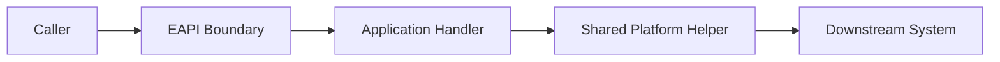

# <Pattern Name>

**Pattern group:** <Platform Runtime | API Boundary | Integration | GraphQL Composition | Workflow And Messaging | Cross-Cutting | Testing And Operations>

**Status:** <Draft | Recommended | Legacy | Deprecated>

**Last reviewed:** <YYYY-MM-DD>

**Owner:** <Team or role>

## Intent

Describe the problem this EAPI pattern solves in one or two short paragraphs.

Example:

> Use this pattern when an Azure Function needs to expose an HTTP endpoint while keeping the trigger thin, OpenAPI documented, and aligned to EAPI response/error conventions.

## Summary

- <One sentence describing the pattern shape.>
- <One sentence describing the main EAPI convention it depends on.>
- <One sentence describing the expected outcome for future agents and engineers.>

## Also Known As

- <Alternative local name>
- <Related repo term>

## Use When

- <Condition that makes this pattern appropriate.>
- <Condition that makes this pattern appropriate.>
- <Condition that makes this pattern appropriate.>

## Do Not Use When

- <Condition where another pattern is more appropriate.>
- <Condition where this would create unnecessary complexity.>
- <Condition where this conflicts with a principle or standard.>

## Context

Explain the EAPI context in which this pattern appears. Include the relevant platform area, for example microservices, GraphQL, facades, orchestration, web functions, or shared infrastructure.

## Forces

- <Operational force, such as supportability, traceability, or release safety.>
- <Security or privacy force.>
- <Integration or downstream-system force.>
- <Developer productivity or AI-agent consistency force.>

## Pattern Shape

Describe the normal implementation flow.

1. <Step one.>
2. <Step two.>
3. <Step three.>
4. <Step four.>

## Structure

Use Mermaid when a diagram makes the pattern easier to understand.



## Participants

| Participant | Responsibility |
| --- | --- |
| `<Component or class>` | <What this participant owns.> |
| `<Component or class>` | <What this participant owns.> |
| `<Component or class>` | <What this participant owns.> |

## Implementation Guidance

- <Rule for where code belongs.>
- <Rule for dependency injection, startup, or registration.>
- <Rule for request/response handling.>
- <Rule for errors, logging, telemetry, or correlation.>
- <Rule for security, data, or privacy.>

## Example

Show a small, EAPI-shaped example. Keep it short and adapt it to the pattern.

```csharp
public sealed class ExampleHandler(IExampleGateway gateway)
{
    public async Task<Response<ExampleResponse>> HandleAsync(
        ExampleRequest request,
        CancellationToken cancellationToken)
    {
        ArgumentNullException.ThrowIfNull(request);

        var downstreamResponse = await gateway.SendAsync(request, cancellationToken);

        return new Response<ExampleResponse>
        {
            Status = Status.OK,
            Value = ExampleMapper.Map(downstreamResponse)
        };
    }
}
```

## Avoid

Show the most common misuse or anti-pattern for this EAPI pattern.

```csharp
public async Task<HttpResponseData> Run(HttpRequestData request)
{
    // Avoid combining trigger parsing, business rules, downstream calls,
    // mapping, error handling, and response construction in one method.
}
```

## Code References

Add stable references to examples already implemented in the repo.

- [<File name>](/absolute/path/to/file.cs:1): <Why this file is a good example.>
- [<File name>](/absolute/path/to/file.cs:1): <Why this file is a good example.>
- [<File name>](/absolute/path/to/file.cs:1): <Why this file is a good example.>

## Related Principles And Standards

- [Architecture Principles](../principles/architecture-principles.md)
- [Security Principles](../principles/security-principles.md)
- [Data Principles](../principles/data-principles.md)
- [Integration Principles](../principles/integration-principles.md)
- [Infrastructure Principles](../principles/infrastructure-principles.md)
- [Coding Standards](../standards/coding-standards.md)

## Security Considerations

- <Authentication or authorization requirement.>
- <Secrets, tokens, or key management requirement.>
- <Logging and sensitive-data requirement.>
- <Secure failure mode.>

## Data Considerations

- <Data ownership or bounded context rule.>
- <PII or sensitive data treatment.>
- <Retention, minimisation, or right-to-erasure consideration.>
- <Consistency or idempotency consideration.>

## Integration Considerations

- <Downstream contract rule.>
- <Timeout, retry, or failure handling rule.>
- <Event, correlation, or message envelope rule.>
- <Backward compatibility or versioning rule.>

## Observability

- <Required logs.>
- <Required telemetry or dependency tracking.>
- <Correlation ID behavior.>
- <Health check or alerting expectation.>

## Testing

- <Unit test expectation.>
- <Integration or contract test expectation.>
- <Fixture, fake, or test data expectation.>
- <Failure-path test expectation.>

## AI Agent Checklist

Before applying this pattern, an AI agent must confirm:

- The pattern is appropriate for the requested change.
- The implementation uses the existing EAPI conventions and shared helpers.
- The change preserves the owning service boundary.
- Security, data, integration, infrastructure, and coding standards have been checked.
- Tests or test-gap notes are included.
- Any new configuration, endpoints, events, or operational behavior are documented.

## Open Questions

- <Question to resolve before this pattern is marked recommended.>
- <Question to resolve before this pattern is marked recommended.>

## Change History

| Date | Change | Author |
| --- | --- | --- |
| <YYYY-MM-DD> | Initial draft. | <Name or role> |
